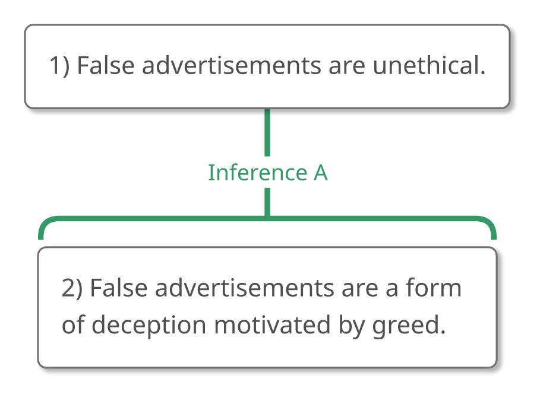
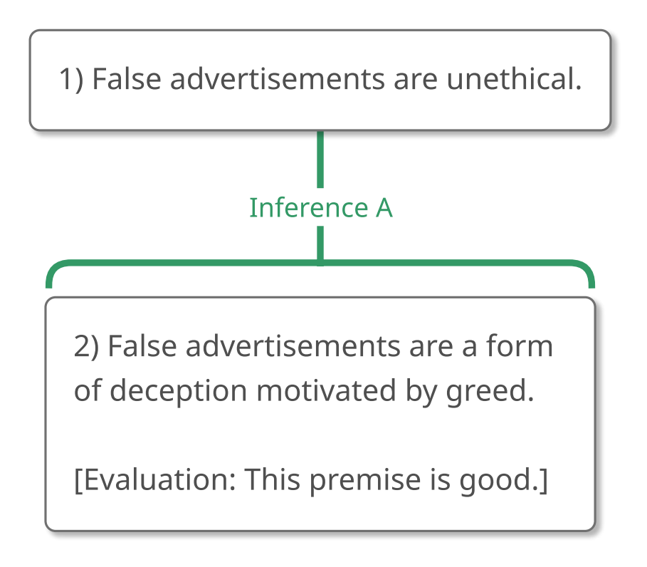
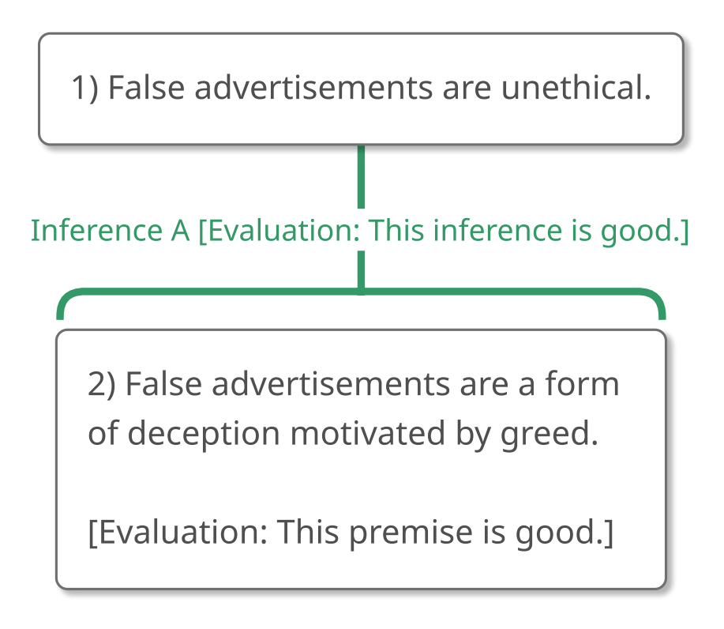

# 1.8 Example 7

## Step 1 – Recognizing an Argument

Take a look at the following passage. As usual, we start by asking,
**"What is this passage doing? Is it trying to convince us that
something is true?"**

> "Have you ever wondered about the morality of false advertisements?
> Wonder no more! False advertisements are a form of deception motivated
> by greed. It follows that they are unethical."

I'd say that this passage does contain an argument because it is trying
to prove that one claim is true by citing other claims as evidence.
There's an inference indicator expression in this passage that might
help us to see this, too. The inference indicator expression here is "it
follows that."

> "Have you ever wondered about the morality of false advertisements?
> Wonder no more! False advertisements are a form of deception motivated
> by greed. **It follows that** they are unethical."

## Step 2 – Analyzing the Argument

You might be starting to anticipate the question that we'll ask
ourselves now: **"What is the ultimate conclusion, or the main claim
that this argument is trying to get us to believe?"**

And once again, we'll use that inference indicator expression. But what
kind of inference indicator is "it follows that"? Does it introduce a
conclusion (making it a conclusion indicator expression like
"therefore") or does it introduce a reason to believe something else
(making it a reason indicator expression like "because")?

### Inference Indicator Expressions with "Follows"

Inference indicator expressions with the word "follows" in them can be
tricky because if we take a look at our inference indicator list, we'll
see that "follows" can appear in a conclusion indicator and in a reason
indicator.

A Conclusion Indicator introduces a conclusion (a claim at the top of an
inference line):

-   \[reason\]. It follows that \[conclusion\].

A Reason Indicator introduces a reason (a claim at the bottom of an
inference line):

-   \[conclusion\]. This follows from \[reason\].

The key is to remember that **the conclusion is whatever the expression
describes as following**.

-   In "P. It follows that Q," "Q" is described as following, so "Q" is
    the conclusion.

-   In "P. This follows from Q," "P" is described as following (it's the
    referent of "this"), so "P" is the conclusion.

In the argument we're considering, the claim after "It follows
that" is the thing described as following, so it's a conclusion. In
fact, in this passage, it's the ultimate conclusion.

> "Have you ever wondered about the morality of false advertisements?
> Wonder no more! False advertisements are a form of deception motivated
> by greed. **It follows that** (1) they are unethical."

Returning to the beginning of the passage, our next questions are,
**"What else is being claimed?"** and **"Is this claim part of the
argument?"**

Since the first sentence, "Have you ever wondered about the morality of
false advertisements?" is a question, and since questions don't usually
convey claims, let's ignore this sentence.

The second sentence, "Wonder no more!" is a command, and since commands
don't usually convey claims, let's ignore this sentence, too.

Unlike the first two sentences, however, the third sentence, "False
advertisements are a form of deception motivated by greed," *is* part of
the argument. It's "connected" to the ultimate conclusion with "It
follows that," which tells us that an inference will run between these
claims.

> "Have you ever wondered about the morality of false advertisements?
> Wonder no more! (2) False advertisements are a form of deception
> motivated by greed. **It follows that** (1) they are unethical."

With the claims identified, we can ask ourselves, **"How are these
claims connected to each other?"** Since we've already seen that "it
follows that" introduces a conclusion, we know that Claim 1 is a
conclusion from Claim 2. The map of the argument, then, looks like this:

> "Have you ever wondered about the morality of false advertisements?
> Wonder no more! (2) False advertisements are a form of deception
> motivated by greed. **It follows that** (1) they are unethical."

{#fig-1-8-ad-1 width=291px fig-alt="Argument map concluding: 1) False advertisements are unethical. A full text description is provided."}

::: {.map-outline fig="fig-1-8-ad-1"}

:::

## Step 3 – Evaluating the Argument

Now that we've mapped the argument, we can evaluate it.

Let's start by looking at the premise, "False advertisements are a form
of deception motivated by greed," and asking, **"Is this premise
true?"** and **"Could someone who doesn't already believe the ultimate
conclusion believe this premise?"**

I suspect that this premise is true because it seems to me that false
advertisements aren't accidental (not usually anyway), which makes them
a kind of deception, and I think that they're designed to make money.

I also think that people who don't already think that false
advertisements are unethical could believe this premise.

In short, this premise looks pretty good to me.

> "Have you ever wondered about the morality of false advertisements?
> Wonder no more! (2) False advertisements are a form of deception
> motivated by greed. **It follows that** (1) they are unethical."

{#fig-1-8-ad-p-eval-1 width=291px fig-alt="Argument map concluding: 1) False advertisements are unethical. A full text description is provided."}

::: {.map-outline fig="fig-1-8-ad-p-eval-1"}

:::

This isn't enough information for us to evaluate the entire argument,
though, because if the inference is bad, the ultimate conclusion won't
be supported and the argument will fail.

We need to take a look at the inference, using the Gully Test and
asking, **"If a perfectly gullible, perfectly rational person, like
Gully, believes the reasons, how likely is that person to accept the
conclusion on that basis?"**

Once again, I'd say that the inference in this argument is pretty good.
It's not *perfect*, of course, but I think Gully would be inclined to
accept the ultimate conclusion if he were told the premise, so I think
that the inference is fine.

> "Have you ever wondered about the morality of false advertisements?
> Wonder no more! (2) False advertisements are a form of deception
> motivated by greed. **It follows that** (1) they are unethical."

{#fig-1-8-ad-i-eval-1 width=293px fig-alt="Argument map concluding: 1) False advertisements are unethical. A full text description is provided."}

::: {.map-outline fig="fig-1-8-ad-i-eval-1"}

:::

Now, what about the argument itself? Well, we've seen that the premise
is good in part because it's true. We've seen that the inference is
strong because if the premise is true then the conclusion is probably
true as well. Putting these observations together, we can see that this
argument does establish the probable truth of its conclusion. And
because this is exactly what we want from an argument, this argument is
good.

Let's pause to enjoy this moment because we've finally seen a good
argument! What made it good? The fact that it has good premises and good
inferences. In general, **if an argument's premises and inferences are
good, then the argument is good as well**.

> "Have you ever wondered about the morality of false advertisements?
> Wonder no more! (2) False advertisements are a form of deception
> motivated by greed. **It follows that** (1) they are unethical."

{#fig-1-8-ad-i-eval-2 width=293px fig-alt="Argument map concluding: 1) False advertisements are unethical. A full text description is provided."}

::: {.map-outline fig="fig-1-8-ad-i-eval-2"}

:::

Note: This argument is good.

### The Relationship Between an Argument and Its Ultimate Conclusion

As we learned from Example 1, **a bad argument can have a false
conclusion**. Example 2 showed us that **a bad argument can have a true
conclusion**. This means that deciding that an argument is bad tells us
nothing about the ultimate conclusion. Maybe the conclusion is true.
Maybe it's false. The argument doesn't help us determine which it is.
Consequently, **if we decide that an argument is bad, we should suspend
judgment about the truth or falsity of its ultimate conclusion**. (Of
course, maybe we have some other reasons external to the argument to
believe or disbelieve the conclusion, but our assessment of the argument
shouldn't sway us one way or another.)

But what if we decide that the argument is *good*? What *then*?

Well, as we saw in this example, if we decide that an argument is good,
we must think that the premise is true. We must also think that the
inference is good. What does it mean to think that an inference is good?
It means thinking that the truth of the premise would make the truth of
the conclusion more likely than not. (That's why if Gully believes the
premise, Gully will be inclined to accept the conclusion.)

In short, if we think that an argument is good, we must think: i) that
the premise is true, and ii) that if the premise is true then it's more
likely than not that the conclusion is true. This should lead us to
decide that the conclusion is at least probably true.

**If we decide that an argument is good, we should be inclined to think
that its ultimate conclusion is probably true**.

### Swallowing the Bitter Pill

We've worked our way to the following two (very important) truths:

**1. If we decide that an argument is bad, we should form no opinion
about the argument's ultimate conclusion.**

This is because a bad argument can have a false conclusion and a bad
argument can have a true conclusion. Consequently, the fact that an
argument is bad can't help us decide whether its conclusion is true or
false. We may have *other* reasons to believe or disbelieve the ultimate
conclusion, of course, but the argument *itself* gives us no evidence
one way or the other.

(By the way, this observation has a pretty significant consequence for
conversation: when we hear someone criticizing an argument, we can't
decide that she disagrees with the conclusion. Maybe she does disagree
with the conclusion, but maybe she agrees with the conclusion and simply
thinks that the argument at hand doesn't do a good job proving it.)

**2. If we decide that an argument is good, we should be inclined to
think that the argument's ultimate conclusion is probably true.**

This is because deciding that an argument is good involves deciding that
its premises are true and that its inferences are strong. And if we put
those facts together, we'll be naturally led to think that the
conclusion is well supported and so is (at least probably) true.

Of these two relationships between arguments and conclusions, the first
is generally quite easy for people to swallow. The second, however, can
strike people as a *very* bitter pill.

It's *important to take this pill*, however. Reflect for a bit upon the
consequences of *not* taking it. If we think that good arguments, like
bad arguments, tell us nothing about the truth or falsity of their
conclusions, then *no* arguments at *all*, good or bad, can give us
reason to think that their conclusions are true. And if that is the
case, why bother with arguments? What would be the point of listening to
the arguments that other people give us if no argument could properly
convince us to accept its conclusion? And what would be the point of
supporting our own positions with arguments if good arguments are not
the sort of thing that could properly persuade other people?

So, we need to take the pill. And, correctly understood, it isn't even
bitter. Most of the time, people have one or more misconceptions in mind
when they resist accepting that good arguments establish their
conclusions, so let's take a moment to address some of the most common
reasons for spitting out the pill.

#### "I don't think that I should be inclined to accept the conclusion if I decide that an argument is good because I don't want anyone to tell me what to believe."

Good! I don't want anyone to tell you what to believe either (within
reason, of course; it's important to listen to experts). But that's not
what's going on here. It's not as though *somebody else* is telling you,
"This is a good argument," and demanding that you accept the conclusion.
You are adjusting your acceptance of the conclusion to *your own*
assessment of the argument.

#### "I don't think that I should be inclined to accept the conclusion if I decide that an argument is good because some good arguments have false conclusions, for instance ..."

At this point, the sentence is completed in one of two ways. Either the
speaker will present an argument that is *clever* but has an obviously
false premise or weak inference, or the speaker will present an argument
that doesn't have an obviously false premise or weak inference but that
brings us to a clearly counterintuitive and probably false conclusion.

In the first case, we don't have an argument that is good in our sense
of "good." The argument might be funny, or amusing, or the sort of thing
that could deceive the unwary, but it isn't *good*.

The second case is a bit more interesting. Philosophy has a lot of
arguments for mind-boggling conclusions, like "motion is impossible" and
"a perfect island must exist." An argument like that captures our
attention because it is often *very hard* to say what's wrong with it.
But here's the thing: *we try to find what's wrong with the argument
because we know that something must be*, and we know that something must
be wrong with the argument because we know that the conclusion is false.
Maybe we never find the problem. Maybe that puzzle remains unsolved for
us. But as long as we have compelling reason to think that a conclusion
is false, we have equally compelling reason to think that *something* is
wrong with an argument that supports it. We can be justified in
believing *that* an argument is bad even if we're hard-pressed to say
exactly *why* it's bad. And don't let anybody tell you otherwise.

#### "I don't think that I should be inclined to accept the conclusion if I decide that an argument is good because an argument that I think is good now could turn out to be bad later."

Indeed! As we gather more evidence and learn more about the world, it
might happen that we'll change our minds about our evaluation of an
argument. We might find out, for example, that a premise that we thought
was true is actually false, or vice versa. In such cases, we should
change our minds about the argument and adjust our conviction in the
conclusion accordingly. We don't need to commit ourselves to an
argument's conclusion forever. We should allow our confidence in the
conclusion to vary with our assessment of the argument.

#### "I don't think that I should be inclined to accept the conclusion if I decide that an argument is good because other people might evaluate the argument differently."

It is important to realize that we often won't reach unanimous agreement
about the evaluation of an argument. Sometimes, of course, a premise or
an inference is objectively good or bad, in which case there is exactly
one correct assessment of it, but in *other* cases people can
legitimately disagree over whether or not a premise or an inference is
acceptable and this will result in legitimate disagreement about the
evaluation of the argument. Sometimes, in fact, you might disagree with
the evaluation of an argument presented in this text, and you shouldn't
automatically assume that you're wrong when you do. (Although you
probably should read over what I've written to make sure that you
understand why I evaluated the argument as I did.)

Because you might disagree with other people about whether an argument
is good, you might also disagree with other people about the degree to
which the conclusion of the argument has been established. That is
simply the way of this complex world.

#### "I don't think that I should be inclined to accept the conclusion if I decide that an argument is good because I might think that the argument is just 'sort of' good."

In fact, very few arguments are absolutely, 100%, fantastically good,
the sort of argument that establishes the truth of its conclusion beyond
question. Instead, most arguments fall somewhere on a continuum from
"really awful" to "pretty good." The principle here is not that we
should stake everything we have on the conclusion of an argument that is
only "sort of" good, but that we should proportion our confidence in the
conclusion of an argument to our assessment of the argument supporting
it.

If an argument is "sort of good" (perhaps because the premises are
probably true but can't be proven beyond a reasonable doubt, or perhaps
because the inference is fairly strong but not valid) we should be "sort
of" confident that the conclusion is true.

#### "I don't think that I should be inclined to accept the conclusion if I decide that an argument is good because I might have a good argument for a conclusion and another good argument for the opposite conclusion."

Because arguments lie on a continuum between good and bad, arguments are
more often better or worse than each other than they are absolutely
perfect or absolutely horrible. This is especially important to bear in
mind when we examine arguments for and against particularly deep and
complex claims. In such a case, we may *never* find a perfectly good
argument for *any* position. We can only compare the arguments on all
sides of the issue and adhere to the side that's supported by the
strongest (although imperfect) arguments.

Nevertheless, it can happen that you'll be faced with arguments for
contradictory conclusions and that you'll find those arguments to have
roughly equal merit. Just to take one example, you might see one
argument in favor of universal health care, another argument against
universal health care, and be genuinely undecided about which argument
is better. In the case of a tie between equal and opposite arguments,
you are well advised to suspend judgment about the conclusion and wait
for another argument to come your way and tip the scales.

## Summary of Example 7

Here's the passage that we considered in this example:

> "Have you ever wondered about the morality of false advertisements?
> Wonder no more! False advertisements are a form of deception motivated
> by greed. It follows that they are unethical."

### Step 1 – Recognizing an Argument

We asked, **"What is this passage doing? Is it trying to convince us
that something is true?"**

And we decided that this passage is trying to convince us of something
and so does contain an argument.

The inference indicator expression "It follows that" helped us to see
this, too.

> "Have you ever wondered about the morality of false advertisements?
> Wonder no more! False advertisements are a form of deception motivated
> by greed. **It follows that** they are unethical."

### Step 2 – Analyzing the Argument

Our first question when we analyze an argument is, **"What is the
ultimate conclusion, or the main claim that this argument is trying to
get us to believe?"**

The fact that "It follows that" introduces a conclusion allowed us to
see that "false advertisements are unethical" is the ultimate conclusion
of this argument.

> "Have you ever wondered about the morality of false advertisements?
> Wonder no more! False advertisements are a form of deception motivated
> by greed. **It follows that** (1) they are unethical."

Returning to the beginning of the passage, our next questions are,
**"What else is being claimed?"** and **"Is this claim part of the
argument?"**

We ignored the first two sentences because the first is a question and
the second is a command. Neither of them conveys a claim. The third
sentence, however, does convey a claim that's part of the argument, so
we gave it the number "2".

> "Have you ever wondered about the morality of false advertisements?
> Wonder no more! (2) False advertisements are a form of deception
> motivated by greed. **It follows that** (1) they are unethical."

At this point, we asked, **"How are these claims connected to each
other?"** "It follows that" has already allowed us to see that Claim 1
is a conclusion supported by Claim 2, so we mapped the argument like
this:

> "Have you ever wondered about the morality of false advertisements?
> Wonder no more! (2) False advertisements are a form of deception
> motivated by greed. **It follows that** (1) they are unethical."

{#fig-1-8-ad-2 width=291px fig-alt="Argument map concluding: 1) False advertisements are unethical. A full text description is provided."}

::: {.map-outline fig="fig-1-8-ad-2"}

:::

### Step 3 – Evaluating the Argument

We evaluated the premise by asking **"Is this premise true?"** and
**"Could someone who doesn't already believe the ultimate conclusion
believe this premise?"**

We decided that the answer to both questions was "Yes," making the
premise good.

{#fig-1-8-ad-p-eval-2 width=291px fig-alt="Argument map concluding: 1) False advertisements are unethical. A full text description is provided."}

::: {.map-outline fig="fig-1-8-ad-p-eval-2"}

:::

We evaluated the inference by asking, **"If a perfectly gullible,
perfectly rational person, like Gully, believes the reasons, how likely
is that person to accept the conclusion on that basis?"**

We decided that someone who believed the premise would be quite likely
to believe the conclusion as well, making the inference good.

{#fig-1-8-ad-i-eval-3 width=293px fig-alt="Argument map concluding: 1) False advertisements are unethical. A full text description is provided."}

::: {.map-outline fig="fig-1-8-ad-i-eval-3"}

:::

Because this argument has good premises and good inferences, it's a good
argument as a whole.

> "Have you ever wondered about the morality of false advertisements?
> Wonder no more! (2) False advertisements are a form of deception
> motivated by greed. **It follows that** (1) they are unethical."

{#fig-1-8-ad-i-eval-4 width=293px fig-alt="Argument map concluding: 1) False advertisements are unethical. A full text description is provided."}

::: {.map-outline fig="fig-1-8-ad-i-eval-4"}

:::

Note: This argument is good.

Finally, we saw that although bad arguments tell us nothing about the
ultimate conclusion, good arguments *do*. In particular, if we decide
that an argument is good, we should be inclined to think that its
conclusion is probably true.

That's the last of the examples for this chapter!

So far, we've learned quite a bit about how to analyze and evaluate
arguments. We've learned how to evaluate premises, how to evaluate
inferences, and how to put this information together to get an
evaluation of the entire argument. We've also learned how our evaluation
of an argument should, and shouldn't, affect our attitude toward the
ultimate conclusion.

The arguments we've considered have been structurally simple, but the
concepts we've learned have been pretty sophisticated and they'll carry
directly over to the more complex arguments that we'll see in the
following chapters.

In real life, of course, we'll almost certainly want to do more than
understand and respond to the arguments that other people give; we'll
want to give an argument of our own, as well. Before closing this
chapter, let's start to see how we can go about constructing
arguments—the last of the Four Big Steps that we saw at the very
beginning of the chapter.
