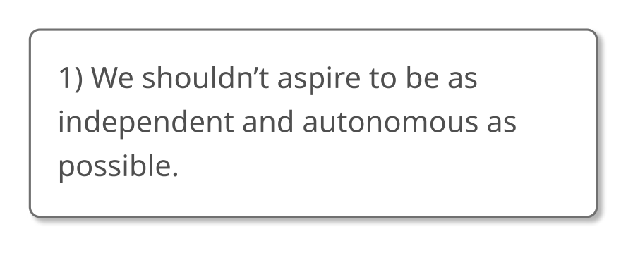
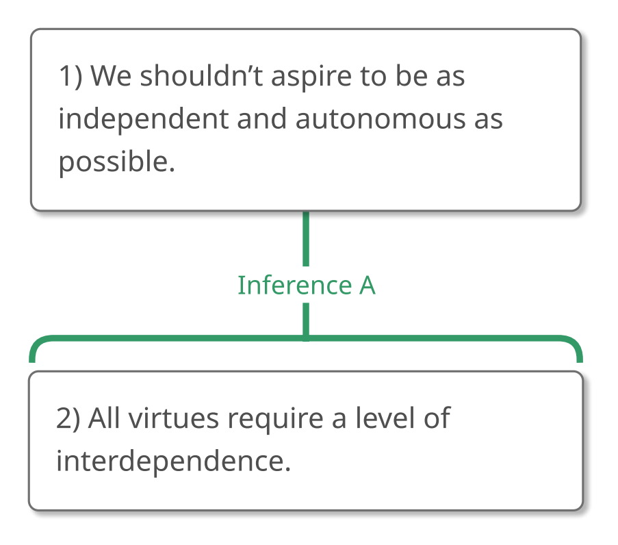
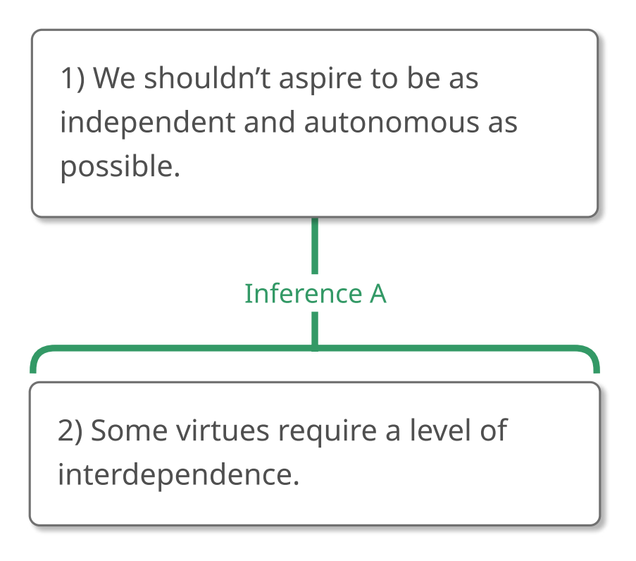

# 1.9 Constructing Arguments

## The Introspection Myth

The process of constructing an argument of your own can pose special
challenges. For one thing, there's often the same indeterminate
scariness to it that characterizes writer's block: it's just you, and
this big blank field that you're supposed to magically fill up with
claims that come from who-knows-where. For another thing, constructing
your own argument is *almost always* "messier" than analyzing and
evaluating someone else's argument: you might start, and change your
mind, and go back and fix what you've done, and then change directions,
and start again, in an apparent chaos of random activity. In my
experience, these two factors often cooperate to form an unholy
alliance: the messiness of creative intellectual activity can make you
feel as though you're permanently confused, which can make the process
scarier, and the scariness of the process can prompt you to dash out in
any direction, making it even messier, until you eventually stop working
on the project altogether. Nothing about this is fun. In fact, it's all
rather horrible.

Many of these problems are fueled by a central misconception, which
we'll call "The Introspection Myth." The Introspection Myth says that
your claims are (or should be) sort of like books on a library shelf,
all neatly ordered and waiting for you to take them down.

According to the Myth, when you want or need to construct an argument,
defend a position, or engage in any other sort of creative intellectual
activity, all you need to do is *introspect*, turn your inner eye onto
your mental library, scan the shelves, choose the volume you want, and
read off what you see.

Of course, the Introspection Myth is almost never stated so bluntly, or
in exactly those terms, but most of us carry around the notion that our
claims should *already be in our minds somewhere* before we express
them. After reading a very impressive article, have you ever thought "I
could never write anything like that," because you don't "see" anything
like that already constructed and waiting for you inside your own head?
After listening to someone be very articulate, have you ever thought,
"I'm not that smart" because you never talk *to yourself* like that?
Have you ever done a pretty good job formulating an opinion and
expressing yourself, and then thought "I must have gotten lucky. I could
never do that again" because it just doesn't seem to you as though you
*usually* have well-constructed views like that? If so, you're probably
in the grip of The Introspection Myth.

The good news is that the Introspection Myth is *just* a myth, and once
you recognize it as such, and take another perspective toward thinking,
much of the anxiety about formulating and defending your own positions
will go away. In actuality, *nobody* (at least nobody *I* know) walks
around with fully constructed and well-articulated positions in their
heads, positions which they merely need to recite when the opportunity
presents itself. **Most of the time, people work out what they think in
the process of thinking it.**

When someone writes an article, for instance, he might start by saying
things to his friends or colleagues. He'll probably change his mind a
little and express himself in another way. Maybe he'll decide that the
issue he's considering is a little broad, so he'll narrow it down. Then
he'll read and talk and write and change his mind some more. Eventually,
he'll have a bunch of stuff written, which he'll reorganize. He'll go
back and rewrite the beginning in light of what he's written at the
end. He'll show it to his friends, who'll make suggestions and he'll
change it some more. Finally, he might get the article published, and
people will read it and think to themselves "I could never do anything
like that because there's never been anything like that in my head."
But, you see, *it wasn't exactly in the author's head either!* It wasn't
as though the author's head contained a Big Book of Brilliant Claims,
parts of which he transcribed into the paper. To a very large extent,
*the claims and arguments in the paper were what evolved in the process
of writing the paper and the author half-discovered and half-invented
what he thought in the process of expressing it.*

Realizing this can make writer's (or thinker's) block go away, or at
least lessen it a lot. It *isn't* just you, and this big blank field
that you're supposed to magically fill up with claims that come from
who-knows-where. It's you talking to yourself and other people, learning
from their claims, learning from your own claims, changing your mind,
and eventually producing something you like. Abandoning the
Introspection Myth can also help you to remain unfazed by the messiness
of original thinking. And it *is* messy because there's almost always
quite a bit of changing your mind, backing up, tossing everything out
and starting over. But this is cause for alarm only if you assume that
you should be accessing pre-existing claims already presented with
crystalline clarity somewhere in your mind. Once you recognize that your
eventual position doesn't already exist anywhere but will be the result
of a wonderfully messy and playful process, you'll be in a position to
*enjoy* creative intellectual pursuits.

What I want to do here is introduce you to the main outline of this
process, but you shouldn't be misled by the relative tidiness of the
steps that I'm going to give you. Tidy steps are *extraordinarily*
helpful, but you should never confuse a description of a process with
the activity itself. Reading a recipe is no substitute for baking, and
the fact that the *recipe* is clean and neat doesn't mean that flour
won't get all over the kitchen. Everything is messier than the
directions make it sound. Just remember that that's okay and don't be
afraid to get your hands dirty.

So, let's get started.

## 1. Pose a question that you'd like to answer.

The first step in constructing an argument is finding a question that
interests you. It's important to begin with a question (or constellation
of questions) because it can keep you motivated when the going gets
tough. No other incentive is better than a deep and abiding curiosity.

Beginning with a question can also help you to keep an open mind. If you
remember that what you *really* want to do is find the answer to your
question, you'll be less likely to confuse success with proving your own
preconceptions right.

Furthermore, if your investigations never seem to get you anywhere, an
awareness of your question will enable you to entertain the idea that
it, and the entire line of inquiry that it generates, may be
fundamentally flawed.

### Flawed Questions

How can a question be flawed? Many flawed questions presuppose things
that aren't true. For example, suppose I ask you, "Have you stopped
stealing your neighbor's mail?"

No matter how you answer this question, you buy into the assumption
that at one time you *did* steal your neighbor's mail. If this
assumption is true then the question is fine. But if this assumption is
untrue (as I suspect it is), this question shouldn't be answered. It
should be *unasked*.

Many of the most profound insights have been achieved by realizing that
the very question with which one began trapped one into making certain
false assumptions or into thinking about things in a counterproductive
fashion. So if you continually fail to find a satisfactory answer to a
question that interests you, stop and consider if that question assumes
something false.

### Choosing a Question

Ideally, the question with which you begin should meet the following
(admittedly rather vague) criteria:

1.  It should "matter" in some sense. Its answer should affect what you
    or other people think or do in a meaningful way.

2.  It should be the "right size," neither too broad nor too narrow to
    fit the space available for the argument.

3.  It should have the "right level of controversy." It shouldn't, for
    example, be an elementary question for which we could easily look up
    the answer.

For the sake of discussion, our question will be:

> "Should we aspire to be as independent and autonomous as possible?"

## 2. Consider some answers to your question.

Once we've decided on a question, the next thing we need to do is
consider various answers to our question. The possible answers to our
question are

-   "Yes, we should aspire to be as independent and autonomous as
    possible" and

-   "No, we shouldn't aspire to be as independent and autonomous as
    possible"

At this point, we might want to learn and think more about the issues
involved. We might, for instance, want to read about some theories of
human nature, learn about different ethical systems, and reflect upon
our own experience. If you think that you dislike research, you might be
pleasantly surprised by how fun this can be. It's often frustrating to
read with no particular purpose in mind because there's a tendency to
think that you have to remember *everything*. Reading in order to answer
specific questions, however, can be enjoyable and fascinating.

## 3. Identify the answer that you think is probably true.

After you've learned more about the issues involved, you'll probably be
inclined to favor one of the possible answers to your question. This
answer will be your ultimate conclusion. (By the way, if you're writing
a paper, this answer, or ultimate conclusion, will be your *thesis*.)

For the sake of discussion, let's assume that after research and
reflection, we decide that the answer to our question is "No, we
shouldn't aspire to be as independent and autonomous as possible."

Since this will be our ultimate conclusion, we'll start an argument map
with it at the top.

{#fig-1-9-conclusion width=287px fig-alt="Argument map concluding: 1) We shouldn't aspire to be as independent and autonomous as possible. A full text description is provided."}

::: {.map-outline fig="fig-1-9-conclusion"}

:::

## 4. Identify one reason to support that claim by asking "What is a reason to think that this claim is true?" If the reason isn't true, you should revise it.

Because we need to supply a reason to support our conclusion, we'll ask
ourselves, "What is a reason to think that our conclusion is true?"

One answer to that question might be "All virtues require a level of
interdependence," so we'll take that as our premise.

{#fig-1-9-reason width=289px fig-alt="Argument map concluding: 1) We shouldn't aspire to be as independent and autonomous as possible. A full text description is provided."}

::: {.map-outline fig="fig-1-9-reason"}

:::

Of course, we'll want our argument to be good, and we've seen that good
arguments need true premises, so it's always wise to step back from our
own premises and ask, "Is this really the case? *Is this true?*"

Looking at our premise, I'm not sure that it *is* true because I'm not
sure that all virtues *do* require a level of interdependence. Courage
and creativity, for instance, look like they may be exceptions.

It's a common habit to over-state one's case, as we just did. It's
analogous to shouting. Just like people often speak very loudly in order
to get attention or be taken seriously, people often make *very* strong
claims, like "*All* virtues require a level of interdependence."

There's nothing wrong with making a strong claim if the claim is true,
but we should avoid saying more than we honestly believe. Bold
falsehoods can't prove anything, and often the modest truth is all we
need. While not *all* virtues require a level of interdependence, *some*
(like generosity and thankfulness) do. Since that's enough for our
argument, let's change our premise accordingly and get the following
argument map:

{#fig-1-9-revised-1 width=289px fig-alt="Argument map concluding: 1) We shouldn't aspire to be as independent and autonomous as possible. A full text description is provided."}

::: {.map-outline fig="fig-1-9-revised-1"}

:::

That's better!

### Very Important Argument Construction Pro Tip

Before we turn to communicating this argument, it's worth stressing a
Pro Tip: **Make sure you have only one claim in each box!**

Because we tend to think quickly, it's easy to take a compound
sentence—or even multiple sentences—as a conclusion, premise, or
(later on) subconclusion. For example, it's tempting to write "We
shouldn't aspire to be as independent and autonomous as possible because
some virtues require a level of interdependence," as our conclusion. But
that sentence contains two claims, each of which should have its own box
because the second claim is being given as a reason to believe the
first. **Never, *ever*, have inference indicator expressions in a box
because sentences with inference indicators need to be divided into
multiple claims, each of which has its own box. The inference indicator
expression will then appear as the line connecting the boxes.**

But what about other connectors, like "and"? Can we use them in a box?
Well, it depends. Saying "We shouldn't aspire to be as independent *and*
autonomous as possible," is okay because that's essentially one claim.
But what if we said, "We shouldn't aspire to be as independent and
autonomous as possible, *and* the common assumption to the contrary is
an unfortunate byproduct of the industrial revolution."? There we have
two separate claims. We can certainly argue for each claim on its own,
but if we put these claims together too soon, it will be easy to argue
for only one part and that will weaken our argument. Try to avoid
compound conclusions at least for now.

Try to avoid compound premises too. For example, don't have "Some
virtues require a level of interdependence *and* we should encourage the
virtues," as a premise because each of these claims should have its own
box, allowing us to treat them as dependent reasons (as we'll see in
Chapter 3). Having "some virtues require a level of interdependence" and
"we should encourage the virtues" in their own boxes will also enable us
to evaluate them separately more easily and will help us to more clearly
understand how they function in the argument. (Maybe the argument will
go on to support one of the claims, making it a subconclusion, but not
the other, for example.)

In short, it's easy to over-value quick thinking, but speed is most
important in crisis situations. Hopefully, we're not in crisis
situations very often. The vast majority of the time, we should
prioritize *clear and careful* thinking over *fast* thinking. So when
you're constructing an argument of your own, make a special effort to
**slow your thinking and put only one claim in a box**. Later, when you
express your argument, you can combine those single claims into compound
sentences to your heart's content, and those compound sentences will be
much better off for having been intentionally constructed out of smaller
sentences. Big pictures are often painted with little brushes.

## Communicating Arguments

Once we've constructed our argument, we can communicate it—perhaps by
writing it down in a normal prose passage.

There's a lot to be said about good writing, of course, but for our
purposes we can focus on one thing: **we should state our case in a way
that will make it easy for other people to map our argument**. This
involves helping our readers to:

1)  **identify the claims that compose our argument** and
2)  **understand the connections between those claims**.

Not surprisingly, **inference indicator expressions can be very
useful**. When we're expressing an inference between a reason and
conclusion, there are two ways that we can tell our reader which claim
is the reason and which claim is the conclusion:

1)  **We can state a conclusion indicator expression before the
    conclusion** or
2)  **We can state a reason indicator expression before the reason**.

Let's do that for the argument we've constructed:

{#fig-1-9-revised-2 width=289px fig-alt="Argument map concluding: 1) We shouldn't aspire to be as independent and autonomous as possible. A full text description is provided."}

::: {.map-outline fig="fig-1-9-revised-2"}

:::

Because "We shouldn't aspire to be as independent and autonomous as
possible" is the conclusion of this argument, we can write the argument
with a **conclusion indicator expression** (like "therefore") in front
of that claim, like this:

> "Some virtues require a level of interdependence. **Therefore**, we
> shouldn't aspire to be as independent and autonomous as possible."

Because "Some virtues require a level of interdependence" is the reason
in this argument, we can also write the argument with a **reason
indicator expression** (like "because") in front of that claim, like
this:

> "We shouldn't aspire to be as independent and autonomous as possible
> **because** some virtues require a level of interdependence."

Or like this:

> "**Because** some virtues require a level of interdependence, we
> shouldn't aspire to be as independent and autonomous as possible."

Finally, we might want to add some rhetorical touches, sentences that
aren't part of the argument but that serve to smooth the passage for the
reader. Right now, that means adding some question and command sentences
if we think they would help set the mood.

For instance, we might say:

> "Do you agree with the popular opinion that we should all be as
> self-reliant as we can? In fact, we shouldn't aspire to be as
> independent and autonomous as possible because some virtues require a
> level of interdependence."

## Summary of Constructing Arguments

We've now seen the first steps of argument construction! In particular,
we've learned how to

1.  Pose a question that we'd like to answer.
2.  Consider some answers to our question.
3.  Identify the answer that we think is probably true.
4.  Identify one reason to support that claim by asking "What is a
    reason to think that this claim is true?" If the reason isn't true,
    we should revise it.

We also learned how to communicate an argument by using inference
indicator expressions to help our readers identify the claims that
compose our argument and accurately track the relationships between
those claims.

We've covered a *lot* of material in this chapter! Congratulations! In
Chapter 2, we'll continue to practice with the support relationship and
learn even more about arguments.
