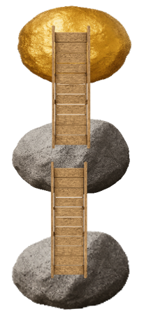

# 2.1 Introduction

## What You'll Learn in this Chapter

Welcome! Here you'll learn some more about reasoning, continuing to
follow the Four Big Steps. In particular, you'll learn:

More about **recognizing arguments**. Specifically,

-   how to distinguish arguments from explanations.

More about **analyzing arguments**. Specifically,

-   how to recognize when questions, commands, and statements should be
    rephrased and included in the map,
-   how to recognize when statements should be ignored,
-   what to do if you can't identify the ultimate conclusion of an
    argument, and
-   how to map arguments with subconclusions. (We'll see what
    subconclusions are in a bit.)

More about **evaluating arguments**. Specifically,

-   how to evaluate arguments with subconclusions.

More about **constructing arguments**. Specifically,

-   how to construct arguments with subconclusions, and
-   how to write passages containing arguments with subconclusions.

## Subconclusions

So far, we've seen arguments that we can represent with very short maps
that take us from one boulder to another, like this:

{.illustration width=140px fig-alt="A ladder leads from a gray boulder up to a golden boulder."}

It often happens, however, that the distance between our starting
boulder (our premise) and the boulder that we want to reach (the
ultimate conclusion) is too long to be spanned by a single bridge. In
cases like that, an argument will often provide us with an *intermediate
boulder* (which we'll call a "subconclusion"), on the way from our
starting boulder (the premise) to the golden boulder (the ultimate
conclusion). Like this:

{.illustration width=125px fig-alt="A ladder leads from a gray boulder up to a second gray boulder, and another ladder leads from there up to a golden boulder."}

That's the sort of argument we'll be seeing in this chapter. So let's
get to it!

## Summary of Introduction

The big idea in this chapter will be subconclusions, intermediate steps
from the premises to the ultimate conclusion.

As we learn about subconclusions, we'll also learn more about
recognizing, analyzing, evaluating, and constructing arguments.
