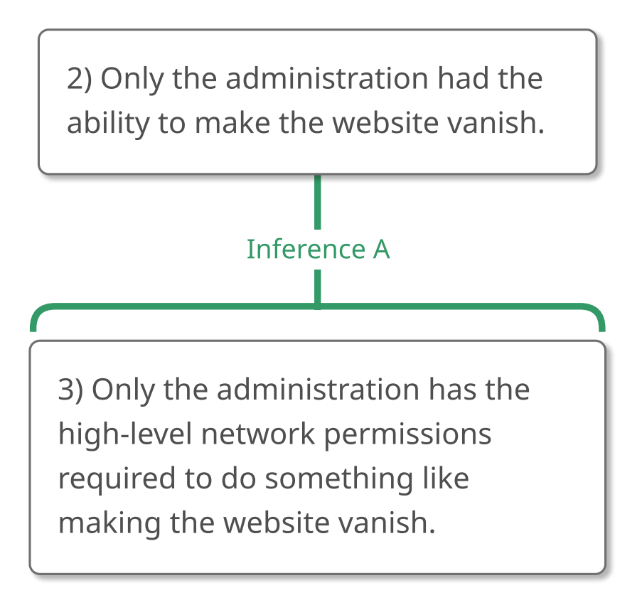
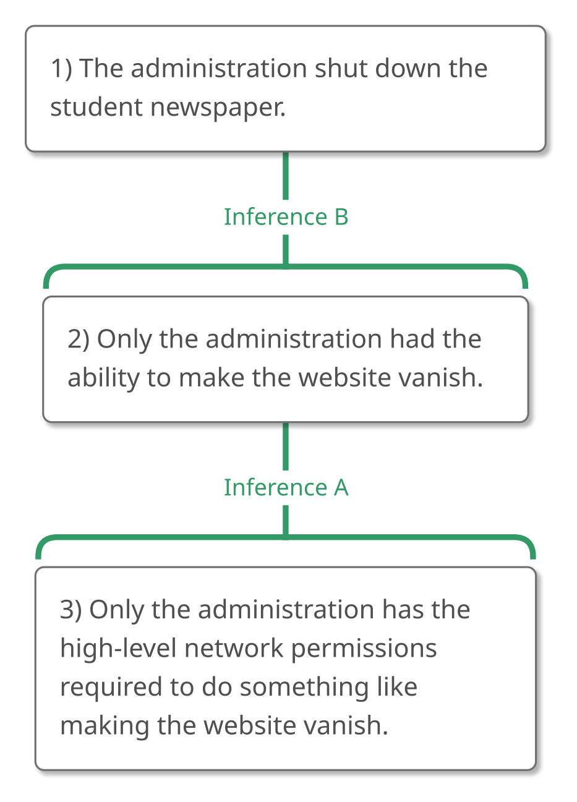
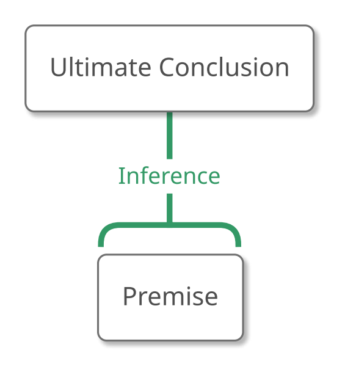
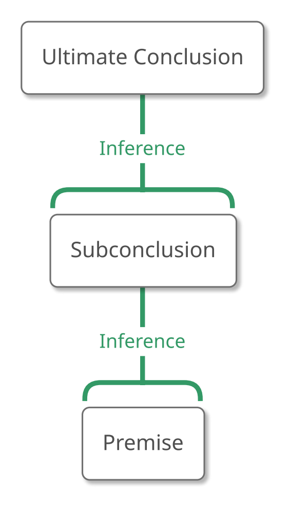
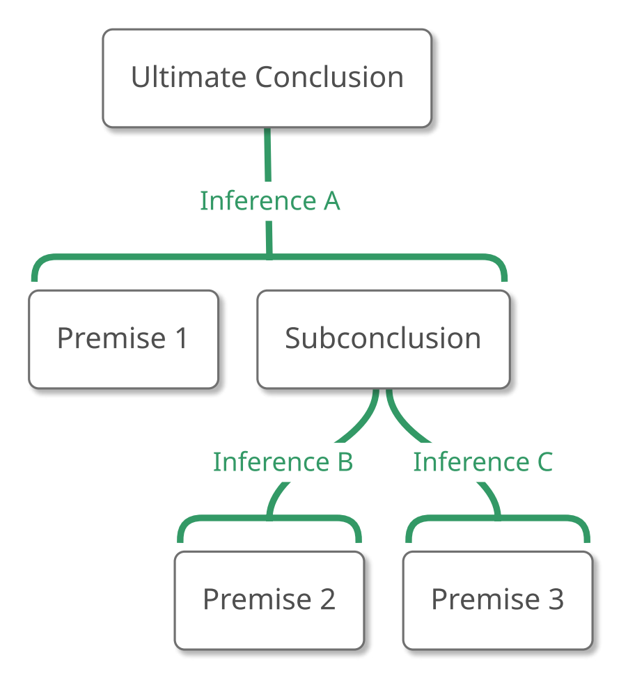
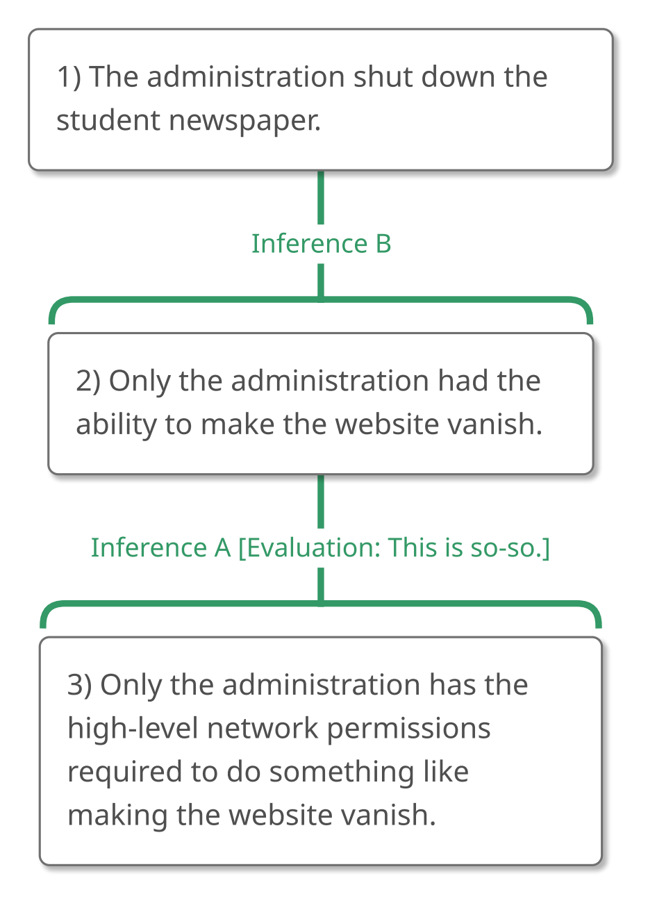
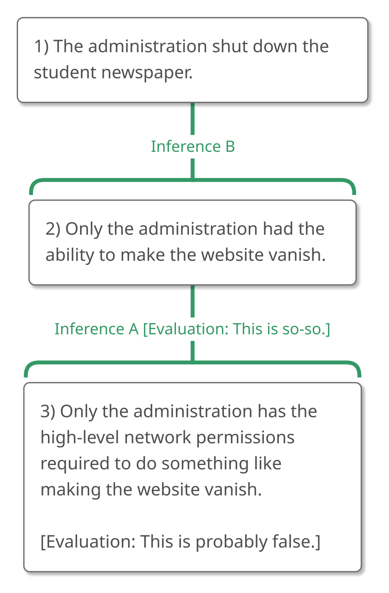

# 2.3 Example 2

## Step 1 – Recognizing an Argument

What about this passage? **"What is this passage doing? Is it trying to
convince us that something is true?"**

> "You probably noticed that the online student newspaper seems to have
> disappeared. Who took it down? It seems pretty clear to me. I think
> the administration shut down the student newspaper. After all, only
> the administration had the ability to make the website vanish because
> only the administration has the high-level network permissions
> required to do something like that."

Unlike the earlier passage, this one *is* trying to convince us of
something, so it does contain an argument. We can turn our attention to
analyzing and evaluating it!

## Step 2 – Analyzing the Argument

As you probably remember from Chapter 1, our first question here is
**"What is the ultimate conclusion, or the main claim that this argument
is trying to get us to believe?"**

> "You probably noticed that the online student newspaper seems to have
> disappeared. Who took it down? It seems pretty clear to me. I think
> the administration shut down the student newspaper. After all, only
> the administration had the ability to make the website vanish because
> only the administration has the high-level network permissions
> required to do something like that."

I think that ultimate conclusion is "the administration shut down the
student newspaper," so let's give this phrase a number 1.

> "You probably noticed that the online student newspaper seems to have
> disappeared. Who took it down? It seems pretty clear to me. I think
> (1) the administration shut down the student newspaper. After all,
> only the administration had the ability to make the website vanish
> because only the administration has the high-level network permissions
> required to do something like that."

A couple of quick comments might be in order here.

First, it might have been harder for you to identify the ultimate
conclusion in this passage than it was for you to identify the ultimate
conclusion in the earlier chapter. That's understandable because (as
we'll see) this passage is the first we've seen with a subconclusion.
**A subconclusion is an intermediate claim on the way from the premise
to the ultimate conclusion.** It's a claim that the argument uses to
support other claims (which means it's not the ultimate conclusion) but
that the argument gives us reason to accept by providing evidence for it
(which means it's not a premise). Because subconclusions are supported
by other claims and because the ultimate conclusion is supported by
other claims too, a subconclusion can *easily* be mistaken for the
ultimate conclusion. Sometimes, rhetorical cues (like questions) can
help us to distinguish between a subconclusion and the ultimate
conclusion. Notice how what we identified as the ultimate conclusion
answers the question "Who took it \[the student newspaper\] down?"

Second, you might wonder why we didn't take the entire sentence "I think
the administration shut down the student newspaper" as the ultimate
conclusion. Why did we ignore the "I think" bit? We ignored it because
the author isn't trying to convince us that they have a certain opinion.
(It's not as though we said to the author "I don't believe you really
*do* think that" and the author is trying to establish that they really
think what they say they do.) Instead, the author is trying to convince
us that their opinion is *true* and that the administration is
responsible for shutting down the newspaper. That's why we identified
only part of that sentence as the ultimate conclusion. In general, the
important point is to try to capture the author's *meaning*, which may
or may not involve capturing all of the author's exact *words*. As we'll
see again later, **sometimes we'll want to rephrase statements to better
express the claims that they convey.**

We're now in a position to ask, **"What else is being claimed?"** And
**"Is this claim part of the argument?"**

### Unimportant Statements

In Chapter 1, we learned that claims are complete thoughts that are
either true or false, that statements convey claims, and that a claim is
important if it helps to establish the truth of the conclusion. **The
fact that a claim helps us to establish the ultimate conclusion is what
makes that claim important to the argument**. It just so happened, in
Chapter 1, that all statements in an argument were important because
they all helped to establish the ultimate conclusion.

But in real life, things aren't that tidy. Sometimes a statement in an
argument conveys a claim that *isn't* relevant to establishing the truth
of the ultimate conclusion. The first sentence in the passage under
consideration is like this.

> "You probably noticed that the online student newspaper seems to have
> disappeared. Who took it down? It seems pretty clear to me. I think
> (1) the administration shut down the student newspaper. After all,
> only the administration had the ability to make the website vanish
> because only the administration has the high-level network permissions
> required to do something like that."

"You probably noticed that the online student newspaper seems to have
disappeared," isn't used to convince the reader that the administration
shut down the student newspaper; it just sets the stage. **Since an
argument is supposed to establish that its ultimate conclusion is true,
sentences that don't help do that in some way aren't really part of the
argument. We'll call them "unimportant statements" and ignore them.**
We'll ignore the first sentence in this argument.

The next sentence is a question, and the following sentence is another
unimportant statement, so we can ignore them, too.

The sentence after the conclusion, the last sentence in our argument, is
more interesting! It contains two claims, both of them important,
connected with the inference indicator expression "because." (Remember,
as we saw in Chapter 1, we'll always be dividing sentences into
component claims around inference indicator expressions because
otherwise we can't represent that inference or evaluate it very
effectively.)

> "You probably noticed that the online student newspaper seems to have
> disappeared. Who took it down? It seems pretty clear to me. I think
> (1) the administration shut down the student newspaper. After all, (2)
> only the administration had the ability to make the website vanish
> because (3) only the administration has the high-level network
> permissions required to do something like that."

This argument has *three* claims, not just two! So, when we ask our next
question, **"How are these claims related to each other?"** exactly what
claims do we mean? The first two claims? The last two claims? All three
claims together?

Happily, there are two principles that can help us here:

### 1. Two at a time!

With a couple of pretty rare exceptions that we'll be seeing later,
we'll always want to put things together two at a time—not three at a
time, not four at a time, but two at a time—because that's how our
brains usually work.

To see this, take a moment to do the following math problem. Don't use a
calculator. Do it in your head.

> 7 + 4 + 3 + 5 = ?

You almost certainly arrived at the correct answer of 19.

> 7 + 4 + 3 + 5 = 19

But *how* did you arrive at that answer? I've posed that question to
many people over many years, and the answers are always interesting.

Some people add the 7 and 4 to get 11. They then add the 3 to 11 to get
14, and add the 5 to 14 to get 19.

Some people add the 4 and the 3 to get 7, which they then add to the
first 7 to get 14. Adding the 5 gives them 19.

Other people always go for tens or multiples of ten, so they add the 7
and the 3 first to get 10. Then they add the 4 and the 5 to get 9, and
add the 10 to the 9 to get 19.

What's interesting about this, you ask? What's interesting is that I
have yet to find *anybody* who said, "What do you mean, how did I arrive
at the answer? I just added the four numbers, all at once, and came up
with 19. I never, at any point, added two numbers. Why would I do that?
There are four numbers so I instantly added them all together."

People don't swallow a math problem whole. They chew their food, so to
speak, two bites at a time. We'll want to do the same thing when
analyzing arguments. If we try to think about more than two things at a
time, we will get unnecessarily confused. That's a promise.

### 2. Save the ultimate conclusion for last

So, we want to think about the connection between two of the claims in
our argument, not three. But which two claims? There are two inference
indicator expressions in our argument, "after all," and "because."

> "You probably noticed that the online student newspaper seems to have
> disappeared. Who took it down? It seems pretty clear to me. I think
> (1) the administration shut down the student newspaper. **After all,**
> (2) only the administration had the ability to make the website vanish
> **because** (3) only the administration has the high-level network
> permissions required to do something like that."

Should we look at the "after all" first, connecting claims 1 and 2?
Should we look at the "because" first, connecting claims 2 and 3? Does
it matter?

Oh, *it matters*.

An inference indicator expression attached to the ultimate conclusion is
ambiguous. It might apply to the claim that is immediately next to it,
*or* it might apply to the entire chain of reasoning that follows or
precedes it.

Suppose, for example, that we have an ultimate conclusion, claim 1,
connected with a reason indicator, like "because," and followed by an
argument composed of claims 2 through 9.

> "1 because 2 \.... 9"

The "because" might tell us that claim 2 directly supports the
conclusion, with an inference running from 2 to 1.

> "(1 because 2) \.... 9"

Or it could tell us that the entire argument, composed of ideas 2
through 9, supports the ultimate conclusion, without an inference
specifically going from 2 to 1.

> "1 because (2 \.... 9)"

Similarly, we might have an ultimate conclusion, claim 1, connected with
a conclusion indicator, like "therefore," and preceded by an argument
composed of claims 2 through 9.

> "2 \.... 9 therefore 1."

In this case, the "therefore" might tell us that claim 9 directly
supports the conclusion, with an inference running from 9 to 1.

> "2 \.... (9 therefore 1)."

Or it could tell us that the entire argument, composed of ideas 2
through 9, supports the ultimate conclusion, without an inference
specifically going from 9 to 1.

> "(2 \.... 9) therefore 1."

For this reason, we won't pay much attention to inference indicator
expressions that attach to ultimate conclusions. In fact, **although
we'll try to *identify* the ultimate conclusions first, because knowing
where we're going helps us to follow the reasoning, we won't *map* it
first. Instead, we'll map it near the end of the mapping process.**

In this case, then, we should look at claims 2 and 3 and ask, **"How are
they related to each other?"**

> "You probably noticed that the online student newspaper seems to have
> disappeared. Who took it down? It seems pretty clear to me. I think
> (1) the administration shut down the student newspaper. **After all,**
> (2) only the administration had the ability to make the website vanish
> **because** (3) only the administration has the high-level network
> permissions required to do something like that."

The "because" tells us that claim 3 is a reason to believe claim 2,
giving us the following map:

{#fig-2-3-partial-1 width=289px fig-alt="Argument map concluding: 2) Only the administration had the ability to make the website vanish. A full text description is provided."}

::: {.map-outline fig="fig-2-3-partial-1"}

:::

With claims 2 and 3 connected properly, we can think of that argument
module as one thing. This allows us to ask, **"How is this part of the
argument related to what has gone before?"** In other words, how is the
"3 to 2" bit related to the "1" bit?

Not surprisingly, the inference indicator expression "after all" helps
us here, making it clear that the ultimate conclusion is supported by
the part of the argument that we've just mapped. Our final map of the
argument, then, is this:

> "You probably noticed that the online student newspaper seems to have
> disappeared. Who took it down? It seems pretty clear to me. I think
> (1) the administration shut down the student newspaper. **After all,**
> (2) only the administration had the ability to make the website vanish
> **because** (3) only the administration has the high-level network
> permissions required to do something like that."

{#fig-2-3-full-1 width=299px fig-alt="Argument map concluding: 1) The administration shut down the student newspaper. A full text description is provided."}

::: {.map-outline fig="fig-2-3-full-1"}

:::

(Note that we're continuing to give letters to the inferences so we can
more easily refer to the inferences later. In this case, I gave "Inference
A" to the inference from 3 to 2 just because it was the first inference
I identified, but there's no rule about this. If you wanted to give
"Inference A" to the inference from 2 to 1 because it's closer to the
top of the map, that's fine.)

As we can see, this argument has a subconclusion! In fact we can read
the role of each claim directly off the map itself.

-   Claim 1 is the **ultimate conclusion** because it isn't supporting
    another claim (i.e., there's no number above it). The reasoning
    *stops* at this claim.

-   Claim 2 is a **subconclusion** because it is both supported by a
    claim (claim 3, which is underneath it) and supporting another claim
    (claim 1, which is above it). The reasoning *passes through* this
    claim.

-   Claim 3 is a **premise** because there is no claim supporting it
    (i.e., there's no number underneath it). The reasoning *starts* with
    this claim.

## Step 3 – Evaluating the Argument

Now that we have our argument mapped, we can evaluate it. But because
arguments are starting to get a bit more complex, it's a good idea to
pause for a bit to distinguish between the *principles* of argument
evaluation that we're learning here and the *practice* that we'll
probably follow in real life.

### The Principles of Argument Evaluation

As we saw in Chapter 1, in order to evaluate an argument that has one
premise and an ultimate conclusion, we simply need to assess the premise
and the inference between the premise and the conclusion. If both the
premise and the inference are good then the conclusion is supported and
the argument is good. Contrariwise, if either the premise or the
inference is bad, then the conclusion is not supported and so the argument
fails as whole.

{#fig-2-3-pu-1 width=181px fig-alt="Generic argument map: an ultimate conclusion supported by one premise. A full text description is provided."}

::: {.map-outline fig="fig-2-3-pu-1"}

:::

The same is true for arguments with subconclusions. If the premise is
false then the argument is bad because the premise can't establish the
subconclusion, and because the subconclusion needs to be established in
order for it to establish the ultimate conclusion. If the inference from
the premise to the subconclusion is bad then the argument is bad because
the subconclusion won't be established and because the subconclusion
needs to be established in order for it to establish the ultimate
conclusion. And finally, if the inference from the subconclusion to the
ultimate conclusion is bad, then the argument is bad because the
subconclusion won't be able to establish that the ultimate conclusion is
true.

{#fig-2-3-psu-1 width=181px fig-alt="Generic argument map: an ultimate conclusion supported by a subconclusion, which is supported by a premise. A full text description is provided."}

::: {.map-outline fig="fig-2-3-psu-1"}

:::

At the end of the day, we've seen that evaluating arguments with
subconclusions is exactly like evaluating arguments without
subconclusions! Specifically, **an argument must have good premises and
good inferences; even one bad premise or even one bad inference will
make the argument bad as well**.

Furthermore, we already know how to evaluate premises and inferences.

In order to evaluate premises, we ask

-   "Is this premise true?"

-   "Could someone who doesn't already believe the ultimate conclusion
    believe this premise?"

In order to evaluate an inference, we ask

-   "If a perfectly gullible, perfectly rational person (we could call
    him 'Gully' for short) believes the reasons, how likely is that
    person to accept the conclusion on that basis?"

So, believe it or not, we already have the basic principles of argument
evaluation in hand! We evaluate the premises, evaluate the inferences,
and put that information together to give us the evaluation of the
argument. That's it!

### Where to Start Evaluating

In practice, though, we might not evaluate every premise and inference
in an argument. That's especially likely to be the case if the argument
is structurally complex. Suppose, for instance, that we're faced with an
argument with the following structure.

{#fig-2-3-complex-1 width=289px fig-alt="Generic argument map: Premise 1 and a subconclusion together support the ultimate conclusion; Premises 2 and 3 each separately support the subconclusion. A full text description is provided."}

::: {.map-outline fig="fig-2-3-complex-1"}

:::

We won't officially see arguments like this until Chapter 4, so don't
worry if it looks confusing. Essentially, Premise 1 and the
Subconclusion work together to support the Ultimate Conclusion (making
them *dependent reasons*) and Premises 2 and 3 each provide their own line
of support for the Subconclusion (making them *independent reasons*).

#### Start Where You Disagree

A good principle is to start our evaluation of the argument at the point
that strikes us as most confusing or incorrect. Suppose, for example,
that we find Premise 1 to be problematic. That's where we might want to
begin our evaluation of the argument, asking "Is it true?" and "Could
someone who doesn't already believe the ultimate conclusion think that
it's true?"

#### Start at the Top of the Map

If no part of the argument strikes us as any more confusing or
incorrect than any other part in the argument, it's a good idea to start
evaluating the argument at the top of the map and to work our way down.
In this case, we might start with Inference A and ask, "If Gully accepts
Premise 1 and the Subconclusion, how likely will Gully be to accept the
ultimate conclusion on that basis?"

Why should we start at the top rather than at the bottom? Because
arguments tend to converge toward the top and so evaluating from the top
down can be more efficient. Let's look at our argument again.

{#fig-2-3-complex-2 width=289px fig-alt="Generic argument map: Premise 1 and a subconclusion together support the ultimate conclusion; Premises 2 and 3 each separately support the subconclusion. A full text description is provided."}

::: {.map-outline fig="fig-2-3-complex-2"}

:::

If Inference A turns out to be bad, we'll know that the argument fails
as a whole. We can stop evaluating the argument, if we want.

But what if we start evaluating at the *bottom* of the map, maybe with
Inference B? If Inference B is bad, the argument could still be good
because the Subconclusion could be supported by Premise 3 and Inference
C. We have more work to do.

### Evaluating Subconclusions

But now, what about subconclusions? Should we evaluate them as part of
our evaluation of an argument?

A good principle is to **evaluate the claims in the argument in the
spirit in which they are offered**.

**If a claim is a premise, the argument is saying, in effect, "Just
accept this,"** so if we know or suspect that the claim is false, we're
free to say, "No. I *don't* accept that." We are free to level a "not
so" objection.

If a claim is a *subconclusion*, though, the argument *isn't* saying,
"Just accept this." **If a claim is a subconclusion, the argument is
saying, "Be *convinced* of this,"** so if we don't accept a
subconclusion, *we need to determine why we aren't convinced*. In other
words, we need to inspect the reasoning that supports the subconclusion.
**If we don't like a subconclusion, we should "look down" at the claims
and inferences below it.**

**We can allow our initial objection to a subconclusion to tell us where
to focus our attention (particularly if we're starting our evaluation
of an argument at the point where we disagree)—but we should try to
formulate our final response to the argument as an evaluation of the
premises and inferences**.

### Evaluating our Argument

Now that we know how to evaluate arguments like this, let's return to
the argument that we mapped.

> "You probably noticed that the online student newspaper seems to have
> disappeared. Who took it down? It seems pretty clear to me. I think
> (1) the administration shut down the student newspaper. **After all,**
> (2) only the administration had the ability to make the website vanish
> **because** (3) only the administration has the high-level network
> permissions required to do something like that."

{#fig-2-3-full-2 width=299px fig-alt="Argument map concluding: 1) The administration shut down the student newspaper. A full text description is provided."}

::: {.map-outline fig="fig-2-3-full-2"}

:::

Suppose our initial reaction to this argument is, "No way! I'm sure that
other people besides the administration could have eliminated the
website." The first thing we should do is identify the part of the
argument targeted by that reaction, and it looks to us like we're
disagreeing with Claim 2. That's great, but because Claim 2 is a
subconclusion, we shouldn't stop there. We should look down, inspecting
the reasoning that supports it.

Let's look at Inference A. If a perfectly gullible, perfectly rational
person thinks that Claim 3 is true and that only the administration has
the required network permissions, how likely would that person be to
accept that only the administration has the ability to delete the
website? Maybe somewhat likely, but it isn't forced. After all, hackers
do exist. Who's to say that someone didn't hack into the system? And
might a perfectly gullible, perfectly rational person recognize that
possibility? I think so. "Gullible" refers only to the acceptance of
the premise. It doesn't mean "naïve." Inference A isn't horrible—Claim
3 does support Claim 2 a bit—but it's less than perfect. I'd say it's
"so-so."

> "You probably noticed that the online student newspaper seems to have
> disappeared. Who took it down? It seems pretty clear to me. I think
> (1) the administration shut down the student newspaper. **After all,**
> (2) only the administration had the ability to make the website vanish
> **because** (3) only the administration has the high-level network
> permissions required to do something like that."

{#fig-2-3-i-eval-1 width=299px fig-alt="Argument map concluding: 1) The administration shut down the student newspaper. A full text description is provided."}

::: {.map-outline fig="fig-2-3-i-eval-1"}

:::

Now what about Claim 3, which is a premise. Is it true? Maybe not. It's
probable that the IT department has those high-level network permissions
as well.

By noting our discomfort with Claim 2 (a subconclusion), we were able to
trace the problem to Claim 3 (a premise) and (to a lesser extent) to
Inference A. This argument is bad.

> "You probably noticed that the online student newspaper seems to have
> disappeared. Who took it down? It seems pretty clear to me. I think
> (1) the administration shut down the student newspaper. **After all,**
> (2) only the administration had the ability to make the website vanish
> **because** (3) only the administration has the high-level network
> permissions required to do something like that."

{#fig-2-3-p-eval-1 width=299px fig-alt="Argument map concluding: 1) The administration shut down the student newspaper. A full text description is provided."}

::: {.map-outline fig="fig-2-3-p-eval-1"}

:::

Does this mean that the conclusion is false and that the administration
*didn't* shut down the student newspaper? No. It just means that we
haven't yet established that the administration is guilty of doing this.

## Summary of Example 2

Example 2 presented us with this passage:

> "You probably noticed that the online student newspaper seems to have
> disappeared. Who took it down? It seems pretty clear to me. I think
> the administration shut down the student newspaper. After all, only
> the administration had the ability to make the website vanish because
> only the administration has the high-level network permissions
> required to do something like that."

### Step 1 – Recognizing an Argument

We asked ourselves, "What is this passage doing? Is it trying to
convince us that something is true?" and we decided that this passage
does contain an argument.

### Step 2 – Analyzing the Argument

Our next question was, "What is the ultimate conclusion, or the main
claim that this argument is trying to get us to believe?" We decided that
the ultimate conclusion was "the administration shut down the student
newspaper" so we gave that claim number 1.

> "You probably noticed that the online student newspaper seems to have
> disappeared. Who took it down? It seems pretty clear to me. I think
> (1) the administration shut down the student newspaper.
> After all, only the administration had the ability to make the website
> vanish because only the administration has the high-level network
> permissions required to do something like that."

It's important to note that we ignored the "I think" part of the
conclusion because the argument isn't trying to convince us that the
author has a certain opinion. Instead, the argument is trying to
convince us that this opinion is true. Sometimes we'll want to rephrase
statements to better express the claims that they convey.

Returning to the passage, we asked, "What else is being claimed?" and
"Is this claim part of the argument?"

We decided that the first sentence isn't part of the argument because it
doesn't help to establish the ultimate conclusion. We ignored it.

We ignored the second sentence because it's a question, and the third
sentence because it's another unimportant statement.

The next sentence, however, gave us two important claims! (We divided
around the inference indicator expression "because.")

> "You probably noticed that the online student newspaper seems to have
> disappeared. Who took it down? It seems pretty clear to me. I think
> (1) the administration shut down the student newspaper. After all, (2)
> only the administration had the ability to make the website vanish
> because (3) only the administration has the high-level network
> permissions required to do something like that."

Our next question was, "How are these claims connected to each other?"
But this argument has three claims, so we need to be deliberate about
the claims we focus on first. In particular, we saw that we should try
to think about only two things at a time, leaving the ultimate
conclusion for last. This led us to map the relationship between Claims
2 and 3 first.

> "You probably noticed that the online student newspaper seems to have
> disappeared. Who took it down? It seems pretty clear to me. I think
> (1) the administration shut down the student newspaper. After all, (2)
> only the administration had the ability to make the website vanish
> because (3) only the administration has the high-level network
> permissions required to do something like that."

{#fig-2-3-partial-2 width=289px fig-alt="Argument map concluding: 2) Only the administration had the ability to make the website vanish. A full text description is provided."}

::: {.map-outline fig="fig-2-3-partial-2"}

:::

Turning to the ultimate conclusion, we asked a new question: "How is this
part of the argument related to what has gone before?"

The inference indicator expression "after all" allowed us to see that
the part of the argument that we already mapped supports the ultimate
conclusion.

> "You probably noticed that the online student newspaper seems to have
> disappeared. Who took it down? It seems pretty clear to me. I think
> (1) the administration shut down the student newspaper. After all, (2)
> only the administration had the ability to make the website vanish
> because (3) only the administration has the high-level network
> permissions required to do something like that."

{#fig-2-3-full-3 width=299px fig-alt="Argument map concluding: 1) The administration shut down the student newspaper. A full text description is provided."}

::: {.map-outline fig="fig-2-3-full-3"}

:::

### Step 3 – Evaluating the Argument

For an argument like this one, even one bad premise or one bad inference
will prevent the argument from establishing that the ultimate conclusion
is true and so make the argument bad.

We can start our evaluation at the point in the argument that strikes us
as the most confusing or incorrect.

If no point strikes us as the most confusing or incorrect, it's a good
policy to start evaluating at the top of the map and to work our way
down.

If we find ourselves disagreeing with a subconclusion, we should
evaluate the claims and inferences that support it, trying to formulate
our final evaluation of the argument as an evaluation of premises and
inferences.

In this case, our discomfort with claim 2 (a subconclusion) led us to
question Inference A and Claim 3 (a premise).

> "You probably noticed that the online student newspaper seems to have
> disappeared. Who took it down? It seems pretty clear to me. I think
> (1) the administration shut down the student newspaper. After all, (2)
> only the administration had the ability to make the website vanish
> because (3) only the administration has the high-level network
> permissions required to do something like that."

{#fig-2-3-p-eval-2 width=299px fig-alt="Argument map concluding: 1) The administration shut down the student newspaper. A full text description is provided."}

::: {.map-outline fig="fig-2-3-p-eval-2"}

:::
