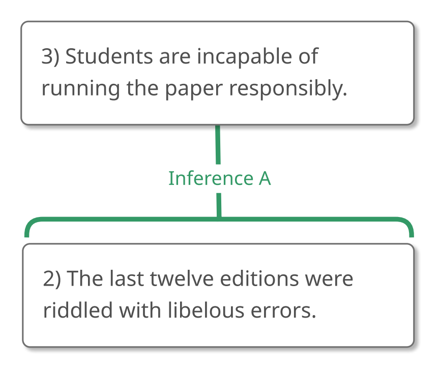
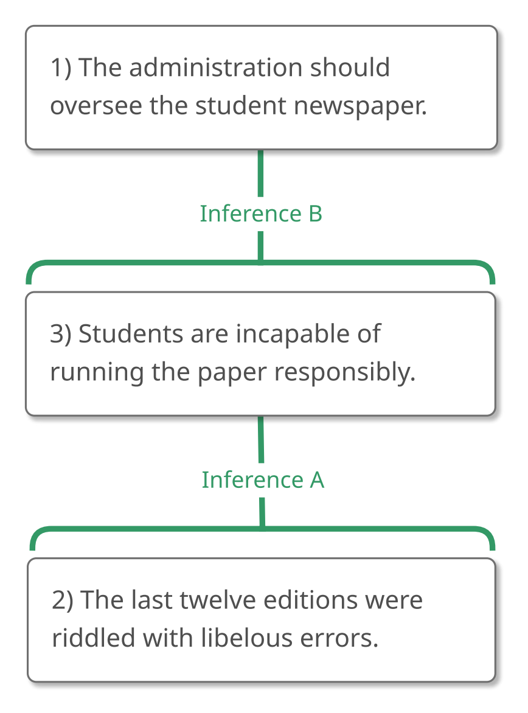
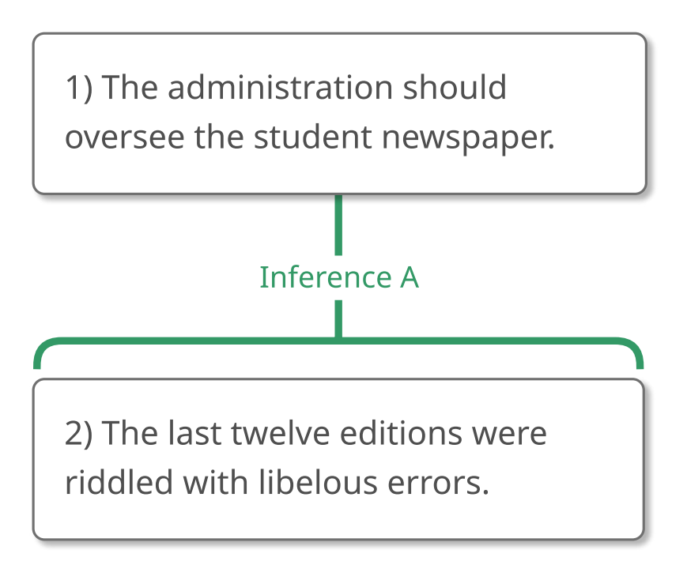
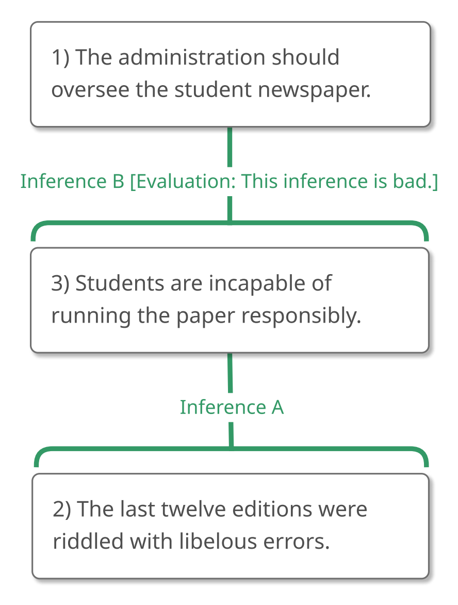

# 2.5 Example 4

## Step 1 – Recognizing an Argument

Now what about this passage? **"What is this passage doing? Is it trying
to convince us that something is true?"**

> "Some people on campus are in favor of an independent student
> newspaper whereas other people on campus oppose it. In fact, the
> administration should oversee the student newspaper. The reason is
> that the last twelve editions were riddled with libelous errors, which
> proves that students are incapable of running the paper responsibly."

I think that this passage is trying to convince us of something, so I'll
say that this passage contains an argument. Let's analyze it!

## Step 2 – Analyzing the Argument

As always, we'll begin by identifying the ultimate conclusion, asking,
**"What is the ultimate conclusion, the main claim that this argument is
trying to get us to believe?"**

It seems to me that this argument is trying to convince us that the
administration should oversee the student newspaper, so let's give that
claim number 1.

> "Some people on campus are in favor of an independent student
> newspaper whereas other people on campus oppose it. In fact, (1) the
> administration should oversee the student newspaper. The reason is
> that the last twelve editions were riddled with libelous errors, which
> proves that students are incapable of running the paper responsibly."

As we saw in Example 2, **we won't map the ultimate conclusion right
away.** For now, we'll just use it as our North Star, so to speak. It
shows us where we're headed.

Instead, we'll proceed by returning to the beginning of the passage,
asking **"What else is being claimed?"** and **"Is this claim part of
the argument?"**

The first sentence does express a claim. It's a statement. But I don't
see how it is being given as a reason to believe the conclusion, so
let's ignore it.

The next sentence, however, does convey an important claim. In fact, it
conveys two! (Remember, we'll always divide a sentence around inference
indicators and "which proves that" is an inference indicator, so we'll
divide there.)

> "Some people on campus are in favor of an independent student
> newspaper whereas other people on campus oppose it. In fact, (1) the
> administration should oversee the student newspaper. The reason is
> that (2) the last twelve editions were riddled with libelous errors,
> **which proves that** (3) students are incapable of running the paper
> responsibly."

It might be tempting to relate claim 2 to claim 1 at this point, but
remember what we learned in Example 2. We **identify the relationships
between claims as soon as we have identified two claims that are part of
the argument, *not counting the ultimate conclusion***, so we'll look to
our next claim, number 3, and ask, **"How are claims 2 and 3 related to
each other?"**

As usual, we'll take advantage of the inference indicator expression
that connects these claims: "which proves that." This is a conclusion
indicator, so Claim 3 is a conclusion that follows from Claim 2. We'll
map that relationship like this:

> "Some people on campus are in favor of an independent student
> newspaper whereas other people on campus oppose it. In fact, (1) the
> administration should oversee the student newspaper. The reason is
> that (2) the last twelve editions were riddled with libelous errors,
> **which proves that** (3) students are incapable of running the paper
> responsibly."

{#fig-2-5-partial-1 width=277px fig-alt="Argument map concluding: 3) Students are incapable of running the paper responsibly. A full text description is provided."}

::: {.map-outline fig="fig-2-5-partial-1"}

:::

With that part of the argument in hand, we can ask, **"How is this part
of the argument (the partial map) related to what has gone before (i.e.,
claim 1)?"**

And now we can look at the inference indicator expression "the reason is
that."

> "Some people on campus are in favor of an independent student
> newspaper whereas other people on campus oppose it. In fact, (1) the
> administration should oversee the student newspaper. **The reason is
> that** (2) the last twelve editions were riddled with libelous errors,
> which proves that (3) students are incapable of running the paper
> responsibly."

As a reason indicator expression, "the reason is that" introduces a
reason to believe the conclusion. What is this reason? It's *not* claim
2. Instead, *it's the part of the argument that we've already mapped*,
so our final map of the argument looks like this:

{#fig-2-5-full-1 width=278px fig-alt="Argument map concluding: 1) The administration should oversee the student newspaper. A full text description is provided."}

::: {.map-outline fig="fig-2-5-full-1"}

:::

By the way, let's take a moment to appreciate why **we were very wise
not to map the ultimate conclusion too soon**. The argument was written
like this:

> "Some people on campus are in favor of an independent student
> newspaper whereas other people on campus oppose it. In fact, (1) the
> administration should oversee the student newspaper. **The reason is
> that** (2) the last twelve editions were riddled with libelous errors,
> which proves that (3) students are incapable of running the paper
> responsibly."

If we had mapped Claim 1 right away, we might have been tempted to look
at "the reason is that" and mapped Claim 2 directly under Claim 1, like
so:

{#fig-2-5-mistake-1 width=278px fig-alt="Mistaken argument map concluding: 1) The administration should oversee the student newspaper, with claim 2 directly beneath it. A full text description is provided."}

::: {.map-outline fig="fig-2-5-mistake-1"}

:::

Not only is that mistaken (Claim 2 doesn't go immediately to Claim 1),
but when we continue reading and see Claim 3, we won't know where to put
it. Claim 3 is introduced with a conclusion indicator expression, but it
can't be a conclusion from Claim 2 (because that would give us two
ultimate conclusions) and it can't be a conclusion from Claim 1 (because
then Claim 1 would be supporting another claim, but because Claim 1 is
the ultimate conclusion, it can't be supporting another claim).

We avoided this mess entirely by waiting to map the ultimate conclusion
and by starting our map by looking at the *body* of the argument, not
its head.

## Step 3 – Evaluating the Argument

Let's suppose that nothing immediately strikes us as wrong with this
argument and evaluate it from the top down.

> "Some people on campus are in favor of an independent student
> newspaper whereas other people on campus oppose it. In fact, (1) the
> administration should oversee the student newspaper. The reason is
> that (2) the last twelve editions were riddled with libelous errors,
> which proves that (3) students are incapable of running the paper
> responsibly."

{#fig-2-5-full-2 width=278px fig-alt="Argument map concluding: 1) The administration should oversee the student newspaper. A full text description is provided."}

::: {.map-outline fig="fig-2-5-full-2"}

:::

What about Inference B? **If a perfectly gullible, perfectly rational
person (Gully) believes Claim 3 ("Students are incapable of running the
paper responsibly"), how likely is that person to accept Claim 1 ("The
administration should oversee the student newspaper") on that basis?**

I think this inference is fairly bad. On the basis of believing 3, Gully
would probably believe that *someone* should oversee the student
newspaper, but it needn't be the administration. Perhaps a faculty
member could do it, or the editor of the local paper.

{#fig-2-5-ib-eval-1 width=284px fig-alt="Argument map concluding: 1) The administration should oversee the student newspaper, with Inference B evaluated as bad. A full text description is provided."}

::: {.map-outline fig="fig-2-5-ib-eval-1"}

:::

Because Inference B is bad, the argument, taken as a whole, can't
establish the ultimate conclusion. This makes the argument, taken as a
whole, bad as well. We don't need to evaluate Inference A or Claim 2 if
all we're interested in is whether or not this argument should convince
us of its ultimate conclusion.

At this point, it's not unusual to be concerned. What if you disagree
with this evaluation of an argument? Or, if you do agree with this
evaluation, what if you wouldn't have come up with that evaluation
yourself?

How worried should you be when your evaluation of an argument disagrees
with the one presented here, or when you simply wouldn't have seen a
problem until I, or someone else, pointed it out to you?

You don't need to be very worried at all.

Analyzing and evaluating arguments are very different activities. Unless
an argument is complex or poorly written, its analysis is often fairly
objective. It might be *difficult* to arrive at the correct map, but
there frequently *is* a correct map. To this extent, mapping arguments
is a skill that can be learned and eventually mastered. But evaluating
an argument is often at *least* as much of an art as a skill. Certain
premises are obviously false. Certain inferences are obviously weak. But
sometimes reasonable people might disagree about a particular premise or
inference. Sometimes a good objection might occur to one person but not
another. That shouldn't bother us. We should simply evaluate an argument
as best we can and keep our minds open to other points of view.

## Summary of Example 4

Example 4 presented us with this passage:

> "Some people on campus are in favor of an independent student
> newspaper whereas other people on campus oppose it. In fact, the
> administration should oversee the student newspaper. The reason is
> that the last twelve editions were riddled with libelous errors, which
> proves that students are incapable of running the paper responsibly."

### Step 1 – Recognizing an Argument

We asked, **"What is this passage doing? Is it trying to convince us
that something is true?"**

We decided that this passage was trying to convince us of something,
making it an argument.

### Step 2 – Analyzing the Argument

To analyze this argument, we began by asking, **"What is the ultimate
conclusion, or the main claim that this argument is trying to get us to
believe?"**

We decided that the ultimate conclusion was "the administration should
oversee the student newspaper."

> "Some people on campus are in favor of an independent student
> newspaper whereas other people on campus oppose it. In fact, (1) the
> administration should oversee the student newspaper. The reason is
> that the last twelve editions were riddled with libelous errors, which
> proves that students are incapable of running the paper responsibly."

**We did not map the ultimate conclusion right away.** Instead, we
turned to the body of the argument and asked, **"What else is being
claimed?"** and **"Is this claim part of the argument?"** We decided to
ignore the first sentence but to attend to the claims "the last twelve
editions were riddled with libelous errors" and "students are incapable
of running the paper responsibly."

> "Some people on campus are in favor of an independent student
> newspaper whereas other people on campus oppose it. In fact, (1) the
> administration should oversee the student newspaper. The reason is
> that (2) the last twelve editions were riddled with libelous errors,
> which proves that (3) students are incapable of running the paper
> responsibly."

Taking advantage of the conclusion indicator expression "which proves
that," we mapped Claim 2 supporting Claim 3.

> "Some people on campus are in favor of an independent student
> newspaper whereas other people on campus oppose it. In fact, (1) the
> administration should oversee the student newspaper. The reason is
> that (2) the last twelve editions were riddled with libelous errors,
> **which proves that** (3) students are incapable of running the paper
> responsibly."

{#fig-2-5-partial-2 width=277px fig-alt="Argument map concluding: 3) Students are incapable of running the paper responsibly. A full text description is provided."}

::: {.map-outline fig="fig-2-5-partial-2"}

:::

With that part of the argument in hand, we asked, **"How is this part of
the argument (the partial map) related to the ultimate conclusion?"**
The inference indicator expression "the reason is that" helped us to see
that the unit of reasoning that we mapped is being given as a reason to
accept Claim 1.

> "Some people on campus are in favor of an independent student
> newspaper whereas other people on campus oppose it. In fact, (1) the
> administration should oversee the student newspaper. **The reason is
> that** (2) the last twelve editions were riddled with libelous errors,
> which proves that (3) students are incapable of running the paper
> responsibly."

{#fig-2-5-full-3 width=278px fig-alt="Argument map concluding: 1) The administration should oversee the student newspaper. A full text description is provided."}

::: {.map-outline fig="fig-2-5-full-3"}

:::

### Step 3 – Evaluating the Argument

To evaluate the argument, we started at the top with Inference B, asking
**"If a perfectly gullible, perfectly rational person (Gully) believes
Claim 3 ("Students are incapable of running the paper responsibly"), how
likely is that person to accept Claim 1 ("The administration should
oversee the student newspaper") on that basis?"**

Because it seemed to us as though Gully could very easily believe Claim
3 without accepting Claim 1, we decided that Inference B is bad.

> "Some people on campus are in favor of an independent student
> newspaper whereas other people on campus oppose it. In fact, (1) the
> administration should oversee the student newspaper. The reason is
> that (2) the last twelve editions were riddled with libelous errors,
> which proves that (3) students are incapable of running the paper
> responsibly."

{#fig-2-5-ib-eval-2 width=284px fig-alt="Argument map concluding: 1) The administration should oversee the student newspaper, with Inference B evaluated as bad. A full text description is provided."}

::: {.map-outline fig="fig-2-5-ib-eval-2"}

:::

This is enough to make the argument bad as a whole because it prevents
the argument from establishing the ultimate conclusion.
