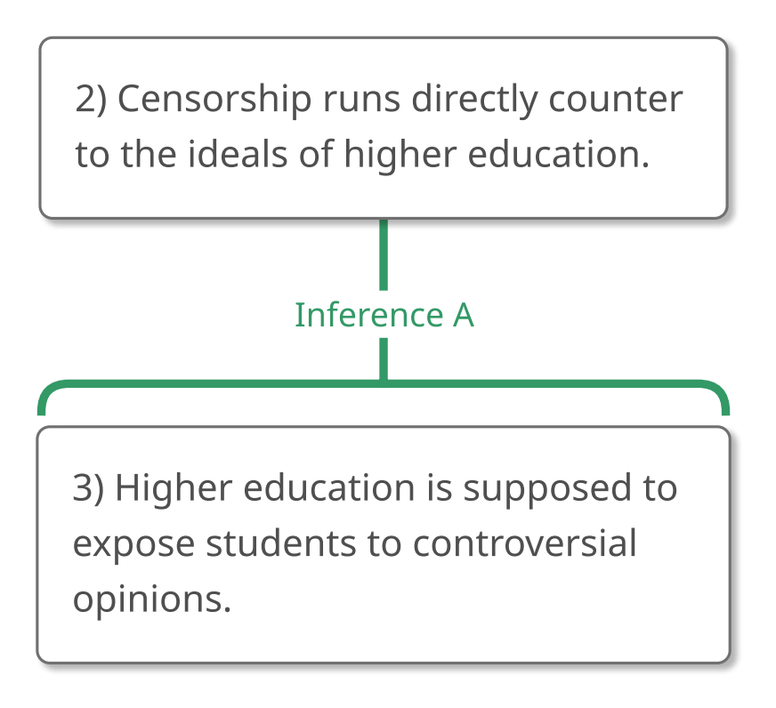
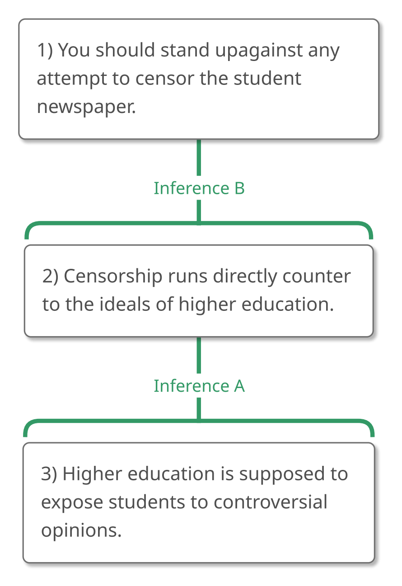
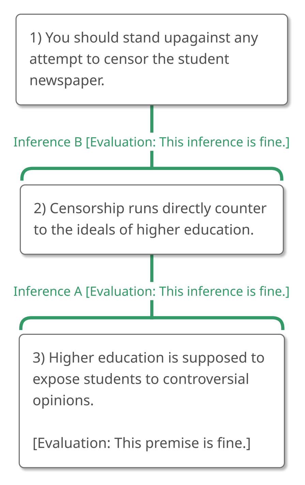

# 2.6 Example 5

## Step 1 – Recognizing an Argument

Here's another passage for us to consider:

> "Have you heard that some people want to remove offensive content from
> the student newspaper? Think about it! Censorship runs directly
> counter to the ideals of higher education! After all, isn't higher
> education supposed to expose students to controversial opinions? So
> stand up against any attempt to censor the student newspaper!"

**"What is that passage doing? Is it trying to convince us that something
is true?"**

I'd say that this passage contains an argument because it's trying to
convince us that something is true. But it's definitely different than
the arguments we've seen before, so let's take a closer look at it.

## Step 2 – Analyzing the Argument

As always, we'll start analyzing the argument by asking, **"What is the
ultimate conclusion, or the main claim that this argument is trying to
get us to believe?"**

The ultimate conclusion is, more or less, "Stand up against any
attempt to censor the student newspaper," because that's what the
argument is trying to convince us to do. (The conclusion indicator
expression, "so," can help us to see this.)

> "Have you heard that some people want to remove offensive content from
> the student newspaper? Think about it! Censorship runs directly
> counter to the ideals of higher education! After all, isn't higher
> education supposed to expose students to controversial opinions?
> **So** (1) stand up against any attempt to censor the student
> newspaper!"

But this *might* strike you as strange. After all, "stand up against any
attempt to censor the student newspaper" is a *command* sentence, and we
learned in Chapter 1 that normal commands don't really convey claims at
all since they can't be true or false. What's up?

Although command sentences *usually* don't convey claims, they
*sometimes* do. Sometimes a command is a way of conveying the claim that
someone *should* do a particular thing, or that a particular course of
action is the *right* one, in which case we have what we'll call a
"**statement command**," instead of a normal command that just instructs
us to do something.

When we're faced with a statement command, we'll rephrase it as a
"should" statement when we include it among our important claims. So,
instead of taking "stand up against any attempt to censor the student
newspaper" as our conclusion, we'll change it to "\[you should\] stand
up against any attempt to censor the student newspaper."

(The difference here is subtle but significant. If I said to you, "stand
up against any attempt to censor the student newspaper," you could
comply or refuse to comply but you couldn't really agree or disagree
with me. You couldn't say "True!" or "False!" to that. *However*, if I
said, "you should stand up against any attempt to censor the student
newspaper," I'm expressing a claim that you can accept or reject. It
makes perfect sense to say "True!" or "False!" to that.)

> "Have you heard that some people want to remove offensive content from
> the student newspaper? Think about it! Censorship runs directly
> counter to the ideals of higher education! After all, isn't higher
> education supposed to expose students to controversial opinions?
> **So** (1) \[you should\] stand up against any attempt to censor the
> student newspaper!"

This is the first time in this chapter that we've seen the ultimate
conclusion at the end of the passage. When the ultimate conclusion is at
the end of the passage, there is sometimes the temptation to analyze the
argument by looking at the claim *immediately before it* and asking,
"How is this related to the conclusion?" That puts us in the position of
reading the passage backwards, and that's almost always a tactical
mistake.

Passages are written to be understood from front to back, not back to
front, so after we've identified the ultimate conclusion, no matter
where that ultimate conclusion is, we **should return to the start of
the passage** and ask, **"What else is being claimed?"** and **"Are
those claims part of the argument?"**

Doing that, we see that the first sentence is a normal question. It doesn't
convey a claim at all. Neither does the second sentence, which is a
normal command (unlike the ultimate conclusion).

The third sentence, however, does convey a claim that's part of the
argument, so we'll give that number 2.

> "Have you heard that some people want to remove offensive content from
> the student newspaper? Think about it! (2) Censorship runs directly
> counter to the ideals of higher education! After all, isn't higher
> education supposed to expose students to controversial opinions? So
> (1) \[you should\] stand up against any attempt to censor the student
> newspaper!"

Now, what about the next sentence, "isn't higher education supposed to
expose students to controversial opinions?"

We might be inclined to ignore that sentence because it's a question and
because questions *usually* don't convey claims. As with command
sentences, however, *sometimes* they do. Sometimes a question isn't
really a question; instead, it's a coy way of asserting something
without coming right out and saying it. You're already familiar with
sentences like this. (Remember the last time someone said something to
you like "Are you *really* sure you want to wear that sweater with those
pants?"?) We'll call such rhetorical questions **"statement questions"**
to distinguish them from normal questions, and the sentence under
consideration is definitely like that. "Isn't higher education supposed
to expose students to controversial opinions?" is the author's way of
saying, "Higher education is supposed to expose students to
controversial opinions," so we'll indicate that this is the claim that
figures in the argument.

> "Have you heard that some people want to remove offensive content from
> the student newspaper? Think about it! (2) Censorship runs directly
> counter to the ideals of higher education! After all, isn't higher
> education supposed to expose students to controversial opinions? \[(3)
> Higher education is supposed to expose students to controversial
> opinions.\] So (1) \[you should\] stand up against any attempt to
> censor the student newspaper!"

We've now identified two claims that are part of the argument (not
counting the ultimate conclusion), so we can ask ourselves, **"How are
these claims related to each other?"**

Happily, the "after all," as a reason indicator, tells us that Claim 3 is
the reason supporting Claim 2.

> "Have you heard that some people want to remove offensive content from
> the student newspaper? Think about it! (2) Censorship runs directly
> counter to the ideals of higher education! **After all**, isn't higher
> education supposed to expose students to controversial opinions? \[(3)
> Higher education is supposed to expose students to controversial
> opinions.\] So (1) \[you should\] stand up against any attempt to
> censor the student newspaper!"

{#fig-2-6-partial-1 width=279px fig-alt="Argument map concluding: 2) Censorship runs directly counter to the ideals of higher education. A full text description is provided."}

::: {.map-outline fig="fig-2-6-partial-1"}

:::

With that part of the argument mapped, we can ask, **"How is this part
of the argument (the partial map) related to the ultimate conclusion?"**

The "so" tells us that Claim 1 is the conclusion of that piece of
reasoning. The argument, then, would be mapped like this:

> "Have you heard that some people want to remove offensive content from
> the student newspaper? Think about it! (2) Censorship runs directly
> counter to the ideals of higher education! After all, isn't higher
> education supposed to expose students to controversial opinions? \[(3)
> Higher education is supposed to expose students to controversial
> opinions.\] **So** (1) \[you should\] stand up against any attempt to
> censor the student newspaper!"

{#fig-2-6-full-1 width=285px fig-alt="Argument map concluding: 1) You should stand up against any attempt to censor the student newspaper. A full text description is provided."}

::: {.map-outline fig="fig-2-6-full-1"}

:::

## Step 3 – Evaluating the Argument

Because no claim strikes me as obviously wrong, I'll start at the top of
this argument and work my way down.

**Would a perfectly rational person who accepts Claim 2 be inclined to
accept Claim 1?** I think so. Inference B looks okay to me.

**Would a perfectly rational person who accepts Claim 3 be inclined to
accept Claim 2?** I think so. Inference A looks okay to me, too.

Now I'll look at Claim 3. **Is that premise true?** And **could it be
accepted by people who don't already believe the ultimate conclusion?**
I think so. I'd say that the premise is fine.

In short, I think this argument is fairly good.

{#fig-2-6-eval-1 width=286px fig-alt="Argument map concluding: 1) You should stand up against any attempt to censor the student newspaper, with both inferences and the premise evaluated as fine. A full text description is provided."}

::: {.map-outline fig="fig-2-6-eval-1"}

:::

And, of course, thinking that the argument is fairly good, I should be
inclined to accept the ultimate conclusion as well, which I do.

If you disagree with me about this evaluation of the argument, are you
absolutely wrong? No. There's *plenty* of room for reasonable people to
disagree about things like the purpose of higher education. That's what
makes conversations about such matters so fascinating. In these cases,
argument maps can help us to understand exactly *where* we disagree with
each other, and *why*. And that's no small thing, especially for larger,
more structurally complex pieces of reasoning.

### Skipping the Subconclusions

Because subconclusions are relatively new, let's take a moment to notice
something: I didn't evaluate the subconclusion, Claim 2, when I
evaluated the argument from top to bottom. Instead, I skipped it. Was
that an oversight? No.

**When we evaluate an argument from top to bottom, we should skip the
subconclusions.**

Here's why.

-   Suppose we think that a subconclusion is true. We'll need to
    evaluate the reasoning for it anyway, because the question isn't
    whether we think that a subconclusion is true but whether the
    argument has *established* that the subconclusion is true.

-   Suppose we think that a subconclusion is false. We'll need to
    evaluate the reasoning for it because we'll want to identify why the
    argument hasn't established that the subconclusion is true.

In either case, we'll need to evaluate the reasoning for the
subconclusion, so nothing is gained by evaluating the subconclusion
separately. (Of course, if we evaluate an argument by starting with a
claim that we think is false, that's different. If that's the strategy
we're using, disagreeing with a subconclusion can lead us to examine the
reasoning for that subconclusion, but even then, we don't stop our
evaluation with our objection to the subconclusion.)

## Summary of Example 5

Example 5 presented us with this passage:

> "Have you heard that some people want to remove offensive content from
> the student newspaper? Think about it! Censorship runs directly
> counter to the ideals of higher education! After all, isn't higher
> education supposed to expose students to controversial opinions? So
> stand up against any attempt to censor the student newspaper!"

### Step 1 – Recognizing an Argument

We began by asking, **"What is this passage doing? Is it trying to
convince us that something is true?"** and we decided that this passage
was, in fact, trying to convince us of something. It's an argument.

### Step 2 – Analyzing the Argument

We started our analysis of this argument by asking, **"What is the
ultimate conclusion, or the main claim that this argument is trying to
get us to believe?"**

We decided that the ultimate conclusion was the claim that we should
stand up against any attempt to censor the student newspaper. "Stand up
against any attempt to censor the student newspaper!" was, as we saw, a
statement command, so we rephrased it.

> "Have you heard that some people want to remove offensive content from
> the student newspaper? Think about it! Censorship runs directly
> counter to the ideals of higher education! After all, isn't higher
> education supposed to expose students to controversial opinions?
> **So** (1) stand up against any attempt to censor the student
> newspaper!"

We returned to the beginning of the passage, resisting the temptation to
read backward from the ultimate conclusion, and asking, **"What else is
being claimed?"** and **"Are those claims part of the argument?"**

We decided to ignore the first two sentences, but include the third.

> "Have you heard that some people want to remove offensive content from
> the student newspaper? Think about it! (2) Censorship runs directly
> counter to the ideals of higher education! After all, isn't higher
> education supposed to expose students to controversial opinions? So
> (1) \[you should\] stand up against any attempt to censor the student
> newspaper!"

We also decided that "After all, isn't higher education supposed to
expose students to controversial opinions?" isn't a genuine question. It
is, instead, a statement question that conveys a claim, so we rephrased
it and included that claim in the argument.

> "Have you heard that some people want to remove offensive content from
> the student newspaper? Think about it! (2) Censorship runs directly
> counter to the ideals of higher education! After all, isn't higher
> education supposed to expose students to controversial opinions? \[(3)
> Higher education is supposed to expose students to controversial
> opinions.\] So (1) \[you should\] stand up against any attempt to
> censor the student newspaper!"

Looking at Claims 2 and 3, we asked, **"How are these claims related to
each other?"**

The "After all" allowed us to see that Claim 3 is the reason supporting
Claim 2.

{#fig-2-6-partial-2 width=279px fig-alt="Argument map concluding: 2) Censorship runs directly counter to the ideals of higher education. A full text description is provided."}

::: {.map-outline fig="fig-2-6-partial-2"}

:::

Then we asked, **"How is this part of the argument (the partial map)
related to the ultimate conclusion?"** And the "So" helped us to see
that the unit of reasoning supports the ultimate conclusion.

> "Have you heard that some people want to remove offensive content from
> the student newspaper? Think about it! (2) Censorship runs directly
> counter to the ideals of higher education! After all, isn't higher
> education supposed to expose students to controversial opinions? \[(3)
> Higher education is supposed to expose students to controversial
> opinions.\] **So** (1) \[you should\] stand up against any attempt to
> censor the student newspaper!"

{#fig-2-6-full-2 width=285px fig-alt="Argument map concluding: 1) You should stand up against any attempt to censor the student newspaper. A full text description is provided."}

::: {.map-outline fig="fig-2-6-full-2"}

:::

### Step 3 – Evaluating the Argument

Because no claim struck us as obviously wrong, we started at the top of
this argument and worked our way down.

Inference B, Inference A, and Premise 3 all seemed fine, which led us to
decide that the argument was good as a whole.

{#fig-2-6-eval-2 width=286px fig-alt="Argument map concluding: 1) You should stand up against any attempt to censor the student newspaper, with both inferences and the premise evaluated as fine. A full text description is provided."}

::: {.map-outline fig="fig-2-6-eval-2"}

:::

We didn't need to evaluate the subconclusion as a separate step because
whether or not we agree with the subconclusion, we'll need to evaluate
the reasoning supporting it.
