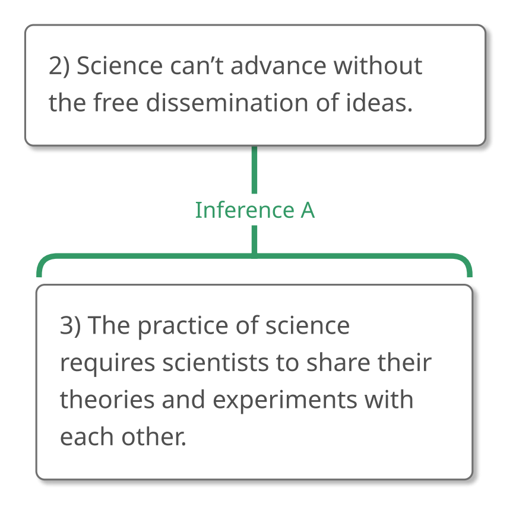
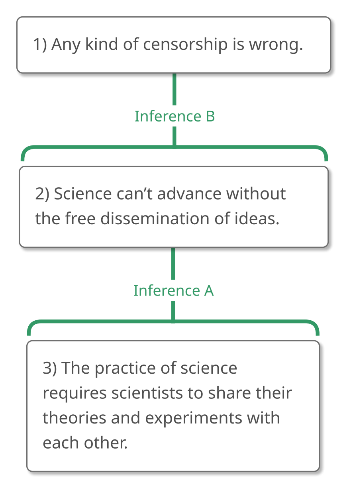
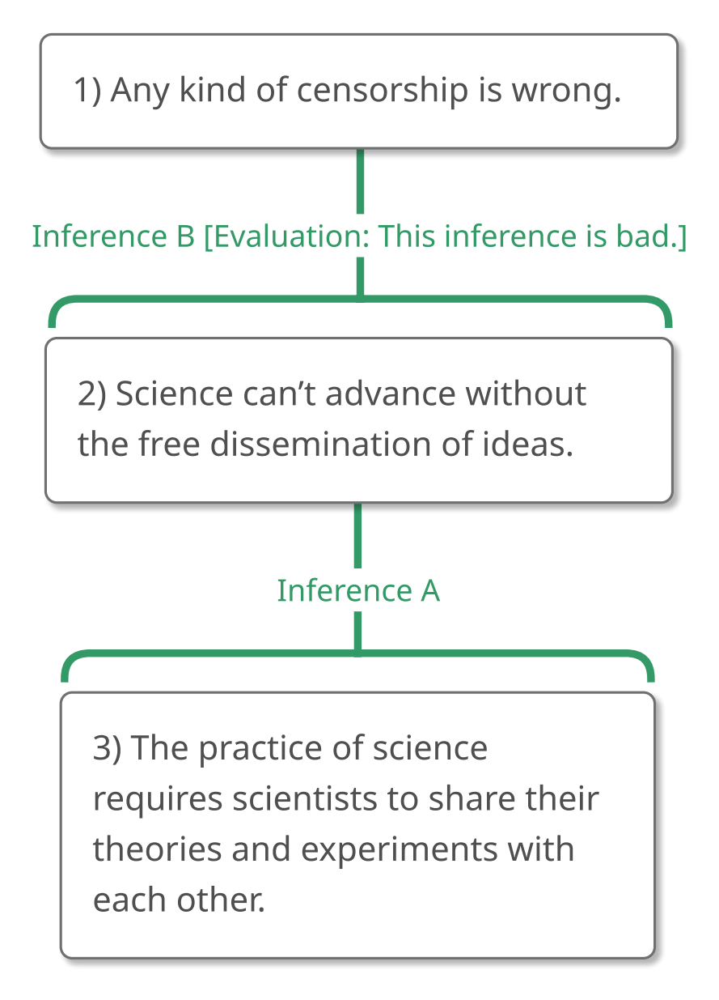

# 2.7 Example 6

## Step 1 – Recognizing an Argument

What do you think about the following passage? **"What is this passage
doing? Is it trying to convince us that something is true?"**

> "Anyone would be stupid to think that science can advance without the
> free dissemination of ideas since the practice of science requires
> scientists to share their theories and experiments with each other.
> Therefore any kind of censorship is wrong."

It looks to me like the passage is trying to convince us that something
is true and so contains an argument. Let's analyze it.

## Step 2 – Analyzing the Argument

**"What is the ultimate conclusion, or the main claim that this argument
is trying to get us to believe?"**

I'd say that the ultimate conclusion is "Any kind of censorship is
wrong," so let's give that 1.

> "Anyone would be stupid to think that science can advance without the
> free dissemination of ideas since the practice of science requires
> scientists to share their theories and experiments with each other.
> Therefore (1) any kind of censorship is wrong."

Now that we've identified the ultimate conclusion, we can return to the
beginning of the passage and ask, **"What else is being claimed?"** And
**"Are those claims part of the argument?"**

When trying to decide if the first sentence conveys an important claim,
we notice the reason indicator expression "since."

> "Anyone would be stupid to think that science can advance without the
> free dissemination of ideas **since** the practice of science requires
> scientists to share their theories and experiments with each other.
> Therefore (1) any kind of censorship is wrong."

This tells us that the second part of the sentence is being given as a
reason to believe the first part of the sentence, so both parts of the
sentence are parts of the argument.

> "(2) Anyone would be stupid to think that science can advance without
> the free dissemination of ideas **since** (3) the practice of science
> requires scientists to share their theories and experiments with each
> other. Therefore (1) any kind of censorship is wrong."

But is the claim conveyed by the first part of the sentence *exactly
what the sentence says*? I don't think so. It seems to me that the
important claim conveyed by the first part of the sentence *isn't* the
assertion that everyone who believes that science can advance without
unrestricted communication must suffer from a lack of intelligence. The
important claim conveyed by the first sentence is something *else*,
something like "Science can't advance without the free dissemination of
ideas," so let's take that as the important claim conveyed by the first
part of the sentence.

> "Anyone would be stupid to think that science can advance without the
> free dissemination of ideas \[(2) Science can't advance without the
> free dissemination of ideas.\] **since** (3) the practice of science
> requires scientists to share their theories and experiments with each
> other. Therefore (1) any kind of censorship is wrong."

Would it have been *wrong* to take Claim 2 to be exactly what the
sentence says, i.e., "Anyone would be stupid to think that science can
advance without the free dissemination of ideas"? Maybe not. But **it is
a good practice to identify the claim that is conveyed by a sentence and
to take *that claim* as part of the argument—especially when the
wording of the original sentence could be confusing or inflammatory**.
This is because we want to evaluate an argument on the strength of its
reasoning, and not on the clarity or diplomacy of its author. It is, of
course, entirely appropriate (and often very important) to evaluate the
way that an argument is expressed. It's just not the same thing as
evaluating the argument itself.

Now that we've identified two claims that are part of the argument (not
counting the ultimate conclusion, which we're saving for later), we can
ask ourselves **"How are these claims related to each other?"**

As often happens, an inference indicator expression is there to help us.
The "since" tells us that Claim 3 is a reason to believe Claim 2.

> "Anyone would be stupid to think that science can advance without the
> free dissemination of ideas \[(2) Science can't advance without the
> free dissemination of ideas.\] **since** (3) the practice of science
> requires scientists to share their theories and experiments with each
> other. Therefore (1) any kind of censorship is wrong."

{#fig-2-7-partial-1 width=278px fig-alt="Argument map concluding: 2) Science can't advance without the free dissemination of ideas. A full text description is provided."}

::: {.map-outline fig="fig-2-7-partial-1"}

:::

With this partial map in hand, we can ask, **"How is this part of the
argument related to the ultimate conclusion?"** The "therefore" tells us
that the ultimate conclusion follows from that piece of reasoning. This
gives us the following map:

> "Anyone would be stupid to think that science can advance without the
> free dissemination of ideas \[(2) Science can't advance without the
> free dissemination of ideas.\] since (3) the practice of science
> requires scientists to share their theories and experiments with each
> other. **Therefore** (1) any kind of censorship is wrong."

{#fig-2-7-full-1 width=282px fig-alt="Argument map concluding: 1) Any kind of censorship is wrong. A full text description is provided."}

::: {.map-outline fig="fig-2-7-full-1"}

:::

## Step 3 – Evaluating the Argument

Now that we've mapped the argument, we are ready to evaluate it!

Let's assume that nothing strikes us as particularly bad about the
argument and so let's evaluate the argument a piece at a time, working
downward from the ultimate conclusion.

The first thing that we'll want to evaluate, then, is Inference B. We'll
do that by asking, **"If a perfectly gullible, perfectly rational person
(Gully) believes Claim 2 ('science can't advance without the free
dissemination of ideas'), how likely is that person to accept Claim 1
('any kind of censorship is wrong') on that basis?"**

It looks to me like Gully could believe that science can't advance
without the free dissemination of ideas (Claim 2) and still not accept
that any kind of censorship is wrong (Claim 1). Perhaps Gully
appreciates the importance of science, and so would disapprove of
censorship in *that* arena, but thinks that the free dissemination of
ideas in scientific circles can peacefully coexist with censorship in
other areas. Couldn't we let scientists freely publish their results and
still censor other things, like pornography?

This shows that Inference B is bad, and because this prevents the
argument from establishing the conclusion, we know that the argument is
bad as a whole.

> "Anyone would be stupid to think that science can advance without the
> free dissemination of ideas \[(2) Science can't advance without the
> free dissemination of ideas.\] since (3) the practice of science
> requires scientists to share their theories and experiments with each
> other. Therefore (1) any kind of censorship is wrong."

{#fig-2-7-eval-1 width=284px fig-alt="Argument map concluding: 1) Any kind of censorship is wrong, with Inference B evaluated as bad. A full text description is provided."}

::: {.map-outline fig="fig-2-7-eval-1"}

:::

If the purpose of our evaluation is to decide whether or not the
argument is good, we're done!

(Of course, if the purpose of our evaluation is to find points of
agreement and disagreement with the author, or to give the author the
best possible feedback, then we should evaluate Inference A and the
premise as well. But if all we want to know is whether or not we should
be convinced by this reasoning, we can stop at this point and turn our
attention to other things. Life, after all, is both busy and short.)

## Summary of Example 6

In this example, we examined the following passage:

> "Anyone would be stupid to think that science can advance without the
> free dissemination of ideas since the practice of science requires
> scientists to share their theories and experiments with each other.
> Therefore any kind of censorship is wrong."

### Step 1 – Recognizing an Argument

We began by asking, **"What is this passage doing? Is it trying to
convince us that something is true?"** and we decided that this passage
was trying to convince us of something. It's an argument.

### Step 2 – Analyzing the Argument

We started our analysis of this argument by asking, **"What is the
ultimate conclusion, or the main claim that this argument is trying to
get us to believe?"** We decided that the ultimate conclusion was "any
kind of censorship is wrong."

> "Anyone would be stupid to think that science can advance without the
> free dissemination of ideas since the practice of science requires
> scientists to share their theories and experiments with each other.
> Therefore (1) any kind of censorship is wrong."

Asking, **"What else is being claimed?"** and **"Are those claims part
of the argument?"**, we noted that the first sentence contains the
inference indicator word "since," leading us to divide that sentence
into parts.

> "Anyone would be stupid to think that science can advance without the
> free dissemination of ideas **since** the practice of science requires
> scientists to share their theories and experiments with each other.
> Therefore (1) any kind of censorship is wrong."

We rephrased the first part of the sentence to better capture the claim
that it was conveying.

> "Anyone would be stupid to think that science can advance without the
> free dissemination of ideas \[(2) Science can't advance without the
> free dissemination of ideas.\] **since** (3) the practice of science
> requires scientists to share their theories and experiments with each
> other. Therefore (1) any kind of censorship is wrong."

Looking at Claims 2 and 3, we asked **"How are these claims related to
each other?"** The "since" told us that Claim 3 is a reason to believe
Claim 2.

{#fig-2-7-partial-2 width=278px fig-alt="Argument map concluding: 2) Science can't advance without the free dissemination of ideas. A full text description is provided."}

::: {.map-outline fig="fig-2-7-partial-2"}

:::

We then asked, **"How is this part of the argument related to the
ultimate conclusion?"** The "therefore" told us that the ultimate
conclusion followed from the piece of reasoning that we'd already
mapped.

> "Anyone would be stupid to think that science can advance without the
> free dissemination of ideas \[(2) Science can't advance without the
> free dissemination of ideas.\] since (3) the practice of science
> requires scientists to share their theories and experiments with each
> other. **Therefore** (1) any kind of censorship is wrong."

{#fig-2-7-full-2 width=282px fig-alt="Argument map concluding: 1) Any kind of censorship is wrong. A full text description is provided."}

::: {.map-outline fig="fig-2-7-full-2"}

:::

### Step 3 – Evaluating the Argument

We decided to evaluate this argument from the ultimate conclusion on
down, starting with Inference B, so we asked **"If a perfectly gullible,
perfectly rational person (Gully) believes Claim 2 ('science can't
advance without the free dissemination of ideas'), how likely is that
person to accept Claim 1 ('any kind of censorship is wrong') on that
basis?"**

We decided that Gully could believe Claim 2 without accepting Claim 1,
making Inference B bad. And this is enough to make the argument bad as
a whole, because it prevents us from safely reaching the conclusion of the
argument.

> "Anyone would be stupid to think that science can advance without the
> free dissemination of ideas \[(2) Science can't advance without the
> free dissemination of ideas.\] since (3) the practice of science
> requires scientists to share their theories and experiments with each
> other. Therefore (1) any kind of censorship is wrong."

{#fig-2-7-eval-2 width=284px fig-alt="Argument map concluding: 1) Any kind of censorship is wrong, with Inference B evaluated as bad. A full text description is provided."}

::: {.map-outline fig="fig-2-7-eval-2"}

:::
