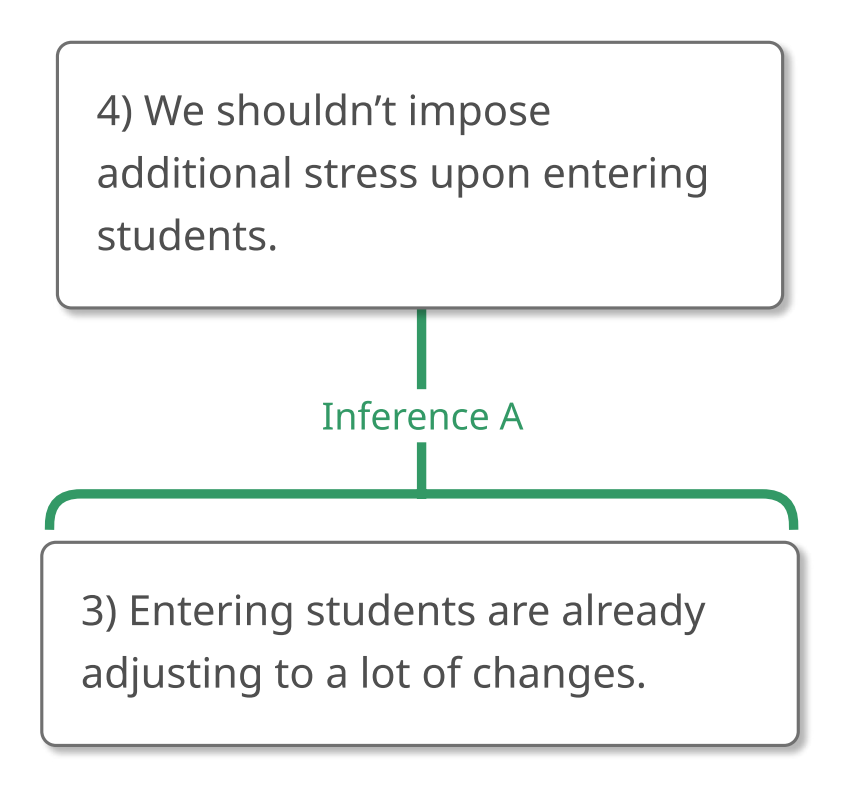
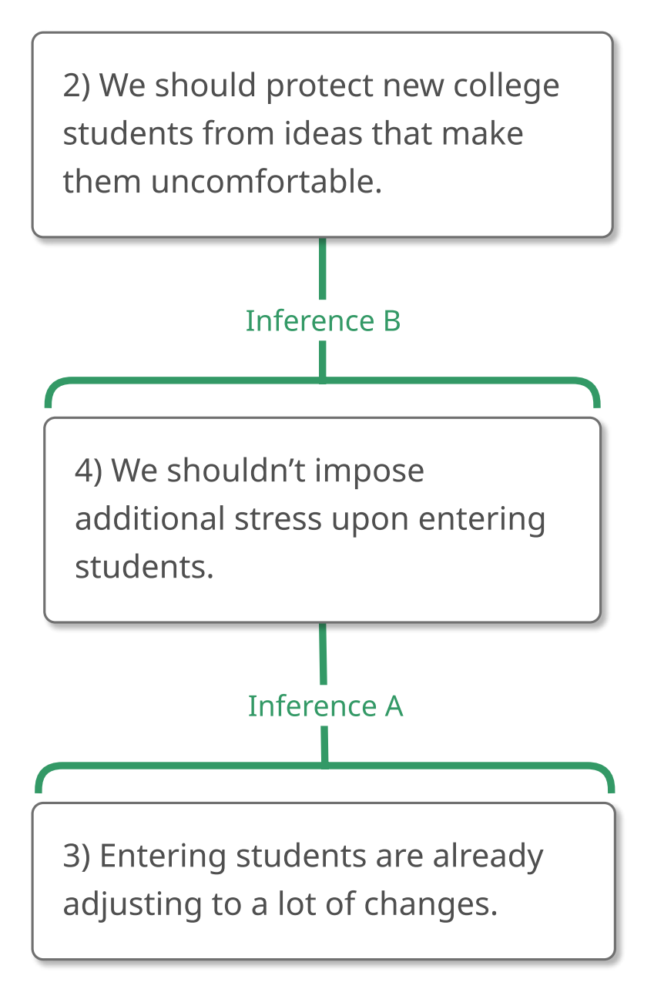
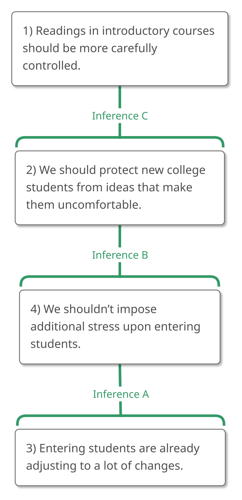
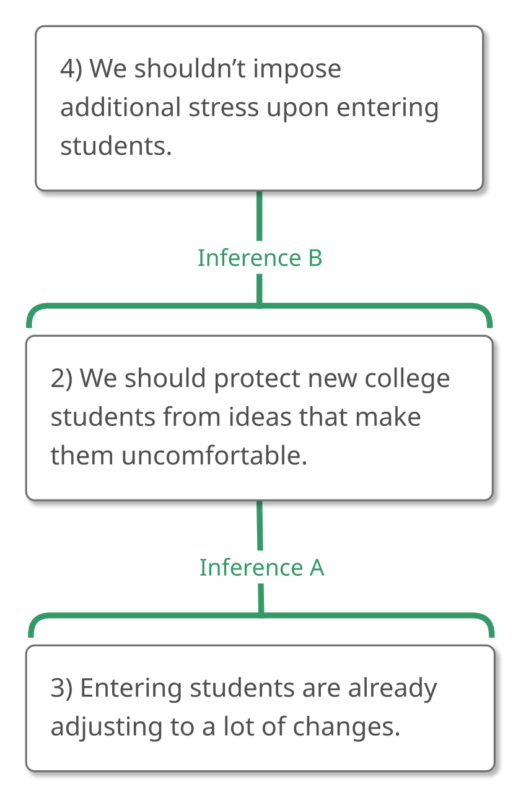
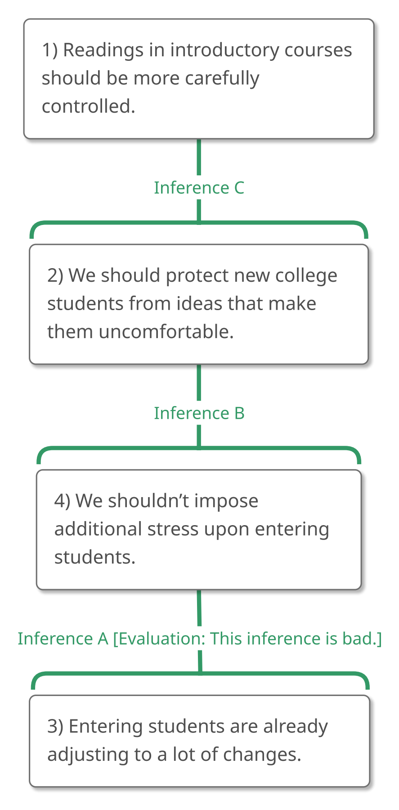

# 2.8 Example 7

## Step 1 – Recognizing an Argument

Here's the longest passage we've seen yet! **"What is the passage doing?
Is it trying to convince us that something is true?"**

> "Picture this. You're away from home for the first time. You're
> struggling to get settled in the dorm. You've just written the largest
> check of your life to cover your tuition. And now you're sitting in
> your Introduction to Philosophy class reading David Hume and having
> your religious faith challenged. It can't be denied that censorship is
> generally a bad thing, but should faculty be allowed to teach whatever
> they want at the 100-level? I, for one, think that readings in
> introductory courses should be more carefully controlled because we
> should protect new college students from ideas that make them
> uncomfortable. After all, entering students are already adjusting to a
> lot of changes and so we shouldn't impose additional stress upon
> them."

It looks to me like this passage is trying to convince us of something,
so I'd say that it contains an argument. Let's analyze it.

## Step 2 – Analyzing the Argument

**"What is the ultimate conclusion, or the main claim that this argument
is trying to get us to believe?"**

> "Picture this. You're away from home for the first time. You're
> struggling to get settled in the dorm. You've just written the largest
> check of your life to cover your tuition. And now you're sitting in
> your Introduction to Philosophy class reading David Hume and having
> your religious faith challenged. It can't be denied that censorship is
> generally a bad thing, but should faculty be allowed to teach whatever
> they want at the 100-level? I, for one, think that readings in
> introductory courses should be more carefully controlled because we
> should protect new college students from ideas that make them
> uncomfortable. After all, entering students are already adjusting to a
> lot of changes and so we shouldn't impose additional stress upon
> them."

As passages get longer and more complex, it can become increasingly
difficult to identify the ultimate conclusions. In such cases, it's
helpful to utilize clues that the author gives us. One such clue, as we
briefly saw in Example 2, is the question that the author poses. It's
not uncommon for an author to pose a question and then take the answer
to that question as the ultimate conclusion of the argument. That's
what's happening here. The author asks the question, "Should faculty be
allowed to teach whatever they want at the 100-level?" and answers
"readings in introductory courses should be more carefully controlled."
That answer, then, is probably the ultimate conclusion of the argument.

> "Picture this. You're away from home for the first time. You're
> struggling to get settled in the dorm. You've just written the largest
> check of your life to cover your tuition. And now you're sitting in
> your Introduction to Philosophy class reading David Hume and having
> your religious faith challenged. It can't be denied that censorship is
> generally a bad thing, but should faculty be allowed to teach whatever
> they want at the 100-level? I, for one, think that (1) readings in
> introductory courses should be more carefully controlled because we
> should protect new college students from ideas that make them
> uncomfortable. After all, entering students are already adjusting to a
> lot of changes and so we shouldn't impose additional stress upon
> them."

(Note that I didn't include "I think that" as part of the conclusion
because the author isn't trying to convince us that they think
something. Instead, the author is trying to convince us that the content
of their thought is true so that's what I identified as the ultimate
conclusion. Note, too, that I stopped at the "because." This is because
inference indicator expressions introduce new claims. We'll always
divide sentences around inference indicators.)

Now, **"What else is being claimed?"** And **"Are those claims part of
the argument?"**

The first sentence, "Picture this," is a command. If it's included in
our list, we'll need to rephrase it as a statement, presumably "You
should picture this." But it doesn't seem to us as though "You should
picture this" is playing any argumentative role here. "Picture this" is
a normal command, so we'll leave it out.

Let's consider the next four sentences as a group since they seem to
belong together.

> "Picture this. *You're away from home for the first time. You're
> struggling to get settled in the dorm. You've just written the largest
> check of your life to cover your tuition. And now you're sitting in
> your Introduction to Philosophy class reading David Hume and having
> your religious faith challenged*. It can't be denied that censorship
> is generally a bad thing, but should faculty be allowed to teach
> whatever they want at the 100-level? I, for one, think that (1)
> readings in introductory courses should be more carefully controlled
> because we should protect new college students from ideas that make
> them uncomfortable. After all, entering students are already adjusting
> to a lot of changes and so we shouldn't impose additional stress upon
> them."

It seems to me as though the role played by these sentences isn't
primarily *argumentative* in our sense of "argumentative." They aren't
being given as evidence for anything. Instead, the sentences, from
"You're away from home for the first time" through "And now you're
sitting in your Introduction to Philosophy class reading David Hume and
having your religious faith challenged," serve a primarily *emotional*
purpose. They're designed to make us empathize with the plight of
college students in the hope that this will lead us to view the ultimate
conclusion of this argument more favorably, but emotional appeals
shouldn't be confused with rational persuasion. Emotions are important,
but they can't serve as evidence for the objective truth of anything (at
least not without some further argument linking emotion to truth). This
means that we won't include these sentences in our argument.

(By the way, the practice of omitting emotionally charged sentences from
our list of claims carries the important implication that such language
doesn't affect the worth of the argument at all. It's easy to think that
an argument is better than it actually is simply because its emotionally
loaded language sweeps its audience toward the conclusion. It's also
easy to think that an argument is worse than it actually is simply
because it makes an insultingly obvious appeal to the emotions. Now you
can see why both tendencies are mistaken. Since the emotional language
*disappears* from claims, it disappears from the map as well. And since
the evaluation of an argument is solely a function of its map, this
evaluation is unaffected by any appeals to emotions in the original
passage. Such appeals may be wise or unwise, offensive or inoffensive,
effective or ineffective from a purely psychological point of view, but
they can't make an argument good or bad.)

So, we've agreed to ignore the first five sentences in the passage. This
brings us to "It can't be denied that censorship is generally a bad
thing, but should faculty be allowed to teach whatever they want at the
100-level?"

> "Picture this. You're away from home for the first time. You're
> struggling to get settled in the dorm. You've just written the largest
> check of your life to cover your tuition. And now you're sitting in
> your Introduction to Philosophy class reading David Hume and having
> your religious faith challenged. *It can't be denied that censorship
> is generally a bad thing, but should faculty be allowed to teach
> whatever they want at the 100-level?* I, for one, think that (1)
> readings in introductory courses should be more carefully controlled
> because we should protect new college students from ideas that make
> them uncomfortable. After all, entering students are already adjusting
> to a lot of changes and so we shouldn't impose additional stress upon
> them."

The first part of the sentence "It can't be denied that censorship is
generally a bad thing," might look like it's part of the argument
because it anticipates resistance to the conclusion. It's not at all
uncommon for authors to start their arguments in this way, saying
something like "I know that lots of people say X, but let me tell you
why X is wrong..." Generally speaking, an acknowledgment that people
might oppose the ultimate conclusion is not part of the argument. It
just motivates the need for the argument. (That's handy to remember.)

The second part of that sentence, of course, is the question that the
conclusion answers. It's not really part of the argument either. We can,
then, ignore the entire sentence.

The next claim in the argument is "we should protect new college
students from ideas that make them uncomfortable," and we know that's
important since it's introduced with the reason indicator expression
"because."

> "Picture this. You're away from home for the first time. You're
> struggling to get settled in the dorm. You've just written the largest
> check of your life to cover your tuition. And now you're sitting in
> your Introduction to Philosophy class reading David Hume and having
> your religious faith challenged. It can't be denied that censorship is
> generally a bad thing, but should faculty be allowed to teach whatever
> they want at the 100-level? I, for one, think that (1) readings in
> introductory courses should be more carefully controlled because (2)
> we should protect new college students from ideas that make them
> uncomfortable. After all, entering students are already adjusting to a
> lot of changes and so we shouldn't impose additional stress upon
> them."

At this point, it might be tempting to draw the connection between Claim
2 and Claim 1 that is indicated by "because." *Resist that temptation!*
Remember, inference indicator expressions attached to the ultimate
conclusion can be deceptive. That's why we don't pay much attention to
them.

Although we try to identify the ultimate conclusion first, we won't
*map* it first. We will, instead, continue to hunt for the next claim,
and we might naturally see that the next sentence contains two claims
connected with the inference indicator expression "and so."

> "Picture this. You're away from home for the first time. You're
> struggling to get settled in the dorm. You've just written the largest
> check of your life to cover your tuition. And now you're sitting in
> your Introduction to Philosophy class reading David Hume and having
> your religious faith challenged. It can't be denied that censorship is
> generally a bad thing, but should faculty be allowed to teach whatever
> they want at the 100-level? I, for one, think that (1) readings in
> introductory courses should be more carefully controlled because (2)
> we should protect new college students from ideas that make them
> uncomfortable. After all, (3) entering students are already adjusting
> to a lot of changes and so (4) we shouldn't impose additional stress
> upon them."

As a general principle, if, in the process of identifying claims, we
encounter an inference indicator expression not attached to the ultimate
conclusion, we'll want to represent that relationship right away. In
this case, because "and so" is a conclusion indicator, Claim 3 is
supporting Claim 4.

{#fig-2-8-partial1-1 width=272px fig-alt="Argument map concluding: 4) We shouldn't impose additional stress upon entering students. A full text description is provided."}

::: {.map-outline fig="fig-2-8-partial1-1"}

:::

Now, of course, we can ask, **"How is this part of the argument related
to what has gone before?"** How, in other words, is the unit of
reasoning comprised of Claim 3 and Claim 4 related to Claim 2?

The inference indicator expression that can help us to see this
connection is "after all." It works like "because," which means that the
unit composed of Claim 3 and Claim 4 is being given as a reason to
believe Claim 2.

> "Picture this. You're away from home for the first time. You're
> struggling to get settled in the dorm. You've just written the largest
> check of your life to cover your tuition. And now you're sitting in
> your Introduction to Philosophy class reading David Hume and having
> your religious faith challenged. It can't be denied that censorship is
> generally a bad thing, but should faculty be allowed to teach whatever
> they want at the 100-level? I, for one, think that (1) readings in
> introductory courses should be more carefully controlled because (2)
> we should protect new college students from ideas that make them
> uncomfortable. After all, (3) entering students are already adjusting
> to a lot of changes and so (4) we shouldn't impose additional stress
> upon them."

{#fig-2-8-partial2-1 width=272px fig-alt="Argument map concluding: 2) We should protect new college students from ideas that make them uncomfortable. A full text description is provided."}

::: {.map-outline fig="fig-2-8-partial2-1"}

:::

And, finally, we can see how all of this goes to support the ultimate
conclusion, Claim 1!

> "Picture this. You're away from home for the first time. You're
> struggling to get settled in the dorm. You've just written the largest
> check of your life to cover your tuition. And now you're sitting in
> your Introduction to Philosophy class reading David Hume and having
> your religious faith challenged. It can't be denied that censorship is
> generally a bad thing, but should faculty be allowed to teach whatever
> they want at the 100-level? I, for one, think that (1) readings in
> introductory courses should be more carefully controlled because (2)
> we should protect new college students from ideas that make them
> uncomfortable. After all, (3) entering students are already adjusting
> to a lot of changes and so (4) we shouldn't impose additional stress
> upon them."

{#fig-2-8-full-1 width=279px fig-alt="Argument map concluding: 1) Readings in introductory courses should be more carefully controlled. A full text description is provided."}

::: {.map-outline fig="fig-2-8-full-1"}

:::

Now *that* was a challenge, so let's talk about it a bit.

Because identifying inferences can be tricky, **it's nice to
double-check our inferences by reading *down* the inference lines with a
*reason indicator expression* like "because."**

Here's what that would give us for this map:

-   Inference C: "(1) readings in introductory courses should be more
    carefully controlled **because** (2) we should protect new college
    students from ideas that make them uncomfortable." That makes sense
    and (perfectly!) corresponds to what the passage is saying so
    Inference C is probably correctly identified.

-   Inference B: "(2) we should protect new college students from ideas
    that make them uncomfortable **because** (4) we shouldn't impose
    additional stress upon entering students." That makes sense and
    seems to be what the passage has in mind, so Inference B is probably
    correctly identified too.

-   Inference A: "(4) we shouldn't impose additional stress upon
    entering students **because** (3) entering students are already
    adjusting to a lot of changes." That makes sense as well and
    captures the meaning of the passage, so it looks like Inference A is
    correctly identified.

Two words of caution here:

1.  It's important to remember that this is only testing our
    *identification* of the inference. **We're using it to determine
    whether or not our map of the argument makes sense, not whether or
    not the inferences are good**.

2.  **We shouldn't depend too much on this test because sometimes
    reading down the inference with "because" makes sense even though
    it's not the inference that the author of the argument had in
    mind**. Accordingly, it's always a good idea to check our inferences
    against the original argument, but reading down the lines is a very
    good "first pass" and if our inferences don't make sense when we do
    this, we can be pretty sure that we made a mistake somewhere.

Using this test can help us answer a question you might have: Why didn't
we map the "after all" between Claims 2 and 3 before we mapped the "and
so" between Claims 3 and 4? In part, we mapped the connection between
Claims 3 and 4 first because they were in the same sentence, but "map
claims in the same sentence first" isn't a reliable guide. At most, it's
a rule of thumb. Instead, I mapped the connection between Claims 3 and 4
first because I anticipated that mapping the connection between Claims 2
and 3 first would get me into trouble. Take a look at the passage again:

> "Picture this. You're away from home for the first time. You're
> struggling to get settled in the dorm. You've just written the largest
> check of your life to cover your tuition. And now you're sitting in
> your Introduction to Philosophy class reading David Hume and having
> your religious faith challenged. It can't be denied that censorship is
> generally a bad thing, but should faculty be allowed to teach whatever
> they want at the 100-level? I, for one, think that (1) readings in
> introductory courses should be more carefully controlled because (2)
> we should protect new college students from ideas that make them
> uncomfortable. After all, (3) entering students are already adjusting
> to a lot of changes and so (4) we shouldn't impose additional stress
> upon them."

If I mapped the "after all" first, Claim 3 would be a reason for Claim
2. The "and so" would then have Claim 4 following from Claim 2. I'd get
this map:

{#fig-2-8-mistake-1 width=272px fig-alt="Argument map concluding: 4) We shouldn't impose additional stress upon entering students, supported by Claim 2, which is supported by Claim 3. A full text description is provided."}

::: {.map-outline fig="fig-2-8-mistake-1"}

:::

Reading down the new Inference B with "because" would get me this: "(4)
we shouldn't impose additional stress upon them **because** (2) we
should protect new college students from ideas that make them
uncomfortable." That sounds wrong. Wouldn't Claim 4 be a reason to
believe Claim 2, rather than the other way around?

Of course, I saw that because I did some of the mapping, including
double-checking the inferences, in my head. And I could do some of this
work in my head because I've had a *lot of practice* mapping arguments.
If I'd had less practice, I might have generated the map above, noticed
that Inference B sounded wrong, and then tried something else. That's
perfectly fine. In the process of repairing that error, I would come to
a better understanding of the argument.

**Being able to map an argument is important because it
helps us to understand the argument better**. This may not have been
obvious in Chapter 1, where the arguments were structurally simple and
we might not have *needed* to map the arguments in order to see how they
worked. As we start looking at more intricate pieces of reasoning,
though, we'll find that the mapping process is an important aid to
comprehension.

## Step 3 – Evaluating the Argument

We're finally ready to evaluate this argument! Since this is a longish
argument, let's see if anything jumps out at us.

> "Picture this. You're away from home for the first time. You're
> struggling to get settled in the dorm. You've just written the largest
> check of your life to cover your tuition. And now you're sitting in
> your Introduction to Philosophy class reading David Hume and having
> your religious faith challenged. It can't be denied that censorship is
> generally a bad thing, but should faculty be allowed to teach whatever
> they want at the 100-level? I, for one, think that (1) readings in
> introductory courses should be more carefully controlled because (2)
> we should protect new college students from ideas that make them
> uncomfortable. After all, (3) entering students are already adjusting
> to a lot of changes and so (4) we shouldn't impose additional stress
> upon them."

{#fig-2-8-full-2 width=279px fig-alt="Argument map concluding: 1) Readings in introductory courses should be more carefully controlled. A full text description is provided."}

::: {.map-outline fig="fig-2-8-full-2"}

:::

Reading this argument, we might be inclined to object to Claim 2, the
assertion that we should protect new college students from ideas that
make them uncomfortable. Furthermore, we might even know exactly what
we'd *say* to that: "An important *purpose* of college is to equip
students with skills that will allow them to productively grapple with
ideas that might make them uncomfortable!"

But here's the thing: Before we just say that and walk away, we need to
be sure that we're engaging with the claims in the right way. Is Claim 2
a premise, something that the author just expects us to accept? No. It's
a subconclusion, something that the author is trying to *convince us
of*. This means that we shouldn't simply reject Claim 2 out of hand. We
should instead address the reasoning that the author advances for it. We
should "look down" and see what part of the reasoning for Claim 2 is
targeted by our natural objection.

Let's start with Claim 4, the claim that immediately supports Claim 2.
Do we appear to be disagreeing with that? I think so, actually. We're
denying that it's always wrong to impose additional stress on new
students. But, of course, Claim 4 is a subconclusion *too*, so we need
to keep our objection in mind as we inspect the reasoning that is being
offered for *it*.

Let's look at Claim 3, the claim that immediately supports Claim 4. Do
we appear to be disagreeing with it? I don't think so. We're not denying
that entering students are adjusting to a lot of changes. We're simply
saying that Claim 4 doesn't *follow from* this, because sometimes the
imposition of additional stress is justified. And *now* we have traced
our initial reaction to Claim 2 to its source. We object to Inference A!
And this is enough to undermine the argument as a whole.

{#fig-2-8-eval-1 width=284px fig-alt="Argument map concluding: 1) Readings in introductory courses should be more carefully controlled, with Inference A evaluated as bad. A full text description is provided."}

::: {.map-outline fig="fig-2-8-eval-1"}

:::

Of course, it doesn't follow from this that the conclusion is false.
Maybe readings for introductory courses should be controlled for other
reasons. This argument doesn't give us any reason to accept or reject
the conclusion itself.

## Summary of Example 7

In this example, we were faced with the following passage:

> "Picture this. You're away from home for the first time. You're
> struggling to get settled in the dorm. You've just written the largest
> check of your life to cover your tuition. And now you're sitting in
> your Introduction to Philosophy class reading David Hume and having
> your religious faith challenged. It can't be denied that censorship is
> generally a bad thing, but should faculty be allowed to teach whatever
> they want at the 100-level? I, for one, think that readings in
> introductory courses should be more carefully controlled because we
> should protect new college students from ideas that make them
> uncomfortable. After all, entering students are already adjusting to a
> lot of changes and so we shouldn't impose additional stress upon
> them."

### Step 1 – Recognizing an Argument

We began by asking, **"What is this passage doing? Is it trying to
convince us that something is true?"** and we decided that this passage
was trying to convince us of something. It's an argument.

### Step 2 – Analyzing the Argument

We started our analysis of this argument by asking, **"What is the
ultimate conclusion, or the main claim that this argument is trying to
get us to believe?"** We decided that the ultimate conclusion was
"readings in introductory courses should be more carefully controlled."

> "Picture this. You're away from home for the first time. You're
> struggling to get settled in the dorm. You've just written the largest
> check of your life to cover your tuition. And now you're sitting in
> your Introduction to Philosophy class reading David Hume and having
> your religious faith challenged. It can't be denied that censorship is
> generally a bad thing, but should faculty be allowed to teach whatever
> they want at the 100-level? I, for one, think that (1) readings in
> introductory courses should be more carefully controlled because we
> should protect new college students from ideas that make them
> uncomfortable. After all, entering students are already adjusting to a
> lot of changes and so we shouldn't impose additional stress upon
> them."

Asking, **"What else is being claimed?"** and **"Are those claims part
of the argument?"**, we decided to ignore all of the sentences before
the ultimate conclusion and include the three claims that follow the
ultimate conclusion.

> "Picture this. You're away from home for the first time. You're
> struggling to get settled in the dorm. You've just written the largest
> check of your life to cover your tuition. And now you're sitting in
> your Introduction to Philosophy class reading David Hume and having
> your religious faith challenged. It can't be denied that censorship is
> generally a bad thing, but should faculty be allowed to teach whatever
> they want at the 100-level? I, for one, think that (1) readings in
> introductory courses should be more carefully controlled because (2)
> we should protect new college students from ideas that make them
> uncomfortable. After all, (3) entering students are already adjusting
> to a lot of changes and so (4) we shouldn't impose additional stress
> upon them."

We already know that we should save the inference indicator "because"
for last since it's attached to the ultimate conclusion. Instead, we
focused on the "and so" that connects Claim 3 and Claim 4.

> "Picture this. You're away from home for the first time. You're
> struggling to get settled in the dorm. You've just written the largest
> check of your life to cover your tuition. And now you're sitting in
> your Introduction to Philosophy class reading David Hume and having
> your religious faith challenged. It can't be denied that censorship is
> generally a bad thing, but should faculty be allowed to teach whatever
> they want at the 100-level? I, for one, think that (1) readings in
> introductory courses should be more carefully controlled because (2)
> we should protect new college students from ideas that make them
> uncomfortable. After all, (3) entering students are already adjusting
> to a lot of changes and so (4) we shouldn't impose additional stress
> upon them."

{#fig-2-8-partial1-2 width=272px fig-alt="Argument map concluding: 4) We shouldn't impose additional stress upon entering students. A full text description is provided."}

::: {.map-outline fig="fig-2-8-partial1-2"}

:::

Then we focused on the "After all" to see that the unit composed of
Claim 3 and Claim 4 is being given as a reason to believe Claim 2.

> "Picture this. You're away from home for the first time. You're
> struggling to get settled in the dorm. You've just written the largest
> check of your life to cover your tuition. And now you're sitting in
> your Introduction to Philosophy class reading David Hume and having
> your religious faith challenged. It can't be denied that censorship is
> generally a bad thing, but should faculty be allowed to teach whatever
> they want at the 100-level? I, for one, think that (1) readings in
> introductory courses should be more carefully controlled because (2)
> we should protect new college students from ideas that make them
> uncomfortable. After all, (3) entering students are already adjusting
> to a lot of changes and so (4) we shouldn't impose additional stress
> upon them."

{#fig-2-8-partial2-2 width=272px fig-alt="Argument map concluding: 2) We should protect new college students from ideas that make them uncomfortable. A full text description is provided."}

::: {.map-outline fig="fig-2-8-partial2-2"}

:::

And finally, we placed the ultimate conclusion.

> "Picture this. You're away from home for the first time. You're
> struggling to get settled in the dorm. You've just written the largest
> check of your life to cover your tuition. And now you're sitting in
> your Introduction to Philosophy class reading David Hume and having
> your religious faith challenged. It can't be denied that censorship is
> generally a bad thing, but should faculty be allowed to teach whatever
> they want at the 100-level? I, for one, think that (1) readings in
> introductory courses should be more carefully controlled because (2)
> we should protect new college students from ideas that make them
> uncomfortable. After all, (3) entering students are already adjusting
> to a lot of changes and so (4) we shouldn't impose additional stress
> upon them."

{#fig-2-8-full-3 width=279px fig-alt="Argument map concluding: 1) Readings in introductory courses should be more carefully controlled. A full text description is provided."}

::: {.map-outline fig="fig-2-8-full-3"}

:::

Double-checking our map by reading down the lines with "because"
reassured us that we'd identified the inferences correctly.

### Step 3 – Evaluating the Argument

Our initial response to this argument targeted Claim 2, but that was a
subconclusion so we worked our way down the argument, tracing our
fundamental objection to Inference A. Because we decided that Inference
A is weak, we concluded that the argument is bad as a whole.

> "Picture this. You're away from home for the first time. You're
> struggling to get settled in the dorm. You've just written the largest
> check of your life to cover your tuition. And now you're sitting in
> your Introduction to Philosophy class reading David Hume and having
> your religious faith challenged. It can't be denied that censorship is
> generally a bad thing, but should faculty be allowed to teach whatever
> they want at the 100-level? I, for one, think that (1) readings in
> introductory courses should be more carefully controlled because (2)
> we should protect new college students from ideas that make them
> uncomfortable. After all, (3) entering students are already adjusting
> to a lot of changes and so (4) we shouldn't impose additional stress
> upon them."

{#fig-2-8-eval-2 width=284px fig-alt="Argument map concluding: 1) Readings in introductory courses should be more carefully controlled, with Inference A evaluated as bad. A full text description is provided."}

::: {.map-outline fig="fig-2-8-eval-2"}

:::
