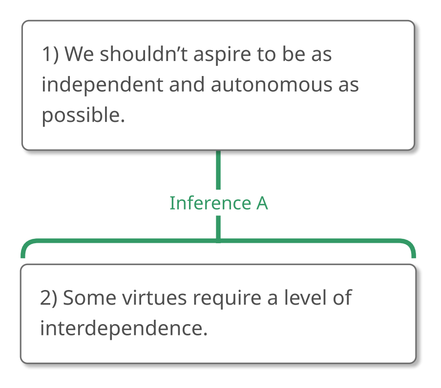
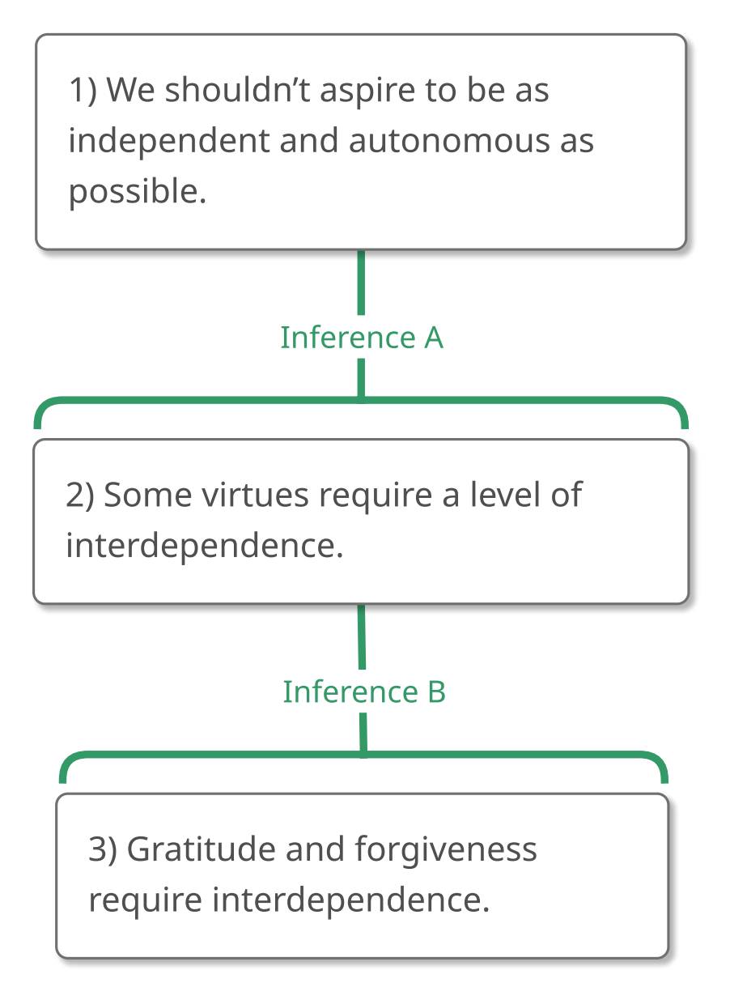

# 2.9 Constructing Arguments

How can we use what we've learned in this chapter to construct arguments
of our own?

Let's return to the map we constructed in Chapter 1:

{#fig-2-9-chapter1 width=289px fig-alt="Argument map concluding: 1) We shouldn't aspire to be as independent and autonomous as possible. A full text description is provided."}

::: {.map-outline fig="fig-2-9-chapter1"}

:::

In the process of constructing this map, we learned one way to fix a
faulty premise: if our premise is false, we can simply change it. In
particular, we changed the premise from "All virtues require a level of
interdependence," to "Some virtues require a level of interdependence."

## Provide Support for Reasons

Sometimes, though, *we* might think that a premise is true while
realizing that our *audience* might not accept it. If we have a premise
that's true but not easily acceptable to most people in our audience, we
can give our audience reason to believe that premise by asking "What is
one reason to think that this claim is true?" In other words, we
transform such premises into subconclusions! **In general, if a reason
requires support, we should provide it.**

For example, the argument that we're constructing currently takes "Some
virtues require a level of interdependence" as a premise. Although *I*
think that this premise is true, I could easily imagine some people
doubting it. Maybe they naturally think of courage and honesty when they
consider virtue, and so find it hard to understand how any virtues
require a level of dependence on others.

If asked to give a reason to believe that some virtues require a level
of interdependence, I'd answer that interdependence is required by
gratitude and forgiveness. (How can you be grateful to anyone if they
can't help you, or forgive anyone if they can't hurt you? And how could
anyone help or hurt you if you weren't dependent on them in some way, if
they couldn't affect you?) This allows us to transform the premise to a
subconclusion by supplying that reason in its support.

{#fig-2-9-reason-for-reason width=289px fig-alt="Argument map concluding: 1) We shouldn't aspire to be as independent and autonomous as possible. A full text description is provided."}

::: {.map-outline fig="fig-2-9-reason-for-reason"}

:::

## Communicating Arguments

Once our argument is mapped, we can communicate it by writing it down in
a reader-friendly passage. And now that we're dealing with slightly
longer arguments, it's a good time to think about where to put our
ultimate conclusion. Should we put it at the front or at the end of our
argument?

### Conclusion Placement

Generally speaking, **it's a good idea to put the ultimate conclusion
near the beginning of the argument.** This is because it will be easier
for our audience to follow our reasoning if they know where we're going.

An exception to this rule, of course, is when we're arguing for a
conclusion that our audience is likely to resist. **If our conclusion is
controversial, it's a good idea to place it near the end of the
passage**. This allows us to avoid alienating our readers right out of
the gate, and hopefully we'll gain our readers' trust throughout the
argument and they'll be more receptive to our ultimate conclusion once
they reach it.

It doesn't look like the ultimate conclusion of the argument we're
building is especially controversial, so let's lead with it.

Of course, now that we know about statement questions, statement
commands, statements that should be rephrased, and statements that
should be ignored, **we can fully exploit the entire range of rhetorical
devices when we write up our arguments**. We can state claims as
questions and commands. We can say one thing and fully intend to convey
another. And we can set the stage for our argument by letting people
know why it's important to defend our conclusion.

We're now ready to write up our argument.

We've already decided to lead with the ultimate conclusion, but before
we start the argument proper, let's begin with some unimportant
statements to explain why we're bothering to consider this issue at all.
Let's also couch one of our claims as a statement question. Here we go.

> "A popular conception of human nature maintains that an ideal person
> is as independent as possible. This 'autonomy-model' of perfection is
> especially popular in the United States, where it supports the norms
> of rugged individualism and self-reliance that allegedly made this
> country great. In fact, however, we shouldn't aspire to be as
> independent and autonomous as possible, because some virtues require a
> level of interdependence. After all, don't gratitude and forgiveness
> require interdependence?"

## Summary of Constructing Arguments

We've learned quite a bit more about argument construction. In
particular, we've learned how to transform a premise into a
subconclusion when we think that our audience might not be inclined to
simply accept a premise.

We also learned to put our conclusion near the front of our argument,
unless it's controversial, and we saw how to add rhetorical touches to
our passages.

Congratulations! You've finished another chapter and learned about
subconclusions!

In the next chapter, we'll see arguments with more than one premise and
learn about another connection between claims.
