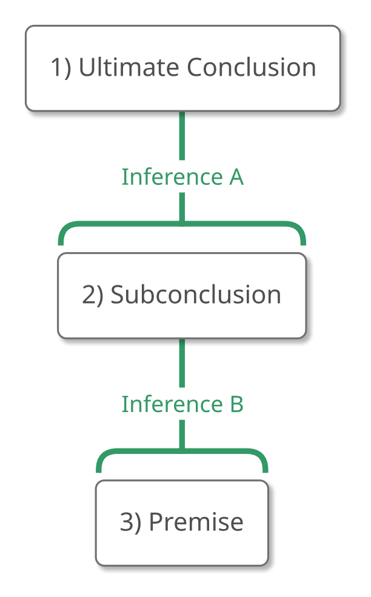
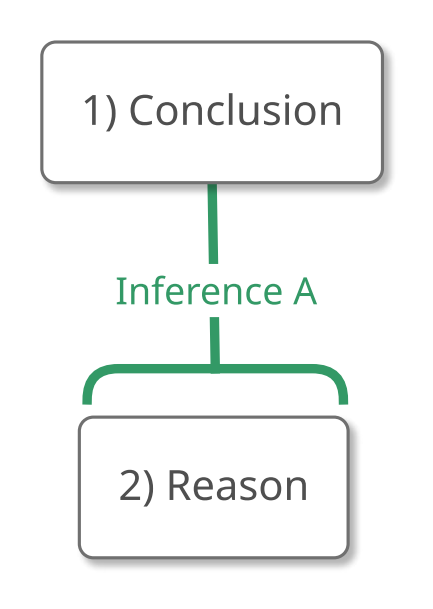

# 2.10 Chapter 2 Handbook

::: {.content-visible when-format="html"}
::: {.handbook-download}
[Download this handbook (Word)](/downloads/Chapter-2-Handbook.docx){download="Chapter-2-Handbook.docx"} · or print this page; the text descriptions of the maps are printed in an appendix at the end.
:::
:::

*Note: Items that are new in Chapter 2 begin with "NEW:".*

## Important Concepts and Terms

-   An *argument* is a unit of reasoning that attempts to establish that
    one claim is true by citing other claims as evidence.
-   Arguments are composed of *claims* and *connections* between the
    claims.
-   An *argument map* displays the claims and connections that compose
    the argument.

{#fig-2-10-map width=105px fig-alt="Argument map with 1) Claim at the top, connected by Inference A to 2) Claim, connected by Inference B to 3) Claim at the bottom. A full text description is provided."}

::: {.map-outline fig="fig-2-10-map"}

:::

### Claims

-   In an argument map, claims are written in boxes.

#### Ultimate Conclusion (or Conclusion)

-   The ultimate conclusion is the main claim that the argument tries to
    establish as true.
-   In an argument map, the ultimate conclusion will be at the top, with
    no claims above it.

#### NEW: Subconclusion

-   A subconclusion is a claim that is used to support the ultimate
    conclusion and that is supported by other claims in the argument.
-   In an argument map, subconclusions will be in the middle, with
    claims above them and claims below them.

#### Premise

-   A premise is a claim that is used to support the ultimate conclusion
    and that the argument assumes to be true without providing support
    for it.
-   In an argument map, premises will be at the bottom, with no claims
    below them.

### Connections

-   In an argument map, connections are represented as lines connecting
    the boxes.

#### Inference

-   An inference is the connection between a claim or set of claims
    (which we can call "R" for "reason") and another claim (which we can
    call "C" for "conclusion"), when the truth of R is supposed to
    establish that C is true.

{#fig-2-10-inference width=139px fig-alt="Argument map with 1) Conclusion at the top, connected by Inference A to 2) Reason below. A full text description is provided."}

::: {.map-outline fig="fig-2-10-inference"}

:::

##### Inference Indicator Expressions

A Conclusion Indicator introduces a conclusion (a claim at the top of an
inference line):

-   \[reason\]. Therefore \[conclusion\].
-   \[reason\]. Thus \[conclusion\].
-   \[reason\]. Consequently \[conclusion\].
-   \[reason\]. Hence \[conclusion\].
-   \[reason\], so \[conclusion\] / \[reason\], and so \[conclusion\].
-   \[reason\] implies \[conclusion\].
-   \[reason\] which means that \[conclusion\].
-   \[reason\] which goes to show that \[conclusion\].
-   \[reason\]. As a result, \[conclusion\].
-   \[reason\]. That's why \[conclusion\].
-   \[reason\]. It follows that \[conclusion\].

A Reason Indicator introduces a reason (a claim at the bottom of an
inference line):

-   \[conclusion\] because \[reason\]. / Because \[reason\],
    \[conclusion\].
-   \[conclusion\] since \[reason\]. / Since \[reason\], \[conclusion\].
-   \[conclusion\] assuming that \[reason\]. / Assuming that \[reason\],
    \[conclusion\].
-   \[conclusion\] given that \[reason\]. / Given that \[reason\],
    \[conclusion\].
-   \[conclusion\] inasmuch as \[reason\]. / Inasmuch as \[reason\],
    \[conclusion\].
-   \[conclusion\] in view of the fact that \[reason\]. / In view of the
    fact that \[reason\], \[conclusion\].
-   \[conclusion\]. The reason is that \[reason\].
-   \[conclusion\]. After all \[reason\].
-   \[conclusion\]. This follows from \[reason\].

## I) Recognizing an Argument

To recognize an argument, we ask "What is this passage doing? Is it
trying to convince us that something is true?" If a passage is trying to
convince us that something is true, it contains an argument.

-   **NEW:** Not all passages that contain inference indicator
    expressions are arguments (because explanations can contain them
    too).

## II) Analyzing an Argument

Analyzing an argument consists of correctly identifying the *claims*
that compose the argument and accurately tracking the *connections*
between those claims.

### 1) Identify the Ultimate Conclusion

Identify the ultimate conclusion right away, if possible, **NEW:** but
*don't map it right away* because the author might take their time
getting there.

### 2) Map the Argument as you Read

**NEW:** Starting at the beginning of the passage, identify claims that
are part of the argument and map the connections between those claims,
following these general principles:

-   **NEW:** *Rephrase sentences* when identifying claims, if necessary.
-   **NEW:** *Think about only two things at a time.*

    As soon as you have identified two things (which can be claims or
    combinations of claims), identify and represent the connection
    between those two things, thereby transforming them into one thing.

-   **NEW:** *Inference indicators trump everything else.*

    As soon as you see an inference indicator, represent it (unless it's
    connected to the ultimate conclusion; see point 1 above).

### 3) Continue to the End

Continue mapping as you read until the argument is mapped.

## III) Evaluating an Argument

We've seen that an argument is a unit of reasoning that attempts to
establish that one claim is true by citing other claims as evidence, so
an argument is good if and only if it succeeds in establishing that this
claim is probably true.

Evaluating an argument consists of correctly assessing the claims and
connections that compose the argument.

### NEW: Where to Start

-   If a claim or connection strikes us as confusing or incorrect, it's
    a good idea to start our evaluation there.
-   If nothing strikes us as confusing or incorrect, it's a good idea to
    start evaluating the argument at the top of the map and work our way
    down, beginning with the inference(s) closest to the ultimate
    conclusion.

### Evaluating Claims

#### NEW: Ultimate Conclusion & Subconclusions

-   An argument expects us *to be convinced of* a conclusion by the
    reasoning presented in the argument.
-   If we disagree with a conclusion, we should inspect the reasoning
    supporting it, trying to trace the problem to a premise or an
    inference.

#### Premise

-   An argument expects us *to accept* a premise, either because we
    think it's true or because we are willing to trust the author of the
    argument.
-   Ask:
    1)  "Is this true?"

        If not, we can say, "This argument assumes P, and P is false
        because \[reasons for P's falsity\]."

    2)  "Could someone who doesn't already believe the ultimate
        conclusion think this is true?"

        If not, we can say, "This argument assumes P, and that assumes
        the conclusion U because \[explain how belief in P presupposes
        belief in U / explain why people who don't believe U won't
        believe P\]."

### Evaluating Connections

#### Inference

-   *The Gully Test:* Ask: "If a perfectly gullible, perfectly rational
    person believed the claim(s) at the bottom of this inference line,
    how likely would that person be to accept the claim at the top of
    this inference line on that basis?"
-   If an inference between reason R and conclusion C is bad, we can
    say, "Just because R, it doesn't follow that C because \[explain how
    R can be true and C false at the same time\]," or "Even if R, it
    wouldn't follow that C because \[explain how R can be true and C
    false at the same time\]."

### Evaluating Combinations

#### Argument as a Whole

-   An argument is good if and only if all of its premises and
    inferences are good.

### Implications for the Ultimate Conclusion

-   If we think that an argument is good, we should be inclined to think
    that the ultimate conclusion is true.
-   If we think that an argument is bad, that tells us nothing about the
    truth or falsity of the ultimate conclusion.

## IV) Constructing an Argument

### Formulating the Thesis (our Conclusion)

1.  Pose a question.
2.  Research answers.
3.  Formulate the answer you accept.

### Arguing in Favor of the Thesis

4.  Identify one reason to accept that answer. If that reason isn't
    true, revise it.
5.  **NEW:** If that reason requires support, provide it.
6.  **NEW:** Repeat the process until you arrive at claims that don't
    require support.

### Communicating an Argument

#### 1) Make the connections clear.

-   Make the connections between the claims clear to your audience by
    using indicator expressions.

#### NEW: 2) Decide in what order you want to state the claims.

-   Lead with the conclusion unless it would alienate your reader, in
    which case start with a claim that your reader would accept.
