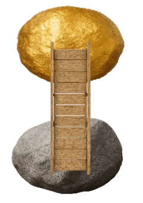
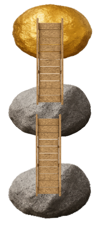
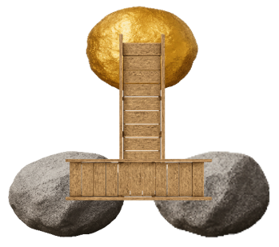

# 3.1 Introduction

## What You'll Learn in this Chapter

Welcome to Chapter 3! Here's where things start to get *really*
interesting. The reasoning skills that you'll learn in this chapter will
put you in a position to analyze and evaluate well over half of the
arguments you encounter in everyday life.

You'll learn more about **analyzing arguments**. In particular, you'll
learn:

-   when to divide one sentence into more than one claim, and
-   how to map arguments with dependent reasons (claims that need to
    "partner up" with each other to support another claim).

You'll learn more about **evaluating arguments**. In particular, you'll
learn:

-   how to evaluate conditional premises,
-   how to evaluate inferences using the missing premise method, and
-   how to evaluate arguments with dependent reasons.

You'll learn more about **constructing arguments**. In particular,
you'll learn:

-   how to construct arguments with dependent reasons, and
-   how to write passages containing your arguments with dependent
    reasons.

## Dependent Reasons

In Chapter 1, we learned about arguments that can be represented with
very short maps because the premise takes us directly to the ultimate
conclusion.

{.illustration width=140px fig-alt="A bridge leads from a gray boulder up to a golden boulder."}

In Chapter 2, we learned about arguments with subconclusions. In such
arguments, the distance between the premise (or starting boulder) and
the ultimate conclusion (or golden boulder) required intermediate claims
(more boulders) that help us progress from the premise to the ultimate
conclusion.

{.illustration width=125px fig-alt="A bridge leads from a gray boulder up to a second gray boulder, and another bridge leads from there up to a golden boulder."}

In this chapter, we'll see cases where one boulder (or reason) isn't
enough on its own to support a bridge to another boulder (or
conclusion). In cases like that, we'll need *multiple boulders working
together* (i.e., dependent reasons) to support the bridge.

{.illustration width=200px fig-alt="Two gray boulders side by side, joined by a plank that rests on both of them. A single bridge rises from the plank up to a golden boulder."}

Arguments with dependent reasons are very common. So let's learn about
them!

## Summary of Introduction

The big idea in this chapter will be dependent reasons, claims that need
to work together to support a conclusion.

This is a major advance in argument structure.
