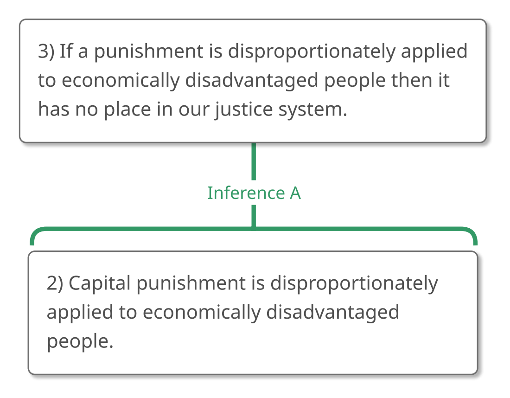
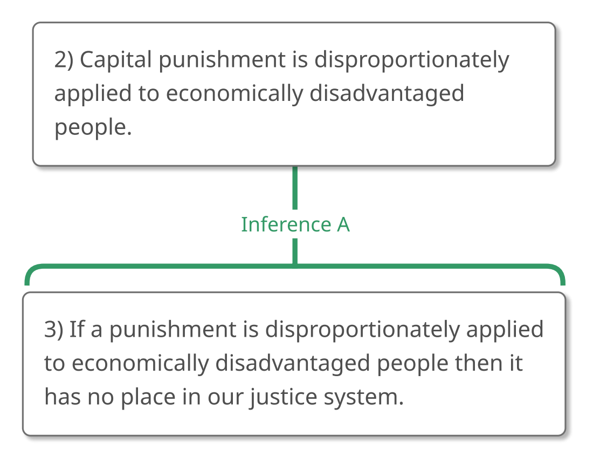
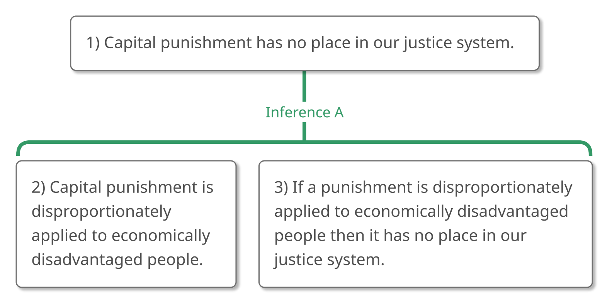
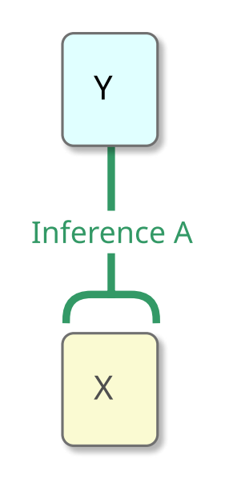
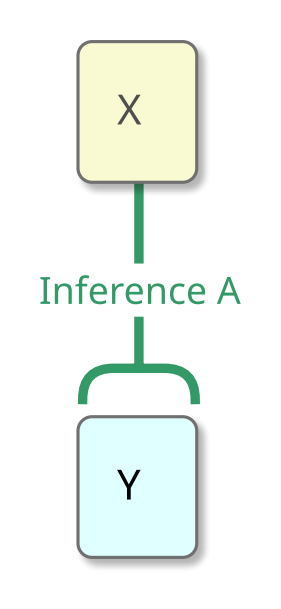
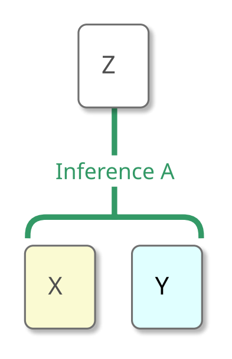
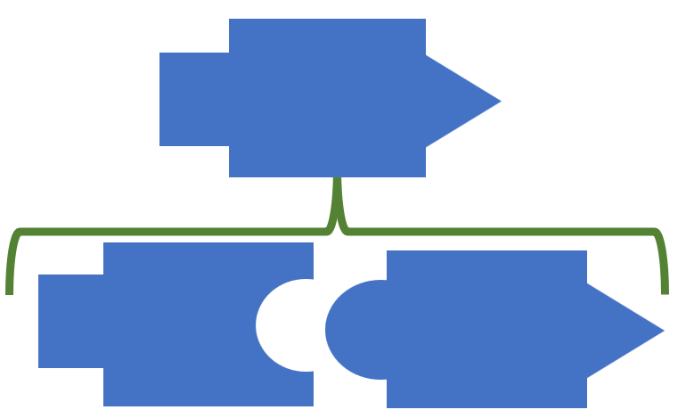
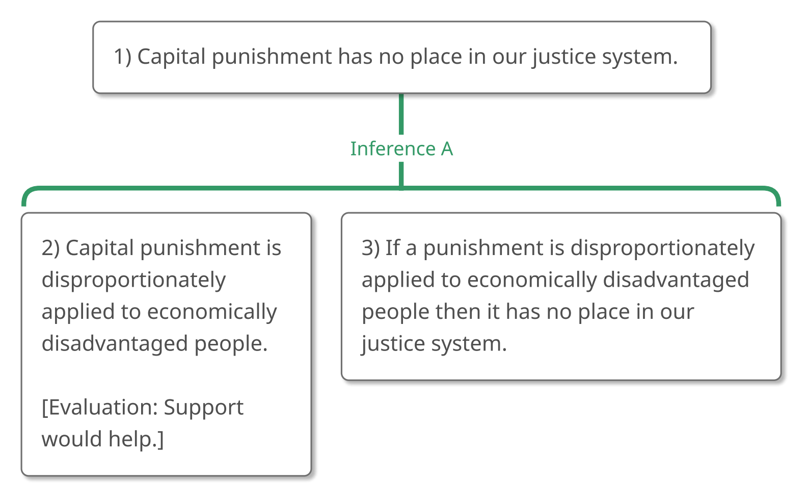
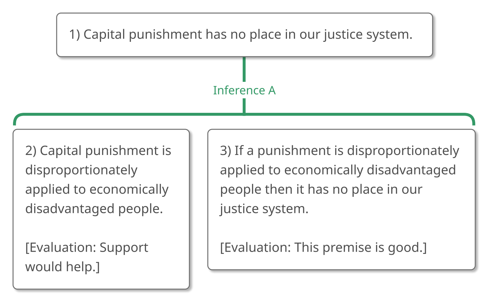
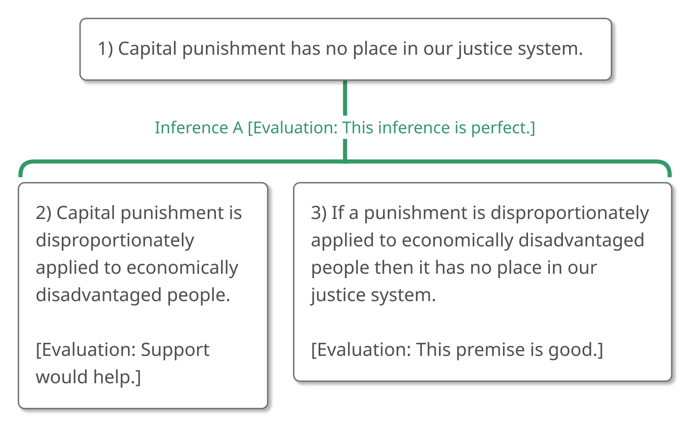

# 3.3 Example 2

## Step 1 – Recognizing an Argument

What about the following passage? **"What is this passage doing? Is it
trying to convince us that something is true?"**

> "It's natural, perhaps, to want to kill those who kill others. But is
> it *right*? Upon rational reflection, we see that capital punishment
> has no place in our justice system because capital punishment is
> disproportionately applied to economically disadvantaged people and if
> a punishment is disproportionately applied to economically
> disadvantaged people then it has no place in our justice system."

Like Example 1, this passage contains the inference indicator expression
"because." Chances are excellent, therefore, that it contains an
argument or an explanation.

Once again, let's focus on the position of the reason indicator
expression "because."

> "It's natural, perhaps, to want to kill those who kill others. But is
> it *right*? Upon rational reflection, we see that capital punishment
> has no place in our justice system **because** capital punishment is
> disproportionately applied to economically disadvantaged people and if
> a punishment is disproportionately applied to economically
> disadvantaged people then it has no place in our justice system."

If this passage were an *explanation*, it would be explaining why
capital punishment has no place in our justice system, under the working
assumption that all of us believe this already. But *is* this passage
assuming that we all believe that capital punishment has no place in our
justice system? I don't think so.

Unlike the passage in Example 1, this passage *does* try to convince us
of something: specifically, it tries to convince us that capital
punishment has no place in our justice system. That's why it's an
argument.

## Step 2 – Analyzing the Argument

We've already answered the question, **"What is the ultimate conclusion,
or the main claim that this argument is trying to get us to believe?"**
This argument is trying to convince us that capital punishment has no
place in our justice system, so that's our ultimate conclusion.

> "It's natural, perhaps, to want to kill those who kill others. But is
> it *right*? Upon rational reflection, we see that (1) capital
> punishment has no place in our justice system **because** capital
> punishment is disproportionately applied to economically disadvantaged
> people and if a punishment is disproportionately applied to
> economically disadvantaged people then it has no place in our justice
> system."

Now we can proceed to identify the other claims in this argument,
keeping track of the connections as we go along. So, let's return to the
beginning of the passage, asking **"What else is being claimed?"** and
**"Is that claim part of the argument?"**

The claim that it's natural to want to kill those who kill others isn't
being given as a reason to believe that capital punishment has no place
in our justice system, so the first sentence isn't playing a role in
this argument.

The second sentence is a normal question, so let's ignore that too.

The next sentence has multiple parts. The first part, as we've seen, is
the ultimate conclusion. What should we do with the rest of that
sentence, "capital punishment is disproportionately applied to
economically disadvantaged people and if a punishment is
disproportionately applied to economically disadvantaged people then it
has no place in our justice system"? It's connected to the conclusion
with "because" so we know that it's a part of the argument. But should
we further divide it into parts, or keep it whole?

We *could*, I suppose, take it as one claim, like this:

> "It's natural, perhaps, to want to kill those who kill others. But is
> it *right*? Upon rational reflection, we see that (1) capital
> punishment has no place in our justice system **because** (2)
> \[capital punishment is disproportionately applied to economically
> disadvantaged people and if a punishment is disproportionately applied
> to economically disadvantaged people then it has no place in our
> justice system.\]"

But what if we believe one part of that claim but not the other? For
example, what if we *don't* believe that capital punishment is
disproportionately applied to economically disadvantaged people but *do*
believe that if a punishment is disproportionately applied to
economically disadvantaged people then it has no place in our justice
system? If we keep these two claims together, we won't be able to
represent our *partial* agreement. And that wouldn't fully represent our
position.

Consequently, we should divide this sentence into two claims, and
because it looks like both claims are necessary to establish the
ultimate conclusion, we should include them both.

> "It's natural, perhaps, to want to kill those who kill others. But is
> it *right*? Upon rational reflection, we see that (1) capital
> punishment has no place in our justice system **because** (2) capital
> punishment is disproportionately applied to economically disadvantaged
> people and (3) if a punishment is disproportionately applied to
> economically disadvantaged people then it has no place in our justice
> system."

Notice how we divided this sentence around an "and"—an expression that
isn't an inference indicator expression. Correctly dividing sentences
into their component claims is an important skill, so let's take a
detour from this argument and talk about that.

### Detour: When to Divide around Sentence Connectors

Compound sentences, as you probably know, are composed of smaller
sentences attached to each other with sentence connectors. So, the
following are all compound sentences:

1.  "Pat just called me from Hawaii **so** Pat isn't at home."
2.  "Pat isn't at home **because** Pat just called me from Hawaii."
3.  "Pat loves warm weather **and** Pat always wanted to travel."
4.  "Pat can't swim **but** Pat loves the ocean."
5.  "**If** I win the lottery **then** I'll go to Hawaii."
6.  "I'll go to Chicago **or** I'll stay home."

The question at hand is: When can we divide a sentence around these
sentence connectors, and when can't we? I'll tell you the answer to that
question, so as not to keep you in suspense:

-   We **must** divide sentences into component claims around "so" (as
    well as other conclusion indicator expressions) and "because" (as
    well as other reason indicator expressions).
-   We **may** divide sentences into component claims around "and" (as
    well as words in the "and" family, like "moreover" and
    "furthermore") and "but" (as well as words in the "but" family, like
    "yet," "however," "although," "even though," "nevertheless").
-   We **should never** divide sentences into component claims around
    "if...then..." and "or."

Here's why:

When we divide a sentence into its component claims, we're saying, in
effect, that the sentence is committed to the truth of these component
claims. The general idea, then, is that **we may divide a compound
sentence into its component parts if the compound sentence asserts the
claims expressed by those component parts**. This isn't as complicated
as it might sound.

In order to determine if sentence S asserts claim C, we can ask
ourselves, "If S were true, must C be true as well?" If the answer is
"Yes," then S asserts C. If the answer is "No," then S doesn't assert C.
I think of this as the **"Trickle-Down Test"** because we imagine that
the sentence is true, taken as a whole, and ask ourselves if the truth
of the sentence trickles down to its parts.

Let's apply the Trickle-Down Test to the sentences that we've just
considered. If we assume that the entire sentence is true, can we
conclude that the parts of the sentence are true as well?

1.  "Pat just called me from Hawaii **so** Pat isn't at home."
2.  "Pat isn't at home **because** Pat just called me from Hawaii."

-   If "Pat just called me from Hawaii **so** Pat isn't at home" is true
    then it's true that Pat just called me from Hawaii and it's true
    that Pat isn't at home.
-   Similarly, if "Pat isn't at home **because** Pat just called me from
    Hawaii" is true then it's true that Pat isn't at home and it's true
    that Pat just called me from Hawaii.
-   **Truth trickles down over "so" and "because," which tells us that
    we can divide a sentence into parts around those words.**

But we can say more than this. Not only *can* we divide around "so" (as
well as other conclusion indicator expressions) and "because" (as well
as other reason indicator expressions), but **we *must* divide around
those words**. Can you see why? It's because such words indicate that
there's an inference between the component claims, so if we don't
divide the sentence into those claims, we can't represent (and hence,
probably won't evaluate) that inference.

What about "and" and "but"?

3.  "Pat loves warm weather **and** Pat always wanted to travel."
4.  "Pat can't swim **but** Pat loves the ocean."

-   Well, if it's true that "Pat loves warm weather **and** Pat always
    wanted to travel," it's true that Pat loves warm weather and it's
    true that Pat always wanted to travel.
-   Additionally, if it's true that "Pat can't swim **but** Pat loves
    the ocean," it's true that Pat can't swim and it's true that Pat
    loves the ocean.
-   **Truth trickles down over "and" and "but" so we can divide a
    sentence into parts around those words as well.**

Do we have to divide around those words, in the same way that we have to
divide around inference indicator expressions? No, but it's a *good
idea* to divide sentences around words like "and" and "but" unless we
have an overriding reason not to. Among other things, the claims
connected by "and" or "but" might have different roles in the
argument—one of them might be a premise, for example, while the other is
a subconclusion—and it's impossible to represent that if we don't divide
the sentence into its claims.

Finally, what about "if... then..." and "or"? Can we divide around
those, too? In fact, we can't.

5.  "**If** I win the lottery **then** I'll go to Hawaii."
6.  "I'll go to Chicago **or** I'll stay home."

-   Suppose that "**If** I win the lottery **then** I'll go to Hawaii"
    is true. Is it also true that I win the lottery and that I'll go to
    Hawaii? No. When I say, "**If** I win the lottery **then** I'll go
    to Hawaii" I'm not asserting that I'll win the lottery or that I'll
    go to Hawaii, only that *if* I win (which I probably won't) *then*
    I'd go. We can't divide around "if... then..."
-   Similarly, suppose it's true that "I'll go to Chicago **or** I'll
    stay home." Is it certainly true that I'll go to Chicago? No,
    because I might stay home instead. Is it certainly true that I'll
    stay home? No, because I might go to Chicago. We can't divide around
    "or" either.
-   **Truth does not trickle down over "if... then..." and "or" so we
    can't divide a sentence into parts around those words.**

This explains why:

-   We **must** divide sentences into component claims around "so" (as
    well as other conclusion indicator expressions) and "because" (as
    well as other reason indicator expressions).
-   We **may** divide sentences into component claims around "and" (as
    well as words in the "and" family, like "moreover" and
    "furthermore") and "but" (as well as words in the "but" family, like
    "yet," "however," "although," "even though," "nevertheless").
-   We **should never** divide sentences into component claims around
    "if...then..." and "or."

### End of Detour: Returning to the Argument

Now that we've learned about dividing sentences into component claims,
we can return to our argument:

> "It's natural, perhaps, to want to kill those who kill others. But is
> it *right*? Upon rational reflection, we see that (1) capital
> punishment has no place in our justice system **because** (2) capital
> punishment is disproportionately applied to economically disadvantaged
> people and (3) if a punishment is disproportionately applied to
> economically disadvantaged people then it has no place in our justice
> system."

It looks like we've done everything right so far. We divided around
"because," which is forced. We divided around "and," which is wise. And
we did not divide around "if...then...," which is forbidden.

Now we need to ask ourselves, **"How are Claims 2 and 3 related to each
other?"** (Remember, we'll leave the conclusion until last.)

Well, maybe Claim 2 supports Claim 3, like this:

> "It's natural, perhaps, to want to kill those who kill others. But is
> it *right*? Upon rational reflection, we see that (1) capital
> punishment has no place in our justice system **because** (2) capital
> punishment is disproportionately applied to economically disadvantaged
> people and (3) if a punishment is disproportionately applied to
> economically disadvantaged people then it has no place in our justice
> system."

{#fig-3-3-2to3-1 width=352px fig-alt="Argument map concluding: 3) If a punishment is disproportionately applied to economically disadvantaged people then it has no place in our justice system, supported by Claim 2. A full text description is provided."}

::: {.map-outline fig="fig-3-3-2to3-1"}

:::

Does that seem right? In Chapter 2, we learned how to double-check
inferences by reading down the inference lines with "because." Doing
that here gives us "(3) If a punishment is disproportionately applied to
economically disadvantaged people then it has no place in our justice
system **because** (2) capital punishment is disproportionately applied
to economically disadvantaged people." I don't think that works. If
someone doesn't believe Claim 3, I don't think that Claim 2 is the sort
of thing that we could say to convince them.

So maybe it's the other way around, with Claim 3 supporting Claim 2,
like this:

{#fig-3-3-3to2-1 width=352px fig-alt="Argument map concluding: 2) Capital punishment is disproportionately applied to economically disadvantaged people, supported by Claim 3. A full text description is provided."}

::: {.map-outline fig="fig-3-3-3to2-1"}

:::

Double-checking that inference by reading down the inference lines with
"because" gives us "(2) Capital punishment is disproportionately applied
to economically disadvantaged people **because** (3) if a punishment is
disproportionately applied to economically disadvantaged people then it
has no place in our justice system." I don't think that works either. If
someone doesn't believe Claim 2, I don't think that Claim 3 is the sort
of thing that we could say to convince them.

Something new is going on here! Claim 2 doesn't support Claim 3, and
Claim 3 doesn't support Claim 2, but Claims 2 and 3 work together to
support Claim 1, like so:

> "It's natural, perhaps, to want to kill those who kill others. But is
> it *right*? Upon rational reflection, we see that (1) capital
> punishment has no place in our justice system because (2) capital
> punishment is disproportionately applied to economically disadvantaged
> people and (3) if a punishment is disproportionately applied to
> economically disadvantaged people then it has no place in our justice
> system."

{#fig-3-3-full-1 width=507px fig-alt="Argument map concluding: 1) Capital punishment has no place in our justice system, supported by Claims 2 and 3 together. A full text description is provided."}

::: {.map-outline fig="fig-3-3-full-1"}

:::

**When claims work together to support another claim in this way, we say
that they are dependent reasons.** They are *reasons*, of course,
because they are being given in support of a claim. They are *dependent*
because they depend upon each other to provide that support.

### The Tricky Thing: Support or Dependent Reason?

**One of *the trickiest things* when analyzing an argument is deciding
if two claims are connected in a support relationship of some kind or if
they work together as dependent reasons.**

We can often tell that two claims (say Claims X and Y) are related to
each other *somehow*, but remain unsure of exactly *how* they are
connected.

Does X support Y, like this?

{#fig-3-3-xtoy-1 width=90px fig-alt="Argument map concluding: Y, supported by X. A full text description is provided."}

::: {.map-outline fig="fig-3-3-xtoy-1"}

:::

Does Y support X, like this?

{#fig-3-3-ytox-1 width=90px fig-alt="Argument map concluding: X, supported by Y. A full text description is provided."}

::: {.map-outline fig="fig-3-3-ytox-1"}

:::

Or do X and Y work together as dependent reasons to support another
claim, like this?

{#fig-3-3-xandy-1 width=126px fig-alt="Argument map concluding: Z, supported by X and Y together. A full text description is provided."}

::: {.map-outline fig="fig-3-3-xandy-1"}

:::

Happily, there are a number of tests to help us determine if two claims
stand in a dependent reason or in a reason/conclusion relationship.
Let's take a look at some of these tests now:

### Tests for Dependent Reasons

#### 1) The Eye-Exam Test

The first test involves asking ourselves the following three questions:

1.  "If someone believed X *but not Y*, would this person be inclined to
    accept Z as a result?"
2.  "If someone believed Y *but not X*, would this person be inclined to
    accept Z as a result?" and
3.  "If someone believed *both X and Y*, would this person be inclined
    to accept Z as a result?"

If the answer to questions 1 and 2 is "No" but the answer to question 3
is "Yes," then neither Claim X nor Claim Y can support Claim Z on its
own, but taken together, Claims X and Y can support Claim Z. That tells
us that Claims X and Y are dependent reasons in support of Claim Z.

I call this "The Eye-Exam Test" because it reminds me of those eye exams
where the ophthalmologist asks you to read a chart with one eye covered,
and then asks you to read the chart with the other eye covered.
Essentially, when using this test, we take turns "looking through" each
reason while covering up the other.

Let's see the Eye-Exam Test in action by applying it to our argument:

> "It's natural, perhaps, to want to kill those who kill others. But is
> it *right*? Upon rational reflection, we see that (1) capital
> punishment has no place in our justice system because (2) capital
> punishment is disproportionately applied to economically disadvantaged
> people and (3) if a punishment is disproportionately applied to
> economically disadvantaged people then it has no place in our justice
> system."

Suppose someone believes Claim 2 but *doesn't* believe Claim 3. It seems
to me that this person wouldn't be inclined to believe the ultimate
conclusion. Such a person would think "Yes, capital punishment is
disproportionately applied to economically disadvantaged people (Claim
2). But so what? I don't see why being applied disproportionately to
economically disadvantaged people should remove a punishment from our
justice system."

Now suppose someone believes Claim 3 but *doesn't* believe Claim 2. I
think this person is unlikely to accept the ultimate conclusion. They
might think "True. We shouldn't have punishments that are
disproportionately applied to economically disadvantaged people (Claim
3), but who thinks that capital punishment *is* disproportionately
applied to economically disadvantaged people?"

It's only when someone believes *both Claim 2 and Claim 3* that the
ultimate conclusion is forced upon them. This means that Claims 2 and 3
must work *together* to establish the truth of Claim 1 and so they are
dependent reasons.

{#fig-3-3-full-2 width=507px fig-alt="Argument map concluding: 1) Capital punishment has no place in our justice system, supported by Claims 2 and 3 together. A full text description is provided."}

::: {.map-outline fig="fig-3-3-full-2"}

:::

#### 2) The Try It Out Test

The second test for dependent reasons is nice because it stems directly
from the question that we're most likely to have when we're confused
about how two ideas are related: **"Does one of these ideas support the
other, or are they working together as dependent reasons?"**

We "try out" one of the support relationships by reading down the
inference lines with "because."

If that reading sounds batty, we can flip the order of the claims and
read down *that* inference.

If that sounds wrong, too, we can try to connect the claims with a
bracket, and double-check our inferences as before, reading the bracket
as an "and." If this reading makes sense, there's a good chance that the
claims are dependent reasons.

We already applied this test to our argument when we noted that this
sounded wrong: "(3) If a punishment is disproportionately applied to
economically disadvantaged people then it has no place in our justice
system **because** (2) capital punishment is disproportionately applied
to economically disadvantaged people." This led us to reject this map:

{#fig-3-3-2to3-2 width=352px fig-alt="Argument map concluding: 3) If a punishment is disproportionately applied to economically disadvantaged people then it has no place in our justice system, supported by Claim 2. A full text description is provided."}

::: {.map-outline fig="fig-3-3-2to3-2"}

:::

This reading sounded wrong too: "(2) Capital punishment is
disproportionately applied to economically disadvantaged people
**because** (3) if a punishment is disproportionately applied to
economically disadvantaged people then it has no place in our justice
system." That led us to reject this map:

{#fig-3-3-3to2-2 width=352px fig-alt="Argument map concluding: 2) Capital punishment is disproportionately applied to economically disadvantaged people, supported by Claim 3. A full text description is provided."}

::: {.map-outline fig="fig-3-3-3to2-2"}

:::

On the other hand, this sounds fine: "(1) Capital punishment has no
place in our justice system **because** (2) capital punishment is
disproportionately applied to economically disadvantaged people **and**
(3) if a punishment is disproportionately applied to economically
disadvantaged people then it has no place in our justice system." That
gives us this map:

{#fig-3-3-full-3 width=507px fig-alt="Argument map concluding: 1) Capital punishment has no place in our justice system, supported by Claims 2 and 3 together. A full text description is provided."}

::: {.map-outline fig="fig-3-3-full-3"}

:::

#### 3) Inference "Erasers"

The third test is probably the quickest to use (although, like all quick
tests, it shouldn't be applied unthinkingly).

Before we learn it, let's see a little magic trick.

I'll present you with three sentences, each very similar to the next.
You'll see an inference in the first sentence, but eventually the
inference will disappear into thin air! Ready?

Here's the first sentence:

-   "Phyllis is a good lawyer **because** she cares about her clients."

Do you see the inference in this sentence? The fact that Phyllis cares
about her clients is being given as a reason to believe that she's a
good lawyer. (If you can, try to "feel" that inference. "Because" might
feel like a little tug. It's tugging "Phyllis cares about her clients"
toward "Phyllis is a good lawyer.")

Now let's take the "because" away:

-   "Phyllis is a good lawyer; she cares about her clients."

Can you still feel that inference a little? I can. It still feels to me
like Phyllis caring about her clients is being given as a reason to
believe that she's a good lawyer. The tug might not be as strong as it
was before, but it's still there.

But *now* let's put an "and" where the "because" used to be:

-   "Phyllis is a good lawyer **and** she cares about her clients."

The inference is completely gone now, isn't it? No more tug! Instead,
"Phyllis is a good lawyer" and "She cares about her clients" are being
presented as independent facts about Phyllis. We might as well have
said, "Phyllis is a good lawyer and her offices are on Second Street."

In general, when two claims are connected with "and" (or a similar
connector, like "also" and "moreover") or with "but" (or a similar
connector, like "yet," "however," "although," "even though," and
"nevertheless") there will probably *not* be an inference between these
claims.

**We might call the connectors "and," "but," and similar connectors
"inference erasers," and often inference erasers connect dependent
reasons.**

(An important *exception* to this rule is the expression *"and so,"*
which counts as a conclusion indicator expression because of the "so."
Basically, "so" is a very small word and to keep it from getting lost,
people naturally put "and" in front of it. The "and" in front of a "so"
really isn't an "and." It's more of a "so-extender.")

Look how nicely recognizing the inference eraser "and" in our argument
can help us to see that Claims 2 and 3 are dependent reasons.

> "It's natural, perhaps, to want to kill those who kill others. But is
> it *right*? Upon rational reflection, we see that (1) capital
> punishment has no place in our justice system because (2) capital
> punishment is disproportionately applied to economically disadvantaged
> people **and** (3) if a punishment is disproportionately applied to
> economically disadvantaged people then it has no place in our justice
> system."

{#fig-3-3-full-4 width=507px fig-alt="Argument map concluding: 1) Capital punishment has no place in our justice system, supported by Claims 2 and 3 together. A full text description is provided."}

::: {.map-outline fig="fig-3-3-full-4"}

:::

#### 4) The Puzzle Piece Test

I call the fourth test for dependent reasons "The Puzzle Piece Test"
because it takes advantage of the fact that dependent reasons often go
together like puzzle pieces, connecting at the common concepts.

Suppose, for example, that you have the two pieces of a jigsaw puzzle.
One piece has a square shape on the left and a circular indentation on
the right.

{.illustration width=159px fig-alt="A blue puzzle piece with a square tab on its left side and a circular notch cut into its right side."}

The other piece has a circular shape on the left and a triangular shape
on the right.

{.illustration width=170px fig-alt="A blue puzzle piece with a round tab on its left side and a triangular point on its right side."}

If we combine those pieces, we'll get a shape that has a square shape on
the left and a triangular shape on the right.

{.illustration width=352px fig-alt="The two puzzle pieces side by side, the round tab of the second fitting into the circular notch of the first. A bracket joins them to the shape they make together, shown above them: a square tab on the left, a triangular point on the right, and no circle."}

Notice that the circles don't appear in the shape that we get when we
combine the two pieces. That's because the circles were what the pieces
had *in common*; it's where they *joined*. The shapes that remain
visible in the final figure are the shapes that the component pieces did
*not* have in common: the square and the triangle.

**Dependent reasons very often connect to each other in *exactly* that
way: they will share some common concept that allows them to "snap
together." This common concept will then *not* appear in the conclusion
that stems from these dependent reasons; instead, the concepts visible
in the conclusion will be the concepts that are *unique* to each of the
dependent reasons.**

Notice, for example, how Claims 2 and 3 in our argument share the
concept of a (generic) punishment being disproportionately applied to
economically disadvantaged people.

-   \(2\) Capital punishment *is disproportionately applied to
    economically disadvantaged people*.
-   \(3\) If a punishment *is disproportionately applied to economically
    disadvantaged people* then it has no place in our justice system.

The concept unique to 2 is "capital punishment" and the concept unique
to 3 is "has no place in our justice system."

-   \(2\) **Capital punishment** *is disproportionately applied to
    economically disadvantaged people*.
-   \(3\) If a punishment *is disproportionately applied to economically
    disadvantaged people* then it **has no place in our justice
    system**.

Consequently, the claim that follows from Claims 2 and 3 will be
composed of "capital \[punishment\]" and "has no place in our justice
system," which is the conclusion of the argument: Capital punishment has
no place in our justice system.

{#fig-3-3-full-5 width=507px fig-alt="Argument map concluding: 1) Capital punishment has no place in our justice system, supported by Claims 2 and 3 together. A full text description is provided."}

::: {.map-outline fig="fig-3-3-full-5"}

:::

How handy is the Puzzle Piece Test? *It's Incredibly Handy!*

## Step 3 – Evaluating the Argument

Now that we know how to analyze arguments with dependent reasons, let's
think about how to evaluate them.

Dependent reasons need (or depend upon) each other to support their
conclusion. For that reason, all of them must be true in order for that
conclusion to be established. And this means that evaluating an argument
with dependent reasons is exactly like evaluating the arguments that
we've already seen—**in order for the argument to be good, all of the
premises need to be good and all of the inferences need to be good**.

So now, let's evaluate our argument!

**Is Premise 2 true and acceptable to the argument's audience?** I
haven't researched the matter. At the very least, members of the
argument's audience might need convincing, so let's note that.

> "It's natural, perhaps, to want to kill those who kill others. But is
> it *right*? Upon rational reflection, we see that (1) capital
> punishment has no place in our justice system because (2) capital
> punishment is disproportionately applied to economically disadvantaged
> people and (3) if a punishment is disproportionately applied to
> economically disadvantaged people then it has no place in our justice
> system."

{#fig-3-3-eval-p2-1 width=507px fig-alt="Argument map concluding: 1) Capital punishment has no place in our justice system, with Premise 2 evaluated as needing support. A full text description is provided."}

::: {.map-outline fig="fig-3-3-eval-p2-1"}

:::

**What about Premise 3? Is that true and acceptable to the argument's
audience?** Premise 3 is a kind of statement that we haven't discussed
before. It's an "if... then..." statement, otherwise known as a
"conditional," and sometimes deciding whether a conditional is true or
false can be tricky. Let's take a quick detour to think about them a
bit.

### Detour: How to Evaluate Conditionals

In order to see how conditionals work, let's pretend we're at a
university holiday party. We spot a woman over by the piano.

We don't know who the woman is, but we do know that the law school has
recently hired a new faculty member. We also know that the law school is
housed in Hamilton Hall, along with other academic units, including the
English department.

A friend of ours motions toward the woman and says to us:

-   "If she's the new law professor then she has an office in Hamilton
    Hall."

Let's think about that sentence. When is it true and when is it false?

Suppose we find out that the woman *isn't* the new law professor. Does
this mean that our friend was mistaken when he said, "If she's the new
law professor then she has an office in Hamilton Hall"? No. Our friend
never said that she *was* the new law professor. Our friend simply said
that if she *were* the new law professor then she'd have an office in
Hamilton Hall, so we see that **an "if...then..." sentence can be true
even if the front part is false**. (The technical term for the front
part of an "if...then..." sentence is "antecedent.")

Similarly, what our friend said could be true even if the woman
*doesn't* have an office in Hamilton Hall because our friend never said
that she *did* have a Hamilton Hall office. Our friend only said that
she *would* have an office there if she were the new law professor.
Maybe she isn't the new law professor. **An "if...then..." sentence can
be true even when its back part is false.** (The technical term for the
back part of an "if...then..." sentence is "consequent.")

An "if...then..." sentence doesn't claim anything about the truth of its
front or back parts considered by themselves; instead it claims that a
certain *connection* holds between these parts. But what connection?

Well, suppose that the front part of the sentence is false while the
back part is true. Let's say we learn that the woman *isn't* the new law
professor but that she *does* have an office in Hamilton Hall.

-   "If *she's the new law professor* (false) then *she has an office in
    Hamilton Hall* (true)."

Would this show that our friend was wrong when he said, "If she's the
new law professor then she has an office in Hamilton Hall"? Actually no,
because our friend didn't say that if she *isn't* the new law professor
then she *doesn't* have an office there, as though only law professors
have offices in that building. The English department, after all, is
housed there too.

In general, an "if... then..." sentence only tells us what to expect
if the front part is true. It doesn't say a thing about what might
happen if the front part is false. Consequently, **showing that the
front part is false and the back part is true doesn't demonstrate that
the "if...then..." sentence is false.**

Now suppose that the front part of the sentence is true while the back
part is false. The woman *is* the new law professor, but due to space
constraints, new hires in the law school are given offices in the
neighboring Jefferson Hall.

-   "If *she's the new law professor* (true) then *she has an office in
    Hamilton Hall* (false)."

This *would* prove what our friend said to be false because he was
claiming that a connection holds between being the new law professor and
having an office in Hamilton Hall and it turns out that this connection
*doesn't* hold.

And note that this connection doesn't hold even if it turns out that the
woman *isn't the law professor after all.* The point isn't that she
*really is* the new law professor and *really doesn't* have an office in
Hamilton Hall. The point is that she *could be* the new law professor
and *not* have her office in Hamilton Hall.

The moral of this story is this: **An "if...then..." sentence is false
if and only if the front part can be true and the back part can be false
at the same time.**

Because "front part true and back part false" is the situation that
shows an "if...then..." to be false, we call it the **"falsification
condition."**

This means that to evaluate an "if...then..." sentence, we need to do
two things:

1.  We need to identify the falsification condition for that
    conditional. It is always, "front part true and back part false."
2.  We need to decide if that falsification condition can happen.
    -   If the falsification condition can happen, then the truth of the
        front part doesn't guarantee the truth of the back part. This
        means the connection claimed by the "if... then..." sentence
        doesn't hold and the "if... then..." sentence is false.
    -   If the falsification condition can't happen, then the truth of
        the front part does guarantee the truth of the back part. This
        means the connection claimed by the "if... then..." sentence
        does hold and the "if... then..." sentence is true.

### End of Detour: Returning to the Argument

Now let's return to our argument:

> "It's natural, perhaps, to want to kill those who kill others. But is
> it *right*? Upon rational reflection, we see that (1) capital
> punishment has no place in our justice system because (2) capital
> punishment is disproportionately applied to economically disadvantaged
> people and (3) if a punishment is disproportionately applied to
> economically disadvantaged people then it has no place in our justice
> system."

{#fig-3-3-eval-p2-2 width=507px fig-alt="Argument map concluding: 1) Capital punishment has no place in our justice system, with Premise 2 evaluated as needing support. A full text description is provided."}

::: {.map-outline fig="fig-3-3-eval-p2-2"}

:::

Premise 3 says, "If a punishment is disproportionately applied to
economically disadvantaged people then it has no place in our justice
system." Is that true?

The falsification condition for Premise 3 is "A punishment is
disproportionately applied to economically disadvantaged people (front
part true) but it does have a place in our justice system (back part
false)."

Can that happen? Not obviously. Part of what "justice" means is that
punishments should be applied equally to all people, regardless of their
socioeconomic status.

Since the falsification condition can't happen, this "if... then..."
sentence is true.

Furthermore, I think that someone who doesn't already believe the
conclusion can accept this conditional, so I'd say that this premise is
good.

> "It's natural, perhaps, to want to kill those who kill others. But is
> it *right*? Upon rational reflection, we see that (1) capital
> punishment has no place in our justice system because (2) capital
> punishment is disproportionately applied to economically disadvantaged
> people and (3) if a punishment is disproportionately applied to
> economically disadvantaged people then it has no place in our justice
> system."

{#fig-3-3-eval-p3-1 width=507px fig-alt="Argument map concluding: 1) Capital punishment has no place in our justice system, with Premise 2 evaluated as needing support and Premise 3 as good. A full text description is provided."}

::: {.map-outline fig="fig-3-3-eval-p3-1"}

:::

There's only one more part of this argument to evaluate: Inference A.

Because Inference A takes us from Claim 2 and Claim 3 to Claim 1, we
need to imagine our perfectly rational, perfectly gullible friend
(Gully) believing Claim 2 and Claim 3 at the same time. If Gully
believes that capital punishment is disproportionately applied to
economically disadvantaged people (Claim 2) and that if a punishment is
disproportionately applied to economically disadvantaged people then it
has no place in our justice system (Claim 3), how likely will Gully be
to believe that capital punishment has no place in our justice system
(Claim 1)?

I don't see how Gully could *avoid* believing this, so Inference A is
actually perfect!

> "It's natural, perhaps, to want to kill those who kill others. But is
> it *right*? Upon rational reflection, we see that (1) capital
> punishment has no place in our justice system because (2) capital
> punishment is disproportionately applied to economically disadvantaged
> people and (3) if a punishment is disproportionately applied to
> economically disadvantaged people then it has no place in our justice
> system."

{#fig-3-3-eval-i-1 width=507px fig-alt="Argument map concluding: 1) Capital punishment has no place in our justice system, with Premise 2 evaluated as needing support, Premise 3 as good, and Inference A as perfect. A full text description is provided."}

::: {.map-outline fig="fig-3-3-eval-i-1"}

:::

Assessing this argument overall, we see that the strength of reasoning
depends upon Claim 2. If that can be supported, the argument will be
good. If it can't be supported, the argument will fall short.

### Detour: Practice Evaluating Conditionals

Before we wrap up this argument, let's spend a bit more time on "if...
then..." sentences because they can be surprisingly subtle.

The argument we just considered contained the following premise:

-   3\) If *a punishment is disproportionately applied to economically
    disadvantaged people* then *it has no place in our justice system*.

To evaluate this claim we first identified its falsification condition,
"front part true and back part false." It was this: "A punishment is
disproportionately applied to economically disadvantaged people (front
part true) but it does have a place in our justice system (back part
false)." Because it seemed to us that the falsification condition
couldn't happen, we decided that the "If... then..." sentence is true.

-   3\) If *a punishment is disproportionately applied to economically
    disadvantaged people* then *it has no place in our justice system*.
    \[TRUE\]

Now, just as an experiment, let's *change* that "If... then..."
sentence ever so slightly by negating the front and back parts. Instead
of the front part being "a punishment is disproportionately applied to
economically disadvantaged people," let's say "a punishment *isn't*
disproportionately applied to economically disadvantaged people," and
instead of the back part being "the punishment has no place in our
justice system," let's say "the punishment *does* have a place in our
justice system." Let's call that new claim "3'".

-   3') If *a punishment isn't disproportionately applied to
    economically disadvantaged people* then *it does have a place in our
    justice system*.

Claim 3, as we saw, is true. Is this new claim, Claim 3', true as well?
Let's check.

First, we'll identify its falsification condition, "front part true and
back part false." It's this: "A punishment isn't disproportionately
applied to economically disadvantaged people (front part true) but it
*doesn't* have a place in our justice system (back part false)."

Can that falsification condition occur? Can a punishment be equally
applied across all economic statuses but still not have a place in our
justice system? I think so. Maybe the punishment, although impartial, is
clearly disproportionate to the offense. Suppose people, regardless of
their net worth, are sentenced to 30 years hard labor for jaywalking. I
think that such an extreme sentence would be unjust, no matter how
evenhandedly it's given. Because it seems to me that the falsification
condition *can* happen here, I'd say that this "If... then..."
sentence is false.

-   3') If *a punishment isn't disproportionately applied to
    economically disadvantaged people* then *it does have a place in our
    justice system*. \[FALSE\]

Notice how sensitive "if... then..." sentences are. If we negate the
front and back parts of an "if... then..." sentence, we can change its
truth value. This tells us that the following "if... then..."
sentences are *very different* indeed:

-   If P then Q.
-   If not-P then not-Q.

Conditionals require careful handling.

### End of Detour: Returning to the Argument

Now that we've worked through this example, let's review what we did.

## Summary of Example 2

Example 2 presented us with the following passage:

> "It's natural, perhaps, to want to kill those who kill others. But is
> it *right*? Upon rational reflection, we see that capital punishment
> has no place in our justice system because capital punishment is
> disproportionately applied to economically disadvantaged people and if
> a punishment is disproportionately applied to economically
> disadvantaged people then it has no place in our justice system."

### Step 1 – Recognizing an Argument

We asked ourselves, **"What is this passage doing? Is it trying to
convince us that something is true?"** and we decided that this passage
does contain an argument.

### Step 2 – Analyzing the Argument

**"What is the ultimate conclusion, or the main claim that this argument
is trying to get us to believe?"** We decided it was "capital punishment
has no place in our justice system."

> "It's natural, perhaps, to want to kill those who kill others. But is
> it *right*? Upon rational reflection, we see that (1) capital
> punishment has no place in our justice system **because** capital
> punishment is disproportionately applied to economically disadvantaged
> people and if a punishment is disproportionately applied to
> economically disadvantaged people then it has no place in our justice
> system."

Returning to the beginning of the passage, we asked, **"What else is
being claimed?"** and **"Is that claim part of the argument?"** We
decided to ignore the first two sentences.

The next sentence contains a number of different claims. Reflecting upon
how sentence connectors work, we learned that:

-   We **must** divide sentences into component claims around "so" (as
    well as other conclusion indicator expressions) and "because" (as
    well as other reason indicator expressions).
-   We **may** divide sentences into component claims around "and" (as
    well as words in the "and" family, like "moreover" and
    "furthermore") and "but" (as well as words in the "but" family, like
    "yet," "however," "although," "even though," "nevertheless").
-   We **should never** divide sentences into component claims around
    "if...then..." and "or."

This gave us the following claims:

> "It's natural, perhaps, to want to kill those who kill others. But is
> it *right*? Upon rational reflection, we see that (1) capital
> punishment has no place in our justice system **because** (2) capital
> punishment is disproportionately applied to economically disadvantaged
> people and (3) if a punishment is disproportionately applied to
> economically disadvantaged people then it has no place in our justice
> system."

Because we want to save the ultimate conclusion for later when we map an
argument, we asked, **"How are Claim 2 and Claim 3 related to each
other?"**

For the first time, we saw claims that related to each other as
dependent reasons! Neither 2 nor 3 could support 1 on its own, but
together they could.

We mapped the argument like this:

> "It's natural, perhaps, to want to kill those who kill others. But is
> it *right*? Upon rational reflection, we see that (1) capital
> punishment has no place in our justice system **because** (2) capital
> punishment is disproportionately applied to economically disadvantaged
> people and (3) if a punishment is disproportionately applied to
> economically disadvantaged people then it has no place in our justice
> system."

{#fig-3-3-full-6 width=507px fig-alt="Argument map concluding: 1) Capital punishment has no place in our justice system, supported by Claims 2 and 3 together. A full text description is provided."}

::: {.map-outline fig="fig-3-3-full-6"}

:::

The dependent reason relationship can be difficult to identify, so we
learned some tests to help us:

1.  The Eye-Exam Test
2.  The Try It Out Test
3.  Inference "Erasers"
4.  The Puzzle Piece Test

### Step 3 – Evaluating the Argument

We saw that in order to evaluate an argument with dependent reasons, we
continue to follow the rule that in order for the argument to be good,
all of the premises and inferences need to be good.

We decided that Claim 2—although possibly true—could benefit from
evidence to back it up.

> "It's natural, perhaps, to want to kill those who kill others. But is
> it *right*? Upon rational reflection, we see that (1) capital
> punishment has no place in our justice system because (2) capital
> punishment is disproportionately applied to economically disadvantaged
> people and (3) if a punishment is disproportionately applied to
> economically disadvantaged people then it has no place in our justice
> system."

{#fig-3-3-eval-p2-3 width=507px fig-alt="Argument map concluding: 1) Capital punishment has no place in our justice system, with Premise 2 evaluated as needing support. A full text description is provided."}

::: {.map-outline fig="fig-3-3-eval-p2-3"}

:::

Claim 3 is a conditional (or an "if... then...") statement. We learned
that to evaluate an "if... then..." statement, we need to do two
things:

1.  We need to identify the falsification condition for that
    conditional. It is always, "front part true and back part false."
2.  We need to decide if that falsification condition can happen.
    -   If the falsification condition can happen, then the truth of the
        front part doesn't guarantee the truth of the back part. This
        means the connection claimed by the "if... then..." sentence
        doesn't hold and the "if... then..." sentence is false.
    -   If the falsification condition can't happen, then the truth of
        the front part does guarantee the truth of the back part. This
        means the connection claimed by the "if... then..." sentence
        does hold and the "if... then..." sentence is true.

The falsification condition for Claim 3 is "A punishment is
disproportionately applied to economically disadvantaged people (front
part true) but it does have a place in our justice system (back part
false)."

We decided that this falsification condition couldn't happen.
Consequently, we decided that Claim 3 is true.

> "It's natural, perhaps, to want to kill those who kill others. But is
> it *right*? Upon rational reflection, we see that (1) capital
> punishment has no place in our justice system because (2) capital
> punishment is disproportionately applied to economically disadvantaged
> people and (3) if a punishment is disproportionately applied to
> economically disadvantaged people then it has no place in our justice
> system."

{#fig-3-3-eval-p3-2 width=507px fig-alt="Argument map concluding: 1) Capital punishment has no place in our justice system, with Premise 2 evaluated as needing support and Premise 3 as good. A full text description is provided."}

::: {.map-outline fig="fig-3-3-eval-p3-2"}

:::

Turning to Inference A, it seemed to us that a perfectly rational person
who believes Claims 2 and 3 would be compelled to accept Claim 1 as
well. This means that Inference A is perfect!

> "It's natural, perhaps, to want to kill those who kill others. But is
> it *right*? Upon rational reflection, we see that (1) capital
> punishment has no place in our justice system because (2) capital
> punishment is disproportionately applied to economically disadvantaged
> people and (3) if a punishment is disproportionately applied to
> economically disadvantaged people then it has no place in our justice
> system."

{#fig-3-3-eval-i-2 width=507px fig-alt="Argument map concluding: 1) Capital punishment has no place in our justice system, with Premise 2 evaluated as needing support, Premise 3 as good, and Inference A as perfect. A full text description is provided."}

::: {.map-outline fig="fig-3-3-eval-i-2"}

:::

The strength of this argument overall will depend upon Claim 2.

In many ways, this was a breakthrough argument! It taught us a *lot*!

Now let's take a look at another passage.
