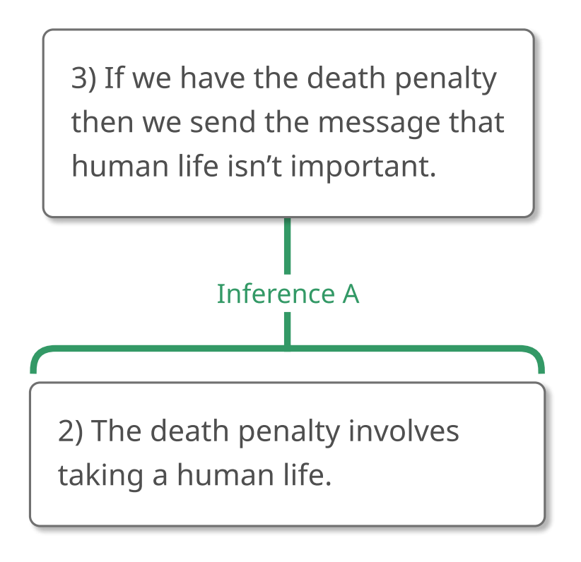
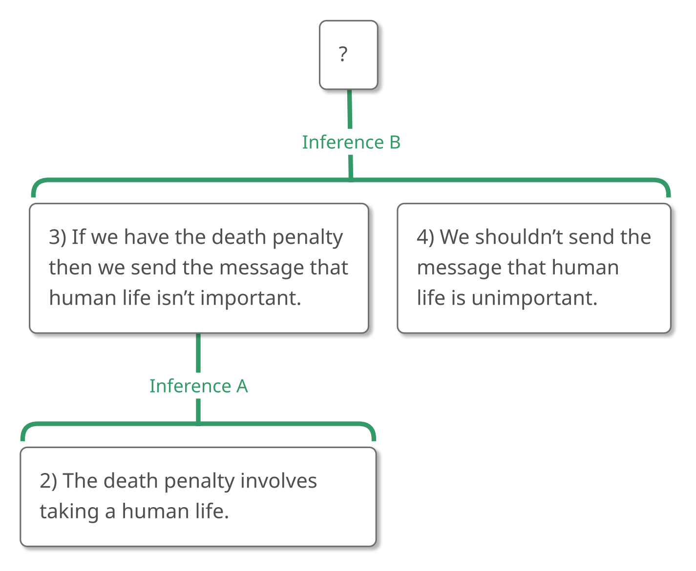
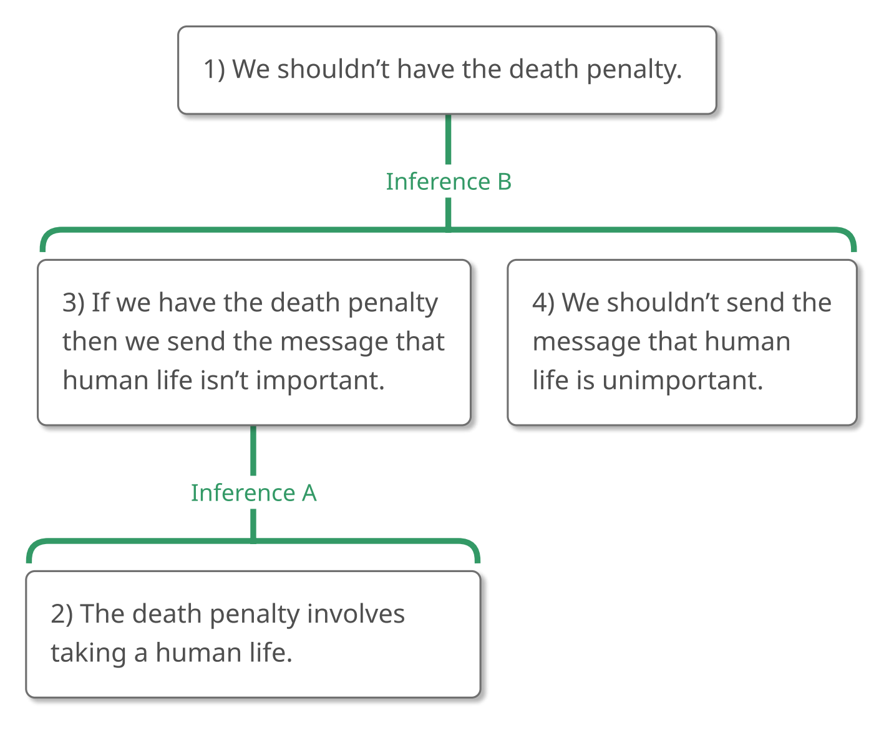
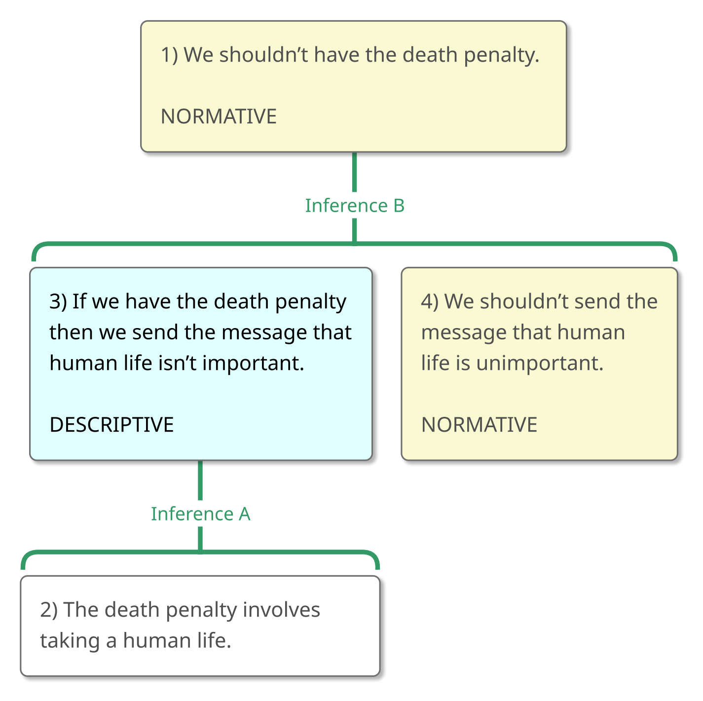
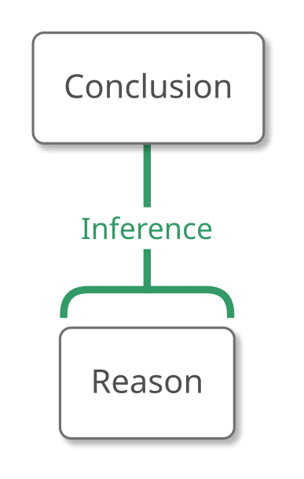
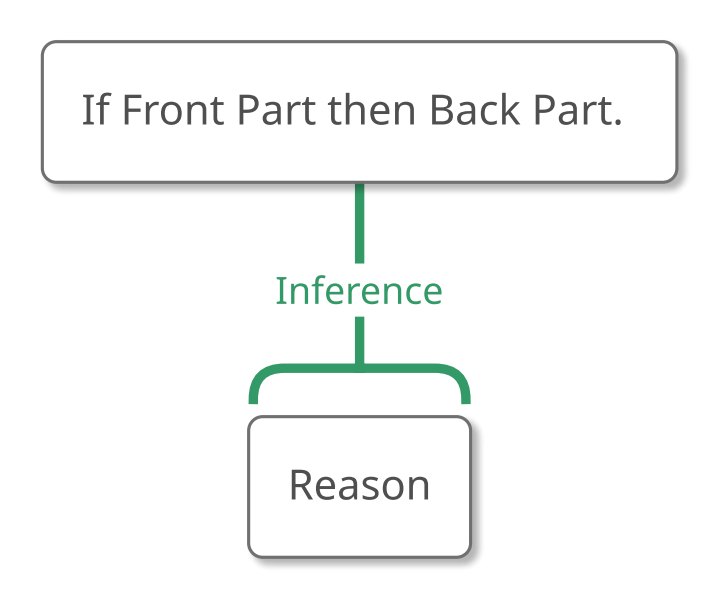
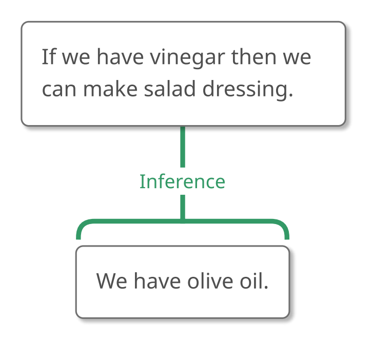
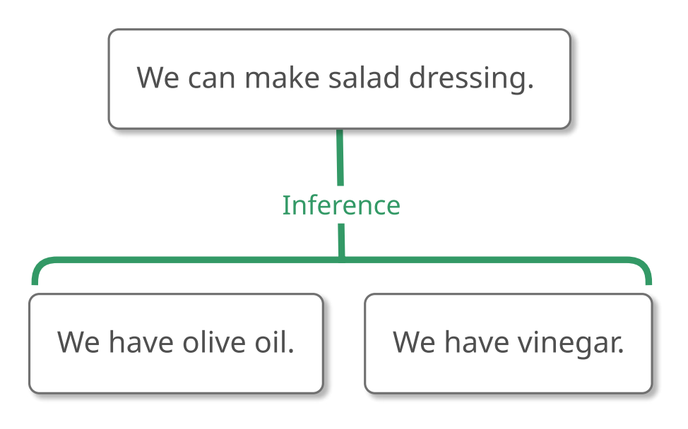
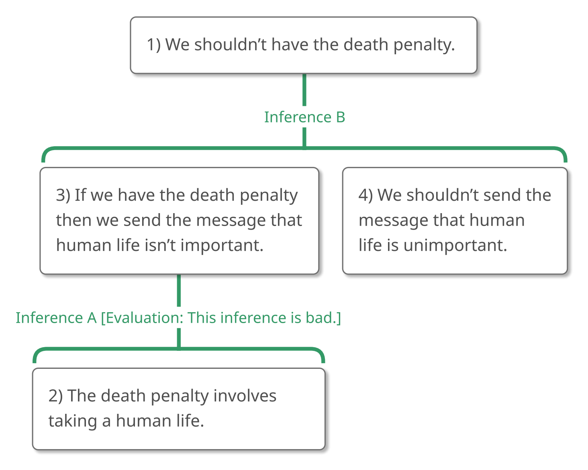

# 3.4 Example 3

## Step 1 – Recognizing an Argument

Consider the following:

> "The debate over capital punishment seems to be unending. But just think about it. Because the death penalty involves taking a human life, if we have the death penalty then we send the message that human life isn't important. Obviously, we shouldn't send that message. Consequently, we shouldn't have the death penalty."

What is this passage doing? Is it trying to establish that something is true?

It looks to me like this passage is trying to establish that something is true, so I'd say that it contains an argument.

## Step 2 – Analyzing the Argument

It's entirely possible that in the course of identifying that passage as an argument, we've already spotted the ultimate conclusion, or the main claim that this argument is trying to get us to believe.

This passage is trying to establish that we shouldn't have the death penalty.

> "The debate over capital punishment seems to be unending. But just think about it. Because the death penalty involves taking a human life, if we have the death penalty then we send the message that human life isn't important. Obviously, we shouldn't send that message. Consequently, (1) we shouldn't have the death penalty."

Now we can return to the beginning to identify the other important claims, using inference indicator expressions where we have them and trying to bear in mind only two parts of the argument at a time.

The first sentence, although expressing a claim, doesn't seem to play a role in the argument, so let's ignore it. Let's ignore the second sentence too, because it's a normal command sentence that doesn't convey a claim at all.

The next sentence starts with a "because," so it's probably going to be important. And let's remember how a reason indicator like "because" works when it's at the front of a sentence. It connects two claims that are separated by a comma, like this:

-   Because \[reason\], \[conclusion\]

Since we want to represent inference indicator expressions as soon as we can (with the exception of inference indicator expressions that are attached to the ultimate conclusion), let's map that part of the argument now. (Notice that we won't divide Claim 3 into its components. That's because Claim 3 is a conditional and we never divide around "if... then...".)

> "The debate over capital punishment seems to be unending. But just think about it. **Because** (2) the death penalty involves taking a human life, (3) if we have the death penalty then we send the message that human life isn't important. Obviously, we shouldn't send that message. Consequently, (1) we shouldn't have the death penalty."

{#fig-3-4-2to3-1 width=263px fig-alt="Argument map concluding: 3) If we have the death penalty then we send the message that human life isn’t important, supported by Claim 2. A full text description is provided."}

::: {.map-outline fig="fig-3-4-2to3-1"}

:::

Are there any other important claims in the argument? Yep! "Obviously, we shouldn't send that message" seems to be part of the reasoning.

> "The debate over capital punishment seems to be unending. But just think about it. Because (2) the death penalty involves taking a human life, (3) if we have the death penalty then we send the message that human life isn't important. (4) Obviously, we shouldn't send that message. Consequently, (1) we shouldn't have the death penalty."

Now, how is Claim 4 related to the part of the argument that we've already mapped?

(And by the way, do you see how we're still thinking about only two things at a time here? That's exactly why we want to identify connections as soon as we can. It allows us to "clump" multiple ideas into one part of the argument, and that prevents us from needing to think about an impossibly large number of things at once.)

### The Principle of Proximity

There's an analysis tip that can come in handy sometimes. It's the ***Principle of Proximity*: If two claims are near each other in the passage, there's a good chance that they will be near each other in the map.**

The Principle of Proximity doesn't *always* hold, but it holds often enough for us to wonder if Claim 4 might be related to Claim 3. And it looks to me like Claims 3 and 4 are connected to each other somehow. But how?

Is Claim 3 being given as a reason to believe Claim 4? I don't think so. If we mapped it that way, with Claim 3 supporting Claim 4, and read down the inference line, we'd get "(4) We shouldn't send the message that human life is unimportant **because** (3) if we have the death penalty then we send the message that human life isn't important." But Claim 3 doesn't give us reason to believe Claim 4.

Is Claim 4 being given as a reason to believe Claim 3? Again, I don't think so. If we mapped it that way, with Claim 4 supporting Claim 3, and read down the inference line, we'd get "(3) If we have the death penalty then we send the message that human life isn't important **because** (4) we shouldn't send the message that human life is unimportant." But Claim 4 doesn't give us reason to believe Claim 3.

Well, if Claim 3 and Claim 4 aren't related to each other with an inference but still seem to be connected to each other *somehow*, maybe they are dependent reasons working together to support some other claim, like this:

{#fig-3-4-3and4-1 width=456px fig-alt="Argument map with a question mark in place of the conclusion, supported by Claims 3 and 4 together through Inference B; Claim 3 is supported by Claim 2 through Inference A. A full text description is provided."}

::: {.map-outline fig="fig-3-4-3and4-1"}

:::

Let's look at Claims 3 and 4 with the Puzzle Piece Test in mind. Do they have common concepts that would allow us to "snap them together"? Indeed they do! They both mention sending the message that human life isn't important.

The conclusion that follows from Claims 3 and 4 will be composed of the parts that are *unique* to each claim. When we ignore sending the message that human life isn't important, we're left with "we have the death penalty" as the unique part from Claim 3 and "we shouldn't" as the unique part from Claim 4. Putting those unique parts together gives us "We shouldn't have the death penalty" as the conclusion from Claims 3 and 4.

And lo and behold, that is Claim 1 in our passage!

> "The debate over capital punishment seems to be unending. But just think about it. Because (2) the death penalty involves taking a human life, (3) if we have the death penalty then we send the message that human life isn't important. (4) Obviously, we shouldn't send that message. Consequently, (1) we shouldn't have the death penalty."

{#fig-3-4-full-1 width=456px fig-alt="Argument map concluding: 1) We shouldn’t have the death penalty, supported by Claims 3 and 4 together; Claim 3 is supported by Claim 2. A full text description is provided."}

::: {.map-outline fig="fig-3-4-full-1"}

:::

### Supplying Conclusions

Notice what we did: As soon as we saw that Claims 3 and 4 were dependent reasons, **we *supplied the conclusion* that follows from them. We didn't wait to find it in the passage. Instead, we figured it out proactively.** This is a *very smart move*.

Why shouldn't we try to locate the conclusion in the argument? Because *sometimes the author won't state the conclusion*. Sometimes, two dependent reasons will lead to an unstated subconclusion, and unless we supply that subconclusion for ourselves, the argument will be very hard to understand. We won't encounter missing conclusions until Chapter 5, but if we start to develop the habit of figuring out the conclusions for ourselves right now, it will be very easy for us to supply missing conclusions later on.

### Normative and Descriptive Claims

Before we proceed to evaluate this argument, there's something else worth noticing about Inference B.

{#fig-3-4-full-2 width=456px fig-alt="Argument map concluding: 1) We shouldn’t have the death penalty, supported by Claims 3 and 4 together; Claim 3 is supported by Claim 2. A full text description is provided."}

::: {.map-outline fig="fig-3-4-full-2"}

:::

The conclusion of this inference, Claim 1, is what we call a "**normative claim**." For our purposes, a claim is normative if it renders a *judgment* about something. Ethical statements are paradigmatically normative. When we say, "Murder is wrong," for instance, "wrong" is a normative notion. When we say, "You shouldn't steal," "shouldn't" is a normative notion. When we say, "You ought to be kind," the normative notion is "ought." Get the idea?

Claim 4 is normative as well because it, like Claim 1, contains that normative notion "shouldn't."

Claim 3, on the other hand, is *not* normative. It isn't making a judgment or saying that something is good or bad. It's simply saying that the death penalty would send the message that human life isn't important without stating or implying that this is a good or bad thing. We can call a statement like this a "**descriptive claim**."

{#fig-3-4-dandn-1 width=456px fig-alt="Argument map concluding: 1) We shouldn’t have the death penalty, labeled NORMATIVE, supported by Claim 3, labeled DESCRIPTIVE, and Claim 4, labeled NORMATIVE, together. A full text description is provided."}

::: {.map-outline fig="fig-3-4-dandn-1"}

:::

Now, suppose for the moment that Claim 4 were missing from the argument and we had a normative conclusion following from a descriptive claim all by itself.

Would the inference be good? Is Claim 3 able to support Claim 1 on its own?

No. Claim 3 can't support Claim 1 on its own. Can you see why? It's because someone could believe that the death penalty sends the message that human life is unimportant without believing that we shouldn't have the death penalty. Such a person could think "Sure, the death penalty implies that human life isn't as important as we thought. But who cares? It seems to me that we've been far too protective of human life lately, so I'm still in favor of the death penalty."

In general, **it's always possible to accept a purely descriptive reason without accepting the normative conclusion that allegedly follows from it**, because values are underdetermined by facts. For any description of something, no matter how detailed, it's always an open question whether or not that thing is good or bad.

This is such an important point, that philosophers have labeled the practice of inferring a statement of value from statements of fact alone "the naturalistic fallacy." We can't derive a conclusion about how things *should* be from premises that give us an objective, value-neutral description of events. Sometimes philosophers express this principle by saying that you can't get an 'ought' from an 'is.'

**The Normative Conclusion Test for dependent reasons exploits this fact by noting that whenever there's a normative notion in the conclusion, there has to be a normative notion in one of the reasons supporting that conclusion.**

(In fact, the normative conclusion test is simply a special case of the puzzle piece method. Can you see why? It's because if the conclusion of an inference contains a value concept then a premise of that inference must contain a value concept as well; otherwise there will be no such concept for the conclusion to inherit.)

### Identifying Premises and Subconclusions in a Map

Before we jump into evaluating this argument, let's think a bit more about what our map tells us about the claims that make up the argument.

{#fig-3-4-full-3 width=456px fig-alt="Argument map concluding: 1) We shouldn’t have the death penalty, supported by Claims 3 and 4 together; Claim 3 is supported by Claim 2. A full text description is provided."}

::: {.map-outline fig="fig-3-4-full-3"}

:::

Claim 1 is the ultimate conclusion because it's at the very top of the map.

Claim 3 is a subconclusion because it is supported by Claim 2 and goes on to support Claim 1.

Claim 2 is a premise because no claims are supporting it.

But what about Claim 4? Is it a premise because it doesn't have any other claims supporting it? Or is it a subconclusion because it's on the same level as Claim 3, which is a subconclusion?

If you answered, "Claim 4 is a premise" give yourself a gold star! It's *very easy* to think that Claim 4 must be a subconclusion because it's on the same level as a subconclusion. But levels don't matter. **The only thing that matters is whether a claim has other claims supporting it (i.e., has claims underneath it with a green line pointing to it from below). If so, it's a subconclusion. If not, it's a premise**. Claim 4 doesn't have any claim underneath it and pointing to it with a green line, so it's a premise!

**This is an important thing to see because (as we've noted) we treat premises and subconclusions differently**. If we think that a premise is false, we can reject it. But if we think that a subconclusion is false, we should examine the reasoning that the argument gives in support of it.

## Step 3 – Evaluating the Argument

Now that we've mapped the argument and reflected upon what the map tells us, we're ready to evaluate it.

> "The debate over capital punishment seems to be unending. But just think about it. Because (2) the death penalty involves taking a human life, (3) if we have the death penalty then we send the message that human life isn't important. (4) Obviously, we shouldn't send that message. Consequently, (1) we shouldn't have the death penalty."

{#fig-3-4-full-4 width=456px fig-alt="Argument map concluding: 1) We shouldn’t have the death penalty, supported by Claims 3 and 4 together; Claim 3 is supported by Claim 2. A full text description is provided."}

::: {.map-outline fig="fig-3-4-full-4"}

:::

### Inferences to "If\... then\..." statements

Normally, we might start at Inference B and work our way down, but let's focus on Inference A instead because it's something that we haven't seen before, an inference to an "if... then..." statement. Inferences to "if... then..." statements can be hard to evaluate. Here's why.

Let's consider a simple inference from a reason to a conclusion.

{#fig-3-4-rtoc-1 width=124px fig-alt="Argument map concluding: Conclusion, supported by Reason. A full text description is provided."}

::: {.map-outline fig="fig-3-4-rtoc-1"}

:::

To evaluate this inference, we ask, "If a perfectly gullible, perfectly rational person (Gully) believes this reason, how likely will he be to accept the conclusion on that basis?"

That can be a difficult question to *answer*, but it isn't a difficult *question*.

But now suppose that the conclusion is a conditional, "If Front Part then Back Part."

{#fig-3-4-rtoifthen1-1 width=233px fig-alt="Argument map concluding: If Front Part then Back Part, supported by Reason. A full text description is provided."}

::: {.map-outline fig="fig-3-4-rtoifthen1-1"}

:::

To evaluate this inference, we would have to ask, "If a perfectly gullible, perfectly rational person (Gully) believes the reason, how likely will he be to believe that if Front Part then Back Part?" And that question is sometimes difficult to wrap our minds around because it contains "nested 'if's."

Happily, there's a work-around for this, a little trick. To understand the trick, let's suppose that we're making dinner and that I look in the cupboard and say, "Well, we have olive oil so if we have vinegar as well then we can make a basic salad dressing."

I would be giving this little argument:

{#fig-3-4-salad1-1 width=232px fig-alt="Argument map concluding: If we have vinegar then we can make salad dressing, supported by: We have olive oil. A full text description is provided."}

::: {.map-outline fig="fig-3-4-salad1-1"}

:::

You would probably have no difficulty with this inference because you know that having olive oil and having vinegar is enough to make a basic dressing. In other words, you'd be thinking something like this:

{#fig-3-4-salad2-1 width=312px fig-alt="Argument map concluding: We can make salad dressing, supported by: We have olive oil, and: We have vinegar, together. A full text description is provided."}

::: {.map-outline fig="fig-3-4-salad2-1"}

:::

Now these are clearly different arguments. The first has an "if... then..." conclusion and doesn't assume that we have vinegar. The second doesn't have an "if... then..." conclusion and does assume that we have vinegar. But the *inferences* are equivalent, so instead of evaluating the inference in the argument with one reason and an "if\... then\..." conclusion (which is hard), we can evaluate the inference in the argument with two reasons and without an "if\... then\..." conclusion (which is easier).

And that's the trick! **If the conclusion of an inference is an "If\... then\..." sentence, we can ask "If a perfectly gullible but perfectly rational person (Gully) believed the claim(s) at the bottom of the inference line, and believed the front part of the 'If\... then\...' conclusion, how likely would that person be to believe the back part of the 'If\... then\...' conclusion?"**

Now let's apply this trick to Inference A in our argument.

> "The debate over capital punishment seems to be unending. But just think about it. Because (2) the death penalty involves taking a human life, (3) if we have the death penalty then we send the message that human life isn't important. (4) Obviously, we shouldn't send that message. Consequently, (1) we shouldn't have the death penalty."

{#fig-3-4-full-5 width=456px fig-alt="Argument map concluding: 1) We shouldn’t have the death penalty, supported by Claims 3 and 4 together; Claim 3 is supported by Claim 2. A full text description is provided."}

::: {.map-outline fig="fig-3-4-full-5"}

:::

If Gully believes that Claim 2 (the death penalty involves taking a human life) *and* believes the *front* part of Claim 3 (we have the death penalty), how likely is Gully to believe the *back* part of Claim 3 (we're sending the message that human life isn't important)?

Your opinion here could easily differ from mine, but I don't think Gully would be inclined to believe that we're sending the message that human life isn't important. Some advocates of capital punishment say that by putting to death convicted murderers, society shows its *appreciation* for the importance of human life by demanding the severest penalty for taking one.

Because I think that Inference A is bad, I have to conclude that the argument is bad as a whole.

> "The debate over capital punishment seems to be unending. But just think about it. Because (2) the death penalty involves taking a human life, (3) if we have the death penalty then we send the message that human life isn't important. (4) Obviously, we shouldn't send that message. Consequently, (1) we shouldn't have the death penalty."

{#fig-3-4-eval-1 width=468px fig-alt="Argument map concluding: 1) We shouldn’t have the death penalty, supported by Claims 3 and 4 together; Claim 3 is supported by Claim 2 through Inference A, which is labeled: Evaluation: This inference is bad. A full text description is provided."}

::: {.map-outline fig="fig-3-4-eval-1"}

:::

It is important to note that I must think that this argument is bad regardless of how I feel about the ultimate conclusion. The question isn't "Do I think that the ultimate conclusion is true?" but "Do I think that *this argument establishes* that the ultimate conclusion is true?" and if Inference A is weak, then it doesn't.

In general, we might vehemently agree with the ultimate conclusion of an argument while still recognizing that an argument supporting that conclusion is bad. In fact, we have a special duty to view with a critical eye the arguments for positions that we support. Not only do we need to be alert to the natural tendency to favor arguments for the positions that we hold, but also (and more importantly) it's in our best interests to ensure that conclusions we endorse aren't allied with bad arguments because there's a natural (although irrational) tendency to assume that conclusions allied with bad arguments are bad by association. We don't want people who don't share our views to think that our views are mistaken simply because they're associated with bad arguments.

## Summary of Example 3

Example 3 presented us with this passage:

> "The debate over capital punishment seems to be unending. But just think about it. Because the death penalty involves taking a human life, if we have the death penalty then we send the message that human life isn't important. Obviously, we shouldn't send that message. Consequently, we shouldn't have the death penalty."

### Step 1 – Recognizing an Argument

We decided that this passage is trying to convince us that something is true. It contains an argument.

### Step 2 – Analyzing the Argument

We decided that the ultimate conclusion is "we shouldn't have the death penalty," and that the first two sentences weren't important.

The next sentence contained two claims connected with an inference indicator expression, so we knew that both of those claims are important and we represented that relationship right away.

> "The debate over capital punishment seems to be unending. But just think about it. **Because** (2) the death penalty involves taking a human life, (3) if we have the death penalty then we send the message that human life isn't important. Obviously, we shouldn't send that message. Consequently, (1) we shouldn't have the death penalty."

{#fig-3-4-2to3-2 width=263px fig-alt="Argument map concluding: 3) If we have the death penalty then we send the message that human life isn’t important, supported by Claim 2. A full text description is provided."}

::: {.map-outline fig="fig-3-4-2to3-2"}

:::

We decided that the next sentence was important, too, giving us Claim 4.

> "The debate over capital punishment seems to be unending. But just think about it. Because (2) the death penalty involves taking a human life, (3) if we have the death penalty then we send the message that human life isn't important. (4) Obviously, we shouldn't send that message. Consequently, (1) we shouldn't have the death penalty."

Then we asked, "How is Claim 4 related to the part of the argument we've already mapped?"

Using the Principle of Proximity, we considered connecting Claim 4 with Claim 3.

We decided that they appeared to be dependent reasons.

> "The debate over capital punishment seems to be unending. But just think about it. Because (2) the death penalty involves taking a human life, (3) if we have the death penalty then we send the message that human life isn't important. (4) Obviously, we shouldn't send that message. Consequently, (1) we shouldn't have the death penalty."

{#fig-3-4-3and4-2 width=456px fig-alt="Argument map with a question mark in place of the conclusion, supported by Claims 3 and 4 together through Inference B; Claim 3 is supported by Claim 2 through Inference A. A full text description is provided."}

::: {.map-outline fig="fig-3-4-3and4-2"}

:::

Using the Puzzle Piece Test, we saw that Claims 3 and 4 would give us "We shouldn't have the death penalty." This happened to be the ultimate conclusion!

> "The debate over capital punishment seems to be unending. But just think about it. Because (2) the death penalty involves taking a human life, (3) if we have the death penalty then we send the message that human life isn't important. (4) Obviously, we shouldn't send that message. Consequently, (1) we shouldn't have the death penalty."

{#fig-3-4-full-6 width=456px fig-alt="Argument map concluding: 1) We shouldn’t have the death penalty, supported by Claims 3 and 4 together; Claim 3 is supported by Claim 2. A full text description is provided."}

::: {.map-outline fig="fig-3-4-full-6"}

:::

Reflecting upon the relationship between Claims 3 and 4 and Claim 1, we were able to see that a normative conclusion (like Claim 1) can't follow from a descriptive claim (like Claim 3) alone, but needs to be supported by a normative claim (like Claim 4) as well.

### Step 3 – Evaluating the Argument

When we evaluated this argument, we saw how to assess inferences that support "if... then..." claims: we can ask "If a perfectly gullible but perfectly rational person (Gully) believed the claim(s) at the bottom of the inference line, and believed the front part of the 'If\... then\...' conclusion, how likely would that person be to believe the back part of the 'If\... then\...' conclusion?"

Thinking about Inference A in that way, I decided that it's bad. This was enough for me to think that the argument as a whole was bad.

> "The debate over capital punishment seems to be unending. But just think about it. Because (2) the death penalty involves taking a human life, (3) if we have the death penalty then we send the message that human life isn't important. (4) Obviously, we shouldn't send that message. Consequently, (1) we shouldn't have the death penalty."

{#fig-3-4-eval-2 width=468px fig-alt="Argument map concluding: 1) We shouldn’t have the death penalty, supported by Claims 3 and 4 together; Claim 3 is supported by Claim 2 through Inference A, which is labeled: Evaluation: This inference is bad. A full text description is provided."}

::: {.map-outline fig="fig-3-4-eval-2"}

:::
