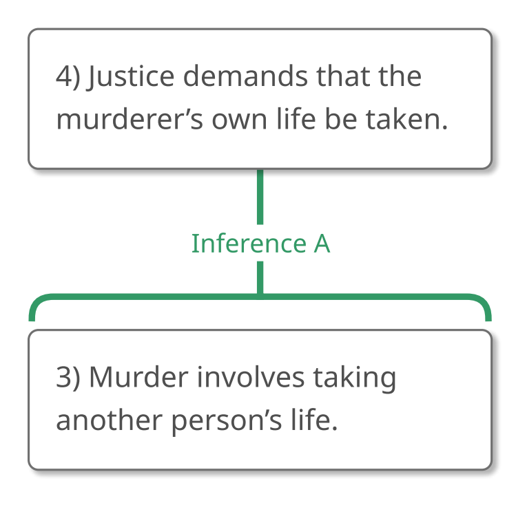
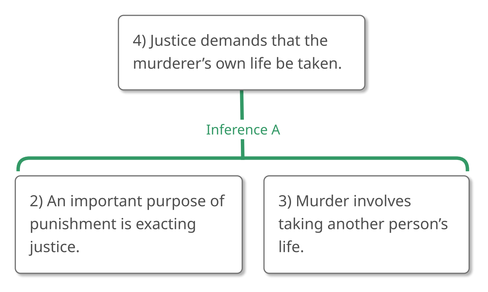
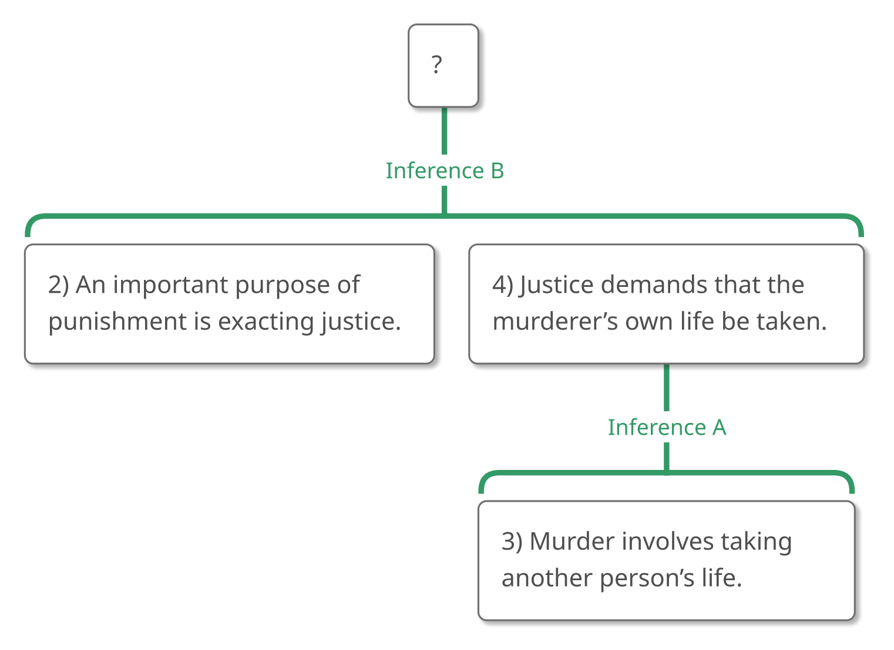
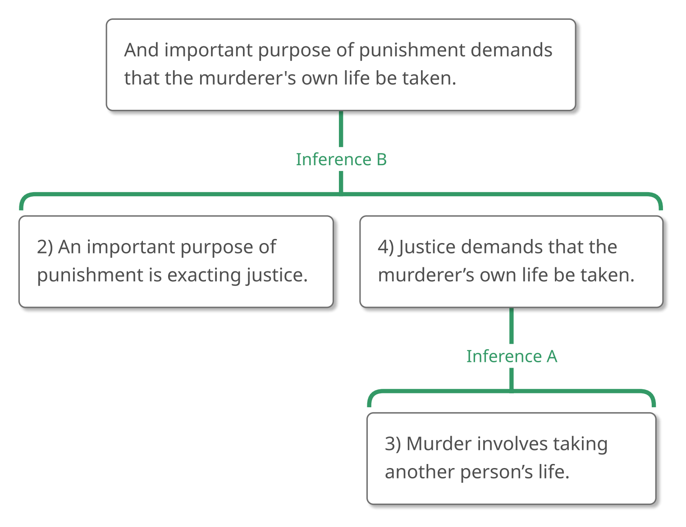
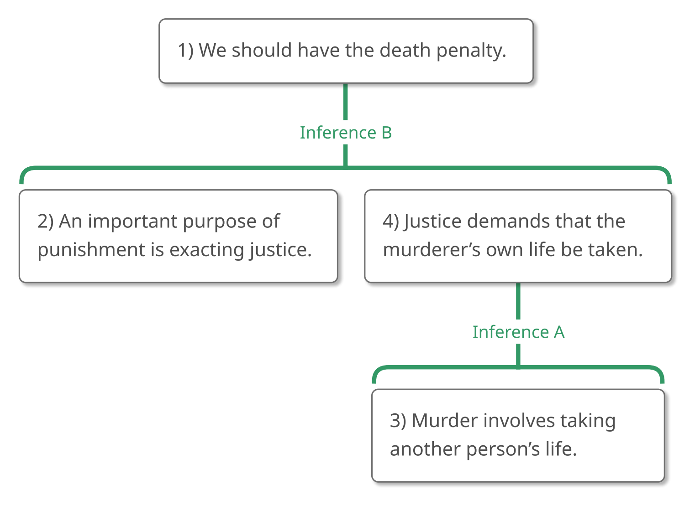
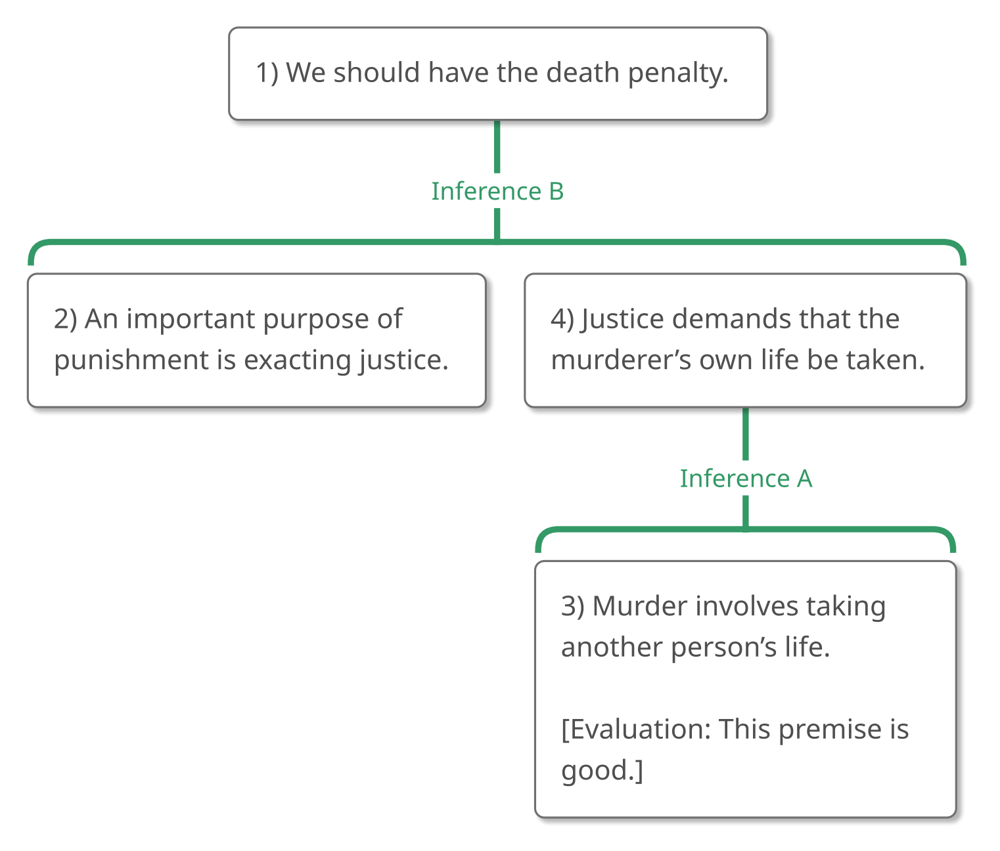
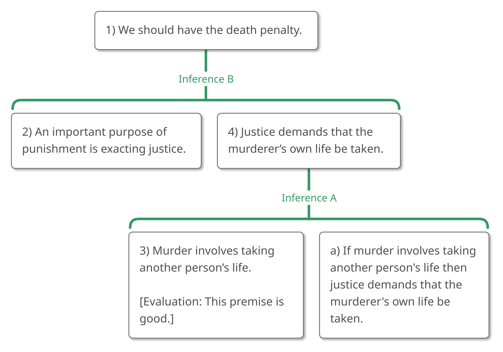
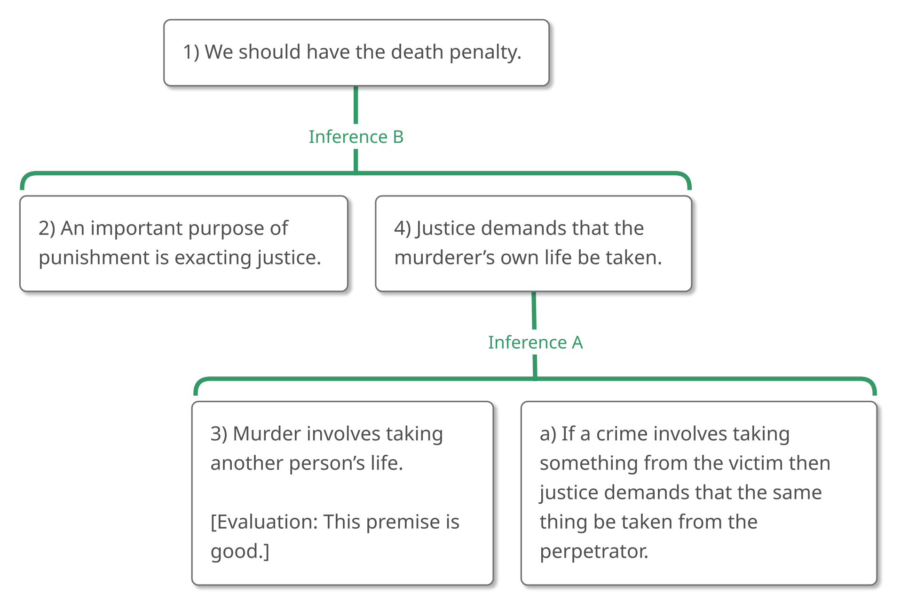
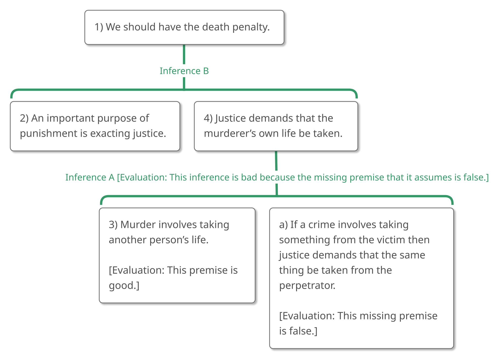

# 3.5 Example 4

## Step 1 – Recognizing an Argument

Here's another passage. What do you think it's doing? Is it trying to establish that something is true?

> "It's popular to oppose capital punishment, but I think it's clear that we should have the death penalty. After all, an important purpose of punishment is exacting justice, and since murder involves taking another person's life, justice demands that the murderer's own life be taken."

It looks to me like this passage is trying to convince us of something, so I'd say that it contains an argument. Let's analyze it.

## Step 2 – Analyzing the Argument

It looks like this argument is trying to convince us that we should have the death penalty, so that's our ultimate conclusion. (The "I think it's clear that" isn't really part of the conclusion because the author isn't trying to convince us that she thinks a particular position is clear.)

> "It's popular to oppose capital punishment, but I think it's clear that (1) we should have the death penalty. After all, an important purpose of punishment is exacting justice, and since murder involves taking another person's life, justice demands that the murderer's own life be taken."

The first component of the first sentence, "It's popular to oppose capital punishment," is expressing a claim but that claim isn't part of the reasoning in favor of why we should have the death penalty. Let's ignore it.

What else is being claimed that *is* part of the argument?

Well, we see "after all." As a reason indicator, that tells us that what follows will probably be part of the argument, but because it's attached to the ultimate conclusion, we shouldn't represent that relationship right away.

We'll follow the practice of dividing at "and."

> "It's popular to oppose capital punishment, but I think it's clear that (1) we should have the death penalty. **After all**, (2) an important purpose of punishment is exacting justice, **and** since murder involves taking another person's life, justice demands that the murderer's own life be taken."

The part of the sentence that follows the "and" begins with a "since" so let's remember how a reason indicator expression at the front of a compound claim works: it connects two claims that are separated by a comma, like this:

-   Since \[reason\], \[conclusion\].

Because we want to represent inference indicator expressions as soon as we can (with the exception of inference indicator expressions that are attached to the ultimate conclusion), let's map that part of the argument now.

> "It's popular to oppose capital punishment, but I think it's clear that (1) we should have the death penalty. **After all**, (2) an important purpose of punishment is exacting justice, and **since** (3) murder involves taking another person's life, (4) justice demands that the murderer's own life be taken."

{#fig-3-5-3to4-1 width=245px fig-alt="Argument map concluding: 4) Justice demands that the murderer’s own life be taken, supported by Claim 3 through Inference A. A full text description is provided."}

::: {.map-outline fig="fig-3-5-3to4-1"}

:::

Now, how is that partial map related to Claim 2?

Well, we see that "and." The Inference Eraser Test would tell us that Claim 2 might work with that mapped unit of reasoning as a dependent reason. But with what claim in that unit of reasoning should Claim 2 be combined, Claim 3 or Claim 4?

> "It's popular to oppose capital punishment, but I think it's clear that (1) we should have the death penalty. After all, (2) an important purpose of punishment is exacting justice, **and** since (3) murder involves taking another person's life, (4) justice demands that the murderer's own life be taken."

The Principle of Proximity would encourage us to see if Claims 2 and 3 are dependent reasons, like this:

> "It's popular to oppose capital punishment, but I think it's clear that (1) we should have the death penalty. After all, (2) an important purpose of punishment is exacting justice, **and** since (3) murder involves taking another person's life, (4) justice demands that the murderer's own life be taken."

{#fig-3-5-2and3-1 width=426px fig-alt="Argument map concluding: 4) Justice demands that the murderer’s own life be taken, supported by Claims 2 and 3 together through Inference A. A full text description is provided."}

::: {.map-outline fig="fig-3-5-2and3-1"}

:::

Reading down the inference line with "because" and reading the bracket as an "and," we get: "(4) Justice demands that the murderer's own life be taken because (2) an important purpose of punishment is exacting justice and (3) murder involves taking another person's life." That doesn't sound *bad*, but neither does it sound like Claim 2 helps Claim 3 very much.

Looking at Claims 2 and 3 with the Puzzle Piece Test in mind, we might notice that they don't share common concepts at which they might "click together." That's a reason to think that Claims 2 and 3 aren't dependent reasons.

The Principle of Proximity, although often helpful, isn't an infallible guide. Maybe Claim 2 is a dependent reason with Claim 4 instead. After all, Claims 2 and 4 have "justice" in common, so let's see what follows from Claims 2 and 4 if we take them as dependent reasons.

> "It's popular to oppose capital punishment, but I think it's clear that (1) we should have the death penalty. After all, (2) an important purpose of punishment is exacting justice, **and** since (3) murder involves taking another person's life, (4) justice demands that the murderer's own life be taken."

{#fig-3-5-2and4-1 width=487px fig-alt="Argument map with a question mark in place of the conclusion, supported by Claims 2 and 4 together through Inference B; Claim 4 is supported by Claim 3 through Inference A. A full text description is provided."}

::: {.map-outline fig="fig-3-5-2and4-1"}

:::

Using the Puzzle Piece Method, we know that the conclusion that follows from Claims 2 and 4 will be composed of the concepts unique to Claim 2, "an important purpose of punishment," and the concepts unique to Claim 4, "demands that the murderer's own life be taken." Putting them together, this gives us, "an important purpose of punishment demands that the murderer's own life be taken."

{#fig-3-5-2and4toc-1 width=487px fig-alt="Argument map concluding: An important purpose of punishment demands that the murderer's own life be taken, supported by Claims 2 and 4 together through Inference B; Claim 4 is supported by Claim 3 through Inference A. A full text description is provided."}

::: {.map-outline fig="fig-3-5-2and4toc-1"}

:::

Although "an important purpose of punishment demands that the murderer's own life be taken" isn't exactly the same as "we should have the death penalty," which is the ultimate conclusion of this argument, it's close enough to indicate that the author almost certainly intends Claims 2 and 4 to be dependent reasons in support of Claim 1.

> "It's popular to oppose capital punishment, but I think it's clear that (1) we should have the death penalty. After all, (2) an important purpose of punishment is exacting justice, and since (3) murder involves taking another person's life, (4) justice demands that the murderer's own life be taken."

{#fig-3-5-full-1 width=487px fig-alt="Argument map concluding: 1) We should have the death penalty, supported by Claims 2 and 4 together through Inference B; Claim 4 is supported by Claim 3 through Inference A. A full text description is provided."}

::: {.map-outline fig="fig-3-5-full-1"}

:::

(By the way, notice how *incredibly useful* it is to represent the inference between Claims 3 and 4 as soon as we see it and then ask, "How is Claim 2 related to that unit of reasoning?" If we *don't* do this, we'll be stuck trying to figure out how Claim 2 is related to Claim 3 and, as we've seen, that's a dead end. Claim 2 *isn't* related to Claim 3. It's related to *Claim 4*. And thinking about the unit of reasoning that contains Claims 3 and 4, we're in a much better position to see that.)

## Step 3 – Evaluating the Argument

Now we can evaluate this argument.

> "It's popular to oppose capital punishment, but I think it's clear that (1) we should have the death penalty. After all, (2) an important purpose of punishment is exacting justice, and since (3) murder involves taking another person's life, (4) justice demands that the murderer's own life be taken."

{#fig-3-5-full-2 width=487px fig-alt="Argument map concluding: 1) We should have the death penalty, supported by Claims 2 and 4 together through Inference B; Claim 4 is supported by Claim 3 through Inference A. A full text description is provided."}

::: {.map-outline fig="fig-3-5-full-2"}

:::

Let's suppose, for the sake of discussion, that the first thing we think is, "I don't think that justice ever demands putting someone to death."

Whether or not that's true, it's not a bad first reaction to have. It engages the argument, after all! But look at *where* it engages the argument. Our reaction is, essentially, a denial of Claim 4, which states, "justice demands that the murderer's own life be taken," and Claim 4 is a *subconclusion*. That means we shouldn't simply reject it; we should, instead, examine the reasoning advanced to support it by looking at Inference A and Premise 3.

What about Premise 3? Is it true? Absolutely. Can it be believed by someone who doesn't already accept the ultimate conclusion of this argument? Sure. So Premise 3 is good.

{#fig-3-5-3eval-1 width=487px fig-alt="Argument map concluding: 1) We should have the death penalty, supported by Claims 2 and 4 together through Inference B; Claim 4 is supported by Claim 3 through Inference A. Claim 3 is labeled: Evaluation: This premise is good. A full text description is provided."}

::: {.map-outline fig="fig-3-5-3eval-1"}

:::

If we're still inclined to reject Claim 4 even though we accept Claim 3, then we're justified in thinking that something must be wrong with Inference A. After all, if *we* can accept Claim 3 and reject Claim 4, then assuming that we're rational, we are basically playing the role of Gully in the Gullible Person Test.

But let's think about this argument a little more, because if we're engaged in a discussion with someone who's advancing this argument, we probably won't move the conversation forward by saying "We don't think that Claim 4 follows from Claim 3"—not even if the person advancing this argument is looking at our map. "Well, I *do* think that Claim 4 follows from Claim 3," they'd probably say, "Why *shouldn't* I? And more to the point, why don't *you*?"

### The Missing Premise Method

It's time to develop a new way to evaluate inferences: The Missing Premise Method.

**When we evaluate an inference using the Missing Premise Method, we identify the missing premise that is assumed by the inference and then evaluate the inference by assessing that missing premise.**

To identify the missing premise, we can start with a missing premise that is simply "If \[reason\] then \[conclusion\]."

Then, we'll usually replace that conditional with the most likely reason that the author has for accepting this "if\... then\..." claim.

Often this reason will be a broader principle that encompasses the specific "if\... then\..." claim. We can discover that broader principle by finding the concepts that the front part of the "if\... then\..." and the back part of the "if\... then\..." have in common and replacing that concept with something more general.

Let's apply this to Inference A, which takes us from "Murder involves taking another person's life," to "Justice demands that the murderer's own life be taken." Our initial missing premise is simply "If murder involves taking another person's life, then justice demands that the murderer's own life be taken." (I'll give the missing premises lowercase letters instead of numbers, because they essentially capture the content of the inference with the uppercase letter.)

{#fig-3-5-aeval1-1 width=591px fig-alt="Argument map concluding: 1) We should have the death penalty, supported by Claims 2 and 4 together through Inference B; Claim 4 is supported by Claim 3 through Inference A. Claim 3, labeled as a good premise, works together with missing premise a): If murder involves taking another person's life then justice demands that the murderer's own life be taken. A full text description is provided."}

::: {.map-outline fig="fig-3-5-aeval1-1"}

:::

Now it's possible that the author means that missing premise exactly as stated, but it's just as likely that the author has some broader principle in mind and would, in fact, justify that missing premise by appealing to the broader principle.

We can find that general principle by noting that the front part and the back part of the "if\... then\..." are both talking about taking a life. If we generalize from that we'd get a claim like "If a crime involves taking something from the victim then justice demands that the same thing be taken from the perpetrator."

{#fig-3-5-aeval2-1 width=613px fig-alt="Argument map concluding: 1) We should have the death penalty, supported by Claims 2 and 4 together through Inference B; Claim 4 is supported by Claim 3 through Inference A. Claim 3, labeled as a good premise, works together with missing premise a): If a crime involves taking something from the victim then justice demands that the same thing be taken from the perpetrator. A full text description is provided."}

::: {.map-outline fig="fig-3-5-aeval2-1"}

:::

So, what do we think about this missing premise?

The missing premise is an "if... then..." sentence, of course, so we should identify the falsification condition and see if we think that the falsification condition can happen.

The falsification condition is "a crime involves taking something from the victim (front part true) but justice does *not* demand that the same thing be taken from the perpetrator (back part false)."

Can that happen? It seems to me that the answer to that question is "Absolutely!" If someone steals a car, we don't assume that justice requires us to steal their car. If someone burns down a house, we don't assume that justice requires us to burn down their house. Certainly justice requires us to inflict some sort of punishment, but we don't usually assume that the punishment needs to be the same crime enacted upon the criminal. It looks to me like this missing premise is false. This means that the inference which assumes that missing premise is bad, and that, in turn, makes the argument bad.

> "It's popular to oppose capital punishment, but I think it's clear that (1) we should have the death penalty. After all, (2) an important purpose of punishment is exacting justice, and since (3) murder involves taking another person's life, (4) justice demands that the murderer's own life be taken."

{#fig-3-5-aeval3-1 width=655px fig-alt="Argument map concluding: 1) We should have the death penalty, supported by Claims 2 and 4 together through Inference B; Claim 4 is supported by Claim 3 through Inference A. Claim 3 is labeled as a good premise; missing premise a), the broader principle about taking the same thing from the perpetrator, is labeled: Evaluation: This missing premise is false. Inference A is labeled: Evaluation: This inference is bad because the missing premise that it assumes is false. A full text description is provided."}

::: {.map-outline fig="fig-3-5-aeval3-1"}

:::

### Communicating Our Evaluation

Evaluating an inference by identifying and evaluating the missing premise that it assumes has the advantage of making our criticism of the argument easier to articulate.

Let's return, for example, to the conversation that we might have with someone who advances this argument. In response to our criticism of Inference A, we imagined this person saying, "Well, I *do* think that Claim 4 follows from Claim 3. Why *shouldn't* I? And more to the point, why don't *you*?"

Having identified the missing premise, we can answer that question quite nicely. We can say, "The inference assumes that whenever a crime involves taking something from another person, justice demands that the same thing be taken from the perpetrator. But that seems wrong. We don't think that we should steal the cars of car thieves, for instance."

**In general, we can say something like, "This inference assumes that \[state missing premise\], but that seems wrong because \[explain why the missing premise is incorrect\]."**

Of course, the person who is advancing the argument in favor of capital punishment is unlikely to say, "You're right! I see that my argument is completely off!" She will, instead, probably adjust her argument to avoid the problem that you've pointed out. And that's fine because your conversation will have advanced the discussion. That's exactly how progress is made in dialogs like this: not so much through the abandonment of arguments, but through the gradual modifications of them. At some point, the modifications either fix the problem or become untenable and the argument collapses, but most points in the discussion aren't simple "thumbs up" or "thumbs down" moments.

## Summary of Example 4

Example 4 presented us with this passage:

> "It's popular to oppose capital punishment, but I think it's clear that we should have the death penalty. After all, an important purpose of punishment is exacting justice, and since murder involves taking another person's life, justice demands that the murderer's own life be taken."

### Step 1 – Recognizing an Argument

We decided that this passage is trying to convince us of something. It contains an argument.

### Step 2 – Analyzing the Argument

The ultimate conclusion of this argument is "We should have the death penalty." We ignored the first part of the sentence containing that conclusion.

> "It's popular to oppose capital punishment, but I think it's clear that (1) we should have the death penalty. After all, an important purpose of punishment is exacting justice, and since murder involves taking another person's life, justice demands that the murderer's own life be taken."

We divided the next sentence at the "and," taking the first part as important because of the "after all."

Because "after all" is attached to the ultimate conclusion, we didn't want to represent it right away. We continued to read, noting that the remainder of that sentence contains two claims connected with "since," which takes effect at the comma. Because we want to represent inference indicator expressions not attached to the ultimate conclusion as soon as we can, we mapped that part of the argument.

> "It's popular to oppose capital punishment, but I think it's clear that (1) we should have the death penalty. **After all**, (2) an important purpose of punishment is exacting justice, and **since** (3) murder involves taking another person's life, (4) justice demands that the murderer's own life be taken."

{#fig-3-5-3to4-2 width=245px fig-alt="Argument map concluding: 4) Justice demands that the murderer’s own life be taken, supported by Claim 3 through Inference A. A full text description is provided."}

::: {.map-outline fig="fig-3-5-3to4-2"}

:::

At this point, we asked, "How is this partial map related to Claim 2?"

Some reflection convinced us that Claims 2 and 4 are dependent reasons that should be joined with a bracket.

{#fig-3-5-2and4-2 width=487px fig-alt="Argument map with a question mark in place of the conclusion, supported by Claims 2 and 4 together through Inference B; Claim 4 is supported by Claim 3 through Inference A. A full text description is provided."}

::: {.map-outline fig="fig-3-5-2and4-2"}

:::

We used the Puzzle Piece Method to proactively fill in the claim that would follow from Claims 2 and 4: An important purpose of punishment demands that the murderer's own life be taken. Because that's very close to Claim 1, we decided that Claim 1 follows from Claims 2 and 4.

> "It's popular to oppose capital punishment, but I think it's clear that (1) we should have the death penalty. After all, (2) an important purpose of punishment is exacting justice, and since (3) murder involves taking another person's life, (4) justice demands that the murderer's own life be taken."

{#fig-3-5-full-3 width=487px fig-alt="Argument map concluding: 1) We should have the death penalty, supported by Claims 2 and 4 together through Inference B; Claim 4 is supported by Claim 3 through Inference A. A full text description is provided."}

::: {.map-outline fig="fig-3-5-full-3"}

:::

### Step 3 – Evaluating the Argument

We noted that someone could respond to this argument by saying, "I don't think that justice ever demands putting someone to death." This, though, would be an objection to Claim 4. Claim 4 is a subconclusion, so we'd want to examine the reasoning supporting it.

#### The Missing Premise Method

Tracing our objection to Claim 4 to its source, we evaluated Inference A by identifying and evaluating the missing premise that is assumed by Inference A.

{#fig-3-5-aeval3-2 width=655px fig-alt="Argument map concluding: 1) We should have the death penalty, supported by Claims 2 and 4 together through Inference B; Claim 4 is supported by Claim 3 through Inference A. Claim 3 is labeled as a good premise; missing premise a), the broader principle about taking the same thing from the perpetrator, is labeled: Evaluation: This missing premise is false. Inference A is labeled: Evaluation: This inference is bad because the missing premise that it assumes is false. A full text description is provided."}

::: {.map-outline fig="fig-3-5-aeval3-2"}

:::

#### Communicating the Evaluation of an Argument

Because objections to claims are often easier to articulate than objections to connections between claims, speaking to the missing premise that's presupposed by an inference can make our objection to an inference easier to explain to other people.

In general, we can say something like, "This inference assumes that \[state missing premise\], but that seems wrong because \[explain why the missing premise is incorrect\]." In this case, for example, we can say, "The inference assumes that whenever a crime involves taking something from another person, justice demands that the same thing be taken from the perpetrator. But that seems wrong. We don't think that we should steal the cars of car thieves, for instance."
