# 3.6 Example 5

## Step 1 – Recognizing an Argument

Here's another passage for us to consider:

> "We want to deter potential murderers and the death penalty will deter potential murderers because people will realize that killing someone might result in their own execution and because nobody wants to be executed. That's why we should have the death penalty."

Does this passage attempt to establish that something is true, or convince us of something? Does it contain an argument?

It looks like it to me! So let's analyze it.

## Step 2 – Analyzing the Argument

What is the ultimate conclusion here, the main claim that the argument is attempting to establish?

> "We want to deter potential murderers and the death penalty will deter potential murderers because people will realize that killing someone might result in their own execution and because nobody wants to be executed. That's why we should have the death penalty."

I'd say it's the claim that we should have the death penalty.

> "We want to deter potential murderers and the death penalty will deter potential murderers because people will realize that killing someone might result in their own execution and because nobody wants to be executed. That's why (1) we should have the death penalty."

Now, let's return to the top of the passage to see what other important claims we can find. The very first sentence of this passage seems to contain an important claim since the inference indicator expression "because" tells us that one part of the sentence is probably providing a reason to accept the other part. We'll certainly need to divide the sentence into parts around that inference indicator, and since it's usually a good idea to divide around "and" as well, we get three important claims right away.

> "(2) We want to deter potential murderers **and** (3) the death penalty will deter potential murderers **because** (4) people will realize that killing someone might result in their own execution and because nobody wants to be executed. That's why (1) we should have the death penalty."

Remember, though, we should try to think about things *two at a time*, not *three at a time*, so let's try to put some of these claims together before we put more claims on our plate. Remember, too, that we should try to represent an inference indicator expression as soon as possible (unless it's connected to the ultimate conclusion), so let's identify the relationship between Claim 3 and Claim 4.

The "because," as a reason indicator expression, tells us that Claim 4 is being given as a reason to believe Claim 3. This gives us the following partial map:

> "(2) We want to deter potential murderers **and** (3) the death penalty will deter potential murderers **because** (4) people will realize that killing someone might result in their own execution and because nobody wants to be executed. That's why (1) we should have the death penalty."

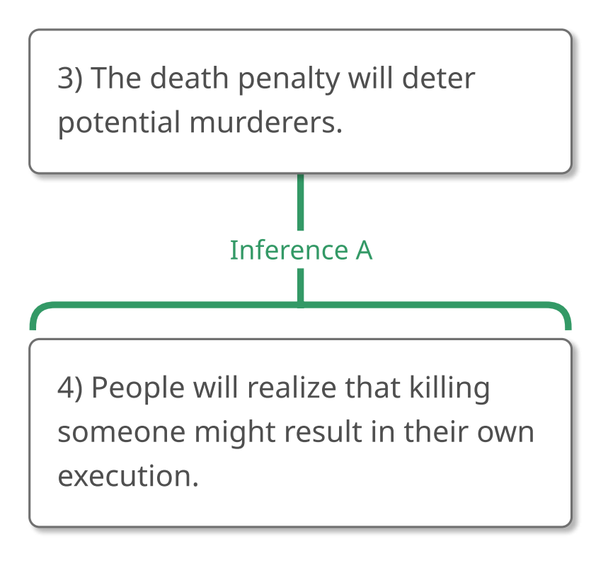{#fig-3-6-4to3-1 width=275px fig-alt="Argument map concluding: 3) The death penalty will deter potential murderers, supported by Claim 4 through Inference A. A full text description is provided."}

::: {.map-outline fig="fig-3-6-4to3-1"}

:::

Now we can ask, "How is this part of the argument related to Claim 2?"

The "and" as an inference eraser suggests that we might take Claims 2 and 3 as dependent reasons. And remember, as soon as we think that two claims are dependent reasons, we should try to *fill in for ourselves* the conclusion that follows from them. (This is because sometimes that conclusion won't be explicitly stated in the argument and we'll need to supply it.)

So, if we take Claims 2 and 3 as dependent reasons, what follows from them?

> "(2) We want to deter potential murderers **and** (3) the death penalty will deter potential murderers **because** (4) people will realize that killing someone might result in their own execution and because nobody wants to be executed. That's why (1) we should have the death penalty."

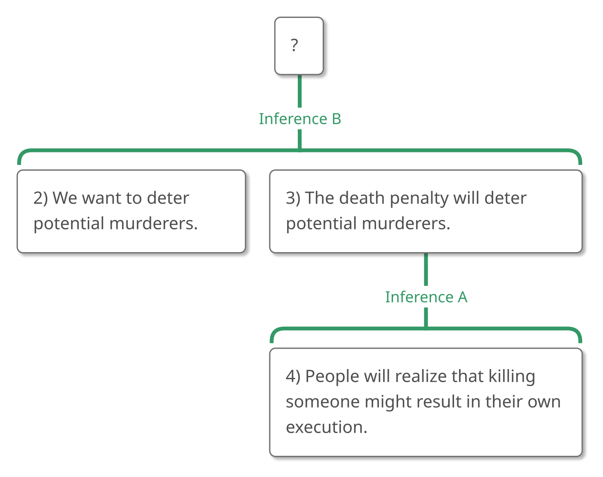{#fig-3-6-2and3-1 width=473px fig-alt="Argument map with a question mark in place of the conclusion, supported by Claims 2 and 3 together through Inference B; Claim 3 is supported by Claim 4 through Inference A. A full text description is provided."}

::: {.map-outline fig="fig-3-6-2and3-1"}

:::

Utilizing the Puzzle Piece Test, we see that both Claims 2 and 3 contain "deter potential murderers." The concept unique to 2 is "we want," and the concept unique to 3 is "the death penalty." Putting them together, we get "We want the death penalty."

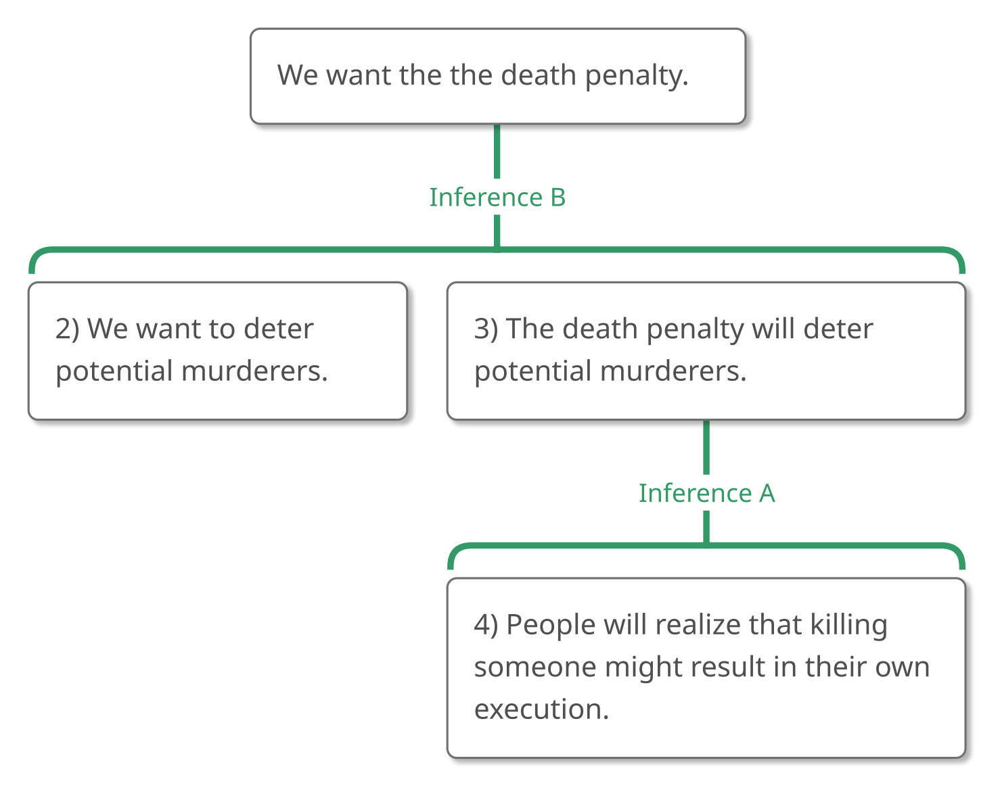{#fig-3-6-2and3toc-1 width=473px fig-alt="Argument map concluding: We want the death penalty, supported by Claims 2 and 3 together through Inference B; Claim 3 is supported by Claim 4 through Inference A. A full text description is provided."}

::: {.map-outline fig="fig-3-6-2and3toc-1"}

:::

That looks like the ultimate conclusion ("We should have the death penalty") to me!

> "(2) We want to deter potential murderers **and** (3) the death penalty will deter potential murderers **because** (4) people will realize that killing someone might result in their own execution and because nobody wants to be executed. That's why (1) we should have the death penalty."

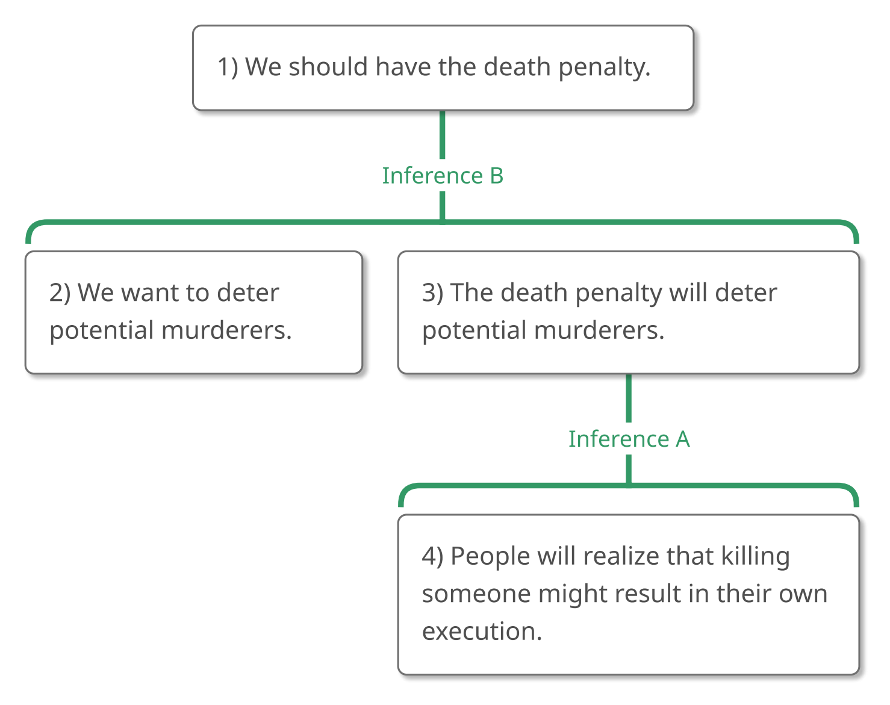{#fig-3-6-2and3to1-1 width=473px fig-alt="Argument map concluding: 1) We should have the death penalty, supported by Claims 2 and 3 together through Inference B; Claim 3 is supported by Claim 4 through Inference A. A full text description is provided."}

::: {.map-outline fig="fig-3-6-2and3to1-1"}

:::

Now we can return to identifying important claims, and there's only one left, "nobody wants to be executed."

> "(2) We want to deter potential murderers and (3) the death penalty will deter potential murderers because (4) people will realize that killing someone might result in their own execution and because (5) nobody wants to be executed. That's why (1) we should have the death penalty."

{#fig-3-6-2and3to1-2 width=473px fig-alt="Argument map concluding: 1) We should have the death penalty, supported by Claims 2 and 3 together through Inference B; Claim 3 is supported by Claim 4 through Inference A. A full text description is provided."}

::: {.map-outline fig="fig-3-6-2and3to1-2"}

:::

How is Claim 5 related to the part of the argument that we've already mapped?

Well, that "because" between Claim 4 and Claim 5 might lead us to think that Claim 5 is being given as a reason to believe Claim 4. So let's try that out.

> "(2) We want to deter potential murderers and (3) the death penalty will deter potential murderers because (4) people will realize that killing someone might result in their own execution and because (5) nobody wants to be executed. That's why (1) we should have the death penalty."

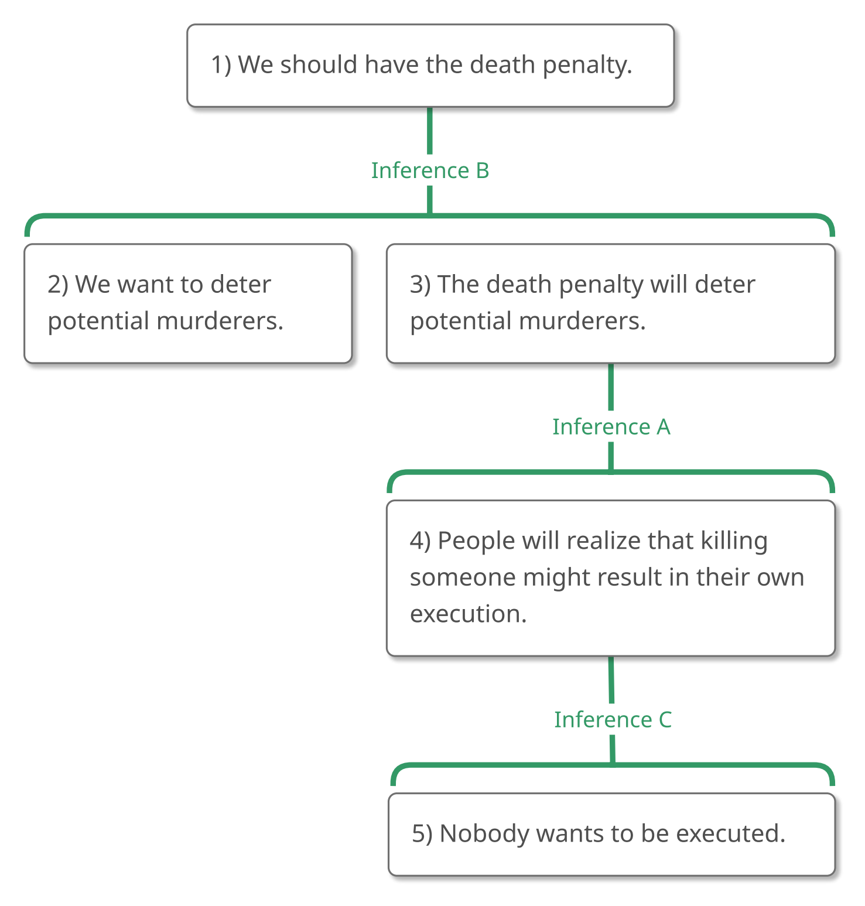{#fig-3-6-5to4-1 width=473px fig-alt="Argument map concluding: 1) We should have the death penalty, supported by Claims 2 and 3 together through Inference B; Claim 3 is supported by Claim 4 through Inference A; Claim 4 is supported by Claim 5 through Inference C. A full text description is provided."}

::: {.map-outline fig="fig-3-6-5to4-1"}

:::

Reading down Inference C with "because" gives us "People will realize that killing someone might result in their own execution (Claim 4) because nobody wants to be executed (Claim 5)."

That doesn't sound right. If someone doesn't think that people will realize that killing someone might get them executed (maybe because they think most murderers assume that they'll never get caught, which is plausible) we couldn't change that person's mind by saying, "Of course, it will! Nobody wants to be executed."

So Claim 5 doesn't support Claim 4. What *is* the relationship between them, then? Answer: They are dependent reasons. Take a look:

> "(2) We want to deter potential murderers and (3) the death penalty will deter potential murderers because (4) people will realize that killing someone might result in their own execution and because (5) nobody wants to be executed. That's why (1) we should have the death penalty."

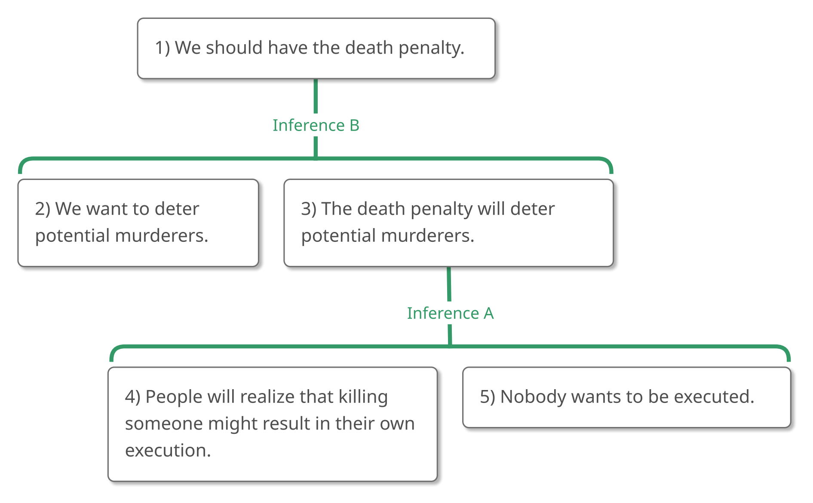{#fig-3-6-full-1 width=605px fig-alt="Argument map concluding: 1) We should have the death penalty, supported by Claims 2 and 3 together through Inference B; Claim 3 is supported by Claims 4 and 5 together through Inference A. A full text description is provided."}

::: {.map-outline fig="fig-3-6-full-1"}

:::

Reading down Inference A with "because" and reading the bracket with "and" gives us "The death penalty will deter potential murderers (Claim 3) because people will realize that killing someone might result in their own execution (Claim 4) and nobody wants to be executed (Claim 5)." That sounds quite nice! That seems to be what the author of the argument had in mind.

### "Because... and because..."

Here's something worth remembering: "because... and because..." (and "since... and since...") often work like that. **"\[conclusion\] because \[reason 1\] and because \[reason 2\]" will frequently have \[reason 1\] and \[reason 2\] as dependent reasons in support of \[conclusion\]**.

### Inference Lines Go Up to One Claim

We've finished mapping this argument! But before we turn to evaluation, there's something we should mention.

Inferences can use multiple reasons but they always take us to one conclusion. That's why an inference line can have a dependent bracket covering more than one claim at the bottom, but should always point to a **single** claim at the top; in particular, an inference line should never run *from* a dependent reason bracket *to* a dependent reason bracket, or point to a space between claims.

Sometimes, when an argument says (for example) "Claim 2 and Claim 3 because Claim 4," it's easy to think that maybe Claim 4 is being given as a reason to believe the combination of Claim 2 and Claim 3, like this:

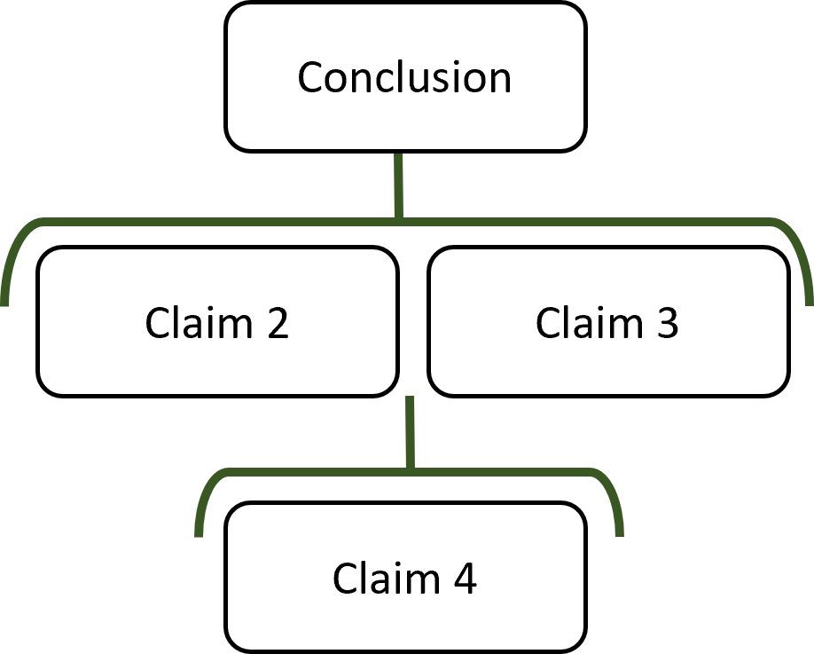{.illustration width=300px fig-alt="An argument map in which Claims 2 and 3, joined by a bracket, support the Conclusion. An inference line from Claim 4 points up to a place between Claim 2 and Claim 3."}

But no. Claim 4 is supporting Claim 3 and Claim 3 *alone*. (And if we represent the "because" before the "and," we'll see that naturally.)

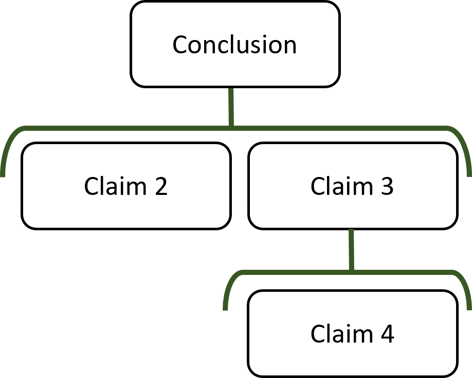{.illustration width=300px fig-alt="An argument map in which Claims 2 and 3, joined by a bracket, support the Conclusion. An inference line from Claim 4 points up to Claim 3."}

## Step 3 – Evaluating the Argument

What should we make of this argument? Should we be convinced by it?

> "(2) We want to deter potential murderers and (3) the death penalty will deter potential murderers because (4) people will realize that killing someone might result in their own execution and because (5) nobody wants to be executed. That's why (1) we should have the death penalty."

{#fig-3-6-full-2 width=605px fig-alt="Argument map concluding: 1) We should have the death penalty, supported by Claims 2 and 3 together through Inference B; Claim 3 is supported by Claims 4 and 5 together through Inference A. A full text description is provided."}

::: {.map-outline fig="fig-3-6-full-2"}

:::

Let's take a closer look at Inference B, because that's a kind of inference that shows up a *lot* in everyday life: it's Means / Ends Reasoning.

### Means / Ends Reasoning

In Means / Ends Reasoning:

-   We note that there's a certain end (or goal, or objective) that we want to achieve. (We'll call it "E" for "end.")

-   We note that a particular course of action will help us to achieve that end. (We'll call it "M" for "means.")

-   And we (often quite sensibly) conclude from this that we should do M.

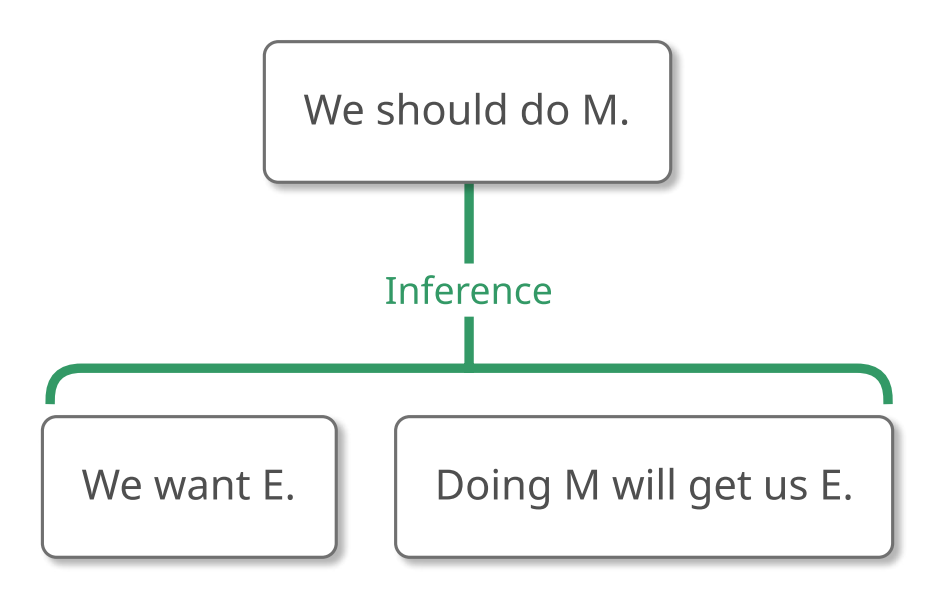{#fig-3-6-means-ends-1-1 width=302px fig-alt="Argument map concluding: We should do M, supported by two claims together through an inference: We want E, and Doing M will get us E. A full text description is provided."}

::: {.map-outline fig="fig-3-6-means-ends-1-1"}

:::

Can you see how Inference B in our argument is an instance of means / ends reasoning? Deterring murderers is our end. The death penalty is the means. And we conclude that we should have the death penalty. That's a *classic* example of means / ends reasoning.

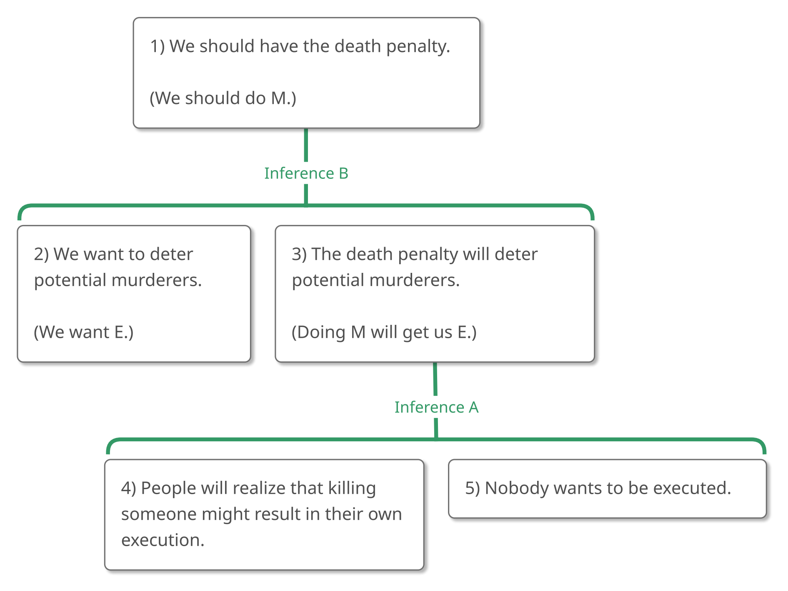{#fig-3-6-me1-1 width=605px fig-alt="Argument map concluding: 1) We should have the death penalty (We should do M), supported by Claims 2 and 3 together through Inference B; Claim 3 is supported by Claims 4 and 5 together through Inference A. Claim 2 is labeled We want E, and Claim 3 is labeled Doing M will get us E. A full text description is provided."}

::: {.map-outline fig="fig-3-6-me1-1"}

:::

Means / ends reasoning is so common that you've almost certainly engaged in it multiple times today.

-   If you ate breakfast because you wanted to avoid being hungry at 10:00 a.m. and because you know that eating breakfast will prevent you from being hungry at 10:00 a.m., you engaged in means / ends reasoning.

-   If you're in school because you want to improve your life and because you know that going to school will help you improve your life, you're engaging in means / ends reasoning.

-   If you get a job because you want money and because you know that getting a job will get you money, you're engaging in means / ends reasoning.

(Side note: Look at all of the "because... and because..." constructions in those examples.)

Means / ends reasoning is all around us, and it works very well the vast majority of the time. When it fails, however, it fails *spectacularly*.

For instance, let's take a look at the third of the examples I gave.

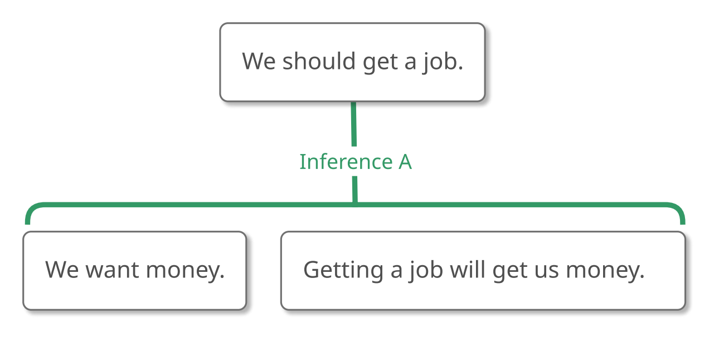{#fig-3-6-job1-1 width=410px fig-alt="Argument map concluding: We should get a job, supported by two claims together through Inference A: We want money, and Getting a job will get us money. A full text description is provided."}

::: {.map-outline fig="fig-3-6-job1-1"}

:::

That's not a problem.

But compare it to this argument.

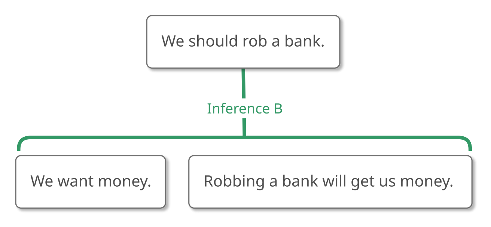{#fig-3-6-bank1-1 width=420px fig-alt="Argument map concluding: We should rob a bank, supported by two claims together through Inference B: We want money, and Robbing a bank will get us money. A full text description is provided."}

::: {.map-outline fig="fig-3-6-bank1-1"}

:::

That's a problem!

So what's the difference? Why is one instance of means / ends reasoning okay and the other not?

The key is seeing that means / ends reasoning always has a hidden premise, like "Doing M is among the best ways to get E."

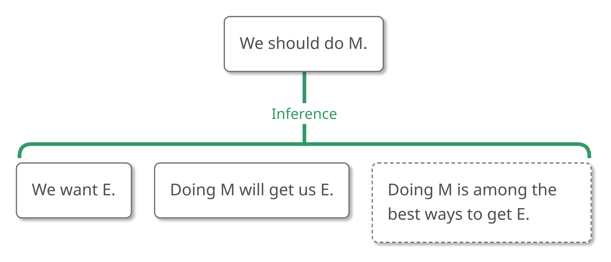{#fig-3-6-means-ends-2-1 width=500px fig-alt="Argument map concluding: We should do M, supported by three claims together through an inference: We want E, Doing M will get us E, and the missing premise Doing M is among the best ways to get E. A full text description is provided."}

::: {.map-outline fig="fig-3-6-means-ends-2-1"}

:::

When that hidden premise is true (as it probably is with getting a job) the inference is fine.

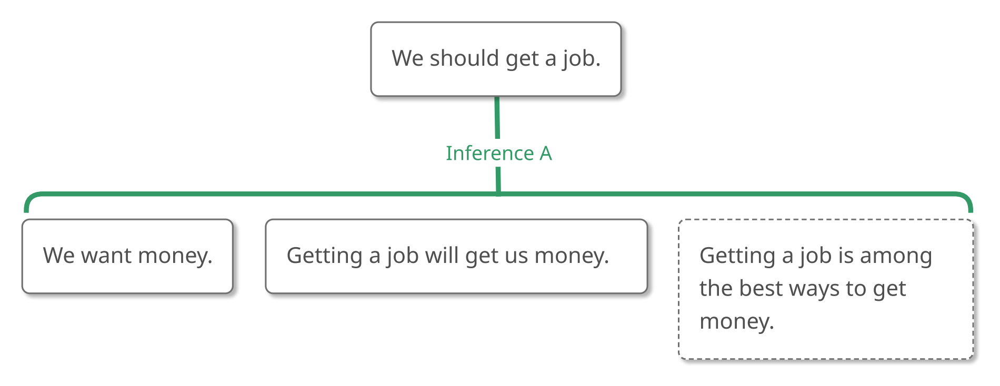{#fig-3-6-job2-1 width=608px fig-alt="Argument map concluding: We should get a job, supported by three claims together through Inference A: We want money, Getting a job will get us money, and the missing premise Getting a job is among the best ways to get money. A full text description is provided."}

::: {.map-outline fig="fig-3-6-job2-1"}

:::

When that hidden premise is false (as it probably is with robbing a bank) the inference is bad.

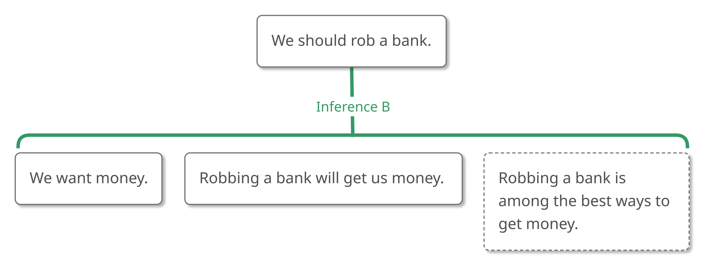{#fig-3-6-bank2-1 width=618px fig-alt="Argument map concluding: We should rob a bank, supported by three claims together through Inference B: We want money, Robbing a bank will get us money, and the missing premise Robbing a bank is among the best ways to get money. A full text description is provided."}

::: {.map-outline fig="fig-3-6-bank2-1"}

:::

(Can you see how this is a special case of using the Missing Premise Method to evaluate an inference?)

Now let's use this method to evaluate Inference B in our argument.

> "(2) We want to deter potential murderers and (3) the death penalty will deter potential murderers because (4) people will realize that killing someone might result in their own execution and because (5) nobody wants to be executed. That's why (1) we should have the death penalty."

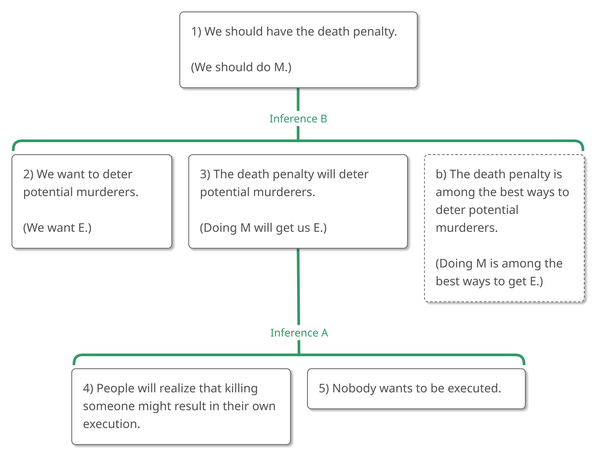{#fig-3-6-me2-1 width=671px fig-alt="Argument map concluding: 1) We should have the death penalty (We should do M), supported through Inference B by Claim 2 (We want E), Claim 3 (Doing M will get us E), and missing premise b): The death penalty is among the best ways to deter potential murderers (Doing M is among the best ways to get E). Claim 3 is supported by Claims 4 and 5 together through Inference A. A full text description is provided."}

::: {.map-outline fig="fig-3-6-me2-1"}

:::

To some extent, the truth of Premise "b" is an empirical question—the sort of question that requires social science and statistics to adequately answer. If the best evidence indicates that the death penalty is no more effective a deterrent than life in prison, then it isn't the best way to deter potential murderers. Even if the evidence indicates that the death penalty *is* a more effective deterrent than life in prison, we could argue capital punishment is sufficiently problematic on ethical grounds to warrant its removal from the category of best deterrents.

This means that someone could say that Inference B is bad and conclude from this that the argument is bad as a whole.

> "(2) We want to deter potential murderers and (3) the death penalty will deter potential murderers because (4) people will realize that killing someone might result in their own execution and because (5) nobody wants to be executed. That's why (1) we should have the death penalty."

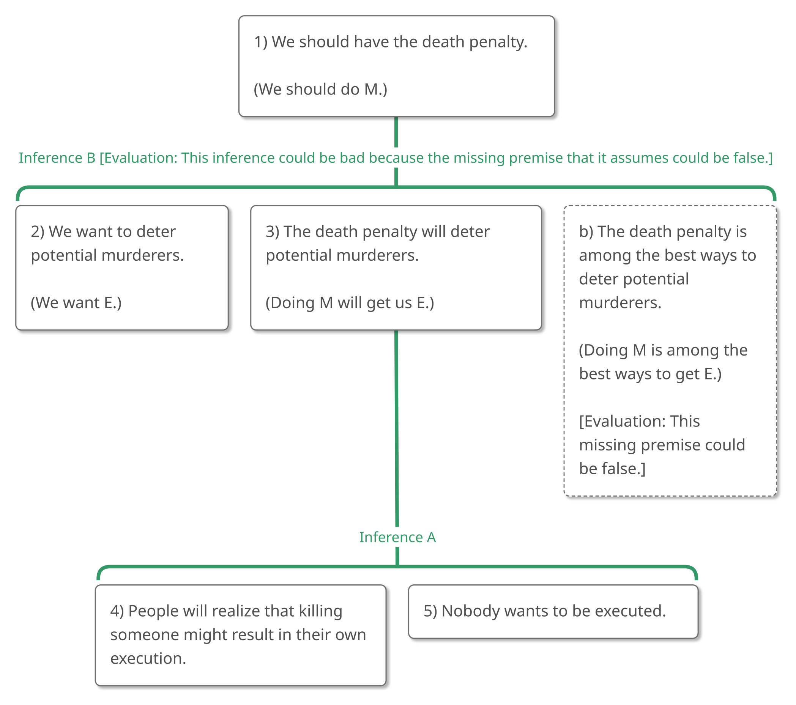{#fig-3-6-me2eval-1 width=671px fig-alt="Argument map concluding: 1) We should have the death penalty (We should do M), supported through Inference B by Claim 2 (We want E), Claim 3 (Doing M will get us E), and missing premise b): The death penalty is among the best ways to deter potential murderers. Missing premise b) is labeled: Evaluation: This missing premise could be false. Inference B is labeled: Evaluation: This inference could be bad because the missing premise that it assumes could be false. Claim 3 is supported by Claims 4 and 5 together through Inference A. A full text description is provided."}

::: {.map-outline fig="fig-3-6-me2eval-1"}

:::

## Summary of Example 5

Example 5 presented us with this passage:

> "We want to deter potential murderers and the death penalty will deter potential murderers because people will realize that killing someone might result in their own execution and because nobody wants to be executed. That's why we should have the death penalty."

### Step 1 – Recognizing an Argument

We decided that this passage is trying to convince us of something. It contains an argument.

### Step 2 – Analyzing the Argument

We decided that the ultimate conclusion is "We should have the death penalty."

> "We want to deter potential murderers and the death penalty will deter potential murderers because people will realize that killing someone might result in their own execution and because nobody wants to be executed. That's why (1) we should have the death penalty."

And we identified Claims 2, 3, and 4 by dividing around "and" and "because."

> "(2) We want to deter potential murderers **and** (3) the death penalty will deter potential murderers **because** (4) people will realize that killing someone might result in their own execution and because nobody wants to be executed. That's why (1) we should have the death penalty."

Since "because" is an inference indicator expression not attached to the ultimate conclusion, we represented that relationship right away.

{#fig-3-6-4to3-2 width=275px fig-alt="Argument map concluding: 3) The death penalty will deter potential murderers, supported by Claim 4 through Inference A. A full text description is provided."}

::: {.map-outline fig="fig-3-6-4to3-2"}

:::

At this point, we asked how that part of the argument is related to Claim 2. The Puzzle Piece Test helped us to see that Claims 2 and 3 are dependent reasons.

{#fig-3-6-2and3-2 width=473px fig-alt="Argument map with a question mark in place of the conclusion, supported by Claims 2 and 3 together through Inference B; Claim 3 is supported by Claim 4 through Inference A. A full text description is provided."}

::: {.map-outline fig="fig-3-6-2and3-2"}

:::

The Puzzle Piece Test also helped us to proactively identify what follows from Claims 2 and 3: "We want the death penalty."

{#fig-3-6-2and3toc-2 width=473px fig-alt="Argument map concluding: We want the death penalty, supported by Claims 2 and 3 together through Inference B; Claim 3 is supported by Claim 4 through Inference A. A full text description is provided."}

::: {.map-outline fig="fig-3-6-2and3toc-2"}

:::

"We want the death penalty" is sufficiently close to the ultimate conclusion to allow us to decide that Claims 2 and 3 jointly support Claim 1.

{#fig-3-6-2and3to1-3 width=473px fig-alt="Argument map concluding: 1) We should have the death penalty, supported by Claims 2 and 3 together through Inference B; Claim 3 is supported by Claim 4 through Inference A. A full text description is provided."}

::: {.map-outline fig="fig-3-6-2and3to1-3"}

:::

The next important claim in the argument is "nobody wants to be executed." Thinking about how that claim relates to the part of the argument that we already mapped allowed us to see that it's a dependent reason that works with Claim 4 to support Claim 3.

> "(2) We want to deter potential murderers and (3) the death penalty will deter potential murderers because (4) people will realize that killing someone might result in their own execution and because (5) nobody wants to be executed. That's why (1) we should have the death penalty."

{#fig-3-6-full-3 width=605px fig-alt="Argument map concluding: 1) We should have the death penalty, supported by Claims 2 and 3 together through Inference B; Claim 3 is supported by Claims 4 and 5 together through Inference A. A full text description is provided."}

::: {.map-outline fig="fig-3-6-full-3"}

:::

We saw that sentences of the form "\[conclusion\] because \[reason 1\] and because \[reason 2\]" will frequently have \[reason 1\] and \[reason 2\] as dependent reasons in support of \[conclusion\].

We also saw that although an inference line can have a dependent bracket covering multiple claims at the bottom, it should always have a single claim at the top.

### Step 3 – Evaluating the Argument

We noted that Inference B is an instance of Means / Ends Reasoning.

{#fig-3-6-means-ends-1-2 width=302px fig-alt="Argument map concluding: We should do M, supported by two claims together through an inference: We want E, and Doing M will get us E. A full text description is provided."}

::: {.map-outline fig="fig-3-6-means-ends-1-2"}

:::

We also learned that Means / Ends Reasoning relies upon a frequently unstated assumption to the effect that adopting the recommended means is among the best ways to achieve the desired end.

{#fig-3-6-means-ends-2-2 width=500px fig-alt="Argument map concluding: We should do M, supported by three claims together through an inference: We want E, Doing M will get us E, and the missing premise Doing M is among the best ways to get E. A full text description is provided."}

::: {.map-outline fig="fig-3-6-means-ends-2-2"}

:::

In the case of this example, Inference B assumes that the death penalty is among the best ways to deter potential murderers. That's debatable, and someone who rejects the assumption will decide that Inference B is bad. That, of course, would be enough to make this person conclude that the argument itself is bad.

{#fig-3-6-me2eval-2 width=671px fig-alt="Argument map concluding: 1) We should have the death penalty (We should do M), supported through Inference B by Claim 2 (We want E), Claim 3 (Doing M will get us E), and missing premise b): The death penalty is among the best ways to deter potential murderers. Missing premise b) is labeled: Evaluation: This missing premise could be false. Inference B is labeled: Evaluation: This inference could be bad because the missing premise that it assumes could be false. Claim 3 is supported by Claims 4 and 5 together through Inference A. A full text description is provided."}

::: {.map-outline fig="fig-3-6-me2eval-2"}

:::
