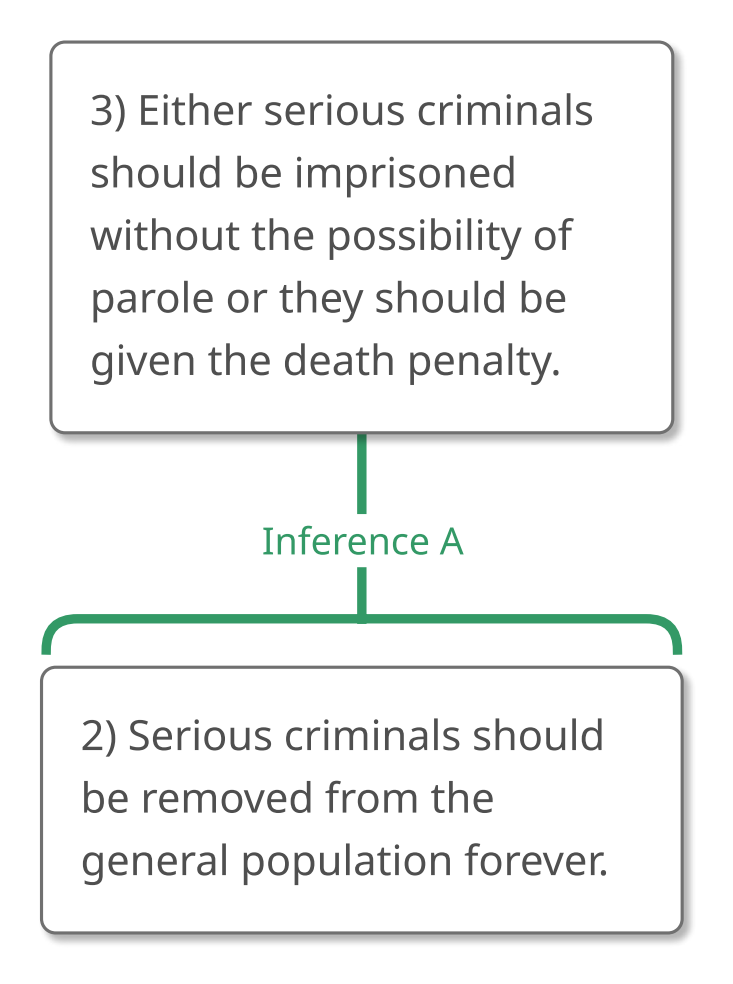
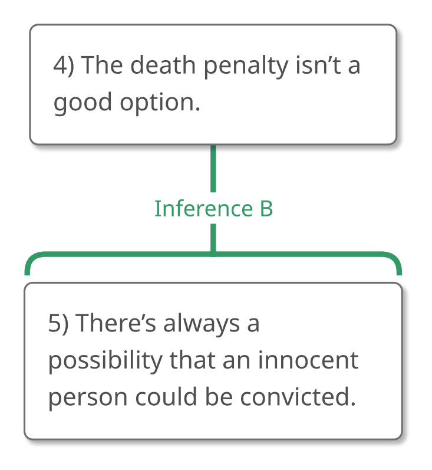
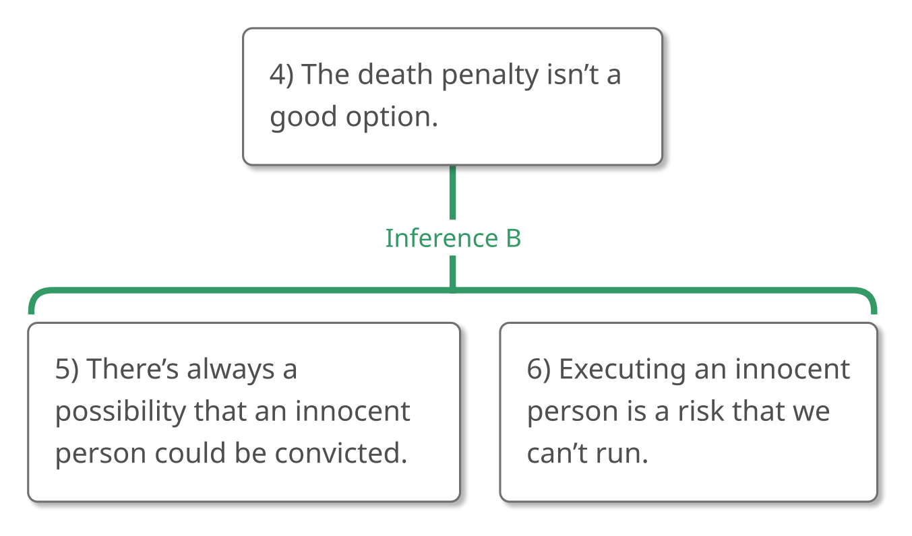
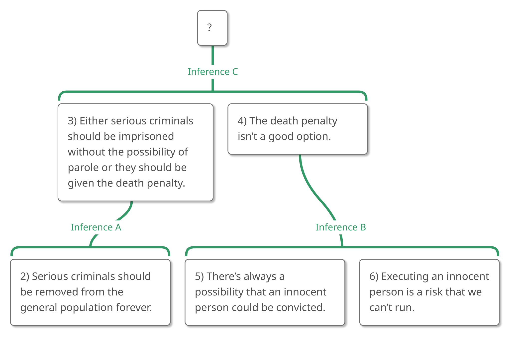
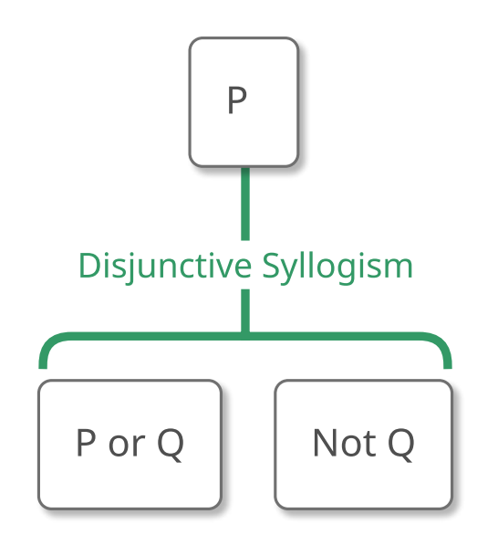
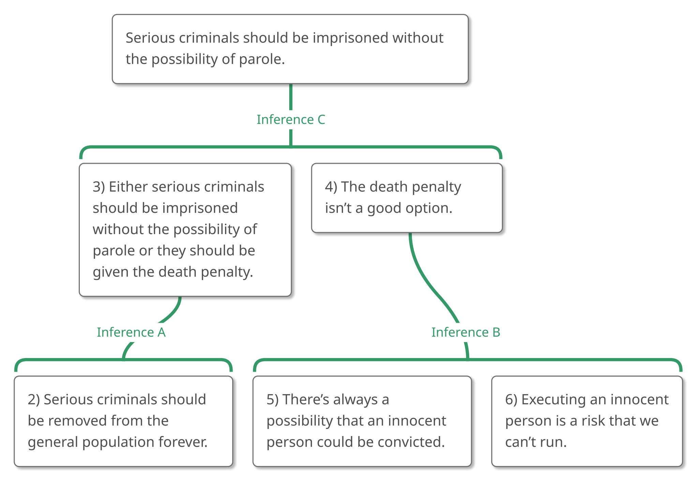
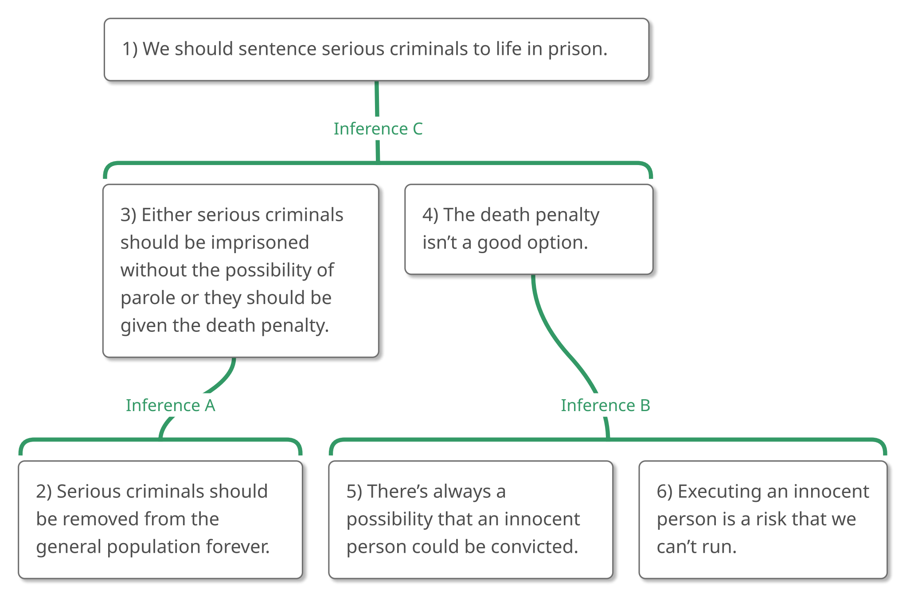
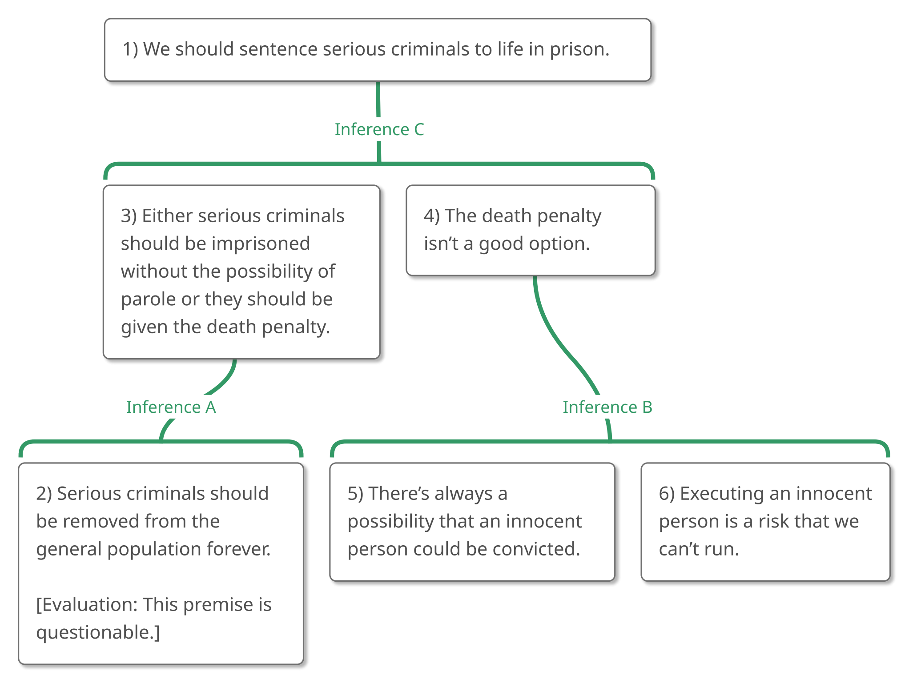

# 3.7 Example 6

## Step 1 – Recognizing an Argument

What do you think about this passage? Does it contain an argument? Is it trying to convince us of something?

> "Obviously, serious criminals should be removed from the general population forever so either they should be imprisoned without the possibility of parole or they should be given the death penalty. But the death penalty isn't a good option because there's always a possibility that an innocent person could be convicted and executing an innocent person is a risk that we can't run. Consequently, we should sentence serious criminals to life in prison."

Indeed, this passage *is* trying to convince us of something. It's another argument. So let's analyze it!

## Step 2 – Analyzing the Argument

What is the ultimate conclusion, the main claim that this argument is trying to get us to believe? It looks to me like it's the statement, "We should sentence serious criminals to life in prison."

> "Obviously, serious criminals should be removed from the general population forever so either they should be imprisoned without the possibility of parole or they should be given the death penalty. But the death penalty isn't a good option because there's always a possibility that an innocent person could be convicted and executing an innocent person is a risk that we can't run. Consequently, (1) we should sentence serious criminals to life in prison."

Now let's return to the beginning of the passage to see what other important claims are being made.

The first sentence contains a "so," and because "so" is an inference indicator expression, it's a fair bet that this sentence contains claims that are part of the argument. Dividing the sentence at the "so," gives us this:

> "Obviously, (2) serious criminals should be removed from the general population forever **so** (3) either they should be imprisoned without the possibility of parole or they should be given the death penalty. But the death penalty isn't a good option because there's always a possibility that an innocent person could be convicted and executing an innocent person is a risk that we can't run. Consequently, (1) we should sentence serious criminals to life in prison."

You'll see that we didn't further divide Claim 3 around the "or." Why not? Did we just not feel like it, or is it strictly forbidden?

It is *strictly forbidden*. **We can never divide around "if... then..." or "or" because such sentences don't assert their component parts.** (We saw that back at Example 2.)

We've seen that we want to represent inference indicator expressions that aren't attached to the ultimate conclusion as soon as we can, so let's map the relationship between Claim 2 and Claim 3. Because "so" is a conclusion indicator expression, Claim 3 follows from Claim 2:

> "Obviously, (2) serious criminals should be removed from the general population forever **so** (3) either they should be imprisoned without the possibility of parole or they should be given the death penalty. But the death penalty isn't a good option because there's always a possibility that an innocent person could be convicted and executing an innocent person is a risk that we can't run. Consequently, (1) we should sentence serious criminals to life in prison."

{#fig-3-7-2to3-1 width=235px fig-alt="Argument map concluding: 3) Either serious criminals should be imprisoned without the possibility of parole or they should be given the death penalty, supported by Claim 2 through Inference A. A full text description is provided."}

::: {.map-outline fig="fig-3-7-2to3-1"}

:::

The next sentence contains "because," which is another inference indicator expression, so let's divide the sentence into parts around "because" and represent that inference next, generating a second small argument map that we'll include along with the first.

> "Obviously, (2) serious criminals should be removed from the general population forever so (3) either they should be imprisoned without the possibility of parole or they should be given the death penalty. But (4) the death penalty isn't a good option **because** (5) there's always a possibility that an innocent person could be convicted and executing an innocent person is a risk that we can't run. Consequently, (1) we should sentence serious criminals to life in prison."

{#fig-3-7-2to3-2 width=235px fig-alt="Argument map concluding: 3) Either serious criminals should be imprisoned without the possibility of parole or they should be given the death penalty, supported by Claim 2 through Inference A. A full text description is provided."}

::: {.map-outline fig="fig-3-7-2to3-2"}

:::

{#fig-3-7-5to4-1 width=235px fig-alt="Argument map concluding: 4) The death penalty isn’t a good option, supported by Claim 5 through Inference B. A full text description is provided."}

::: {.map-outline fig="fig-3-7-5to4-1"}

:::

We aren't quite finished with that sentence, though. Should we continue to identify the ideas in that sentence or should we ask how the unit of reasoning containing Claims 2 and 3 is related to the unit of reasoning containing Claims 4 and 5?

There's no hard and fast rule here. I'm inclined to finish the sentence because that feels more natural, so let's identify the next idea.

> "Obviously, (2) serious criminals should be removed from the general population forever so (3) either they should be imprisoned without the possibility of parole or they should be given the death penalty. But (4) the death penalty isn't a good option because (5) there's always a possibility that an innocent person could be convicted **and** (6) executing an innocent person is a risk that we can't run. Consequently, (1) we should sentence serious criminals to life in prison."

How is Claim 6 related to the rest of the sentence (i.e., the unit of reasoning composed of Claims 4 and 5)? Well, the "and" might lead us to believe that Claims 5 and 6 are dependent reasons, like this:

> "Obviously, (2) serious criminals should be removed from the general population forever so (3) either they should be imprisoned without the possibility of parole or they should be given the death penalty. But (4) the death penalty isn't a good option because (5) there's always a possibility that an innocent person could be convicted **and** (6) executing an innocent person is a risk that we can't run. Consequently, (1) we should sentence serious criminals to life in prison."

{#fig-3-7-2to3-3 width=235px fig-alt="Argument map concluding: 3) Either serious criminals should be imprisoned without the possibility of parole or they should be given the death penalty, supported by Claim 2 through Inference A. A full text description is provided."}

::: {.map-outline fig="fig-3-7-2to3-3"}

:::

{#fig-3-7-5and6-1 width=433px fig-alt="Argument map concluding: 4) The death penalty isn’t a good option, supported by Claims 5 and 6 together through Inference B. A full text description is provided."}

::: {.map-outline fig="fig-3-7-5and6-1"}

:::

Does that make sense? I think so. If an innocent person might be convicted (Claim 5) and if we can't risk executing an innocent person (Claim 6), then it would seem to follow that we can't risk executing convicted people (lest one of them be innocent) and that's very close to Claim 4.

Now, how is the map containing Claims 2 and 3 related to the map containing Claims 4, 5 and 6?

We see that there's a "but" between Claims 3 and 4 in the passage. "But" sometimes joins dependent reasons, so let's try that. Would anything follow from these claims, taken together?

{#fig-3-7-3and4-1 width=657px fig-alt="Argument map with a question mark in place of the conclusion, supported by Claims 3 and 4 together through Inference C; Claim 3 is supported by Claim 2 through Inference A, and Claim 4 is supported by Claims 5 and 6 together through Inference B. A full text description is provided."}

::: {.map-outline fig="fig-3-7-3and4-1"}

:::

### Sneak Peek: Inference Forms

Inference C is actually an instance of an **inference form**. That means we can talk about it very abstractly, regardless of the content of the sentences. We'll be officially introduced to inference forms later on, but there's no reason why we can't take a sneak peek now.

Suppose we're told "Either P or Q is true," and then we learn "Q isn't true." What can we conclude? P must be true! (By the way, that's called the "Disjunctive Syllogism" if you want to impress your friends.)

{#fig-3-7-ds-1 width=175px fig-alt="Argument map concluding: P, supported by two claims together through an inference labeled Disjunctive Syllogism: P or Q, and Not Q. A full text description is provided."}

::: {.map-outline fig="fig-3-7-ds-1"}

:::

Let's apply that pattern here. Claim 3 basically tells us "Either life in prison without parole is the right thing or the death penalty is the right thing." Claim 4 says, in effect, "The death penalty isn't the right thing." What can we conclude? Imprisoned without the possibility of parole, it is!

{#fig-3-7-3and4toc-1 width=657px fig-alt="Argument map concluding: Serious criminals should be imprisoned without the possibility of parole, supported by Claims 3 and 4 together through Inference C; Claim 3 is supported by Claim 2 through Inference A, and Claim 4 is supported by Claims 5 and 6 together through Inference B. A full text description is provided."}

::: {.map-outline fig="fig-3-7-3and4toc-1"}

:::

Because that is equivalent to the ultimate conclusion of our argument, and we have no more claims, our map is complete.

> "Obviously, (2) serious criminals should be removed from the general population forever so (3) either they should be imprisoned without the possibility of parole or they should be given the death penalty. But (4) the death penalty isn't a good option because (5) there's always a possibility that an innocent person could be convicted **and** (6) executing an innocent person is a risk that we can't run. Consequently, (1) we should sentence serious criminals to life in prison."

{#fig-3-7-full-1 width=657px fig-alt="Argument map concluding: 1) We should sentence serious criminals to life in prison, supported by Claims 3 and 4 together through Inference C; Claim 3 is supported by Claim 2 through Inference A, and Claim 4 is supported by Claims 5 and 6 together through Inference B. A full text description is provided."}

::: {.map-outline fig="fig-3-7-full-1"}

:::

## Step 3 – Evaluating the Argument

Now let's evaluate this argument. Even if we think it's good, where might someone criticize it? Let's work our way down the map.

> "Obviously, (2) serious criminals should be removed from the general population forever so (3) either they should be imprisoned without the possibility of parole or they should be given the death penalty. But (4) the death penalty isn't a good option because (5) there's always a possibility that an innocent person could be convicted **and** (6) executing an innocent person is a risk that we can't run. Consequently, (1) we should sentence serious criminals to life in prison."

{#fig-3-7-full-2 width=657px fig-alt="Argument map concluding: 1) We should sentence serious criminals to life in prison, supported by Claims 3 and 4 together through Inference C; Claim 3 is supported by Claim 2 through Inference A, and Claim 4 is supported by Claims 5 and 6 together through Inference B. A full text description is provided."}

::: {.map-outline fig="fig-3-7-full-2"}

:::

Inference C is very strong. It's the Disjunctive Syllogism.

Claims 3 and 4 are subconclusions so we won't evaluate them separately.

What about Inference A? If a perfectly gullible, perfectly rational person believed Claim 2 (the assertion that serious criminals should be removed from the general population forever), how likely would they be to accept Claim 3 on that basis (the assertion that either serious criminals should be imprisoned without the possibility of parole or they should be given the death penalty)?

Because I can't see many other reasonable ways to remove someone from the general population forever, I think that someone who accepts Claim 2 would be pretty likely to accept Claim 3. I'd say that Inference A is fine.

What about Premise 2? Is it true? I could imagine someone disagreeing with that. What if some serious criminals can be rehabilitated? Should they be removed from the general population forever? Someone could reasonably doubt that. Because someone might reasonably question Premise 2, I'd say this argument needs work.

{#fig-3-7-eval-1 width=657px fig-alt="Argument map concluding: 1) We should sentence serious criminals to life in prison, supported by Claims 3 and 4 together through Inference C; Claim 3 is supported by Claim 2 through Inference A, and Claim 4 is supported by Claims 5 and 6 together through Inference B. Claim 2 is labeled: Evaluation: This premise is questionable. A full text description is provided."}

::: {.map-outline fig="fig-3-7-eval-1"}

:::

## Summary of Example 6

Example 6 presented us with this passage:

> "Obviously, serious criminals should be removed from the general population forever so either they should be imprisoned without the possibility of parole or they should be given the death penalty. But the death penalty isn't a good option because there's always a possibility that an innocent person could be convicted and executing an innocent person is a risk that we can't run. Consequently, we should sentence serious criminals to life in prison."

### Step 1 – Recognizing an Argument

We decided that this passage is trying to convince us of something, and so contains an argument.

### Step 2 – Analyzing the Argument

We identified "We should sentence serious criminals to life in prison" as the ultimate conclusion of this argument.

> "Obviously, serious criminals should be removed from the general population forever so either they should be imprisoned without the possibility of parole or they should be given the death penalty. But the death penalty isn't a good option because there's always a possibility that an innocent person could be convicted and executing an innocent person is a risk that we can't run. Consequently, (1) we should sentence serious criminals to life in prison."

Returning to the beginning of the passage, we identified two important claims in the first sentence, being careful to divide around the "so" but not around the "or." We represented the inference between those two claims.

> "Obviously, (2) serious criminals should be removed from the general population forever **so** (3) either they should be imprisoned without the possibility of parole or they should be given the death penalty. But the death penalty isn't a good option because there's always a possibility that an innocent person could be convicted and executing an innocent person is a risk that we can't run. Consequently, (1) we should sentence serious criminals to life in prison."

{#fig-3-7-2to3-4 width=235px fig-alt="Argument map concluding: 3) Either serious criminals should be imprisoned without the possibility of parole or they should be given the death penalty, supported by Claim 2 through Inference A. A full text description is provided."}

::: {.map-outline fig="fig-3-7-2to3-4"}

:::

The next sentence presented us with two more claims connected with an inference indicator expression, so we represented that inference, as well.

> "Obviously, (2) serious criminals should be removed from the general population forever so (3) either they should be imprisoned without the possibility of parole or they should be given the death penalty. But (4) the death penalty isn't a good option **because** (5) there's always a possibility that an innocent person could be convicted and executing an innocent person is a risk that we can't run. Consequently, (1) we should sentence serious criminals to life in prison."

{#fig-3-7-2to3-5 width=235px fig-alt="Argument map concluding: 3) Either serious criminals should be imprisoned without the possibility of parole or they should be given the death penalty, supported by Claim 2 through Inference A. A full text description is provided."}

::: {.map-outline fig="fig-3-7-2to3-5"}

:::

{#fig-3-7-5to4-2 width=235px fig-alt="Argument map concluding: 4) The death penalty isn’t a good option, supported by Claim 5 through Inference B. A full text description is provided."}

::: {.map-outline fig="fig-3-7-5to4-2"}

:::

We opted for continuing to identify the claims in the second-to-last sentence, and decided that Claim 6 is a dependent reason that works with Claim 5 supporting Claim 4.

> "Obviously, (2) serious criminals should be removed from the general population forever so (3) either they should be imprisoned without the possibility of parole or they should be given the death penalty. But (4) the death penalty isn't a good option because (5) there's always a possibility that an innocent person could be convicted **and** (6) executing an innocent person is a risk that we can't run. Consequently, (1) we should sentence serious criminals to life in prison."

{#fig-3-7-2to3-6 width=235px fig-alt="Argument map concluding: 3) Either serious criminals should be imprisoned without the possibility of parole or they should be given the death penalty, supported by Claim 2 through Inference A. A full text description is provided."}

::: {.map-outline fig="fig-3-7-2to3-6"}

:::

{#fig-3-7-5and6-2 width=433px fig-alt="Argument map concluding: 4) The death penalty isn’t a good option, supported by Claims 5 and 6 together through Inference B. A full text description is provided."}

::: {.map-outline fig="fig-3-7-5and6-2"}

:::

At this point we asked ourselves how those two partial maps were related to each other, and we decided that Claims 3 and 4 are dependent reasons in support of Claim 1.

{#fig-3-7-full-3 width=657px fig-alt="Argument map concluding: 1) We should sentence serious criminals to life in prison, supported by Claims 3 and 4 together through Inference C; Claim 3 is supported by Claim 2 through Inference A, and Claim 4 is supported by Claims 5 and 6 together through Inference B. A full text description is provided."}

::: {.map-outline fig="fig-3-7-full-3"}

:::

### Step 3 – Evaluating the Argument

I suggested that Claim 2 was vulnerable to criticism.

> "Obviously, (2) serious criminals should be removed from the general population forever so (3) either they should be imprisoned without the possibility of parole or they should be given the death penalty. But (4) the death penalty isn't a good option because (5) there's always a possibility that an innocent person could be convicted **and** (6) executing an innocent person is a risk that we can't run. Consequently, (1) we should sentence serious criminals to life in prison."

{#fig-3-7-eval-2 width=657px fig-alt="Argument map concluding: 1) We should sentence serious criminals to life in prison, supported by Claims 3 and 4 together through Inference C; Claim 3 is supported by Claim 2 through Inference A, and Claim 4 is supported by Claims 5 and 6 together through Inference B. Claim 2 is labeled: Evaluation: This premise is questionable. A full text description is provided."}

::: {.map-outline fig="fig-3-7-eval-2"}

:::
