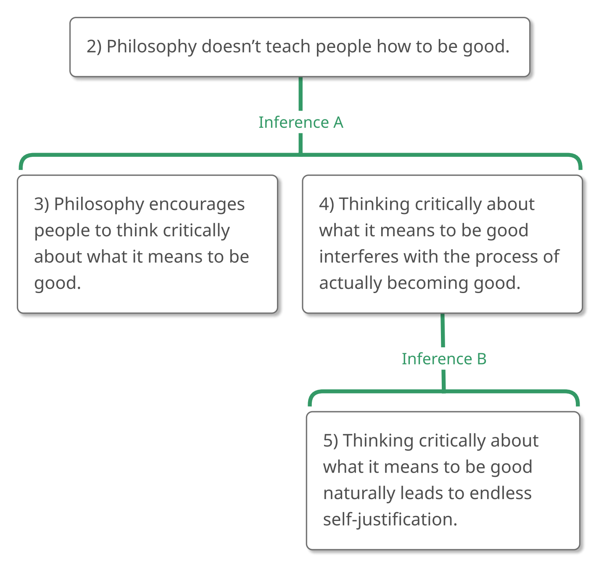
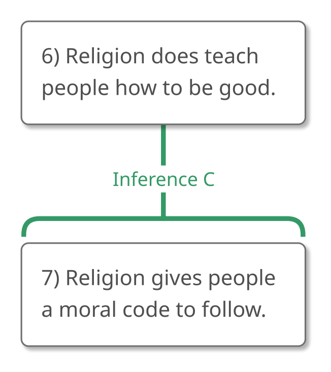
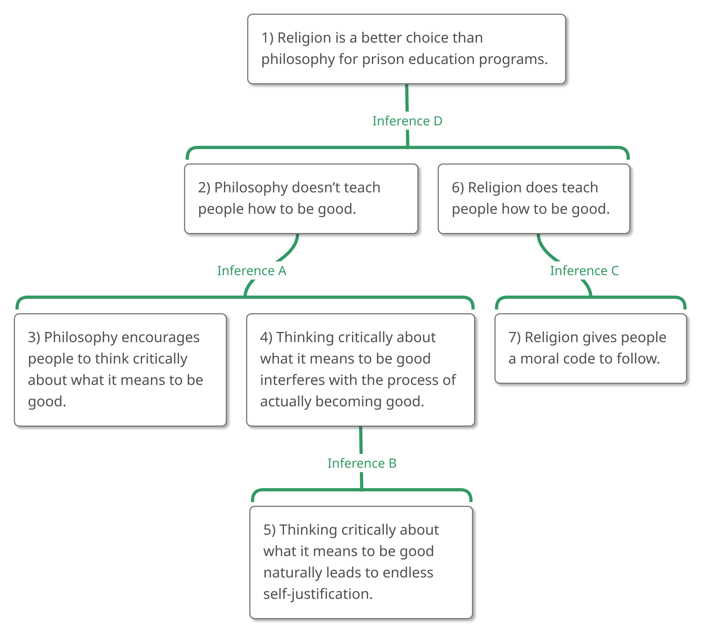
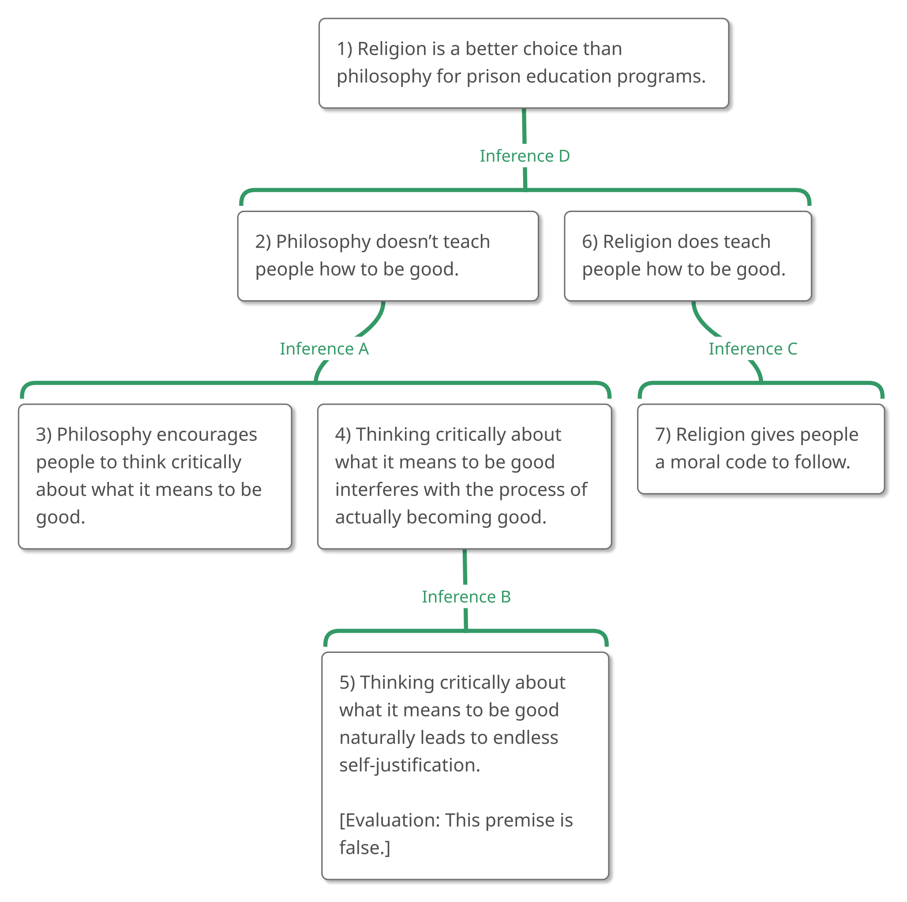

# 3.8 Example 7

## Step 1 – Recognizing an Argument

We have one more passage to consider! Do you think it contains an argument? Is it trying to establish that something is true?

> "Some people maintain that prisoners should study philosophy, presumably on the grounds that thinking about the meaning of life will have a rehabilitative effect, or something like that. In fact, however, religion is a better choice than philosophy for prison education programs given that philosophy doesn't teach people how to be good. After all, philosophy encourages people to think critically about what it means to be good and thinking critically about what it means to be good interferes with the process of actually *becoming* good because it naturally leads to endless self-justification. Religion, on the other hand, does teach people how to be good since it gives them a moral code to follow."

This looks like an argument to me, so let's analyze it.

## Step 2 – Analyzing the Argument

What is the ultimate conclusion of this argument? I'd say it's the claim that religion is a better choice than philosophy for prison education programs.

> "Some people maintain that prisoners should study philosophy, presumably on the grounds that thinking about the meaning of life will have a rehabilitative effect, or something like that. In fact, however, (1) religion is a better choice than philosophy for prison education programs given that philosophy doesn't teach people how to be good. After all, philosophy encourages people to think critically about what it means to be good and thinking critically about what it means to be good interferes with the process of actually *becoming* good because it naturally leads to endless self-justification. Religion, on the other hand, does teach people how to be good since it gives them a moral code to follow."

Now, what other claims are part of this argument, and how are they connected to each other?

Although the first sentence does express some claims ("some people maintain that prisoners should study philosophy" and "their grounds for maintaining this are probably that thinking about the meaning of life will have a rehabilitative effect"), those claims aren't part of the reasoning for the ultimate conclusion. They *motivate* the argument but aren't *part* of the argument, so we'll ignore those claims.

What about the rest of the sentence that contains the ultimate conclusion? The "given that" is a reason indicator expression, so we know that what follows it, "Philosophy doesn't teach people how to be good," is part of the argument. We'll call that Claim 2.

> "Some people maintain that prisoners should study philosophy, presumably on the grounds that thinking about the meaning of life will have a rehabilitative effect, or something like that. In fact, however, (1) religion is a better choice than philosophy for prison education programs **given that** (2) philosophy doesn't teach people how to be good. After all, philosophy encourages people to think critically about what it means to be good and thinking critically about what it means to be good interferes with the process of actually *becoming* good because it naturally leads to endless self-justification. Religion, on the other hand, does teach people how to be good since it gives them a moral code to follow."

Because Claim 2 is connected to the ultimate conclusion, we won't represent that relationship right away. Instead, we'll see what other claims are important to the argument.

Continuing to read, we see that there's a *lot* going on in the next sentence.

> "Some people maintain that prisoners should study philosophy, presumably on the grounds that thinking about the meaning of life will have a rehabilitative effect, or something like that. In fact, however, (1) religion is a better choice than philosophy for prison education programs given that (2) philosophy doesn't teach people how to be good. **After all**, (3) philosophy encourages people to think critically about what it means to be good **and** (4) thinking critically about what it means to be good interferes with the process of actually *becoming* good **because** (5) it naturally leads to endless self-justification. Religion, on the other hand, does teach people how to be good since it gives them a moral code to follow."

Let's see if we can track the connections between Claims 2, 3, 4, and 5 simply using indicator expressions and then double-check by inspecting the resulting map.

-   The "after all" is a reason indicator. It seems to tell us that Claim 3 is a reason to accept Claim 2.

-   The "and" leads me to think that Claims 3 and 4 might be dependent reasons, in which case Claims 3 and 4 would jointly support Claim 2.

-   And the "because" (another reason indicator) leads me to see Claim 5 as a reason to accept Claim 4.

Here's what we get when we map that out.

{#fig-3-8-map1-1 width=460px fig-alt="Argument map concluding: 2) Philosophy doesn’t teach people how to be good, supported by Claims 3 and 4 together through Inference A; Claim 4 is supported by Claim 5 through Inference B. A full text description is provided."}

::: {.map-outline fig="fig-3-8-map1-1"}

:::

Does that seem right?

Well, would Claim 2 follow from Claims 3 and 4? I think so. Notice that Claims 3 and 4 have in common "thinking critically about what it means to be good." The left-over concept from Claim 3 is "philosophy," and the left-over concept from Claim 4 is "interferes with the process of actually becoming good." Putting those concepts together, we get "Philosophy interferes with the process of actually becoming good," and if that's the case then it's certainly true that philosophy doesn't teach people how to be good, which is Claim 2.

Now, would Claim 4 follow from Claim 5? Again, I think so. If someone believes that thinking critically about what it means to be good will lead to self-justification (Claim 5), it would be reasonable for that person to conclude that thinking critically about what it means to be good interferes with the process of becoming good (Claim 4).

It looks like we've correctly mapped the relationships between Claims 2, 3, 4, and 5. And we did it rather quickly, too, by relying upon the indicator expressions in the passage.

By the way, if you're still thinking a little bit about how to use the indicator expressions instead of simply using them automatically, that's okay. In fact, that's absolutely normal. If you're still thinking a *lot* about how to use the indicator expressions, that's okay too, but it would be a good idea to spend some time getting familiar with inference indicator expressions at this point because—as you're probably seeing—when arguments get longer and more complicated it's *very nice* to be able to just "see and represent" these relationships without thinking too much about them.

It's a lot like being able to perform basic mathematical calculations in your head automatically, for example 2 × 5 = 10. Nobody is born being able to do this. People learn it and practice it until it becomes second nature. It's important for it to become second nature because when these people go to work for a space company and help to chart flight trajectories, they shouldn't devote too much mental energy to calculations like that. If they do, they won't have enough mental energy for the other things that they need to figure out and their rockets will miss the moon. (I know that nobody does those calculations manually, of course, but you get the idea.)

Similarly, if you need to think too hard about how inference indicator expressions work, you won't have enough mental energy to do all of the other things that you need to do when you're faced with a complex argument. As a consequence of this, your analysis will probably be mistaken. And as a consequence of *that* your evaluation will probably be off target. You'll miss the moon.

Returning to the argument, we see that the next sentence is composed of two claims connected with the reason indicator "since." This tells us that those claims are connected with an inference, like this:

> "Some people maintain that prisoners should study philosophy, presumably on the grounds that thinking about the meaning of life will have a rehabilitative effect, or something like that. In fact, however, (1) religion is a better choice than philosophy for prison education programs given that (2) philosophy doesn't teach people how to be good. After all, (3) philosophy encourages people to think critically about what it means to be good and (4) thinking critically about what it means to be good interferes with the process of actually *becoming* good because (5) it naturally leads to endless self-justification. (6) Religion, on the other hand, does teach people how to be good **since** (7) it gives them a moral code to follow."

{#fig-3-8-map1-2 width=460px fig-alt="Argument map concluding: 2) Philosophy doesn’t teach people how to be good, supported by Claims 3 and 4 together through Inference A; Claim 4 is supported by Claim 5 through Inference B. A full text description is provided."}

::: {.map-outline fig="fig-3-8-map1-2"}

:::

{#fig-3-8-map2-1 width=209px fig-alt="Argument map concluding: 6) Religion does teach people how to be good, supported by Claim 7 through Inference C. A full text description is provided."}

::: {.map-outline fig="fig-3-8-map2-1"}

:::

### Comparative Conclusions

Now, how should those little maps be combined?

This can be difficult to see, so let's take a look at the ultimate conclusion, "religion is a better choice than philosophy for prison education programs." Note that this is a *comparison* between religion and philosophy. We'll call conclusions like this "**comparative conclusions**."

If you think about it, you'll see **that we can't prove that a comparison is true unless we talk about *all* of the things compared and put those claims together as dependent reasons**. In order to establish that *Bill is taller than Sam*, for instance, we can't just say, "*Bill is 5 feet 4 inches tall*." We need to talk about how tall *Sam* is too. We need to say, "*Bill is 5 feet 4 inches tall **and** Sam is 4 feet 9 inches tall*." This is the **Comparative Conclusion Test for dependent reasons**.

Applying the Comparative Conclusion Test to the argument we're analyzing, we can see that the ultimate conclusion, which is a comparison of philosophy and religion, will probably be supported by a claim that talks about philosophy (Claim 2) and a claim that talks about religion (Claim 6) working as dependent reasons. Like this:

> "Some people maintain that prisoners should study philosophy, presumably on the grounds that thinking about the meaning of life will have a rehabilitative effect, or something like that. In fact, however, (1) religion is a better choice than philosophy for prison education programs given that (2) philosophy doesn't teach people how to be good. After all, (3) philosophy encourages people to think critically about what it means to be good and (4) thinking critically about what it means to be good interferes with the process of actually *becoming* good because (5) it naturally leads to endless self-justification. (6) Religion, on the other hand, does teach people how to be good **since** (7) it gives them a moral code to follow."

{#fig-3-8-full-1 width=658px fig-alt="Argument map concluding: 1) Religion is a better choice than philosophy for prison education programs, supported by Claims 2 and 6 together through Inference D; Claim 2 is supported by Claims 3 and 4 together through Inference A, Claim 4 is supported by Claim 5 through Inference B, and Claim 6 is supported by Claim 7 through Inference C. A full text description is provided."}

::: {.map-outline fig="fig-3-8-full-1"}

:::

Can you see why the connection between 2 and 6 might be hard to identify without using something like the Comparative Conclusion Test? It's because Claim 2 and Claim 6 are pretty far away from each other in the passage and this violates the Principle of Proximity. When dependent reasons are separated from each other in a text like this, the author will sometimes repeat a claim or two to help the reader spot the connection between them. We'll talk about repeating claims later.

## Step 3 – Evaluating the Argument

Does anything strike you as especially problematic with this argument?

One initial reaction could easily be, "Hey! Thinking critically doesn't interfere with goodness!" so let's explore that.

What part of the argument would someone be targeting with this objection? It seems like they'd be directly disagreeing with Claim 4.

> "Some people maintain that prisoners should study philosophy, presumably on the grounds that thinking about the meaning of life will have a rehabilitative effect, or something like that. In fact, however, (1) religion is a better choice than philosophy for prison education programs given that (2) philosophy doesn't teach people how to be good. After all, (3) philosophy encourages people to think critically about what it means to be good and (4) **thinking critically about what it means to be good interferes with the process of actually *becoming* good** because (5) it naturally leads to endless self-justification. (6) Religion, on the other hand, does teach people how to be good **since** (7) it gives them a moral code to follow."

{#fig-3-8-full-2 width=658px fig-alt="Argument map concluding: 1) Religion is a better choice than philosophy for prison education programs, supported by Claims 2 and 6 together through Inference D; Claim 2 is supported by Claims 3 and 4 together through Inference A, Claim 4 is supported by Claim 5 through Inference B, and Claim 6 is supported by Claim 7 through Inference C. A full text description is provided."}

::: {.map-outline fig="fig-3-8-full-2"}

:::

And because Claim 4 is a subconclusion, we shouldn't just *reject* it. We should, instead, examine the reasoning that *supports* it: Claim 5 and Inference B.

Let's take a look at the inference first. If a perfectly gullible, perfectly rational person believes that thinking critically about what it means to be good naturally leads to endless self-justification (Claim 5), how likely would that person be to accept that thinking critically about what it means to be good interferes with the process of actually becoming good (Claim 4)? Pretty likely, actually, so Inference B is okay.

What about Claim 5, though? Is it *true* that thinking critically about what it means to be good naturally leads to endless self-justification? I don't think so. That certainly hasn't been my experience, so our initial objection to Claim 4 (a subconclusion) has shown us that the *fundamental* disagreement is probably with Claim 5 (a premise). And that is enough to make the argument bad as a whole.

> "Some people maintain that prisoners should study philosophy, presumably on the grounds that thinking about the meaning of life will have a rehabilitative effect, or something like that. In fact, however, (1) religion is a better choice than philosophy for prison education programs given that (2) philosophy doesn't teach people how to be good. After all, (3) philosophy encourages people to think critically about what it means to be good and (4) thinking critically about what it means to be good interferes with the process of actually *becoming* good because (5) it naturally leads to endless self-justification. (6) Religion, on the other hand, does teach people how to be good **since** (7) it gives them a moral code to follow."

{#fig-3-8-eval-1 width=658px fig-alt="Argument map concluding: 1) Religion is a better choice than philosophy for prison education programs, supported by Claims 2 and 6 together through Inference D; Claim 2 is supported by Claims 3 and 4 together through Inference A, Claim 4 is supported by Claim 5 through Inference B, and Claim 6 is supported by Claim 7 through Inference C. Claim 5 is labeled: Evaluation: This premise is false. A full text description is provided."}

::: {.map-outline fig="fig-3-8-eval-1"}

:::

## Summary of Example 7

Example 7 presented us with this passage:

> "Some people maintain that prisoners should study philosophy, presumably on the grounds that thinking about the meaning of life will have a rehabilitative effect, or something like that. In fact, however, religion is a better choice than philosophy for prison education programs given that philosophy doesn't teach people how to be good. After all, philosophy encourages people to think critically about what it means to be good and thinking critically about what it means to be good interferes with the process of actually *becoming* good because it naturally leads to endless self-justification. Religion, on the other hand, does teach people how to be good since it gives them a moral code to follow."

### Step 1 – Recognizing an Argument

We decided that this passage does contain an argument because it is trying to convince us that something is true.

### Step 2 – Analyzing the Argument

We identified "Religion is a better choice than philosophy for prison education programs" as the ultimate conclusion, and decided that nothing in the first sentence was important to the argument.

> "Some people maintain that prisoners should study philosophy, presumably on the grounds that thinking about the meaning of life will have a rehabilitative effect, or something like that. In fact, however, (1) religion is a better choice than philosophy for prison education programs given that philosophy doesn't teach people how to be good. After all, philosophy encourages people to think critically about what it means to be good and thinking critically about what it means to be good interferes with the process of actually *becoming* good because it naturally leads to endless self-justification. Religion, on the other hand, does teach people how to be good since it gives them a moral code to follow."

We then mapped the argument, first tracking the connections between Claims 2, 3, 4, and 5 to get the resulting map:

> "Some people maintain that prisoners should study philosophy, presumably on the grounds that thinking about the meaning of life will have a rehabilitative effect, or something like that. In fact, however, (1) religion is a better choice than philosophy for prison education programs given that (2) philosophy doesn't teach people how to be good. **After all**, (3) philosophy encourages people to think critically about what it means to be good **and** (4) thinking critically about what it means to be good interferes with the process of actually *becoming* good **because** (5) it naturally leads to endless self-justification. Religion, on the other hand, does teach people how to be good since it gives them a moral code to follow."

{#fig-3-8-map1-3 width=460px fig-alt="Argument map concluding: 2) Philosophy doesn’t teach people how to be good, supported by Claims 3 and 4 together through Inference A; Claim 4 is supported by Claim 5 through Inference B. A full text description is provided."}

::: {.map-outline fig="fig-3-8-map1-3"}

:::

We saw that Claim 7 was a reason to accept Claim 6, which we mapped as follows:

> "Some people maintain that prisoners should study philosophy, presumably on the grounds that thinking about the meaning of life will have a rehabilitative effect, or something like that. In fact, however, (1) religion is a better choice than philosophy for prison education programs given that (2) philosophy doesn't teach people how to be good. After all, (3) philosophy encourages people to think critically about what it means to be good and (4) thinking critically about what it means to be good interferes with the process of actually *becoming* good because (5) it naturally leads to endless self-justification. (6) Religion, on the other hand, does teach people how to be good **since** (7) it gives them a moral code to follow."

{#fig-3-8-map2-2 width=209px fig-alt="Argument map concluding: 6) Religion does teach people how to be good, supported by Claim 7 through Inference C. A full text description is provided."}

::: {.map-outline fig="fig-3-8-map2-2"}

:::

We then saw that the ultimate conclusion was a comparison supported by Claims 2 and 6.

> "Some people maintain that prisoners should study philosophy, presumably on the grounds that thinking about the meaning of life will have a rehabilitative effect, or something like that. In fact, however, (1) religion is a better choice than philosophy for prison education programs given that (2) philosophy doesn't teach people how to be good. After all, (3) philosophy encourages people to think critically about what it means to be good and (4) thinking critically about what it means to be good interferes with the process of actually *becoming* good because (5) it naturally leads to endless self-justification. (6) Religion, on the other hand, does teach people how to be good **since** (7) it gives them a moral code to follow."

{#fig-3-8-full-3 width=658px fig-alt="Argument map concluding: 1) Religion is a better choice than philosophy for prison education programs, supported by Claims 2 and 6 together through Inference D; Claim 2 is supported by Claims 3 and 4 together through Inference A, Claim 4 is supported by Claim 5 through Inference B, and Claim 6 is supported by Claim 7 through Inference C. A full text description is provided."}

::: {.map-outline fig="fig-3-8-full-3"}

:::

### Step 3 – Evaluating the Argument

We began our evaluation by noting that someone could object to Claim 4. Because Claim 4 is a subconclusion, we traced the objection to Claim 5, a premise.

> "Some people maintain that prisoners should study philosophy, presumably on the grounds that thinking about the meaning of life will have a rehabilitative effect, or something like that. In fact, however, (1) religion is a better choice than philosophy for prison education programs given that (2) philosophy doesn't teach people how to be good. After all, (3) philosophy encourages people to think critically about what it means to be good and (4) thinking critically about what it means to be good interferes with the process of actually *becoming* good because (5) it naturally leads to endless self-justification. (6) Religion, on the other hand, does teach people how to be good **since** (7) it gives them a moral code to follow."

{#fig-3-8-eval-2 width=658px fig-alt="Argument map concluding: 1) Religion is a better choice than philosophy for prison education programs, supported by Claims 2 and 6 together through Inference D; Claim 2 is supported by Claims 3 and 4 together through Inference A, Claim 4 is supported by Claim 5 through Inference B, and Claim 6 is supported by Claim 7 through Inference C. Claim 5 is labeled: Evaluation: This premise is false. A full text description is provided."}

::: {.map-outline fig="fig-3-8-eval-2"}

:::
