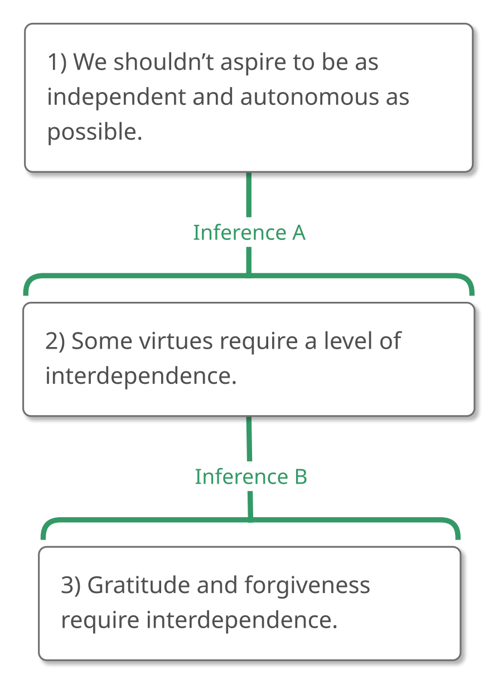
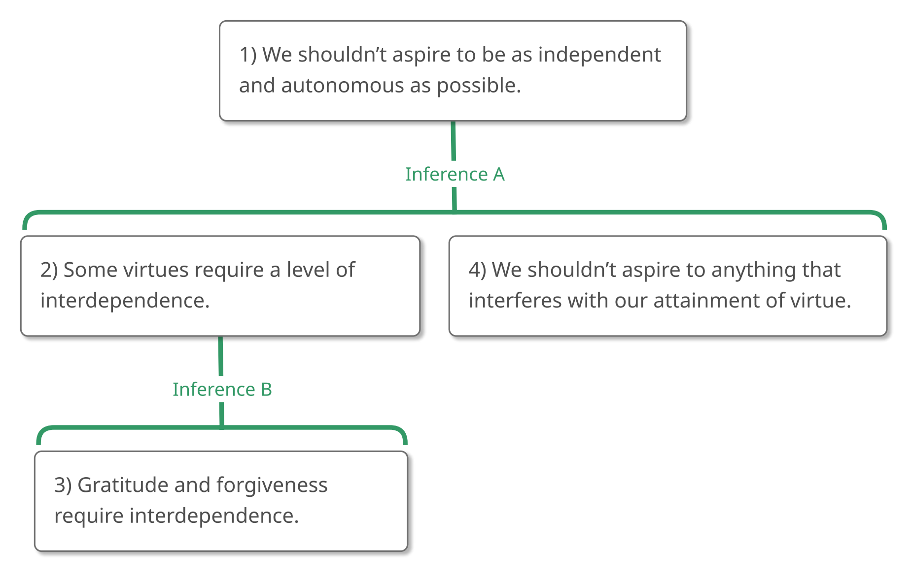
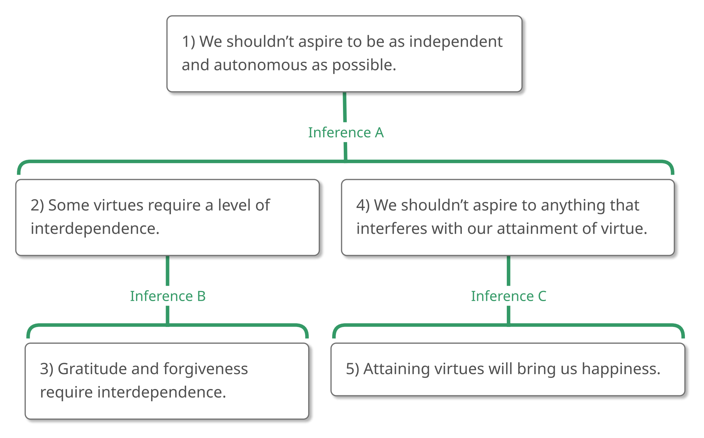
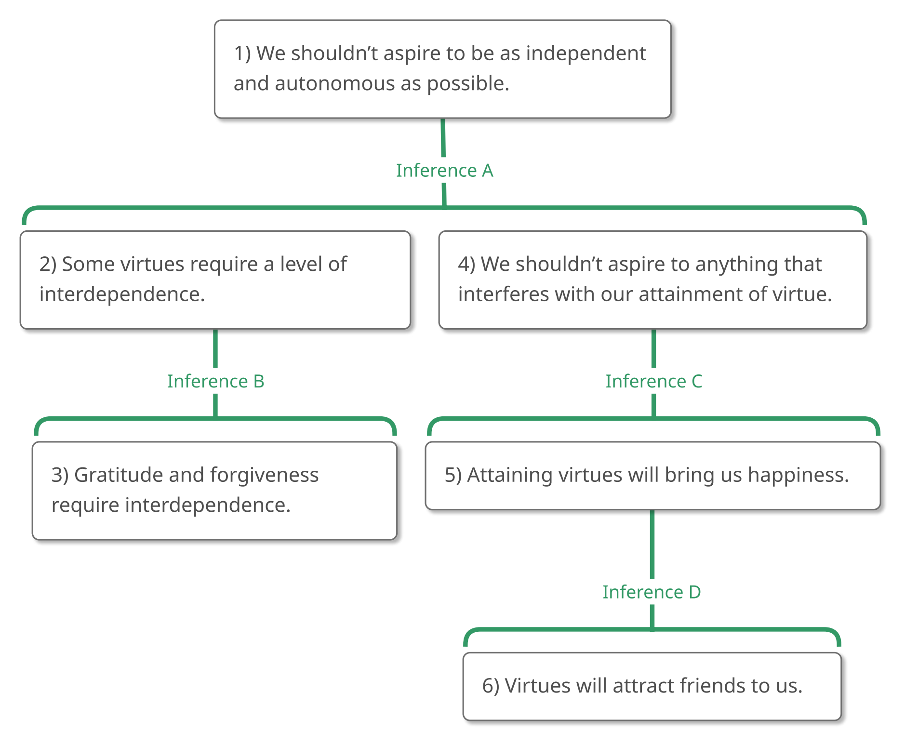
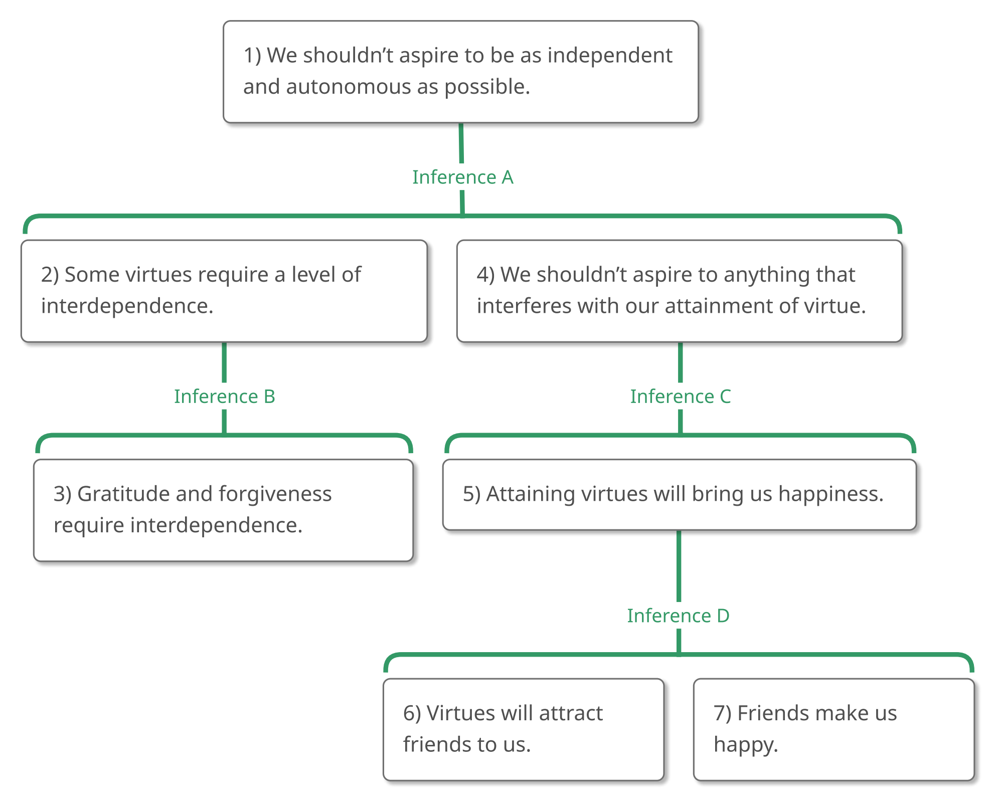
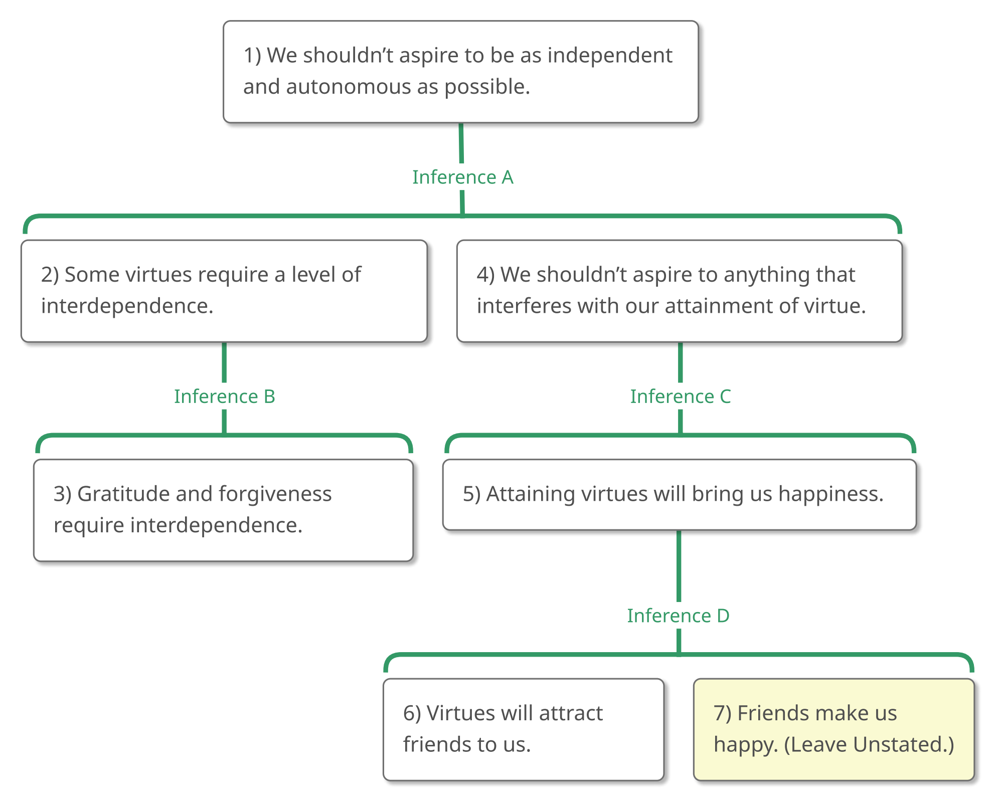

# 3.9 Constructing Arguments

Now that we've learned how to analyze and evaluate arguments with dependent reasons, we're in a position to construct more complex arguments of our own.

So far, we've learned how to determine our ultimate conclusion by posing a question, researching various answers to the question, and formulating the answer that we think is probably true.

We've learned how to construct a relatively simple argument for our conclusion by asking ourselves "What is one reason to think that the ultimate conclusion is true?" and by mapping the resulting premise / conclusion argument.

We've also learned how to repair our argument if it contains a weak premise: if the premise is false, we modify it until it's true and if the premise is true but not the sort of thing we'd expect our audience to believe, we turn it into a subconclusion.

And now we can see how to repair weak inferences by adding dependent reasons!

## Supplying Dependent Reasons

Let's return to the map of the argument that we constructed in Chapter 2.

{#fig-3-9-reason-for-reason width=289px fig-alt="Argument map concluding: 1) We shouldn't aspire to be as independent and autonomous as possible, supported by Claim 2 through Inference A; Claim 2 is supported by Claim 3 through Inference B. A full text description is provided."}

::: {.map-outline fig="fig-3-9-reason-for-reason"}

:::

These inferences aren't horrible, but Inference A might use a little help. Let's supply a dependent reason that works with Claim 2 to patch the gap between our Claim 2 and Claim 1.

We'll approach this *exactly* the same way that we approached identifying a missing premise in someone else's argument.

We'll start with a missing premise that is simply "If [reason] then [conclusion]." In this case that is simply:

- If some virtues require a level of interdependence (Claim 2) then we shouldn't aspire to be as independent and autonomous as possible (Claim 1).

We'll then replace that conditional with the most likely reason that the author has for accepting this "if... then..." claim. Often this reason will be a broader principle that encompasses the specific "if... then..." claim. We can discover that broader principle by finding the concepts that the front part of the "if... then..." and the back part of the "if... then..." have in common and replacing that concept with something more general.

So, what do the front part and the back part of the "if... then..." have in common? There's not a perfect match, but interdependence and independence are certainly related. They're opposites of each other!

- If some virtues require a level of **interdependence** then we shouldn't aspire to be as **independent** and autonomous as possible.

We can make the match closer by thinking about "interdependence" as "not independence" or by thinking of "independence" in the conclusion as "not dependence." Which should we pick?

It's generally easier to *not* think in terms of double negatives. ("It's sunny" is easier to understand than "It's not not sunny.") "Independence" is short for "not-dependent," so thinking about "interdependence" as "not independent" would be forcing ourselves to work with the double negative "not not-dependent." Let's try to avoid that.

Let's think about "independent" as "not dependent," instead. And I think we can ignore the concept of autonomy because it's serving the same function as "independent."

That gives us this:

- If some virtues require a level of **interdependence** then we shouldn't aspire to be as not **dependent** as possible.

Now we have matching concepts between the conclusion and the reason! (I know that "interdependence" and "dependence" aren't exactly the same thing, but I don't think the differences between them are important for this argument.)

What is a broader concept that covers being dependent? When in doubt, we can always use "a thing." That gives us this:

- If some virtues require a level of **a thing** then we shouldn't aspire to be as not **that thing** as possible.

Making some grammatical changes gives us:

- If virtues require something then we shouldn't aspire to not have that thing.

Or, more naturally,

- We shouldn't aspire to anything that interferes with our attainment of virtue.

This gives us the following map:

{#fig-3-9-dependent-reason width=592px fig-alt="Argument map concluding: 1) We shouldn't aspire to be as independent and autonomous as possible, supported by Claims 2 and 4 together through Inference A; Claim 2 is supported by Claim 3 through Inference B. A full text description is provided."}

::: {.map-outline fig="fig-3-9-dependent-reason"}

:::

Now Inference A looks great! Of course, in the process of repairing an inference by adding a dependent reason, we introduced a new premise so we should make sure that it's okay.

I think that "We shouldn't aspire to anything that interferes with our attainment of virtue" is true, but *maybe* someone in our audience might not buy it. Consequently, let's transform this claim into a subconclusion by asking "What are some reasons to believe this?" One answer is "Attaining virtues will bring us happiness," which gives us the following map:

{#fig-3-9-supported1 width=601px fig-alt="Argument map concluding: 1) We shouldn't aspire to be as independent and autonomous as possible, supported by Claims 2 and 4 together through Inference A; Claim 2 is supported by Claim 3 through Inference B, and Claim 4 is supported by Claim 5 through Inference C. A full text description is provided."}

::: {.map-outline fig="fig-3-9-supported1"}

:::

Inspecting our work, Inference C looks good to me, but we could certainly imagine someone questioning the assertion that virtue will make us happy. Isn't vice associated with quite a bit of fun?

I think that this claim is true so I don't want to change it, but I do believe that we should make it into a subconclusion by asking "What are some reasons to believe this?" One answer is "Virtues will attract friends to us," so let's add that to the map.

{#fig-3-9-supported2 width=601px fig-alt="Argument map concluding: 1) We shouldn't aspire to be as independent and autonomous as possible, supported by Claims 2 and 4 together through Inference A; Claim 2 is supported by Claim 3 through Inference B, Claim 4 is supported by Claim 5 through Inference C, and Claim 5 is supported by Claim 6 through Inference D. A full text description is provided."}

::: {.map-outline fig="fig-3-9-supported2"}

:::

Inference D looks fine to me, but just in case someone doesn't follow our thinking, let's add a dependent reason. To identify it, we'll start with this "if... then..." sentence:

- If virtues will attract friends to us (Claim 6) then attaining virtues will bring us happiness (Claim 5).

Both the front and back parts of the "if... then..." contain "virtues." Replacing that with a more general term gives us:

- If something attracts friends to us then it brings us happiness.

We could use that as our missing premise, or we could use the reason that someone would have for accepting that generalization: Friends make us happy. Let's do that.

{#fig-3-9-supported3-1 width=638px fig-alt="Argument map concluding: 1) We shouldn't aspire to be as independent and autonomous as possible, supported by Claims 2 and 4 together through Inference A; Claim 2 is supported by Claim 3 through Inference B, Claim 4 is supported by Claim 5 through Inference C, and Claim 5 is supported by Claims 6 and 7 together through Inference D. A full text description is provided."}

::: {.map-outline fig="fig-3-9-supported3-1"}

:::

You might be getting the feel for this now. It's largely a matter of:

1) Finding a reason to support a claim.
2) Improving the resulting inference by supplying a dependent reason.
3) Repeating the process if it looks like any of the currently unsupported claims require support.

As with analyzing and evaluating arguments, constructing an argument involves doing a finite number of things repeatedly until you're finished. There's some art involved too, of course. Inspiration doesn't hurt. But you can go a *long* way with just a few skills and a procedure for applying them.

## Communicating the Argument

Now that we have a map of our argument, we can communicate it in prose.

### Leaving Premises Unstated

We've seen that authors sometimes leave some of their premises unstated, so before we start to write, we might look at our map and decide if there are any premises that we don't need to state.

{#fig-3-9-supported3-2 width=638px fig-alt="Argument map concluding: 1) We shouldn't aspire to be as independent and autonomous as possible, supported by Claims 2 and 4 together through Inference A; Claim 2 is supported by Claim 3 through Inference B, Claim 4 is supported by Claim 5 through Inference C, and Claim 5 is supported by Claims 6 and 7 together through Inference D. A full text description is provided."}

::: {.map-outline fig="fig-3-9-supported3-2"}

:::

Claim 7, "Friends make us happy," strikes me as something that might not need to be explicitly asserted, so let's leave it out of our passage. We'll only state Claims 1–6.

{#fig-3-9-unstated-1 width=638px fig-alt="Argument map concluding: 1) We shouldn't aspire to be as independent and autonomous as possible, supported by Claims 2 and 4 together through Inference A; Claim 2 is supported by Claim 3 through Inference B, Claim 4 is supported by Claim 5 through Inference C, and Claim 5 is supported by Claims 6 and 7 together through Inference D. Claim 7 is highlighted and reads: Friends make us happy. (Leave Unstated.) A full text description is provided."}

::: {.map-outline fig="fig-3-9-unstated-1"}

:::

### Tracing the Reasoning

Now how can we write the argument?

The guiding principle here is that **we want to communicate our argument in a way that would make it easy for our reader or listener to map**, and that is almost entirely determined by **the order in which we state the claims.**

We've already seen that we should lead with our ultimate conclusion unless it would alienate our reader, in which case we should start with a claim that our reader would accept. I think that our ultimate conclusion isn't excessively controversial, so let's plan to state it first.

A good principle to follow when deciding in what order to state the rest of the claims is this: **we should try to write in a way that we can trace on the map, going up and down inference lines and back and forth between dependent reasons, while lifting our finger as seldom as possible**. This will help our reader to see the connections between the claims fairly easily. When we do need to lift our finger, we should consider repeating the claims in the passage to reflect the proximity of the claims on the map.

For instance, let's take a look at our map again.

{#fig-3-9-unstated-2 width=638px fig-alt="Argument map concluding: 1) We shouldn't aspire to be as independent and autonomous as possible, supported by Claims 2 and 4 together through Inference A; Claim 2 is supported by Claim 3 through Inference B, Claim 4 is supported by Claim 5 through Inference C, and Claim 5 is supported by Claims 6 and 7 together through Inference D. Claim 7 is highlighted and reads: Friends make us happy. (Leave Unstated.) A full text description is provided."}

::: {.map-outline fig="fig-3-9-unstated-2"}

:::

And let's write the argument like this:

> "(1) We shouldn't aspire to be as independent and autonomous as possible. After all, (3) gratitude and forgiveness require interdependence so (2) some virtues require a level of interdependence. And (4) we shouldn't aspire to anything that interferes with our attainment of virtue because (5) attaining virtues will bring us happiness since (6) virtues will attract friends to us."

Not bad! If we wanted to repeat the ultimate conclusion at the end, we can always do that, but if we've made it clear to our reader what the ultimate conclusion is, repeating it isn't necessary here, because there's no real question about how it's connected to the reasoning that supports it.

## Summary of Constructing Arguments

In this chapter we learned more about how to construct arguments of our own. In particular we learned that constructing an argument involves:

1) Finding a reason to support a claim.
2) Improving the resulting inference by supplying a dependent reason, if necessary.
3) Repeating the process if it looks like any of the currently unsupported claims require support.

We also saw that when we communicate our argument, we can decide to leave some premises unstated and we should try to write in a way that we can trace on the map, going up and down inference lines and back and forth between dependent reasons, while lifting our finger as seldom as possible.

Congratulations! Now that we can handle dependent reasons, as well as premises and subconclusions, we have a *very* powerful set of tools at our disposal. In our next chapter, we'll take a look at independent reasons!
