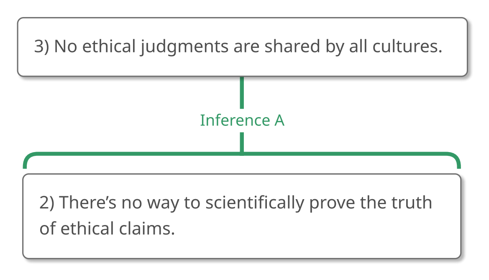
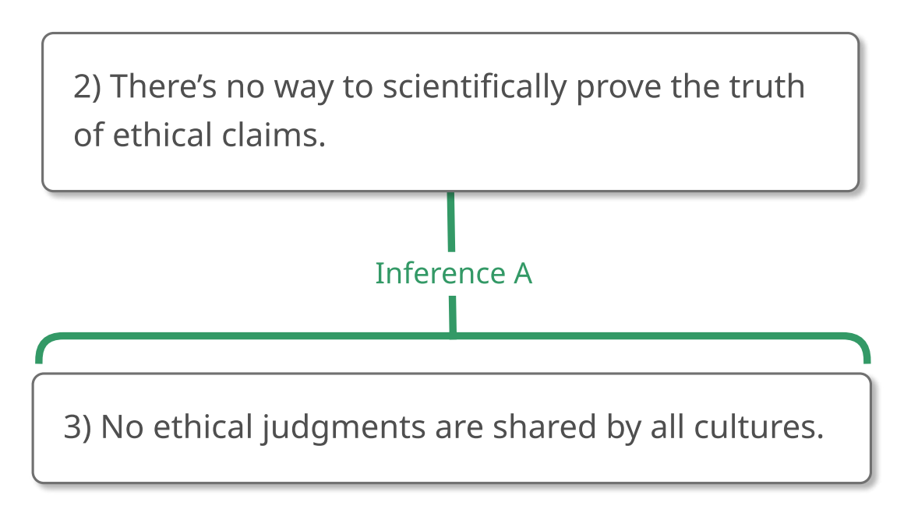
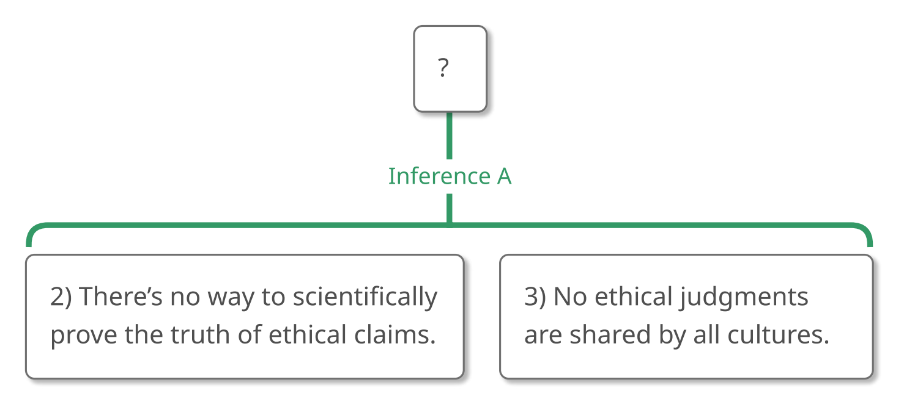
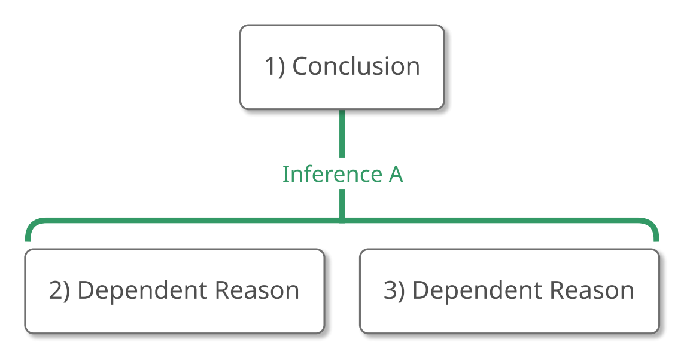
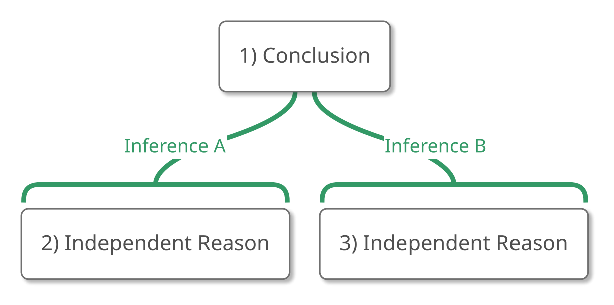
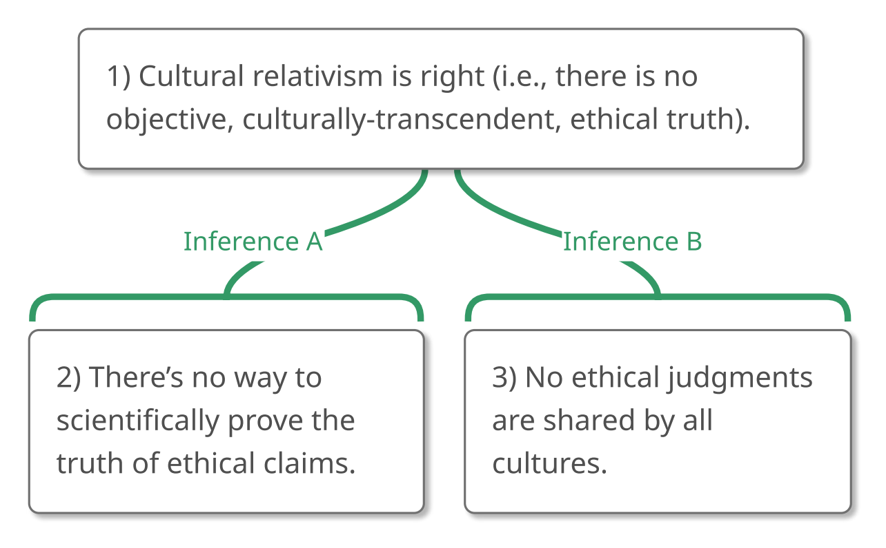
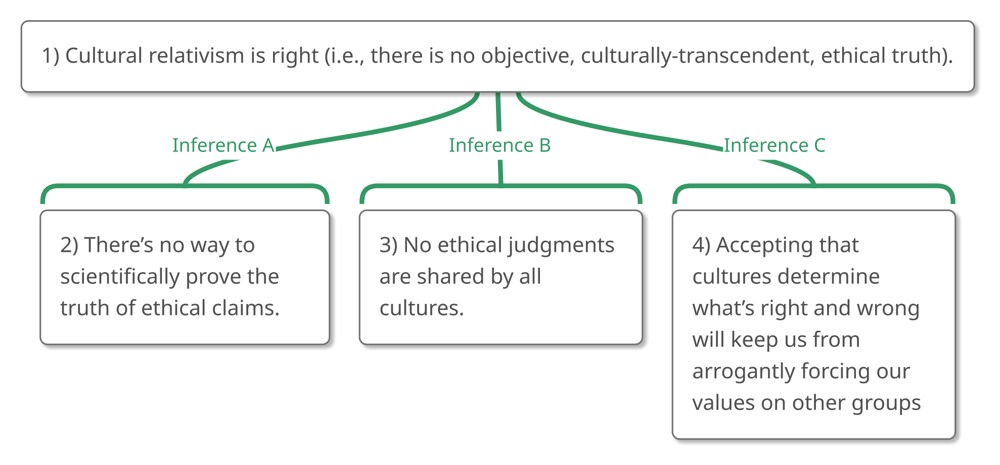
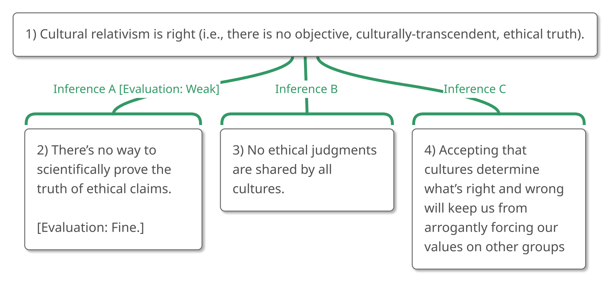
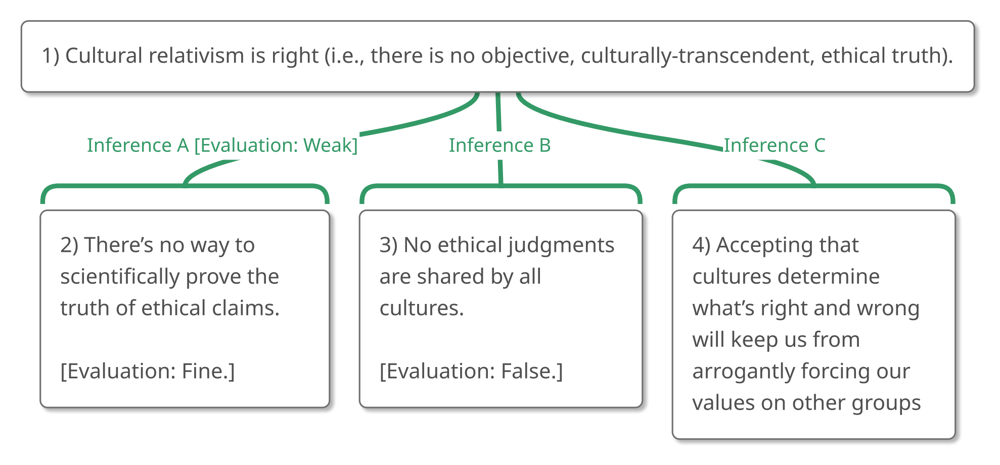
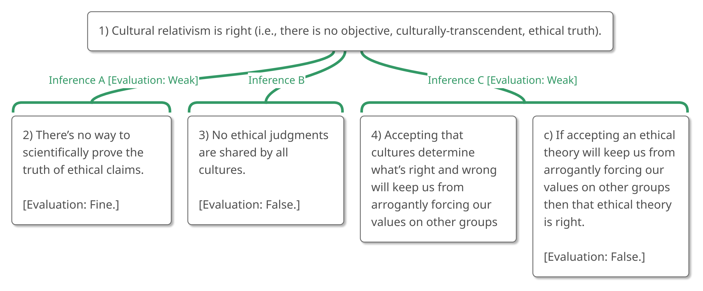

# 4.3 Example 2

## Step 1 – Recognizing an Argument

Take a look at this passage. Is it trying to establish that something is true? Does it contain an argument?

> "There are many different theories about what makes something good or bad, but if you ask me, cultural relativism is right. There is no objective, culturally-transcendent, good or bad in the ethical realm and every culture determines what's right and wrong for itself. Think about it. First, there's no way to scientifically prove the truth of ethical claims. Second, no ethical judgments are shared by all cultures. And finally, accepting that cultures determine what's right and wrong will keep us from arrogantly forcing our values on other groups."

I'd say that this passage does contain an argument. If you thought so, too, you should be quite pleased with yourself because this argument is unlike *any* argument we've seen before. It doesn't contain an inference indicator expression! (If you thought that it did contain inference indicator expressions, look again. They aren't there. You were filling them in on your own, which is all to the good.)

This is an important advance.

### Arguments Without Inference Indicators

In Chapter 1, we were able to rely entirely upon inference indicator expressions when recognizing arguments. If a passage *did* contain an inference indicator expression then it *was* an argument and if a passage *didn't* contain an inference indicator expression then it *wasn't* an argument.

In Chapter 2, the situation became more complicated. We couldn't entirely depend upon indicator expressions anymore because some of the passages that contained inference indicator expressions weren't arguments; they were explanations instead. We *could*, however, still count on indicator expressions a *little* because it was still the case that if a passage *didn't* contain an inference indicator expression then it *wasn't* an argument.

In this chapter, things get more realistic. **Here we'll be seeing some arguments that don't contain any inference indicator expressions at all**. Of course, we can still use inference indicator expressions as rules of thumb, but we can't *rely* on them anymore. From now on, in order to identify an argument, we must be sure to ask "Is this passage trying to convince us that something is true?" If so, it's an argument. If not, it isn't.

## Step 2 – Analyzing the Argument

This passage contains an argument because it's trying to convince us of something. But of what? What is the ultimate conclusion here?

> "There are many different theories about what makes something good or bad, but if you ask me, cultural relativism is right. There is no objective, culturally-transcendent, good or bad in the ethical realm and every culture determines what's right and wrong for itself. Think about it. First, there's no way to scientifically prove the truth of ethical claims. Second, no ethical judgments are shared by all cultures. And finally, accepting that cultures determine what's right and wrong will keep us from arrogantly forcing our values on other groups."

It seems to me that this passage is trying to convince us that cultural relativism is right, so let's take that as our ultimate conclusion. (The first part of that sentence, "there are many different theories about what makes something good or bad," isn't an important claim because it doesn't play a role in showing that cultural relativism is right.)

> "There are many different theories about what makes something good or bad, but if you ask me, (1) cultural relativism is right. There is no objective, culturally-transcendent, good or bad in the ethical realm and every culture determines what's right and wrong for itself. Think about it. First, there's no way to scientifically prove the truth of ethical claims. Second, no ethical judgments are shared by all cultures. And finally, accepting that cultures determine what's right and wrong will keep us from arrogantly forcing our values on other groups."

### Repeated Claims

Now what about the second sentence, "there is no objective, culturally-transcendent, good or bad in the ethical realm and every culture determines what's right and wrong for itself"? What should we do with this?

Since cultural relativism *just is* the position that there is no objective, culturally-transcendent good or bad in the ethical realm and that every culture determines what's right and wrong for itself, *the second sentence says the same thing as the ultimate conclusion*. This sort of thing can happen. **Just like one sentence can convey more than one claim (as we saw in Chapter 3), more than one sentence can convey the same claim**.

**Because the claim is the same claim, performing the same function in the argument, no matter how many times it's repeated in a passage, we'll want to number it *only once*. We can either ignore the repeated claim or give it the same number as the first instance of the claim**. I'll generally give repeated claims the same number as the first instance of the claim because this can make passages a bit easier to follow. In this argument, with the repeated claims back-to-back, it doesn't make much difference, but I'll follow my normal practice anyway.

> "There are many different theories about what makes something good or bad, but if you ask me, (1) cultural relativism is right. (1) There is no objective, culturally-transcendent, good or bad in the ethical realm and every culture determines what's right and wrong for itself. Think about it. First, there's no way to scientifically prove the truth of ethical claims. Second, no ethical judgments are shared by all cultures. And finally, accepting that cultures determine what's right and wrong will keep us from arrogantly forcing our values on other groups."

The third sentence, "Think about it," is a regular command. Let's ignore it. The fourth and fifth sentences are important, though, so we'll include them.

> "There are many different theories about what makes something good or bad, but if you ask me, (1) cultural relativism is right. (1) There is no objective, culturally-transcendent, good or bad in the ethical realm and every culture determines what's right and wrong for itself. Think about it. First, (2) there's no way to scientifically prove the truth of ethical claims. Second, (3) no ethical judgments are shared by all cultures. And finally, accepting that cultures determine what's right and wrong will keep us from arrogantly forcing our values on other groups."

At this point, we have two claims (not counting the ultimate conclusion) so we should determine how they are related to each other. And because this argument doesn't have inference indicator expressions to help us trace the directions of support, we'll need to rely upon our own good sense (and all of the rules that we've learned so far).

Might there be a relationship of support between Claims 2 and 3? Let's try it out.

{#fig-4-3-2to3 width=374px fig-alt="Argument map concluding: 3) No ethical judgments are shared by all cultures, supported by Claim 2 through Inference A: There's no way to scientifically prove the truth of ethical claims. A full text description is provided."}

::: {.map-outline fig="fig-4-3-2to3"}

:::

Reading down the inference with a reason indicator expression would give us "(3) No ethical judgments are shared by all cultures **because** (2) there's no way to scientifically prove the truth of ethical claims."

I suppose someone might say this to account for *why* cultures disagree about ethics, but that would be an *explanation*, not an argument. And in any case, it doesn't seem to me like this is what the author of the argument has in mind.

What if we flip it?

{#fig-4-3-3to2 width=374px fig-alt="Argument map concluding: 2) There's no way to scientifically prove the truth of ethical claims, supported by Claim 3 through Inference A: No ethical judgments are shared by all cultures. A full text description is provided."}

::: {.map-outline fig="fig-4-3-3to2"}

:::

Reading down the inference with a reason indicator expression gives us "(2) There's no way to scientifically prove the truth of ethical claims, **because** (3) no ethical judgments are shared by all cultures."

Again, I suppose someone might say this, on the assumption that if there were some way of scientifically proving ethical claims then some claims would be shared by all cultures, but that doesn't sound to me like what the author of the argument has in mind.

Well, maybe Claims 2 and 3 are dependent reasons, like so:

{#fig-4-3-2and3 width=473px fig-alt="Argument map with a question mark in place of the conclusion, supported by Claims 2 and 3 together through Inference A. A full text description is provided."}

::: {.map-outline fig="fig-4-3-2and3"}

:::

What would follow from these claims? Using the Puzzle Piece Test, the conclusion would be composed of the left-over concepts "no way to scientifically prove" and "not shared by all cultures." We could fashion something out of that, but it feels forced and doesn't seem to be what the argument is doing.

So what's going on here?

### Independent Reasons

In Chapter 3, we saw how two reasons could work together to establish the truth of a conclusion in such a way that if either of the reasons were false then the remaining claim wouldn't be enough to support the conclusion on its own. That's why such reasons are called "dependent reasons." They depend upon each other to support the conclusion.

{#fig-4-3-dependent width=369px fig-alt="Argument map with 1) Conclusion at the top, supported by 2) Dependent Reason and 3) Dependent Reason together through Inference A. A full text description is provided."}

::: {.map-outline fig="fig-4-3-dependent"}

:::

Sometimes, though, it will turn out that if either of the reasons were false, the remaining claim *would* be enough, on its own, to support the conclusion (or, if the remaining claim isn't enough, the inference isn't *weakened* by the absence of the other claim because the ideas don't "work together" in the way the dependent reasons do). In such a case, the claims are **independent reasons** for the conclusion because each of them supports the conclusion independently.

{#fig-4-3-independent width=391px fig-alt="Argument map with 1) Conclusion at the top, supported by 2) Independent Reason through Inference A and, separately, by 3) Independent Reason through Inference B. A full text description is provided."}

::: {.map-outline fig="fig-4-3-independent"}

:::

Claims 2 and 3 in our argument are like *that*. Each of them gives its own, independent, reason to accept cultural relativism!

> "There are many different theories about what makes something good or bad, but if you ask me, (1) cultural relativism is right. (1) There is no objective, culturally-transcendent, good or bad in the ethical realm and every culture determines what's right and wrong for itself. Think about it. First, (2) there's no way to scientifically prove the truth of ethical claims. Second, (3) no ethical judgments are shared by all cultures. And finally, accepting that cultures determine what's right and wrong will keep us from arrogantly forcing our values on other groups."

{#fig-4-3-2-3-1 width=411px fig-alt="Argument map concluding: 1) Cultural relativism is right (i.e., there is no objective, culturally-transcendent, ethical truth), supported by Claim 2 through Inference A and, separately, by Claim 3 through Inference B. A full text description is provided."}

::: {.map-outline fig="fig-4-3-2-3-1"}

:::

Having mapped the claims that we've identified, we can return to the argument for the next and final claim: the assertion that accepting that cultures determine what's right and wrong will keep us from arrogantly forcing our values on other groups.

> "There are many different theories about what makes something good or bad, but if you ask me, (1) cultural relativism is right. (1) There is no objective, culturally-transcendent, good or bad in the ethical realm and every culture determines what's right and wrong for itself. Think about it. First, (2) there's no way to scientifically prove the truth of ethical claims. Second, (3) no ethical judgments are shared by all cultures. And finally, (4) accepting that cultures determine what's right and wrong will keep us from arrogantly forcing our values on other groups."

{#fig-4-3-2-3-2 width=411px fig-alt="Argument map concluding: 1) Cultural relativism is right (i.e., there is no objective, culturally-transcendent, ethical truth), supported by Claim 2 through Inference A and, separately, by Claim 3 through Inference B. A full text description is provided."}

::: {.map-outline fig="fig-4-3-2-3-2"}

:::

How is Claim 4 related to the part of the argument that we've already mapped? As support? As a dependent reason? Or as an independent reason?

Claim 4 looks like another independent reason in support of the conclusion to me, so we'll finish the map of the argument like this:

> "There are many different theories about what makes something good or bad, but if you ask me, (1) cultural relativism is right. (1) There is no objective, culturally-transcendent, good or bad in the ethical realm and every culture determines what's right and wrong for itself. Think about it. First, (2) there's no way to scientifically prove the truth of ethical claims. Second, (3) no ethical judgments are shared by all cultures. And finally, (4) accepting that cultures determine what's right and wrong will keep us from arrogantly forcing our values on other groups."

{#fig-4-3-2-3-4-1 width=633px fig-alt="Argument map concluding: 1) Cultural relativism is right (i.e., there is no objective, culturally-transcendent, ethical truth), supported by three independent reasons: Claim 2 through Inference A, Claim 3 through Inference B, and Claim 4 through Inference C. A full text description is provided."}

::: {.map-outline fig="fig-4-3-2-3-4-1"}

:::

When we have more than one path converging upon the ultimate conclusion, we say that the argument has more than one line of reasoning. **A line of reasoning is simply a route to the ultimate conclusion**. This argument, for instance, has three lines of reasoning. There are three routes to Claim 1.

Notice how the author distinguishes between the lines of reasoning by saying, "first," "second," and "finally." This is a very common and effective way to signal that an argument is advancing independent lines of reasoning.

Sometimes, of course, authors aren't that obliging. A safer and more universal way to identify independent lines of reasoning is to **look for the unique "themes" that differentiate lines of reasoning from each other**. In this argument, for instance, we have a "lack of scientific proof" theme, a "cultural disagreement" theme, and a "let's not be arrogant" theme.

Note that we don't attribute to any of these lines of reasoning a "cultural relativism" theme. That's because the *ultimate conclusion* is about cultural relativism and so every line of reasoning for that conclusion should have something to do with cultural relativism too. **The identifying theme of each line of reasoning is never the ultimate conclusion itself; it is, so to speak, "a way of looking at" or "way of approaching" the ultimate conclusion**.

## Step 3 – Evaluating the Argument

Now that we know how to analyze arguments with independent reasons, let's think about how to evaluate them.

### How to Evaluate an Argument with Independent Lines of Reasoning

We've seen that each line of reasoning attempts to support the ultimate conclusion. This means that if *any* line of reasoning in an argument is good, the ultimate conclusion of that argument is supported. Because an argument is good if it supports the ultimate conclusion, **an argument is good if it has at least one good line of reasoning**.

Because any line of reasoning is composed of claims that depend on each other, **a line of reasoning is good only if all of the premises and inferences in that line of reasoning are good**.

What this means, of course, is that if an argument has only one line of reasoning, all we need to do is find one bad premise or one bad inference to know that the argument fails as a whole. If an argument has *independent* lines of reasoning, though, we must find one bad premise or one bad inference in *every line of reasoning* before we can say that the argument as a whole is bad. Arguments with multiple lines of reasoning are much harder to undermine.

Now that we know how to evaluate arguments with independent lines of reasoning, let's take a look at the argument that we've just mapped.

> "There are many different theories about what makes something good or bad, but if you ask me, (1) cultural relativism is right. (1) There is no objective, culturally-transcendent, good or bad in the ethical realm and every culture determines what's right and wrong for itself. Think about it. First, (2) there's no way to scientifically prove the truth of ethical claims. Second, (3) no ethical judgments are shared by all cultures. And finally, (4) accepting that cultures determine what's right and wrong will keep us from arrogantly forcing our values on other groups."

{#fig-4-3-2-3-4-2 width=633px fig-alt="Argument map concluding: 1) Cultural relativism is right (i.e., there is no objective, culturally-transcendent, ethical truth), supported by three independent reasons: Claim 2 through Inference A, Claim 3 through Inference B, and Claim 4 through Inference C. A full text description is provided."}

::: {.map-outline fig="fig-4-3-2-3-4-2"}

:::

We'll start with the left-hand line of reasoning.

Premise 2 says that there is no way to scientifically prove ethical claims, which is essentially what we learned when we saw that we can't get an 'ought' from an 'is,' so I'd say that Premise 2 is true. It doesn't seem to assume the conclusion either, so I'd say that Premise 2 is fine.

Inference A, however, is another matter. A perfectly gullible, perfectly rational person could think that there *is* an objective ethical truth even though there's no way to prove it scientifically. Why should all truths be scientifically provable? Inference A is bad.

> "There are many different theories about what makes something good or bad, but if you ask me, (1) cultural relativism is right. (1) There is no objective, culturally-transcendent, good or bad in the ethical realm and every culture determines what's right and wrong for itself. Think about it. First, (2) there's no way to scientifically prove the truth of ethical claims. Second, (3) no ethical judgments are shared by all cultures. And finally, (4) accepting that cultures determine what's right and wrong will keep us from arrogantly forcing our values on other groups."

{#fig-4-3-eval-l width=633px fig-alt="Argument map concluding: 1) Cultural relativism is right (i.e., there is no objective, culturally-transcendent, ethical truth), supported by Claims 2, 3 and 4 through Inferences A, B and C. Claim 2 is labeled Evaluation: Fine. Inference A is labeled Evaluation: Weak. A full text description is provided."}

::: {.map-outline fig="fig-4-3-eval-l"}

:::

This is *not*, however, enough information to tell us that the entire argument is bad because there are still two more to examine. Let's take a look at the middle one.

What about Premise 3, the claim that no ethical judgments are shared by all cultures? Well, there's reason to believe that *some* ethical judgments *must* be shared by any viable culture because these judgments articulate rules that are necessary for the survival of any human society. Without some prohibition against the unrestricted killing of innocents, for example, the trust required for interpersonal cooperation would be destroyed. If this is right, then some minimal set of ethical rules must be cross-culturally embraced and Premise 3 is false.

> "There are many different theories about what makes something good or bad, but if you ask me, (1) cultural relativism is right. (1) There is no objective, culturally-transcendent, good or bad in the ethical realm and every culture determines what's right and wrong for itself. Think about it. First, (2) there's no way to scientifically prove the truth of ethical claims. Second, (3) no ethical judgments are shared by all cultures. And finally, (4) accepting that cultures determine what's right and wrong will keep us from arrogantly forcing our values on other groups."

{#fig-4-3-eval-m width=633px fig-alt="Argument map concluding: 1) Cultural relativism is right (i.e., there is no objective, culturally-transcendent, ethical truth), supported by Claims 2, 3 and 4 through Inferences A, B and C. Claim 2 is labeled Evaluation: Fine. Inference A is labeled Evaluation: Weak. Claim 3 is labeled Evaluation: False. A full text description is provided."}

::: {.map-outline fig="fig-4-3-eval-m"}

:::

Of course, this argument still has a chance at success. Maybe the right-hand branch holds! Let's see.

I'd venture to say that Premise 4 is good. True cultural relativists probably would avoid trying to force the ethical views of their own culture upon others.

What about Inference C? Because we evaluated Inference A with the Gullible Person Test, let's evaluate Inference C with the Missing Premise Method, just for practice.

To identify the missing premise, we'll start with the "if... then..." sentence that has Claim 4 in the front and Claim 1 in the back:

-   "If accepting that cultures determine what's right and wrong will keep us from arrogantly forcing our values on other groups (Claim 4) then cultural relativism is right (Claim 1)."

The author probably has a broader principle in mind, though, and we can find that principle by noting what the front and back part of the "if... then..." have in common and replacing it with a more general concept.

Both the front and the back part of the "if... then..." mention cultural relativism. It's described in the front part ("cultures determine what's right and wrong") and named in the back part ("cultural relativism") but it's the same thing both places. Let's replace that with a more general concept – something like "an ethical theory."

-   "If accepting an ethical theory will keep us from arrogantly forcing our values on other groups then that ethical theory is right."

Is that missing premise true? I don't think so. The *consequences* of accepting a theory are one thing, and the *truth* of that theory is another. This means that accepting an ethical theory could have good consequences even though that theory isn't true. And that, of course, is the falsification condition for that "if... then..." statement. Because the hidden premise assumed by Inference C is false, Inference C is weak.

> "There are many different theories about what makes something good or bad, but if you ask me, (1) cultural relativism is right. (1) There is no objective, culturally-transcendent, good or bad in the ethical realm and every culture determines what's right and wrong for itself. Think about it. First, (2) there's no way to scientifically prove the truth of ethical claims. Second, (3) no ethical judgments are shared by all cultures. And finally, (4) accepting that cultures determine what's right and wrong will keep us from arrogantly forcing our values on other groups."

{#fig-4-3-eval-r-1 width=807px fig-alt="Argument map concluding: 1) Cultural relativism is right (i.e., there is no objective, culturally-transcendent, ethical truth), supported by Claims 2, 3 and 4 through Inferences A, B and C. Inference C also has missing premise c): If accepting an ethical theory will keep us from arrogantly forcing our values on other groups then that ethical theory is right. Claim 2 is labeled Evaluation: Fine; Inference A, Evaluation: Weak; Claim 3, Evaluation: False; missing premise c), Evaluation: False; Inference C, Evaluation: Weak. A full text description is provided."}

::: {.map-outline fig="fig-4-3-eval-r-1"}

:::

And finally, since each and every line of reasoning in this argument is bad, the ultimate conclusion is not supported and the entire argument is bad.

## Summary of Example 2

Example 2 presented us with the following passage:

> "There are many different theories about what makes something good or bad, but if you ask me, cultural relativism is right. There is no objective, culturally-transcendent, good or bad in the ethical realm and every culture determines what's right and wrong for itself. Think about it. First, there's no way to scientifically prove the truth of ethical claims. Second, no ethical judgments are shared by all cultures. And finally, accepting that cultures determine what's right and wrong will keep us from arrogantly forcing our values on other groups."

### Step 1 – Recognizing an Argument

We decided that this passage does contain an argument because – even though it doesn't contain any inference indicator expressions – it's trying to convince us that something is true.

### Step 2 – Analyzing the Argument

We decided that the ultimate conclusion is "cultural relativism is right." Because the next sentence conveys the same claim as "cultural relativism is right," we gave it the same number. In general, whenever a claim is repeated in a passage, we'll number it only once.

> "There are many different theories about what makes something good or bad, but if you ask me, (1) cultural relativism is right. (1) There is no objective, culturally-transcendent, good or bad in the ethical realm and every culture determines what's right and wrong for itself. Think about it. First, there's no way to scientifically prove the truth of ethical claims. Second, no ethical judgments are shared by all cultures. And finally, accepting that cultures determine what's right and wrong will keep us from arrogantly forcing our values on other groups."

After we identified the next two claims in the argument, we asked ourselves how those claims were related to each other. We decided that they are independent reasons in support of the ultimate conclusion.

> "There are many different theories about what makes something good or bad, but if you ask me, (1) cultural relativism is right. (1) There is no objective, culturally-transcendent, good or bad in the ethical realm and every culture determines what's right and wrong for itself. Think about it. First, (2) there's no way to scientifically prove the truth of ethical claims. Second, (3) no ethical judgments are shared by all cultures. And finally, accepting that cultures determine what's right and wrong will keep us from arrogantly forcing our values on other groups."

{#fig-4-3-2-3-3 width=411px fig-alt="Argument map concluding: 1) Cultural relativism is right (i.e., there is no objective, culturally-transcendent, ethical truth), supported by Claim 2 through Inference A and, separately, by Claim 3 through Inference B. A full text description is provided."}

::: {.map-outline fig="fig-4-3-2-3-3"}

:::

We then identified the fourth and final claim and decided that it was an independent reason in support of the conclusion as well.

> "There are many different theories about what makes something good or bad, but if you ask me, (1) cultural relativism is right. (1) There is no objective, culturally-transcendent, good or bad in the ethical realm and every culture determines what's right and wrong for itself. Think about it. First, (2) there's no way to scientifically prove the truth of ethical claims. Second, (3) no ethical judgments are shared by all cultures. And finally, (4) accepting that cultures determine what's right and wrong will keep us from arrogantly forcing our values on other groups."

{#fig-4-3-2-3-4-3 width=633px fig-alt="Argument map concluding: 1) Cultural relativism is right (i.e., there is no objective, culturally-transcendent, ethical truth), supported by three independent reasons: Claim 2 through Inference A, Claim 3 through Inference B, and Claim 4 through Inference C. A full text description is provided."}

::: {.map-outline fig="fig-4-3-2-3-4-3"}

:::

Independent reasons give us different lines of reasoning, or paths to the ultimate conclusion.

In this case, the author helped us to see the multiple lines of reasoning by saying "first," "second," and "finally," but when an author doesn't do that, we can distinguish between lines of reasoning by noting that each line of reasoning has its own theme.

### Step 3 – Evaluating the Argument

Reflecting upon our map analogy allowed us to see that an argument with multiple lines of reasoning is good if it has at least one good line of reasoning, and that a line of reasoning is good only if all of its premises and inferences are good.

> "There are many different theories about what makes something good or bad, but if you ask me, (1) cultural relativism is right. (1) There is no objective, culturally-transcendent, good or bad in the ethical realm and every culture determines what's right and wrong for itself. Think about it. First, (2) there's no way to scientifically prove the truth of ethical claims. Second, (3) no ethical judgments are shared by all cultures. And finally, (4) accepting that cultures determine what's right and wrong will keep us from arrogantly forcing our values on other groups."

{#fig-4-3-eval-r-2 width=807px fig-alt="Argument map concluding: 1) Cultural relativism is right (i.e., there is no objective, culturally-transcendent, ethical truth), supported by Claims 2, 3 and 4 through Inferences A, B and C. Inference C also has missing premise c): If accepting an ethical theory will keep us from arrogantly forcing our values on other groups then that ethical theory is right. Claim 2 is labeled Evaluation: Fine; Inference A, Evaluation: Weak; Claim 3, Evaluation: False; missing premise c), Evaluation: False; Inference C, Evaluation: Weak. A full text description is provided."}

::: {.map-outline fig="fig-4-3-eval-r-2"}

:::
