# 4.5 Example 4

## Step 1 – Recognizing an Argument

Let's take a look at another passage. Does it contain an argument? Is it trying to convince us of something?

> "Progress is nothing more than movement toward an objectively better state of affairs, so if there is such a thing as moral progress then there has to be objective moral truth. There is such a thing as moral progress, right? Clearly, there is an objective moral truth. Furthermore, if there were an objective moral truth then some ethical opinions would be shared across cultures, and in fact some ethical opinions are shared across cultures."

It seems to me that this passage does contain an argument, so let's analyze it.

## Step 2 – Analyzing the Argument

As usual, we'll start by trying to identify the ultimate conclusion, or the main idea that this passage is trying to get us to believe. And if you think that you've spotted it, well done!

There is something about the ultimate conclusion of this argument that can make it difficult to identify, though, so *let's proceed as if we don't know what the ultimate conclusion is*, just to prove to ourselves that it can be done.

Because we aren't identifying the ultimate conclusion at the outset, we'll give number 1 to the first claim we see that seems to be part of the argument. It looks like the first sentence contains two claims that are part of the argument, and the inference indicator "so" tells us that the second claim is the conclusion from the first. Let's map that part.

> "(1) Progress is nothing more than movement toward an objectively better state of affairs, **so** (2) if there is such a thing as moral progress then there has to be objective moral truth. There is such a thing as moral progress, right? Clearly, there is an objective moral truth. Furthermore, if there were an objective moral truth then some ethical opinions would be shared across cultures, and in fact some ethical opinions are shared across cultures."

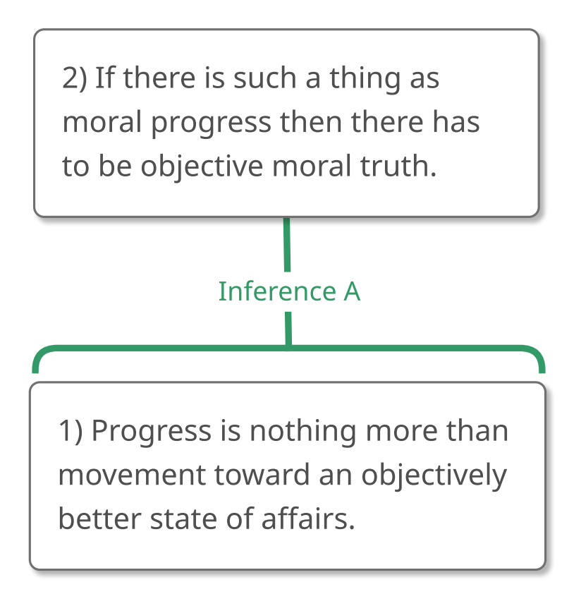{#fig-4-5-1to2 width=264px fig-alt="Argument map concluding: 2) If there is such a thing as moral progress then there has to be objective moral truth, supported by Claim 1 through Inference A: Progress is nothing more than movement toward an objectively better state of affairs. A full text description is provided."}

::: {.map-outline fig="fig-4-5-1to2"}

:::

The next sentence is a rhetorical question that intends to convey the claim that there is such a thing as moral progress, so let's let that be Claim 3.

> "(1) Progress is nothing more than movement toward an objectively better state of affairs, so (2) if there is such a thing as moral progress then there has to be objective moral truth. There is such a thing as moral progress, right? \[(3) There is such a thing as moral progress.\] Clearly, there is an objective moral truth. Furthermore, if there were an objective moral truth then some ethical opinions would be shared across cultures, and in fact some ethical opinions are shared across cultures."

It looks like Claim 3 is a dependent reason with Claim 2, so we'll represent that.

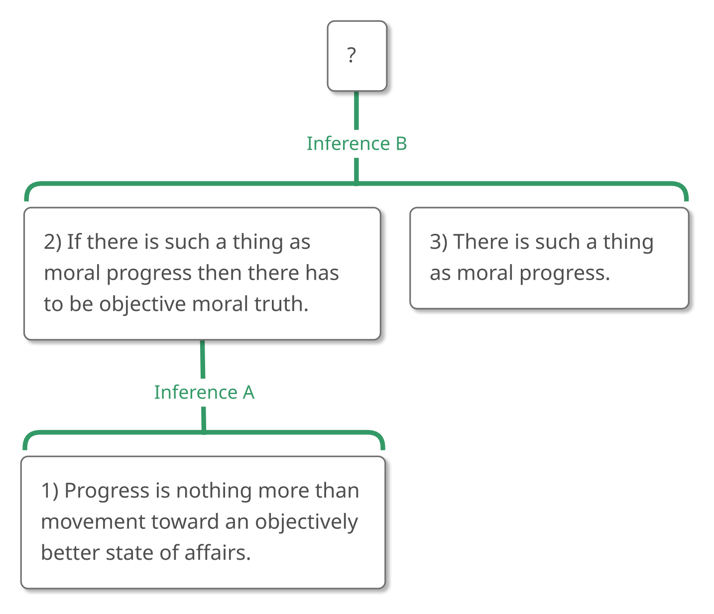{#fig-4-5-2and3 width=459px fig-alt="Argument map with a question mark in place of the conclusion, supported by Claims 2 and 3 together through Inference B. Claim 2 is supported by Claim 1 through Inference A. A full text description is provided."}

::: {.map-outline fig="fig-4-5-2and3"}

:::

Now, what follows from Claims 2 and 3? Well, Claim 2 says that if there is such a thing as moral progress then there has to be objective moral truth. Claim 3 says that there is such a thing as moral progress. From those two things we can conclude that there has to be objective moral truth. That just happens to be the next claim in the passage, so let's map that in.

> "(1) Progress is nothing more than movement toward an objectively better state of affairs, so (2) if there is such a thing as moral progress then there has to be objective moral truth. There is such a thing as moral progress, right? \[(3) There is such a thing as moral progress.\] Clearly, (4) there is an objective moral truth. Furthermore, if there were an objective moral truth then some ethical opinions would be shared across cultures, and in fact some ethical opinions are shared across cultures."

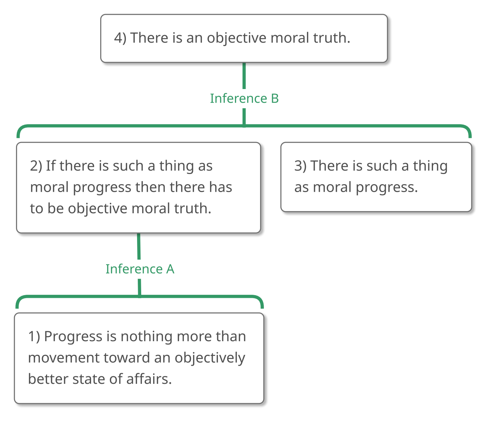{#fig-4-5-2and3to4 width=459px fig-alt="Argument map concluding: 4) There is an objective moral truth, supported by Claims 2 and 3 together through Inference B. Claim 2 is supported by Claim 1 through Inference A. A full text description is provided."}

::: {.map-outline fig="fig-4-5-2and3to4"}

:::

The next sentence has two more claims and begins with "furthermore."

> "(1) Progress is nothing more than movement toward an objectively better state of affairs, so (2) if there is such a thing as moral progress then there has to be objective moral truth. There is such a thing as moral progress, right? \[(3) There is such a thing as moral progress.\] Clearly, (4) there is an objective moral truth. **Furthermore**, (5) if there were an objective moral truth then some ethical opinions would be shared across cultures, **and** (6) in fact some ethical opinions are shared across cultures."

Because Claim 5 and Claim 6 are connected with "and," they might be dependent reasons. What could we conclude from them?

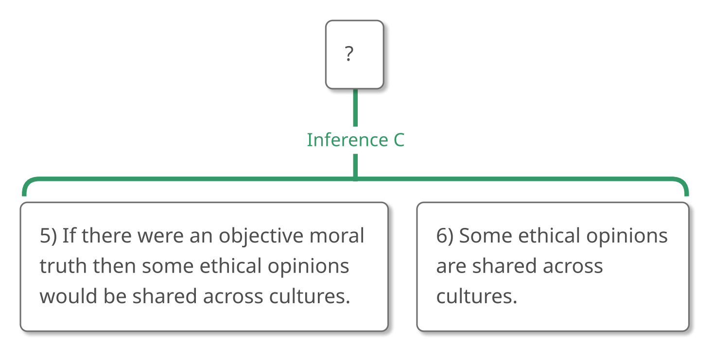{#fig-4-5-5and6 width=470px fig-alt="Argument map with a question mark in place of the conclusion, supported by Claims 5 and 6 together through Inference C. A full text description is provided."}

::: {.map-outline fig="fig-4-5-5and6"}

:::

It seems natural to conclude "There is an objective moral truth" from Claims 5 and 6, and that's just Claim 4! This gives us another line of reasoning for Claim 4, which we can now identify as the ultimate conclusion.

> "(1) Progress is nothing more than movement toward an objectively better state of affairs, so (2) if there is such a thing as moral progress then there has to be objective moral truth. There is such a thing as moral progress, right? \[(3) There is such a thing as moral progress.\] Clearly, (4) there is an objective moral truth. **Furthermore**, (5) if there were an objective moral truth then some ethical opinions would be shared across cultures, **and** (6) in fact some ethical opinions are shared across cultures."

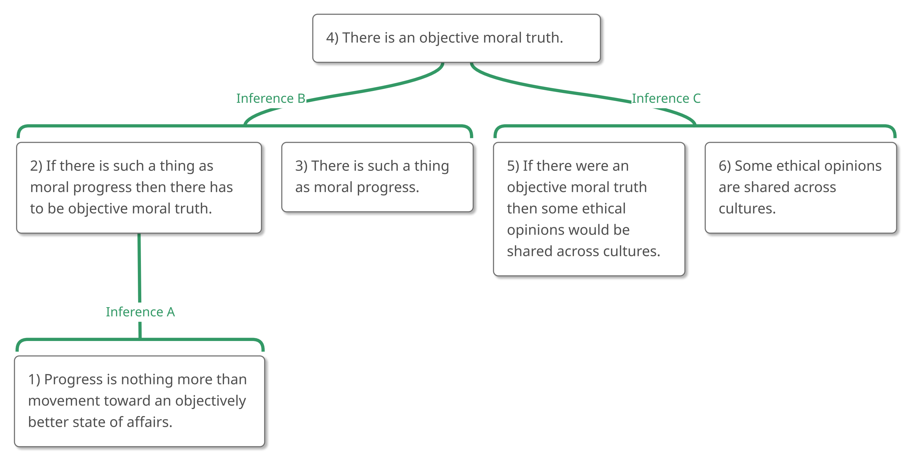{#fig-4-5-full-1 width=855px fig-alt="Argument map concluding: 4) There is an objective moral truth, supported by Claims 2 and 3 together through Inference B and, separately, by Claims 5 and 6 together through Inference C. Claim 2 is supported by Claim 1 through Inference A. A full text description is provided."}

::: {.map-outline fig="fig-4-5-full-1"}

:::

### Ultimate Conclusion in the Middle

We can now see what might have made the ultimate conclusion difficult to identify: it's in the middle of the argument—at the end of one line of reasoning and at the beginning of the other. Now that we have arguments with multiple lines of reasoning, we'll see more of that. In fact, **placing the ultimate conclusion between lines of reasoning is sometimes a way for the author to distinguish between the lines of reasoning**. This author also helped us out by including the word "furthermore," which is sometimes used to introduce a new line of reasoning.

## Step 3 – Evaluating the Argument

Let's begin our evaluation by looking at Inference B.

> "(1) Progress is nothing more than movement toward an objectively better state of affairs, so (2) if there is such a thing as moral progress then there has to be objective moral truth. There is such a thing as moral progress, right? \[(3) There is such a thing as moral progress.\] Clearly, (4) there is an objective moral truth. Furthermore, (5) if there were an objective moral truth then some ethical opinions would be shared across cultures, and (6) in fact some ethical opinions are shared across cultures."

{#fig-4-5-full-2 width=855px fig-alt="Argument map concluding: 4) There is an objective moral truth, supported by Claims 2 and 3 together through Inference B and, separately, by Claims 5 and 6 together through Inference C. Claim 2 is supported by Claim 1 through Inference A. A full text description is provided."}

::: {.map-outline fig="fig-4-5-full-2"}

:::

### Inference Form: Modus Ponens

In Chapter 3, we got a sneak peek at inference forms, noting that sometimes we can evaluate an inference by focusing on the "shape" of its reasons and conclusion. Let's do that here.

Claim 2 is an "if… then…" sentence. Because we want to think about the *form* of the sentence instead of its content, let's think of Claim 2 as "If FRONT then BACK," where "there is such a thing as moral progress" is "FRONT" and "there has to be an objective moral truth," is "BACK."

With "FRONT" and "BACK" identified, we can see that Claim 3 is the same as the front part of the "If… then…" sentence, and that Claim 4 is the same as the back part of the "If… then…" sentence.

In short, Inference B looks like this:

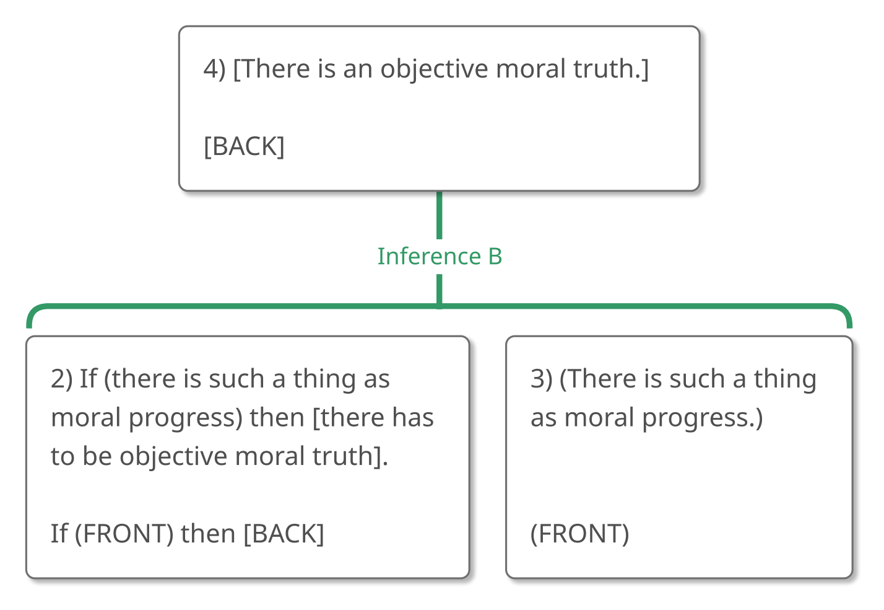{#fig-4-5-mp width=457px fig-alt="Argument map concluding: 4) [There is an objective moral truth.] [BACK], supported through Inference B by Claim 2: If (there is such a thing as moral progress) then [there has to be objective moral truth]. If (FRONT) then [BACK]; and Claim 3: (There is such a thing as moral progress.) (FRONT). A full text description is provided."}

::: {.map-outline fig="fig-4-5-mp"}

:::

If we think about it, we'll see that *any* inference of this form will be good. In fact, it's *perfect*. A perfectly gullible, perfectly rational person who believes "If FRONT then BACK" and also believes "FRONT," will be *logically forced* to accept "BACK." As we saw in Chapter 1, perfect inferences are said to be *valid*.

This valid inference form is so common that it has a name, "***Modus Ponens***." "*Modus Ponens*" is a Latin term that means "In the way of affirming" because it tells us that if we have an "if… then…" sentence, and affirm the front part, we can conclude the affirmation of the back part.

Inference forms are often written horizontally, using the letters "P" and "Q" instead of the words "FRONT" and "BACK." This convention allows us to write *Modus Ponens* like this:

**Modus Ponens: If P then Q. P. Therefore Q.**

(Why do we use "P" and "Q"? "P" stands for "proposition," another word for "claim," and "Q" is just the letter after "P" in the alphabet. If we need another letter, guess what we'll use? That's right "R.")

So, Inference B is valid.

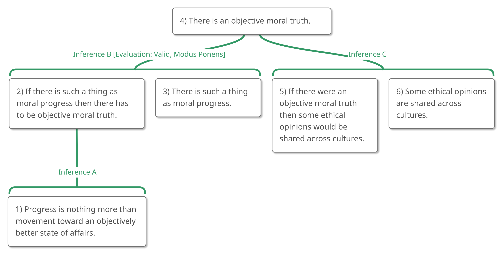{#fig-4-5-eval1 width=855px fig-alt="Argument map concluding: 4) There is an objective moral truth, supported by Claims 2 and 3 together through Inference B and, separately, by Claims 5 and 6 together through Inference C. Claim 2 is supported by Claim 1 through Inference A. Inference B is labeled Evaluation: Valid, Modus Ponens. A full text description is provided."}

::: {.map-outline fig="fig-4-5-eval1"}

:::

Now, what about the rest of that line of reasoning? My attention is drawn to Claim 3, a premise, so let's evaluate it.

Is Claim 3 true? I'd say so. I think that we've witnessed moral progress and will hopefully witness more of it.

Would someone who doesn't already accept the ultimate conclusion think that Claim 3 is true? I'm not so sure. In fact, I doubt it. If someone doesn't accept the conclusion that there is an objective moral truth, I don't see how that person could think that there's such a thing as moral *progress* because, according to that person, no state of affairs is objectively better or worse than any other from an ethical point of view. The most there could be is moral *change*.

Premise 3 looks like it assumes the conclusion.

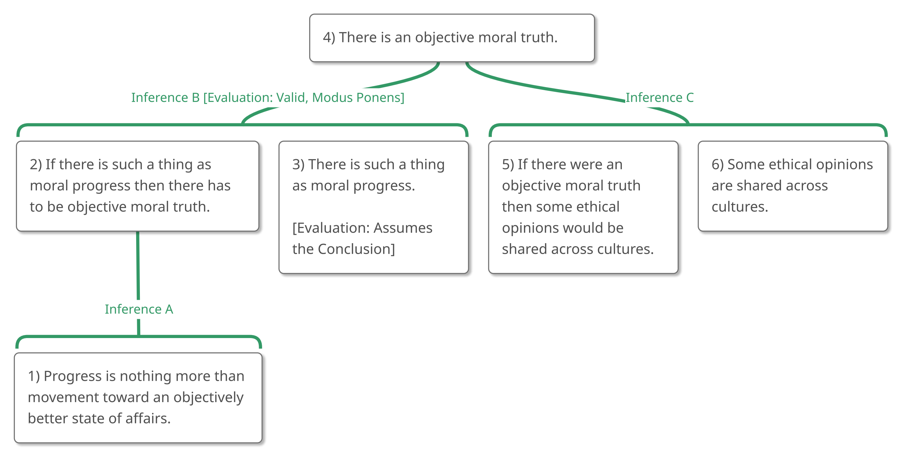{#fig-4-5-eval2 width=855px fig-alt="Argument map concluding: 4) There is an objective moral truth, supported by Claims 2 and 3 together through Inference B and, separately, by Claims 5 and 6 together through Inference C. Claim 2 is supported by Claim 1 through Inference A. Inference B is labeled Evaluation: Valid, Modus Ponens; Claim 3, Evaluation: Assumes the Conclusion. A full text description is provided."}

::: {.map-outline fig="fig-4-5-eval2"}

:::

Because Premise 3 is bad, the line of reasoning on the left fails. The argument could still support the conclusion, however! Let's look at the line of reasoning on the right.

### Inference Form: Assuming the Consequent

Inference C looks a lot like Inference B. Is it *Modus Ponens*, too? Let's check.

Claim 5 is an "if… then…" sentence. Because we want to think about the *form* of the sentence instead of its content, let's think of Claim 5 as "If FRONT then BACK," where "there is an objective moral truth" is "FRONT" and "some ethical opinions would be shared across cultures," is "BACK."

With "FRONT" and "BACK" identified, we can see that Claim 6 is the same as the *back* part of the "If… then…" sentence, and that Claim 4 is the same as the *front* part of the "If… then…" sentence.

In short, Inference C looks like this:

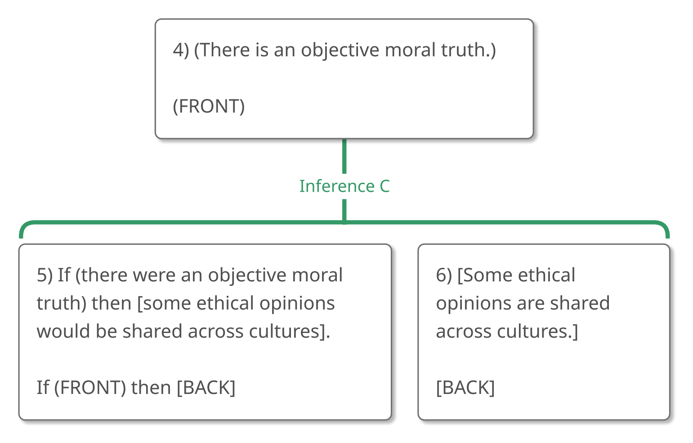{#fig-4-5-fac width=493px fig-alt="Argument map concluding: 4) (There is an objective moral truth.) (FRONT), supported through Inference C by Claim 5: If (there were an objective moral truth) then [some ethical opinions would be shared across cultures]. If (FRONT) then [BACK]; and Claim 6: [Some ethical opinions are shared across cultures.] [BACK]. A full text description is provided."}

::: {.map-outline fig="fig-4-5-fac"}

:::

That's not *Modus Ponens*.

*Modus Ponens* is this: **"If (FRONT) then \[BACK\]. (FRONT). Therefore \[BACK\]."** It goes from front to back.

Inference C is this: **"If (FRONT) then \[BACK\]. \[BACK\]. Therefore (FRONT)."** It goes from back to front.

But it's not as though *Modus Ponens* is the only valid inference form in the world. Is Inference C valid too?

No. It's not. And to see why it's not, let's step away from this argument for a bit and consider the following claim:

**"If Max is a poodle then Max is a dog."**

That claim is true, of course, because all poodles are dogs.

Using this claim in *Modus Ponens*, which goes from front to back, we get "If Max is a poodle then Max is a dog. Max is a poodle. Therefore Max is a dog." That works. If I tell you that there's an animal named Max in the next room, and go on to say that Max is a poodle, you'd naturally know that Max is a dog.

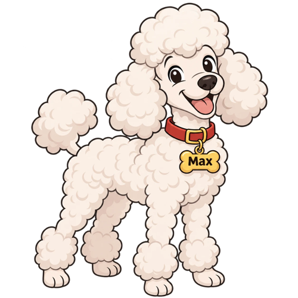{.illustration width=170px fig-alt="A cartoon poodle wearing a red collar with a bone-shaped tag that says Max."}

But what if we go from *back to front*, like in Inference C? That gives us "If Max is a poodle then Max is a dog. Max is a dog. Therefore Max is a poodle." And that *doesn't* work. If I tell you that there's an animal named Max in the next room, and go on to say that Max is a dog, you couldn't infer that Max must be a poodle. There are lots of other ways to be a dog than that. Max could be a beagle, for example.

{.illustration width=170px fig-alt="A cartoon beagle wearing a red collar with a bone-shaped tag that says Max."}

Going from back to front gives us a reasoning mistake, and it's so common that it has a name, "**The Fallacy of Assuming the Consequent**." "Consequent" is the technical term for the back part of an "if… then…" sentence. The Fallacy of Assuming the Consequent says that it's a fallacy to take the back part of the "if… then…" sentence as dependent reason with the "if… then…" sentence itself.

Using "P" and "Q," we now have two inference forms, one good and one bad.

**Modus Ponens (Valid): If P then Q. P. Therefore Q.**

**Fallacy of Assuming the Consequent (Invalid): If P then Q. Q. Therefore P.**

Because Inference C is the Fallacy of Assuming the Consequent, it's invalid. And because there is no other line of reasoning in the argument that might support the conclusion, we know that the argument is bad as a whole.

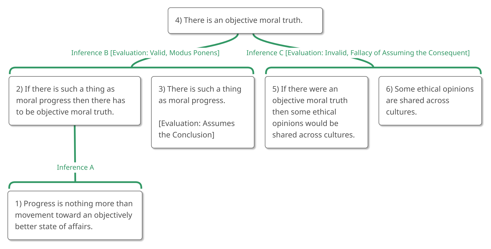{#fig-4-5-eval3-1 width=855px fig-alt="Argument map concluding: 4) There is an objective moral truth, supported by Claims 2 and 3 together through Inference B and, separately, by Claims 5 and 6 together through Inference C. Claim 2 is supported by Claim 1 through Inference A. Inference B is labeled Evaluation: Valid, Modus Ponens; Claim 3, Evaluation: Assumes the Conclusion; Inference C, Evaluation: Invalid, Fallacy of Assuming the Consequent. A full text description is provided."}

::: {.map-outline fig="fig-4-5-eval3-1"}

:::

### Thoughts About Inference Forms

#### Inference Forms Compensate for Natural Reasoning Errors

We now have three ways to evaluate inferences:

1) The Gullible Person (Gully) Test
2) The Missing Premise Method
3) Inference Forms

Inference Forms are *invaluable* because they compensate for an inevitable shortcoming of the Gullible Person Test, which asks us to imagine what conclusion a perfectly rational person would accept. None of us are perfectly rational, after all, so when we try to anticipate what a perfectly rational person will conclude, we are bound to get it wrong sometimes. Our natural reasoning errors will contaminate our predictions of what Gully will think, and they will do so in very foreseeable ways. Fallacies, like the Fallacy of Assuming the Consequent, are *exactly the kind of thing* that we're apt to get wrong, so if we can use an inference form to evaluate an inference, we should. They help us avoid the sort of reasoning errors we naturally make.

#### One but Not the Only Way

Of course, we won't rely upon inference forms if we don't trust them, and sometimes people think, "Sure, I can see why the Fallacy of Assuming the Consequent doesn't work if the sentence is 'If Max is a poodle then Max is a dog.' But we aren't *talking* about poodles and dogs. Why doesn't it work in the argument we're considering? Why doesn't it work with 'If there were an objective moral truth then some ethical opinions would be shared across cultures'?"

To see why the Fallacy of Assuming the Consequent is a fallacy no matter what we're talking about, let's notice why going from back to front fails with poodles and dogs.

When we say, "If Max is a poodle then Max is a dog," we're saying that being a poodle is one way to be a dog, but we aren't saying that it's the *only* way. That's why once we're told that Max is a dog, we can't conclude that Max is a poodle. Maybe Max is a dog in the "beagle way."

The key insight is this. **"If P then Q" tells us that P is *one* way to get Q, but it doesn't tell us that it's the *only* way. For all we know, P is *one but not the only* way to get Q.**

With that in mind, let's return to the sentence from our argument, "If there were an objective moral truth then some ethical opinions would be shared across cultures." That sentence tells us that there being an objective moral truth is *one way* but maybe *not the only way* that ethical opinions would be shared across cultures. There could be other explanations. Maybe, for instance, human brains across the globe are wired to have particular ethical convictions, even though there is no fact that corresponds to those convictions. Because cross-cultural ethical opinions could stem from some source other than objective moral truth, we can't conclude that there are objective moral truths from the assertion that there are shared ethical opinions.

## Summary of Example 4

Example 4 presented us with the following passage:

> "Progress is nothing more than movement toward an objectively better state of affairs, so if there is such a thing as moral progress then there has to be objective moral truth. There is such a thing as moral progress, right? Clearly, there is an objective moral truth. Furthermore, if there were an objective moral truth then some ethical opinions would be shared across cultures, and in fact some ethical opinions are shared across cultures."

### Step 1 – Recognizing an Argument

We decided that this passage does contain an argument.

### Step 2 – Analyzing the Argument

Because it might be difficult to spot the ultimate conclusion in this passage, we decided to analyze this argument without recognizing the ultimate conclusion first, instead giving number 1 to the first claim we identified.

We determined that the first sentence contained two claims connected with an inference.

{#fig-4-5-1to2-s width=264px fig-alt="Argument map concluding: 2) If there is such a thing as moral progress then there has to be objective moral truth, supported by Claim 1 through Inference A: Progress is nothing more than movement toward an objectively better state of affairs. A full text description is provided."}

::: {.map-outline fig="fig-4-5-1to2-s"}

:::

The next sentence was a rhetorical question and conveyed a claim that worked with Claim 2 as a dependent reason.

{#fig-4-5-2and3-s width=459px fig-alt="Argument map with a question mark in place of the conclusion, supported by Claims 2 and 3 together through Inference B. Claim 2 is supported by Claim 1 through Inference A. A full text description is provided."}

::: {.map-outline fig="fig-4-5-2and3-s"}

:::

We noted that the claim that follows from Claims 2 and 3 is "there is such a thing as objective moral truth." That just happened to be the next claim in the passage, so we mapped it in.

{#fig-4-5-2and3to4-s width=459px fig-alt="Argument map concluding: 4) There is an objective moral truth, supported by Claims 2 and 3 together through Inference B. Claim 2 is supported by Claim 1 through Inference A. A full text description is provided."}

::: {.map-outline fig="fig-4-5-2and3to4-s"}

:::

The next sentence gave us two more claims, which we decided were dependent reasons supporting Claim 4 as another line of reasoning.

{#fig-4-5-full-s width=855px fig-alt="Argument map concluding: 4) There is an objective moral truth, supported by Claims 2 and 3 together through Inference B and, separately, by Claims 5 and 6 together through Inference C. Claim 2 is supported by Claim 1 through Inference A. A full text description is provided."}

::: {.map-outline fig="fig-4-5-full-s"}

:::

Reflecting upon the map of this argument, we noted that the ultimate conclusion (Claim 4) is in the middle of the passage. This can happen, especially when (as is the case here) the ultimate conclusion is placed between two lines of reasoning.

### Step 3 – Evaluating the Argument

As we evaluated this argument, we learned that Inference B is ***Modus Ponens***, a valid inference. Premise 3 looks like it assumes the conclusion, though, so the left line of reasoning fails.

Inference C turned out to be the **Fallacy of Assuming the Consequent**, an invalid inference, which made the right line of reasoning fail.

Lacking any other line of reasoning to support the ultimate conclusion, the whole argument is bad.

{#fig-4-5-eval3-2 width=855px fig-alt="Argument map concluding: 4) There is an objective moral truth, supported by Claims 2 and 3 together through Inference B and, separately, by Claims 5 and 6 together through Inference C. Claim 2 is supported by Claim 1 through Inference A. Inference B is labeled Evaluation: Valid, Modus Ponens; Claim 3, Evaluation: Assumes the Conclusion; Inference C, Evaluation: Invalid, Fallacy of Assuming the Consequent. A full text description is provided."}

::: {.map-outline fig="fig-4-5-eval3-2"}

:::
